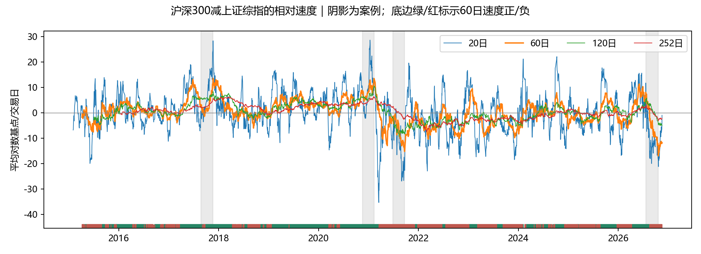
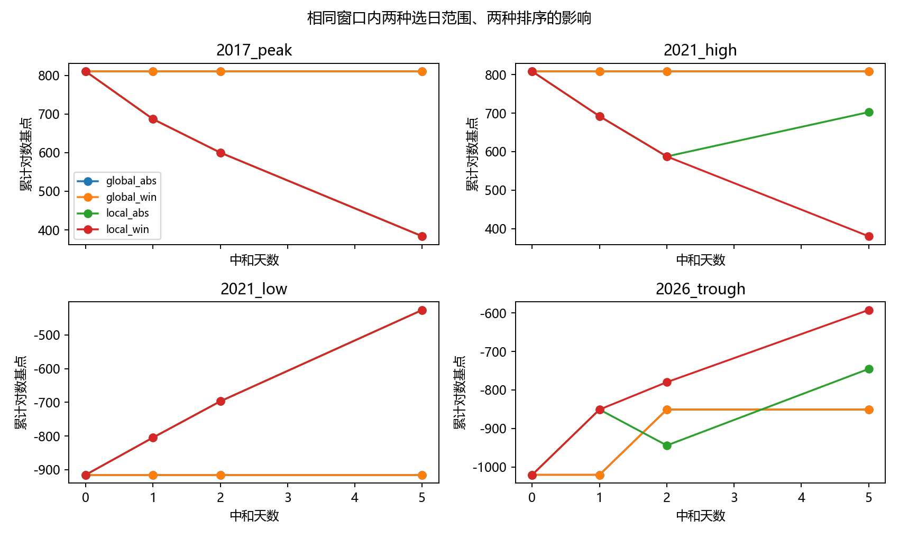
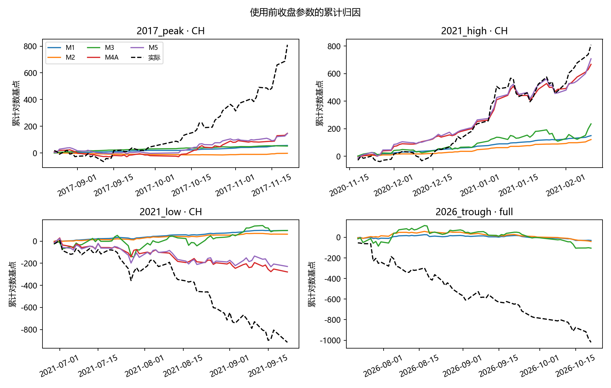
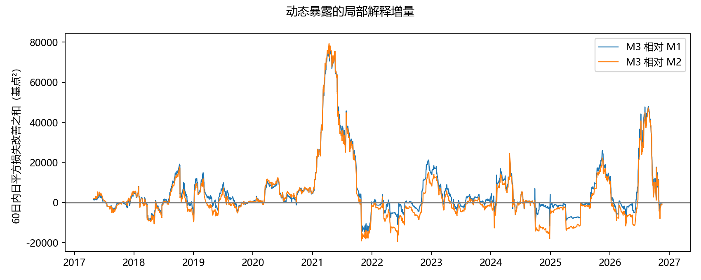
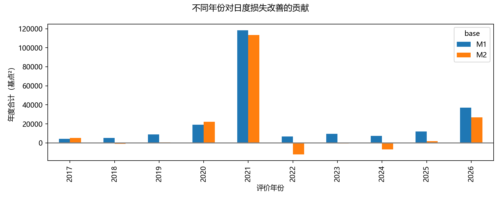
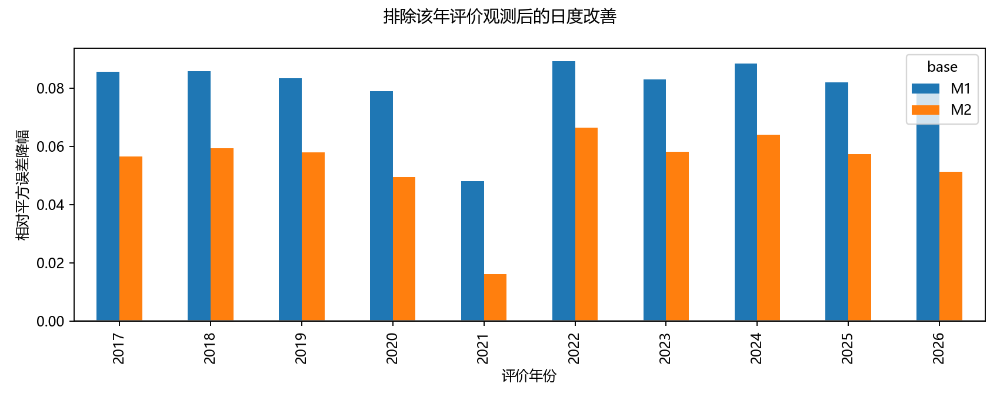
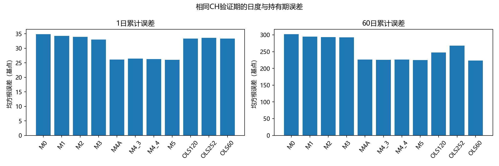
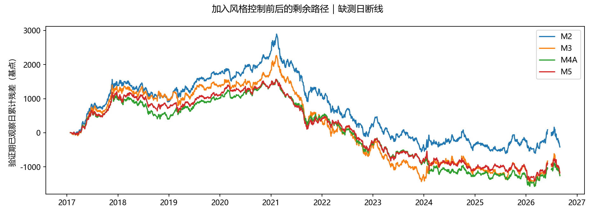
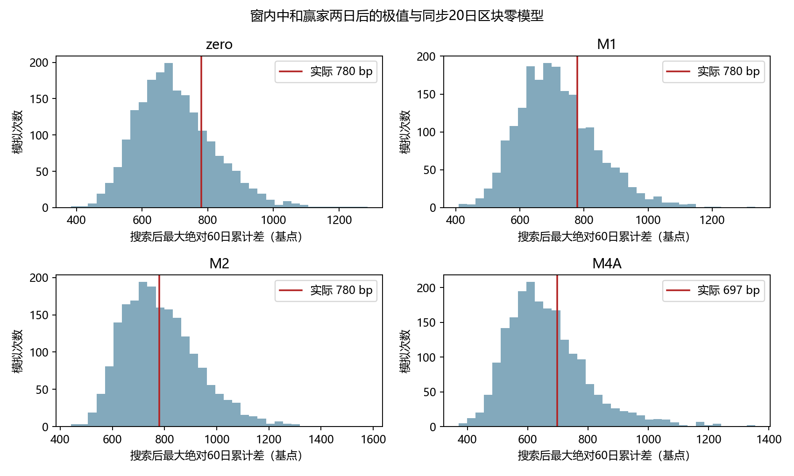

# 沪深300与上证综指连续相对收益偏移的多因子归因与动态暴露局部性

## 摘要

沪深300与上证综指可以共享大部分市场波动，又在特定持有期内持续拉开距离。以2015-01-06至2026-11-17的2,883个日收益为基础，逐窗中和赢家贡献最大的交易日后，四个历史案例均保留原方向。2017年正峰删两日后保留600基点；2021年初正峰的规模因子可解释约549基点。解释日度差额与解释持有期累积差额的结果存在明显差别。相比固定非对称市场模型，随机游走Beta的60日平方归因误差仅下降1.23%；控制风格后的额外降幅为1.13%，两项均未通过主检验。观察得到模型未解释的连续偏移，其异常性和可持续收益含义尚未确立。

## 一、冻结设计、样本与模型

[冻结协议](protocol.md)的提交为7771bf3，研究基线为c99d3fe。沿用V1逐日核对过的收盘序列。令d为沪深300减上证综指的日对数收益，1基点=0.0001对数收益。表中累计偏移取每日d的和。图1的W日速度取窗口和除以W。对于滚动速度同号的阶段，以第一个到最后一个合格**窗口结束日**为阶段边界，仅累计落在这些实际日期上的d。[全部阶段与极值](results/periods.csv)列出边界、实际贡献、同期市场、日差标准差和同向比例。[分阶段模型归因](results/period_attribution.csv.gz)覆盖具有完整顺序估计的阶段。

全样本市场代理为中证全指日对数收益。共同面板使用CH原始简单市场超额收益、SMB、VMG及CH4的PMO。两个工作簿共用市场列；各自的SMB按相应版本取值。共同面板含2,816日，止于2026-08-31；2026-06-05至06-30之间的17个交易日缺因子。估计只使用可匹配日；评价窗口必须在原始市场日历上连续完整，不把缺口拼接。CH模型以简单相对财富收益 exp(d)−1 为响应，所有模型在这个面板内使用相同响应和日期。对模型给出的简单收益和s，将每个加项乘以 log(1+s)/s，s=0时系数为1，剩余项取实际d减各归因项之和。这是总拟合值的单位转换；风格多空收益保持原始取值。两套面板的模型排名只在各自内部解释。[因子数据口径与V1核验](../relative_speed_common_market_v1/research_report.md)

M0为扩展均值，M1加入固定市场，M2再加入市场收益的正部，因而market项表示下行斜率乘市场收益，up_extra表示上行斜率的额外部分。M3用V1随机游走斜率；滚动OLS另用60、120、252日估计截距和斜率。M4_3和M4_4分别加入对应风格，M4A在CH4基础上增加非对称控制。M5先拟合M4A，再对剩余项估计随机游走市场暴露，允许状态方差为零。M3与M2是竞争规格；M5的静态部分和状态超参数每63日联合刷新一次，M4A逐日扩展，因此实际损失差也包含刷新频率差异。各模型前504日只训练；当天的条件归因仅使用前收盘可得的参数及当日实现的因子。价格指数不计现金分红。

## 二、连续区间怎样形成

**表1　完整案例窗口及实际收益差**

| 案例        | 开始       | 结束       | 实际bp   | 市场bp   | 日差标准差bp   | 同向日占比   |
|:------------|:-----------|:-----------|:---------|:---------|:---------------|:-------------|
| 2017_peak   | 2017-08-23 | 2017-11-21 | 810.2    | 468      | 30.97          | 0.6833       |
| 2021_high   | 2020-11-18 | 2021-02-10 | 808.4    | 865.1    | 38.29          | 0.6833       |
| 2021_low    | 2021-06-29 | 2021-09-22 | -915.4   | -25.03   | 48.65          | 0.65         |
| 2026_trough | 2026-07-22 | 2026-10-21 | -1020    | -990.7   | 39.1           | 0.7          |

**表2　不同观察期限的正、负速度极值**

| window   | start               | end                 | mean_speed_bp   | raw_bp   | agree   |
|:---------|:--------------------|:--------------------|:----------------|:---------|:--------|
| 20       | 2020-12-15 00:00:00 | 2021-01-12 00:00:00 | 28.6            | 572      | 0.85    |
| 20       | 2021-02-18 00:00:00 | 2021-03-17 00:00:00 | -35.37          | -707.4   | 0.75    |
| 60       | 2017-08-23 00:00:00 | 2017-11-21 00:00:00 | 13.5            | 810.2    | 0.6833  |
| 60       | 2026-07-22 00:00:00 | 2026-10-21 00:00:00 | -17.01          | -1020    | 0.7     |
| 120      | 2020-08-18 00:00:00 | 2021-02-10 00:00:00 | 10.53           | 1264     | 0.6417  |
| 120      | 2021-02-18 00:00:00 | 2021-08-11 00:00:00 | -9.384          | -1126    | 0.5667  |
| 252      | 2020-02-04 00:00:00 | 2021-02-08 00:00:00 | 6.334           | 1596     | 0.5675  |
| 252      | 2021-02-18 00:00:00 | 2022-03-02 00:00:00 | -7.536          | -1899    | 0.5714  |

60日速度连续同号时间最长的两个阶段如下。阶段起点处的速度已经包含起点之前的59个收益日；raw_bp只加总起止日期之间实际发生的相对收益差。

| start               | end                 | sign   | n   | raw_bp   | market_log_bp   | vol_bp   | agree   |
|:--------------------|:--------------------|:-------|:----|:---------|:----------------|:---------|:--------|
| 2019-06-03 00:00:00 | 2020-03-16 00:00:00 | 1      | 192 | 651.4    | 411.9           | 25.87    | 0.5573  |
| 2021-03-19 00:00:00 | 2021-12-01 00:00:00 | -1     | 172 | -920.3   | 725.2           | 45.13    | 0.5756  |

同向日占比按原窗口整体方向计算。强窗口内可有多日反向波动。2021年两例是从结束于该自然年的所有完整60日窗口中取正负极值；这些案例用于解释构成，显著性必须回到全部窗口。

## 三、全历史删日与区间内部中和

对2824个完整60日窗口分别排序。按原始区间赢家选择1、2、5日，另以绝对日差选日；历史名单亦按同样方向分别构造。所有操作均保留60日分母。图2比较四种名单。表3的1、2、5列为中和**窗内赢家日**后的累计差，单位为基点。

| start      | end        | raw_bp   | 1      | 2      | 5      |
|:-----------|:-----------|:---------|:-------|:-------|:-------|
| 2017-08-23 | 2017-11-21 | 810.2    | 686.7  | 600    | 383.6  |
| 2020-11-18 | 2021-02-10 | 808.4    | 692    | 587.4  | 380.1  |
| 2021-06-29 | 2021-09-22 | -915.4   | -804.7 | -696.9 | -425.7 |
| 2026-07-22 | 2026-10-21 | -1020    | -850.8 | -779.7 | -592.3 |

2017年最强正窗的前两大全历史赢家日均在窗外，按全历史删两日仍领先810.20基点，改为窗内删两日后余600.02基点。2026年负峰的两天按有利于上证综指排序，中和后仍为−779.71基点。在全部窗口中，按绝对差中和两日后有1292窗的绝对偏移反而扩大，原因是被中和的收益原先抵消了部分区间领先。[全部中和结果](results/neutralized_windows.csv.gz)

## 四、实际偏移由哪些模型项解释

**表4　主要案例的逐项归因（累计对数基点）**

| case        | panel   | model   | raw_bp   | intercept   | market   | up_extra   | SMB    | VMG    | PMO    | error   |
|:------------|:--------|:--------|:---------|:------------|:---------|:-----------|:-------|:-------|:-------|:--------|
| 2017_peak   | CH      | M4A     | 810.2    | -52.23      | 8.519    | 36.93      | 101.6  | 49.95  | 2.598  | 662.8   |
| 2021_high   | CH      | M4A     | 808.4    | 20.48       | 38.81    | 94.07      | 549.2  | -5.076 | -30.49 | 141.4   |
| 2021_low    | CH      | M4A     | -915.4   | 3.606       | 1.909    | 77.47      | -283.2 | -54.72 | -23.82 | -636.6  |
| 2026_trough | full    | M2      | -1020    | -295.3      | 1.921    | 253.5      | 0      | 0      | 0      | -980.4  |

2021年初的正峰中，规模项与沪深300的领先同向，市场、非对称和风格控制后的残差约141基点。2017年同样有约810基点的领先，规模项只有约102基点，剩余约663基点。同等幅度的相对收益对风格变量的依赖程度可以相差很大。2021年负峰的规模项约−283基点，仍有约−637基点残差；2026年负峰超出因子覆盖范围，只列市场模型。

**表5　动态规格相对固定规格的条件拟合增量（基点）**

| case        | panel   | baseline   | model   | increment_bp   |
|:------------|:--------|:-----------|:--------|:---------------|
| 2017_peak   | CH      | M1         | M3      | -4.479         |
| 2017_peak   | CH      | M2         | M3      | 54.38          |
| 2017_peak   | CH      | M4A        | M5      | -1.894         |
| 2017_peak   | full    | M1         | M3      | -18.48         |
| 2017_peak   | full    | M2         | M3      | 45.27          |
| 2021_high   | CH      | M1         | M3      | 85.13          |
| 2021_high   | CH      | M2         | M3      | 113.7          |
| 2021_high   | CH      | M4A        | M5      | 40.22          |
| 2021_high   | full    | M1         | M3      | 75.04          |
| 2021_high   | full    | M2         | M3      | 106.1          |
| 2021_low    | CH      | M1         | M3      | 0.3975         |
| 2021_low    | CH      | M2         | M3      | 33.7           |
| 2021_low    | CH      | M4A        | M5      | 49.61          |
| 2021_low    | full    | M1         | M3      | -6.672         |
| 2021_low    | full    | M2         | M3      | 35.02          |
| 2026_trough | full    | M1         | M3      | -74.88         |
| 2026_trough | full    | M2         | M3      | -64.82         |

表5为两个模型的总拟合差，截距也可能改变，不能再把该差额加入动态模型本身的市场项。完整记录把M5额外状态贡献标为dynamic。[多模型分解及同日掩码反事实](results/case_attribution.csv.gz) · [全窗口反事实误差](results/counterfactual_errors.csv.gz)

同时中和实际差额与该日全部模型贡献，得到下列保留日归因。2026年案例因CH数据不足改列全期M3。

| case        | model   | rule      | K   | raw_bp   | explained_bp   | error   |
|:------------|:--------|:----------|:----|:---------|:---------------|:--------|
| 2017_peak   | M5      | raw       | 0   | 810.2    | 145.5          | 664.7   |
| 2021_high   | M5      | raw       | 0   | 808.4    | 707.2          | 101.2   |
| 2021_low    | M5      | raw       | 0   | -915.4   | -229.2         | -686.2  |
| 2017_peak   | M5      | local_win | 2   | 600      | 99.02          | 501     |
| 2021_high   | M5      | local_win | 2   | 587.4    | 591.8          | -4.313  |
| 2021_low    | M5      | local_win | 2   | -696.9   | -135.3         | -561.7  |
| 2017_peak   | M5      | local_win | 5   | 383.6    | 89.65          | 293.9   |
| 2021_high   | M5      | local_win | 5   | 380.1    | 432.6          | -52.45  |
| 2021_low    | M5      | local_win | 5   | -425.7   | 54.46          | -480.2  |
| 2026_trough | M3      | raw       | 0   | -1020    | -104.8         | -915.5  |
| 2026_trough | M3      | local_win | 2   | -779.7   | -64.85         | -714.9  |
| 2026_trough | M3      | local_win | 5   | -592.3   | -44.01         | -548.2  |

主规格保持原历史训练。敏感性在四个案例中按K=2重估M2、M3、M4A、M5：从训练观测和滤波更新中排除指定日，再对同一保留日求残差合计。窗内规则只影响进入窗口之后的更新；全期名单可能影响早期训练，只作事后敏感性。与固定原模型相比，这些配对敏感性中，残差绝对变化的中位数为4.29基点，最大值为38.73基点。[重估明细](results/case_refits.csv.gz)

## 五、动态暴露增量集中于何时

以日平方误差之差评价动态模型，正数表示动态模型误差更小。2021年占全样本相对固定Beta日度改善总额的51.8%，占相对非对称Beta改善总额的76.0%。仅去掉2021年的评价日、保留原训练历史后，两种降幅分别为4.81%和1.61%；后者的单侧HAC检验p=0.251。CH面板M5相对M4A的2021年份额可大于100%，因为其余年份合计抵消了部分改善。

**表6　市场波动与斜率变化的局部性（同组每日平均改善，基点²）**

| variable    | group   | n    | mean_gain_bp2   |
|:------------|:--------|:-----|:----------------|
| volatility  | high    | 1023 | 74.27           |
| volatility  | low     | 1356 | 53.94           |
| beta_change | high    | 1177 | 80.02           |
| beta_change | low     | 1082 | 50.95           |

相对全期M2，三个持有长度中日损失改善最集中的窗口如下。这是对实现损失按时间定位，不能据这些日期事前切换模型。

| W   | start      | end        | sum_gain_bp2   |
|:----|:-----------|:-----------|:---------------|
| 60  | 2021-01-12 | 2021-04-13 | 7.934e+04      |
| 120 | 2021-01-27 | 2021-07-27 | 1.179e+05      |
| 252 | 2020-07-16 | 2021-07-27 | 1.445e+05      |

波动较高、斜率变化较快时，相对非对称模型的平均改善较大。平静组点估计仍为正；分组相关不识别波动导致模型改善的因果关系。每个60、120、252日区间的起止及日损失改善总额可在[局部损失表](results/local_loss.csv.gz)中复核。[各年贡献与逐年剔除](results/yearly.csv)

**表7　相邻年市场斜率变化**

| panel   | model   | year   | next_year   | down_change   | up_change   | p         | holm      |
|:--------|:--------|:-------|:------------|:--------------|:------------|:----------|:----------|
| CH      | M2      | 2020   | 2021        | 0.1348        | 0.1887      | 4.076e-07 | 3.668e-06 |
| CH      | M2      | 2021   | 2022        | -0.2716       | 0.02214     | 0.001662  | 0.004987  |
| CH      | M4A     | 2020   | 2021        | 0.0682        | 0.1116      | 0.003404  | 0.006807  |
| CH      | M4A     | 2021   | 2022        | -0.1071       | -0.01943    | 0.008542  | 0.008542  |
| full    | M2      | 2020   | 2021        | 0.1363        | 0.1778      | 8.574e-08 | 8.574e-07 |
| full    | M2      | 2021   | 2022        | -0.2661       | 0.02121     | 0.001164  | 0.004927  |

允许相邻两年全部系数各自取值，用十阶HAC联合检验两条市场斜率。CH面板控制风格后，两次年度比较仍达到校正后5%水平。该结果支持指定年间的平均暴露差，但不能定位结构断点，也不能说明额外状态参数改善60日解释。

## 六、持有期累计误差

对连续W日取 E=Σ(实际差额−当日模型拟合差额)，再计算绝对值和平方。方向以窗口拟合总和与实际总和是否同号计。训练期内60日绝对累计差的90%分位数为279.4基点，冻结作为大幅窗口阈值；错向或幅度未达阈值均为漏判。阈值只用于样本内定义的分组，尚缺投资者外部风险预算。

**表8　CH共同验证期的60日累计误差、方向与漏判**

| model   | n    | mean_error_bp   | mae_bp   | mse_bp2   | accuracy   | large   | miss   |
|:--------|:-----|:----------------|:---------|:----------|:-----------|:--------|:-------|
| M0      | 2209 | -41.52          | 238.9    | 9.115e+04 | 0.5211     | 776     | 1      |
| M1      | 2209 | -43.04          | 234      | 8.707e+04 | 0.5464     | 776     | 1      |
| M2      | 2209 | -9.022          | 232.3    | 8.588e+04 | 0.6102     | 776     | 1      |
| M3      | 2209 | -32.98          | 221.6    | 8.556e+04 | 0.6062     | 776     | 0.9175 |
| M4A     | 2209 | -35.33          | 178.3    | 5.112e+04 | 0.789      | 776     | 0.8634 |
| M4_3    | 2209 | -63.41          | 175.8    | 5.087e+04 | 0.7651     | 776     | 0.8454 |
| M4_4    | 2209 | -59.83          | 178.4    | 5.138e+04 | 0.7546     | 776     | 0.857  |
| M5      | 2209 | -31.35          | 168.7    | 5.054e+04 | 0.7687     | 776     | 0.7332 |
| OLS120  | 2209 | 12.77           | 191.8    | 6.122e+04 | 0.7243     | 776     | 0.634  |
| OLS252  | 2209 | 14.49           | 214.2    | 7.192e+04 | 0.6777     | 776     | 0.8054 |
| OLS60   | 2209 | 16.18           | 170.7    | 5.004e+04 | 0.7727     | 776     | 0.4446 |

**补充诊断　60日滚动OLS的改善有多少来自更新斜率？**

在看到持有期结果后，另固定当时的扩展市场斜率，只用过去60个观测更新截距。下表区分相对M2的整体改善和相对这个局部截距对照的改善，并列出静态风格项的增量。全样本滚动OLS相对M2降低60日平方误差40.6%，相对只更新截距的对照仅降低4.2%，后者未达到显著水平。各行属于单独的探索性检验族；gain为累计平方损失降幅，HAC滞后59阶。

| panel   | baseline        | model   | gain    | mean_bp2   | se        | p         | holm_secondary   |
|:--------|:----------------|:--------|:--------|:-----------|:----------|:----------|:-----------------|
| CH      | M2              | OLS60   | 0.4173  | 3.584e+04  | 1.413e+04 | 0.005581  | 0.01674          |
| CH      | local_intercept | OLS60   | 0.04907 | 2582       | 5111      | 0.3067    | 0.6134           |
| CH      | M2              | M4A     | 0.4048  | 3.476e+04  | 8521      | 2.254e-05 | 0.0001127        |
| full    | M2              | OLS60   | 0.4061  | 3.799e+04  | 1.397e+04 | 0.003267  | 0.01307          |
| full    | local_intercept | OLS60   | 0.04198 | 2435       | 5331      | 0.3239    | 0.6134           |

在CH共同样本中，M4A将60日均方误差较M2降低40.5%。方向判断由61.0%提高至78.9%。加入动态项后，漏判减少，但方向准确率降至76.9%，累计平方误差的额外改善很小。60日滚动OLS在这段历史的累计误差也较低；它同时更新局部截距和斜率，不能把全部改善归给时变Beta。不同模型并无统一的指标排序。[各期限与每日评价](results/holding_metrics.csv) · [逐窗实际与误差](results/holding_windows.csv.gz)

**表9　60日累计平方误差改善：重叠和非重叠口径**

| panel   | base   | model   | stride   | n    | gain      | mean   | se   | p      |
|:--------|:-------|:--------|:---------|:-----|:----------|:-------|:-----|:-------|
| CH      | M4A    | M5      | 1        | 2209 | 0.01134   | 579.6  | 3130 | 0.4266 |
| CH      | M4A    | M5      | 60       | 37   | 0.0009951 | 32.8   | 3379 | 0.4961 |
| full    | M2     | M3      | 1        | 2320 | 0.01228   | 1149   | 7716 | 0.4408 |
| full    | M2     | M3      | 60       | 39   | 0.0607    | 4441   | 9638 | 0.3225 |

主规格以59阶HAC处理重叠；每60个交易日取一个窗口，从首个合格窗口固定起算，作为对照。mean与se单位均为平方基点，p为单侧。日度损失之和与持有期误差平方不同，后者还包含不同日期误差的交叉乘积。

## 七、重新搜索区间后的推断

每个零模型和区块长度各模拟2,000次。零漂移模型同步重抽实际收益向量所决定的日差，先扣除平均差；固定市场与非对称模型同步抽取市场和残差区块，残差整块随机换号；风格零模型在CH可用日期采用同样处理，同时抽取风格、市场和缺测标志。每次重新搜索全部合格60日窗口、重判区间赢家并按指定规则选日。区块换号假定块内残差可共同翻转；只保留块内的时间依赖。主统计量是中和赢家两日后**重新搜索得到的最大绝对累计差**；它不必与原始峰值来自同一窗口。风格零模型参照其自身可观察日历。

**表10　预设六项主检验，主区块20日**

| 主检验                 | 观察值   | 单位     | p      | Holm_p   |
|:-----------------------|:---------|:---------|:-------|:---------|
| zero 窗内中和两日极值  | 779.7    | 对数基点 | 0.2269 | 1        |
| M1 窗内中和两日极值    | 779.7    | 对数基点 | 0.2704 | 1        |
| M2 窗内中和两日极值    | 779.7    | 对数基点 | 0.4663 | 1        |
| M4A 窗内中和两日极值   | 696.9    | 对数基点 | 0.3353 | 1        |
| M3 相对 M2 的60日改善  | 1.228    | %        | 0.4408 | 1        |
| M5 相对 M4A 的60日改善 | 1.134    | %        | 0.4266 | 1        |

不同区块长度的未校正高尾p值如下，四个基准在三种设定下均未达到5%。

| null   | 5      | 20     | 60     |
|:-------|:-------|:-------|:-------|
| M1     | 0.2119 | 0.2704 | 0.3123 |
| M2     | 0.2459 | 0.4663 | 0.7836 |
| M4A    | 0.2689 | 0.3353 | 0.3778 |
| zero   | 0.1639 | 0.2269 | 0.3128 |

区块长度5、60的结果及K=1、5等敏感性见[完整零模型比较](results/null_tests.csv)。固定非对称+CH4下，另逐次重估固定系数，检查调整后残差自身的窗内赢家两日中和极值。观察值510.7基点，在20日区块下的零模型95%参考范围为[356.8, 682.5]基点，单侧p=0.367。该项是对固定风格基准的辅助检验；没有把对照模型的全期拟合残差当成真实交易期可获得的预测误差。

## 八、研究结论

**存在模型尚未解释完的连续相对价格偏移。现有检验不足以说明它系统性地超出普通市场、非对称暴露和风格暴露叠加相关残差所能产生的范围。** 对历史基准比较，2017年与2021年两段规模近似的领先应给出不同的风险解释；对模型选择，固定风格控制已提供明显的描述性改善，复杂动态规格在60日累计评价中没有通过增量检验。本轮将M5保留为对照。指数价格未计股息，因子可能遗漏行业、调样及其他风险，稀有大幅行情也限制有效独立区间数。保持正式投稿论文与本轮探索分开。
