# 摘要

以同一组2,884个价格指数收盘点为输入，在八类规则中生成初始固定库1,245个去重候选。全历史事后收益冠军扣费后累计80.02%、年化5.27%、最大回撤16.42%。事前逐窗执行的收益选择规则从2018年起累计-44.42%，综合选择规则累计-11.54%。预定理想门槛下共有0个合格解。报告分别列示参数回看、固定库后续历史和18次实时序选参；三个对象回答不同问题。

# 数据、时序与账户

上证综指000001为A、沪深300指数000300为B。使用仓库v2价格快照并核对上海交易日历，2015-01-05收盘至2026-11-17收盘，2,883个日收益。所有统计采用252个交易日年化，现金及Sharpe的无风险利率为零。价格指数不含分红；不能按指数点位实际成交，尚未纳入ETF跟踪、期指基差、保证金制度、滑点及实际可借规模。

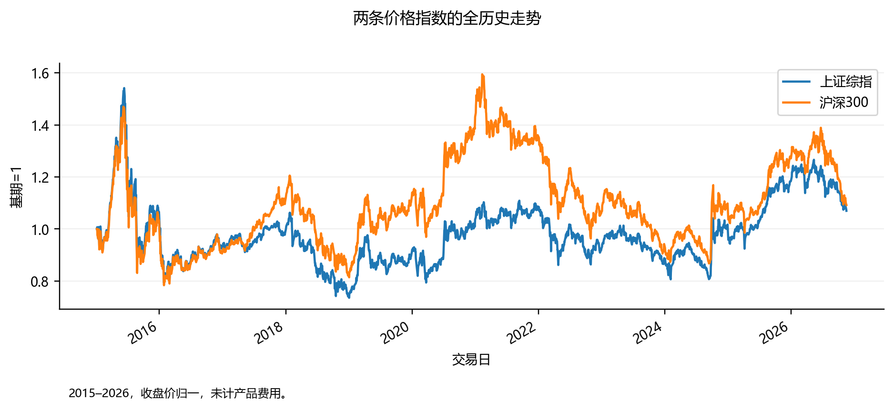

图：两条价格指数的全历史走势。2015–2026，收盘价归一，未计产品费用。

收益日t的特征仅使用截至t−2收盘的收益，t−1收盘执行。信号确认后仅在设定频率的交易日调整，期间持仓随市价漂移。名义总敞口最高为自有权益的2.5倍，对应40%总名义保证金；漂移超限于下一次收盘决策强制恢复目标。成交按费后权益迭代确定，末日清仓。空头卖出款全额受限，自有权益可用于多头，超额多头借款年率3%，空头借券2%，单边成交费5bp，按相邻收盘自然日/365计息。权益耗尽触发破产异常，本轮没有破产路径。

# 决策函数与参数空间

组合按目标总敞口G、空多比h及方向s配置，A权重=sG/(1+h)，B权重=−sGh/(1+h)。固定家族始终多A空B。允许反向的扩展家族在负信号下交换符号。静态总敞口0.5–2.5，h取0.35–2.2；频率为每1、5或20个交易日。方向确认1或3日，寿命5、20或60日，到期退出。动量、趋势的标准化强度为窗口平均日收益乘根号窗口长度再除以窗口标准差。所有窗口属于10、20、40、60、120日。

表：八类规则及条件变量

| 家族 | 方向、对冲或持仓规则 |
| --- | --- |
| 固定 | 固定h与G；另保留G=h=1的日调仓对照 |
| 相对动量 | A−B日收益强度越过0.2–1.8阈值；确认、平仓或反向 |
| 相对反转 | 对平稳性要求更弱的收益差采用反向强度信号；不假设价格协整 |
| 共同趋势 | 用(A+B)/2收益强度控制是否交易与方向 |
| 波动预算 | 按过去(A−B)/2波动率将总仓缩放至上限；目标2%–10%，为代理风险预算 |
| 动态对冲 | 等额、首120日静态OLS、滚动OLS、EWMA、波动比、共同基准Beta匹配、总敞口最小方差 |
| 状态切换 | 共同趋势强度绝对值超1时追随相对动量，否则反转；波动冲击比率过滤 |
| 信号融合 | 0.65相对动量+0.35共同趋势；波动上限、目标风险及4%–15%回撤后10日冷却 |

传统OLS为Cov(A,B)/Var(B)，固定多头金额时最小化剩余方差。一倍总敞口下令wA−wB=1，最小方差h=(Var(A)+Cov)/(Var(B)+Cov)。相对等权市场的Beta匹配在本模型与该式等价。动态比率裁剪至0.15–5，缺失退回1；未形成有效方向信号时空仓。策略库未把所有可想象的连续交易阈值或机器学习规则纳入搜索。

# 分层搜索与评分协议

首个外层窗之前：2015–16用于训练，2017为内层验证，截止至2017-12-28。固定随机种子7319、9319；每个种子随机128、打乱Sobol 256、分组多变量TPE 128、NSGA-II 128次。随机与Sobol在八族内均匀分层，类别离散映射，连续值保留四位小数。TPE代理为0.35训练Sharpe+0.65验证Sharpe+2验证CAGR−验证回撤（Sharpe截至±4）。NSGA-II种群32，以验证CAGR、负回撤、Sharpe最大化，继承上阶段8个代理高分起点。种子对比是顺序热启动试验，非独立重复。初次Sobol加随机共768次；TPE采用有限预算，把更多计算用于逐窗重新选择。

之后每半年取最近约三年为内层，最后一年为验证，两年为训练；将外层首笔执行收盘留出，搜索截止到再前一交易日。每窗重评冻结库并追加24次TPE、64次NSGA-II。验证Pareto集中仅考虑活跃率至少15%的候选，邻域总敞口与阈值或配比同时±10%扰动。A按CAGR、B按理想评分、C按综合评分冻结。若当窗没有合格B，以分数最高者作为近似策略，明示不合格。外层平仓后下一窗重新开仓，按窗末本金顺序复利。信号没有重叠的未来标签；时间分隔用于保障收盘执行顺序。

全历史榜单专评首窗冻结的参数库，按完整历史事后排序。A与C要求15%活跃率；B另要求年化≥1.5%、Sharpe≥0.65、回撤≤12%、活跃≥30%、盈利年度比例≥60%且对数净值斜率为正。B的增长、回撤及持续时间、Sharpe/Sortino、盈利月份及Ulcer、盈利年度、成本换手权重为20/25/20/15/15/5。C对增长、风险、Sharpe组合、邻域、后续窗口表现、成本、绝对Beta与参数数目分别加权25/15/12/15/12/8/8/5。内层用已知训练表现代替后续表现。固定尺度截至[0,1]，CAGR以12%、回撤25%、持续500日、年化波动20%、Sharpe 2、Sortino 3、Ulcer 10%、年化成本4%、年化换手80倍为尺度。具体映射见scoring.py。全部阈值先于最终排名设定。

# 全历史榜单与日度净值

表：代表策略的固定参数及全历史表现

| 榜单 | 参数ID | 家族 | 累计 | CAGR | 回撤 | Sharpe |
| --- | --- | --- | --- | --- | --- | --- |
| 收益 | 3dea574fab809815 | 相对动量 | 80.02% | 5.27% | 16.42% | 0.67 |
| 理想近似 | 3dea574fab809815 | 相对动量 | 80.02% | 5.27% | 16.42% | 0.67 |
| 综合 | 3dea574fab809815 | 相对动量 | 80.02% | 5.27% | 16.42% | 0.67 |

收益冠军参数为 {"confirm": 3, "family": "momentum", "frequency": 20, "gross": 1.4318, "hold": 60, "ratio": 2.1958, "reverse": true, "threshold": 0.6432, "window": 40}。正、负动量均可开仓，方向反转时两腿同时交换。图中完全相同的净值合并图例，完整排名和每一个候选的具体决策参数随报告发布。

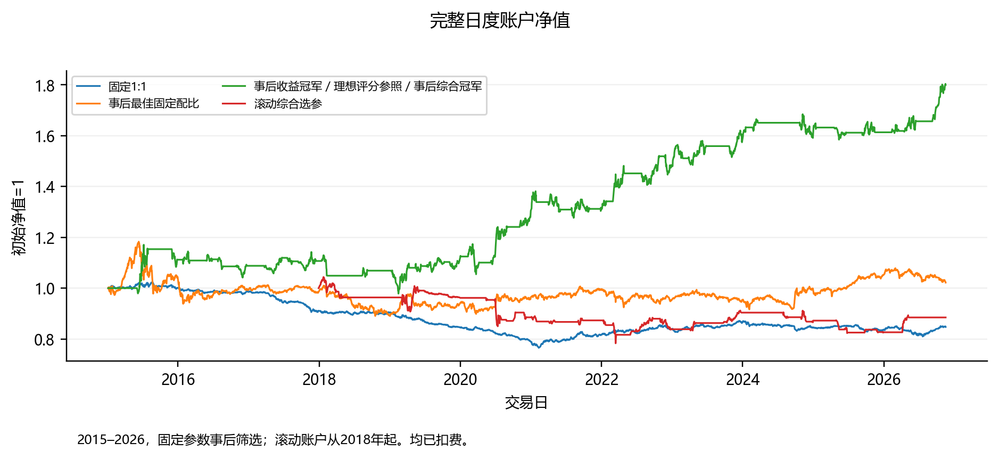

图：完整日度账户净值。2015–2026，固定参数事后筛选；滚动账户从2018年起。均已扣费。

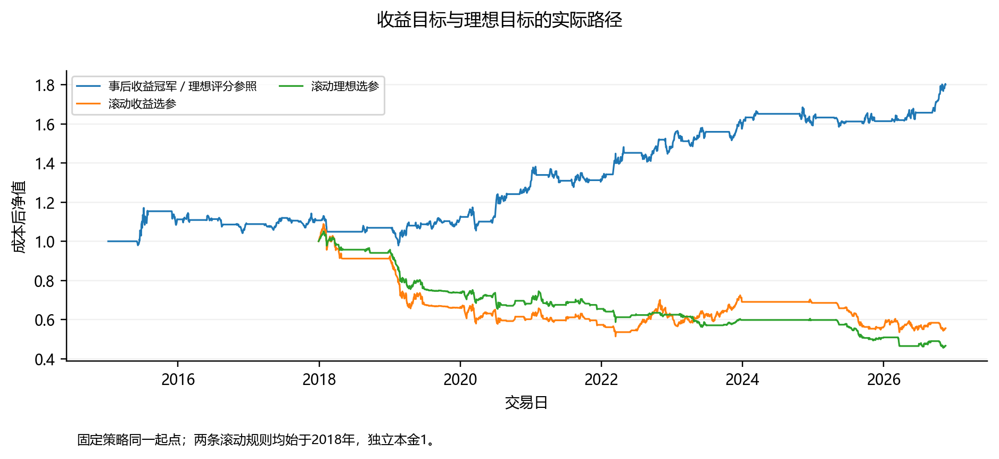

图：收益目标与理想目标的实际路径。固定策略同一起点；两条滚动规则均始于2018年，独立本金1。

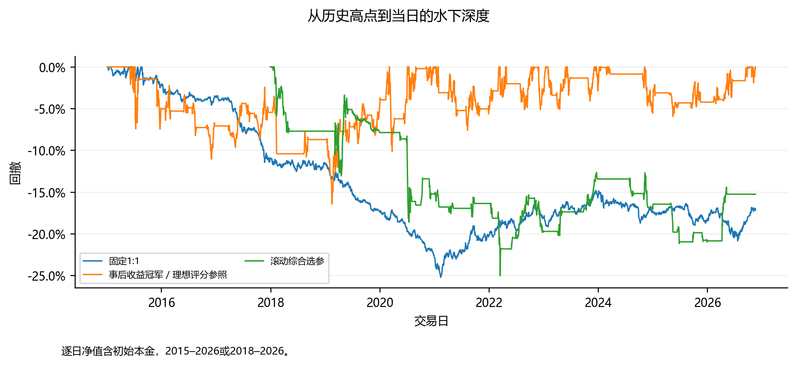

图：从历史高点到当日的水下深度。逐日净值含初始本金，2015–2026或2018–2026。

冠军最长水下期1133个交易日，水下日占比93.69%，盈利月占比39.16%。理想榜为空，近似者虽获高分仍超过回撤上限。收益榜与综合榜选出同一参数组合。这些曲线的事后识别不构成盈利预测。

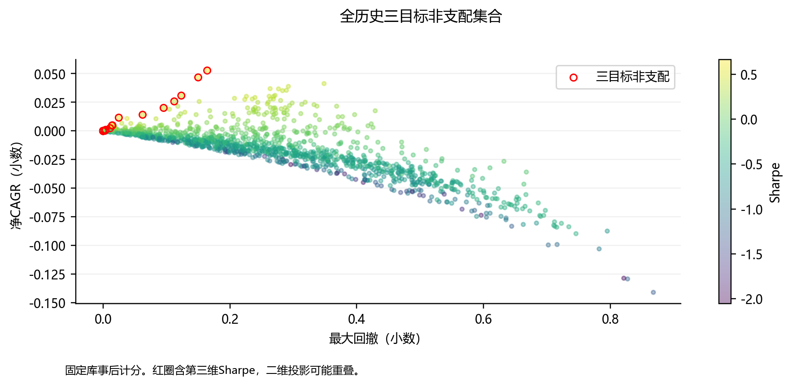

图：全历史三目标非支配集合。固定库事后计分。红圈含第三维Sharpe，二维投影可能重叠。

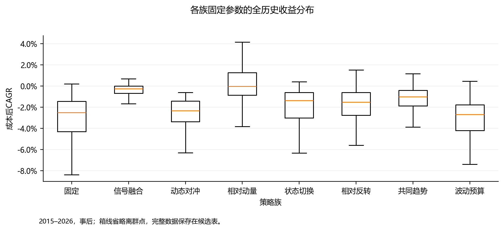

图：各族固定参数的全历史收益分布。2015–2026，事后；箱线省略离群点，完整数据保存在候选表。

表：各族样本分布（非等概率投资组合）

| 家族 | 候选数 | CAGR中位 | CAGR最高 | 回撤中位 |
| --- | --- | --- | --- | --- |
| 固定 | 146 | -2.51% | 0.19% | 41.80% |
| 信号融合 | 136 | -0.24% | 0.67% | 6.45% |
| 动态对冲 | 135 | -2.34% | -0.60% | 35.29% |
| 相对动量 | 275 | -0.02% | 5.27% | 24.02% |
| 状态切换 | 138 | -1.36% | 0.41% | 19.94% |
| 相对反转 | 144 | -1.52% | 1.52% | 20.62% |
| 共同趋势 | 127 | -1.02% | 2.15% | 16.67% |
| 波动预算 | 144 | -2.67% | 0.44% | 40.68% |

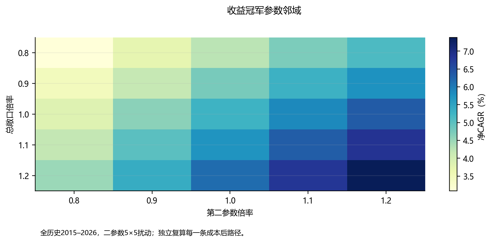

图：收益冠军参数邻域。全历史2015–2026，二参数5×5扰动；独立复算每一条成本后路径。

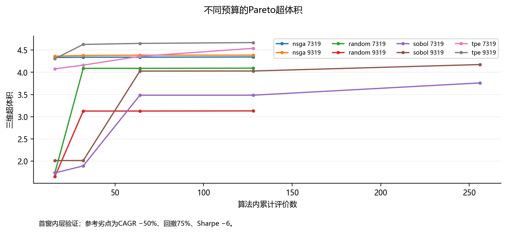

图：不同预算的Pareto超体积。首窗内层验证；参考劣点为CAGR −50%、回撤75%、Sharpe −6。

表：初始探索各算法成本与末次诊断

| 算法 | 种子 | 次数 | 最优验证CAGR | HV | 搜索耗时秒¹ |
| --- | --- | --- | --- | --- | --- |
| nsga | 7319 | 128 | 18.42% | 4.35 | 0.18 |
| nsga | 9319 | 128 | 19.35% | 4.39 | 0.15 |
| random | 7319 | 128 | 14.68% | 4.09 | 0.69 |
| random | 9319 | 128 | 6.04% | 3.13 | 0.11 |
| sobol | 7319 | 256 | 10.60% | 3.76 | 0.34 |
| sobol | 9319 | 256 | 19.02% | 4.17 | 0.28 |
| tpe | 7319 | 128 | 21.58% | 4.54 | 1.87 |
| tpe | 9319 | 128 | 23.64% | 4.67 | 1.46 |

¹ 从各组首次评价结束至最后一次评价结束，包括Optuna候选生成；最优值及超体积轨迹见 convergence.csv。初始种群继承既有高分点，算法间的差异同时包含热启动与搜索预算影响。

# 严格时序选择及后续历史

采用与18个外窗完全相同的开仓日、清仓日及调仓日历，冻结参数的等额基准累计-8.61%，事后收益冠军累计52.33%。这一对照将切窗引起的再平衡及双边交易费也对齐。后一个参数的冠军身份使用了后续历史，仍属事后分析；逐窗事前选参的结果单独列示。

表：阶段累计净收益（空白表示尚未启动）

| 账户 | 2015–17 | 2018–24 | 2025–26 | 全段累计 | 全段回撤 |
| --- | --- | --- | --- | --- | --- |
| 固定1:1 | -8.91% | -7.28% | 0.30% | -15.29% | 25.20% |
| 事后最佳固定配比 | -1.40% | 0.69% | 2.92% | 2.18% | 24.73% |
| 事后收益冠军 | 10.69% | 45.01% | 12.15% | 80.02% | 16.42% |
| 理想评分参照 | 10.69% | 45.01% | 12.15% | 80.02% | 16.42% |
| 事后综合冠军 | 10.69% | 45.01% | 12.15% | 80.02% | 16.42% |
| 滚动收益选参 | — | -31.47% | -18.89% | -44.42% | 52.76% |
| 滚动理想选参 | — | -40.20% | -21.98% | -53.35% | 56.63% |
| 滚动综合选参 | — | -12.79% | 1.43% | -11.54% | 25.00% |

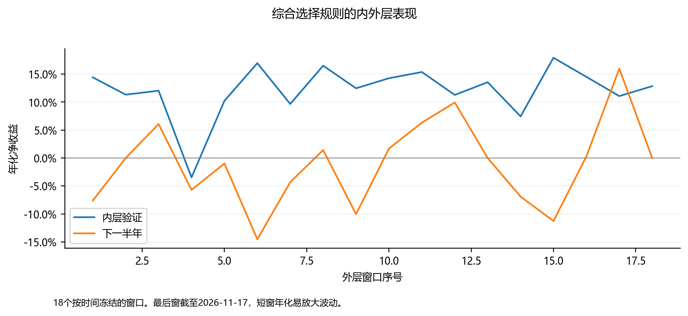

图：综合选择规则的内外层表现。18个按时间冻结的窗口。最后窗截至2026-11-17，短窗年化易放大波动。

以相同TPE代理在各窗前16次与全部预算中选择，再以外层真实账本拼接，两者累计分别为-14.55%和-15.27%。更多尝试能提高库内最优值，不保证下一窗改善。2025–2026的原始历史在先前研究中已被查看，本实验不能把它当成全新盲测。

# 头寸、资金成本与风险归因

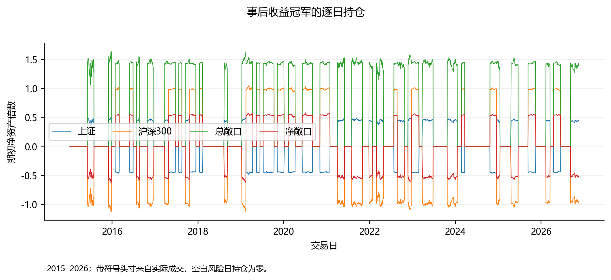

图：事后收益冠军的逐日持仓。2015–2026；带符号头寸来自实际成交，空白风险日持仓为零。

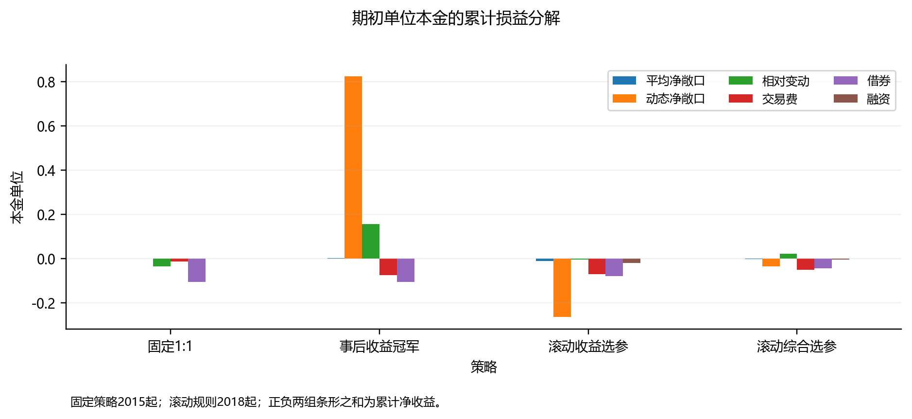

图：期初单位本金的累计损益分解。固定策略2015起；滚动规则2018起；正负两组条形之和为累计净收益。

将(A+B)/2作为共同收益，(A−B)/2作为相对收益，分别乘以当日实际头寸之和与之差。共同项再分解成全段平均净权重与偏离平均的部分，仅为描述性恒等式。收益冠军共同损益+0.824元，其中动态净敞口+0.822元；相对损益+0.156元，交易费0.074、借券0.106、融资0.0001元。标签为动态方向主导，绝对Beta较低仍可有大的条件方向暴露。120日实现Beta在daily_positions.csv。

# 稳健性、经济解释与结论

表：冠军的单独成本冲击

| 费率／借券／融资情景 | 净CAGR |
| --- | --- |
| fee=0,borrow=0,finance=0 | 6.53% |
| fee=0.001,borrow=0.04,finance=0.06 | 4.03% |
| fee=0.0005,borrow=0.02,finance=0.06 | 5.27% |

表：冠军一次仅改一个变量的最大绝对变化

| 参数 | CAGR变化 | 回撤变化 |
| --- | --- | --- |
| window | 5.58% | 10.08% |
| hold | 4.71% | 3.66% |
| frequency | 2.83% | 6.36% |
| reverse | 2.80% | 3.43% |
| confirm | 2.24% | 11.76% |
| threshold | 1.51% | 11.61% |
| ratio | 1.44% | 2.73% |
| gross | 1.02% | 3.38% |

对该冠军，在所试邻域内，对收益最敏感的是window，对回撤最敏感的是confirm。二维邻域收益范围3.09%至7.38%。±10%邻域稳定度0.882（1为最稳）；早期、主段、追加段分别重开账户后的CAGR为3.56%、3.42%、0.96%。局部稳定性无法抵消重复筛选产生的乐观偏差。

三目标全历史前沿有26个参数。不同风险容忍度对应不同可选点。提高风险与邻域权重后，综合第一名为3dea574fab809815（原为3dea574fab809815）。内外层年化差与参数数目的Spearman相关为-0.18，重复窗口和相同赢家使其只能作描述性诊断。多信号融合族中位CAGR为-0.24%；这些观察没有隔离交互项的因果效果。

含择时而始终只允许多上证、空沪深300的候选共774个，最高CAGR为2.15%，中位-1.59%；允许反向的471个候选分别为5.27%、-0.53%。这两个候选集合的参数分布不同，不能将收益差直接归于方向反转本身。

相较固定等额，全部候选中有673/1245个在完整历史上获得更高CAGR。但固定族不得反向，最高值为0.19%；历史收益最高的结构属相对动量。绝对收益、低回撤和持续性需同时评价，最高历史收益不等于最稳的未来策略。本次没有合格理想策略，滚动收益、理想、综合规则的真实时序表现见表。即便事后固定赢家在部分后续年份盈利，也没有证据证明滚动选择能反复识别它。

本次是有成本、有限结构和有限预算的经验边界。相互依赖的候选、共享市场路径、研究者已知历史及短而不独立的半年窗限制统计推断。没有把搜索次数等同于独立试验次数，也未对参数挑选的收益进行显著性宣称。

# 复现与数据索引

逐笔试验见 all_trials.csv，内层与事后前沿分别见 inner_fronts.csv、pareto_front.csv；候选完整参数、风险成本、三段统计与相对基准差见 candidate_metrics.csv。榜单与最近似候选独立存档。walk_forward.csv 提供每次冻结的ID、执行日、信息截止和参数。daily_nav.csv 与 daily_positions.csv 保存日度净值及会计桥。verification.json 记录账户及排名核验。
