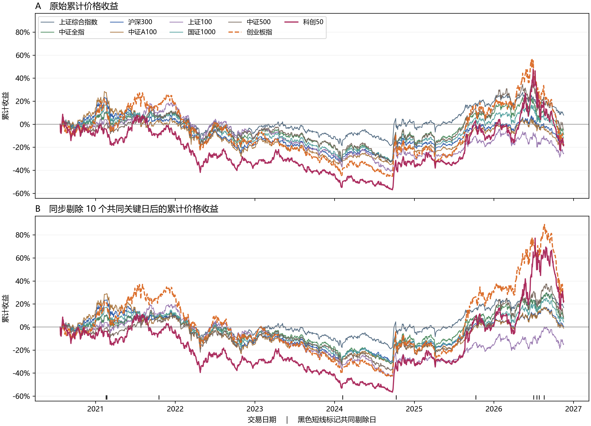
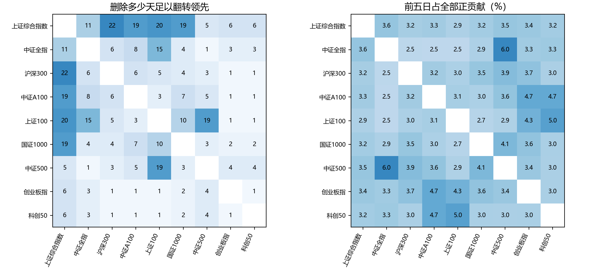

# 九大A股宽基指数相对收益的路径依赖与关键日集中性研究

*Path Dependence and Critical-Day Concentration in Relative Returns Across Nine Chinese Broad-Market Indices*

2026年11月22日　｜　历史样本截止2026年11月17日

## 摘要

九条价格指数形成36组无序配对。其中31组只要删去不超过1%交易日便会失去历史领先，翻转所需日数的中位数为4天。但最有利的5天只占全部正向对数贡献的3.26%（配对中位数），正负贡献抵消率中位数达98.61%。小额净优势容易翻转，可以与相对收益分散在数百个交易日同时成立。五种同步区块零漂移模拟均未检出全池前五日贡献占比或关键日期重合异常偏高。过去一年的集中度也未改善多数配对的样本外风险预测。

**关键词**　宽基指数，相对财富，路径依赖，收益集中度，同步区块抽样，样本外预测

## 九条曲线的直接比较

**图1　原始路径与同步剔除共同关键日后的路径。** 初始收盘日为2020-07-23，累计收益从0开始。先对每组配对取历史赢家贡献最大的10日，再按每个日期入选的配对数降序排列，同票取较早日期。第二幅图将入选最多的十个日期上九条指数的日对数收益同时置零，其余日收益按原顺序复合。黑色短线标记被剔除日。纵轴与日期范围相同，每条曲线保留其自然波动幅度。该图使用全样本事后归因。[可编辑矢量图](figures/nine_paths.svg) · [逐日净值，初始值为1](results/nine_paths.csv) · [共同日期及得票](results/common_key_dates.csv)

为检验科创50、创业板指可能偏离其余七条的观察，先对每组配对计算全路径的距离。令 $W_{i,t}$ 为从同一初值累计的财富，以 $\sqrt{\operatorname{mean}_t[(\log W_{i,t}-\log W_{j,t})^2]}$ 度量两条曲线在整个样本期的分离程度，再对指定组内的配对等权平均。表1的距离乘100，以对数点计。日收益相关性只使用保留日。

| 比较组 | 配对数 | 原始路径距离 | 同删10日后 | 原始日收益相关 | 同删后日收益相关 |
|---|---:|---:|---:|---:|---:|
| 其余七条之间 | 21 | 10.45 | 9.57 | 0.916 | 0.917 |
| 科创50与其余七条 | 7 | 25.07 | 24.39 | 0.754 | 0.750 |
| 创业板指与其余七条 | 7 | 14.03 | 16.67 | 0.857 | 0.857 |
| 科创50与创业板指 | 1 | 19.40 | 22.20 | 0.834 | 0.827 |
| 全部配对 | 36 | 14.24 | 14.18 | — | — |

**表1　全路径距离与日收益相关性。** 其余七条之间的平均距离下降约8.5%，全部36组的平均距离仅下降约0.4%。科创50与七条的距离仍是七条内部距离的2.55倍，创业板指为1.74倍。数据支持这两条指数相对更分散的判断；同步删除后，创业板指反而离七条更远。删除5日或20日时，三个组的距离排序相同，但全池平均距离分别为14.05、15.35对数点。因而不能从删日操作推出九条曲线会普遍收敛。“科技行业集中造成分离”是待检验的机制，需要同期行业权重及收益归因。该分组是在配对主实验运行期间、绘制此图前提出的描述性分析。[逐对距离与相关](results/path_distances.csv)

## 样本与判据

从 SQLite 行情库读取九条价格指数，以交易所代码标识。2015年开始的历史行情用于早期研究，本次统一使用科创50正式发布实时行情后的1,532个共同收盘点，得到2020-07-24至2026-11-17的1,531个日对数收益。九列均与上海交易日历逐日匹配，逐列重核来源、点位、发布日期和原始快照哈希。以绝对日对数收益超过10%作异常筛查，九列合计10个观测，保留经源文件核对的记录。价格收益未含现金分红，指数仍可能发生编制规则调整。[逐指数验收与编制方资料](results/data_audit.csv) · [共同价格快照](results/input_closes.csv) · [科创50发布公告](https://www.sse.com.cn/market/sseindex/diclosure/c/c_20200619_5130634.shtml)

主分析开始前固定以下操作性判据。超过半数配对同时满足翻转占比不超过1%、前五日占正贡献至少5%，才称“普遍且集中”。异常集中与异常重合的主统计量分别为36组的中位 $C_5$ 和630个集合比较的平均前五日 Jaccard，两者分别要求自己的单侧 p 值在五种设定下均不超过0.05。预测要求在20日和60日两个期限上均有正的中位增量样本外 $R^2$，且各有至少一组通过校正的正向DM检验。这些阈值为研究约定，原始连续统计量也全部保留。[预设协议版本](https://github.com/zhoushuming073-cell/A-Share-Broad-Market-Index-Research/blob/78357b0/experiments/nine_index_path_dependence_v1/config.yaml)

## A　终值有多容易翻转

令 $d_t=r_{j,t}-r_{i,t}$，$D=\sum d_t$，$z_t=\operatorname{sgn}(D)d_t$。原始赢家相对输家的财富优势为 $\exp(|D|)-1$。按 $z_t$ 降序移除前K日后的财富优势为 $\exp(|D|-\sum_{m=1}^K z_{(m)})-1$。转向后用 $|D|$ 判定首次失去领先，保证两种代码排序给出相同翻转日数。取 $C_K=\sum_{m=1}^K z_{(m)}/\sum z_t^+$，$HHI=\sum(z_t^+/\sum z_t^+)^2$，有效贡献日数为其倒数，抵消率为 $1-|D|/\sum|z_t|$。

**图2　全体配对的历史归因。** 翻转所需交易日从1至22日，中位值4日，占样本0.26%。31组达到低翻转门槛，只有2组同时达到5%的集中度门槛，低于预设多数标准。正向有效贡献日数的中位数为461日，最有利20日的贡献占比中位数为10.21%。历史终值的符号敏感性强于日贡献本身的集中程度。[36组的赢家、全部指标及删1、2、5、10、20日后的财富优势](results/pairwise_summary.csv) · [逐对关键日及原始贡献](results/key_days.csv)

## B　哪些日期反复出现

前五日名单的180个名额分布于60个交易日，前十日名单的360个名额分布于110个交易日。2021-02-22进入14组配对的前十，2026-07-28进入12组，2026-07-17进入11组。得票最多的十个日期合计占96个前十名额，为26.7%。每两组日期集合按交集除以并集计算重合度，630组比较的平均值在前五日为0.0754，前十日为0.0853。每个指数参与8组配对，36组共用同一段市场历史，对集中出现的日期需按联合样本推断。[逐日频数](results/key_date_overlap.csv) · [逐月频数](results/monthly_overlap.csv) · [全部两两重合度](results/pair_jaccard.csv)

## C　零相对漂移下的联合检验

逐列从日收益扣除自身样本均值，再加回九列均值的平均值，得到共同市场平均漂移相同的九维向量。循环移动区块按均匀随机起点抽取，越过样本末端时绕回。平稳区块每天以1/20概率重新抽取起点。每次均同步抽取九维向量，累计至1,531日。每条模拟路径重新选择36组赢家，并重新计算关键日、正向贡献、有效日数及重合程度。重复抽到的来源日期在合成时间轴上是不同的收益日，同一次抽到的九个收益始终共用时间位置。按来源日期和同日抽取顺序打破并列。

**表2　主统计量及辅助统计量的经验单侧p值。** 每列20,000条路径。$k^*$ 取低尾，其余三行取高尾。概率用“尾部次数加一”除以20,001。对个别配对，在每个指标及区块设定内另行对36项检验作Holm校正。表中池级统计量直接从同步抽样的联合分布计算。

| 统计量 | 历史值 | 循环5日 | 循环10日 | 循环20日 | 循环60日 | 平稳20日 |
|---|---:|---:|---:|---:|---:|---:|
| 中位翻转日数 | 4 | .158 | .161 | .151 | .168 | .159 |
| 中位前五日贡献占比 | 3.26% | .750 | .727 | .712 | .679 | .701 |
| 平均前五日 Jaccard | .0754 | .969 | .973 | .973 | .979 | .977 |
| 平均前十日 Jaccard | .0853 | .971 | .969 | .967 | .970 | .970 |

以循环20日为例，模拟中位 $C_5$ 的中央95%区间为2.92%至4.57%，历史值处于区间内。五种设定对“异常偏高”的判断一致。配对级 $C_5$ 与低翻转日数检验经 Holm 校正均未达到5%。重合度的高尾 p 值接近1，表示模拟中出现更大重合度相当常见；本研究预设的是高尾检验。该基准以真实历史厚尾和共同冲击为抽样材料，只检验等平均漂移及既定局部时间依赖下的相对异常程度。[全部指标、经验区间、蒙特卡洛标准误与校正结果](results/bootstrap_results.csv)

## 稳健性与样本切分

将1,531个收益日按时间分为前765日、后766日，在各半样本重新确定赢家与关键日。中位 $C_5$ 分别为4.64%和7.81%，中位翻转日占比分别为0.98%和0.33%，同时满足两个描述性门槛的配对比例分别为22.2%和88.9%。两段处于不同市场时期，且半样本的正贡献分母较小，故不把水平差异直接归于市场结构改变。全样本逐一排除某条指数、保留28组配对，中位 $C_5$ 在3.18%至3.31%之间。上述分段与排除比较是描述性敏感性检验，联合模拟推断对应预设全样本。[完整稳健性结果](results/robustness_results.csv)

## D　过去的集中度能否预测下一阶段的风险

每个预测日收盘，用过去252日的赢家方向和正向贡献计算 $C_5$。目标为随后 $h$ 日相对对数收益平方和的平方根。三个模型依次使用过去252日的相对收益标准差及平均绝对收益，再加入 $C_5$，再加入有符号日均相对收益及绝对收益超过窗口标准差两倍的频率。逐日滚动OLS仅取最近252个已完全到期的标签，预测值以零为下限。相对历史均值预测和相对基准回归分别计算样本外 $R^2$。DM比较基准与扩展模型的平方损失，采用Bartlett权重、滞后 $h-1$ 的HAC标准误及双侧渐近检验，各预测期限和模型比较内对36组作Holm校正。目标重叠和嵌套模型限制检验功效。

| 期限 | 每组预测次数 | 扩展模型优于基准 | 中位增量样本外R² | 校正后显著改善 |
|---|---:|---:|---:|---:|
| 20日 | 989 | 4／36 | −12.87% | 0／36 |
| 60日 | 909 | 6／36 | −4.44% | 0／36 |

加入趋势与极端频率后，相对基准的中位增量 $R^2$ 分别为−22.92%和−15.83%。在这套滚动设计中，集中度没有达到预设预测标准。[各配对的MAE、RMSE、两种样本外R²与DM检验](results/prediction_results.csv) · [逐日预测及实际值](results/predictions.csv.gz)

## 学术判断与复现

历史领先对少量交易日敏感，是本样本最一致的发现。结合贡献分母后，证据指向大量正负相对收益抵消形成小净差。异常集中、异常日期重合与样本外增量预测三个更强命题均未达到预先约定的标准。九条指数的持仓存在交叠，价格收益遗漏现金分红，仅观察到一段市场历史。指数曲线与行业权重间的因果关系仍待持仓数据检验。

在安装仓库依赖及 NumPy、Numba、pandas、SciPy、statsmodels、exchange_calendars、matplotlib、PyYAML 后，从仓库根目录运行以下命令。

~~~shell
python experiments/nine_index_path_dependence_v1/run_all.py
~~~

[运行入口](run_all.py)按数据验收、历史归因、日期重合、联合模拟、稳健性和预测的顺序执行。五个 simulation 文件分别保存在 [results](results/)；每个文件含20,000次模拟的逐对与全池统计量、指标轴、配对轴、随机种子、区块设定、随机发生器、软件版本及输入哈希。种子依次为20261122至20261126，每批500次。图1用同一删除掩码重建四组净值（原始、同删5、10、20日）；掩码可由得票表复算。所有归因均为历史条件分析。
