# 摘要

2015-01-05至2026-11-17，沪深300比上证综指的终值高2.07%。累积正负相对对数收益抵消了99.73%；删除两个事后最有利日即可使领先消失。对固定历史做1,071,000次同步无放回抽帧，其中七个核心比例各含100,000次均匀抽样。随机删除10%交易日后，领先翻负的频率为36.98%。平均日相对对数收益仅0.071个基点，HAC双侧检验p=0.916。数据支持终值对关键日期敏感，而不足以证明沪深300享有稳定正漂移。

# 数据、时间坐标与财富口径

使用仓库 four_pair_tests_v2/data/input_closes.csv 的上证综指000001（A）和沪深300 000300（B），与只读SQLite库及上海交易日日历复核。2,884个正收盘价配对形成2,883组日收益。价格指数未含现金分红。先逐日从相邻真实收盘价计算两条对数收益，再使用同一日期掩码过滤。没有跨越已删除日期重新计算任何收益。

令 $d_t=\log(B_t/B_{t-1})-\log(A_t/A_{t-1})$。对删除集合 $S$，保留日的累计对数差 $D^{(-S)}=\sum_{t\notin S}d_t=D-\sum_{t\in S}d_t$，相对财富优势 $Q^{(-S)}=\exp(D^{(-S)})-1$。图中用原日历轴呈现，删除日维持前值；均值、相关性、回归与路径偏离统计只计保留日。所有终值均为累计值。由于删帧不改变原日历跨度，本文不把保留日压缩为新的实际投资年数。

原始买入持有累计价格收益为上证综指6.99%、沪深300 9.20%。两者相差2.21个百分点，财富比值减一则为2.07%。相对日标准差34.66bp。B领先的交易日1400个（48.56%），落后1483个（51.44%）。正日对数差合计3.74144、负日-3.72098、合计0.02046。抵消率定义为1−|净和|/绝对贡献之和。

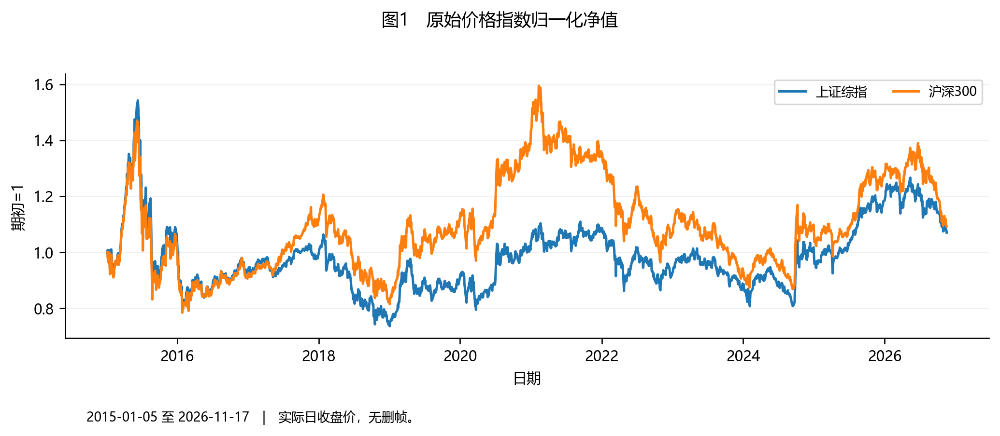

图 1　两指数全时期买入持有价格净值

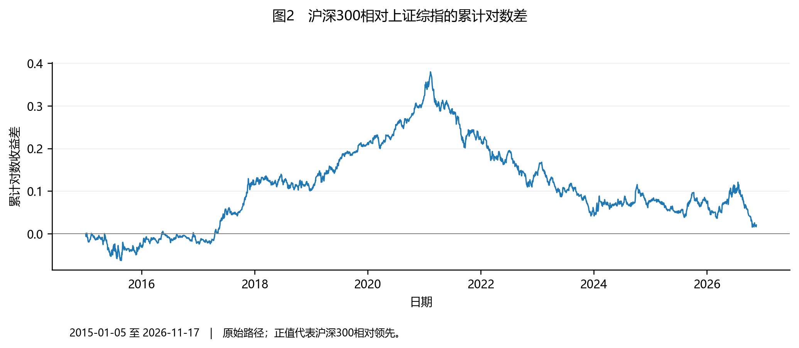

图 2　沪深300相对上证综指的累计对数收益轨迹

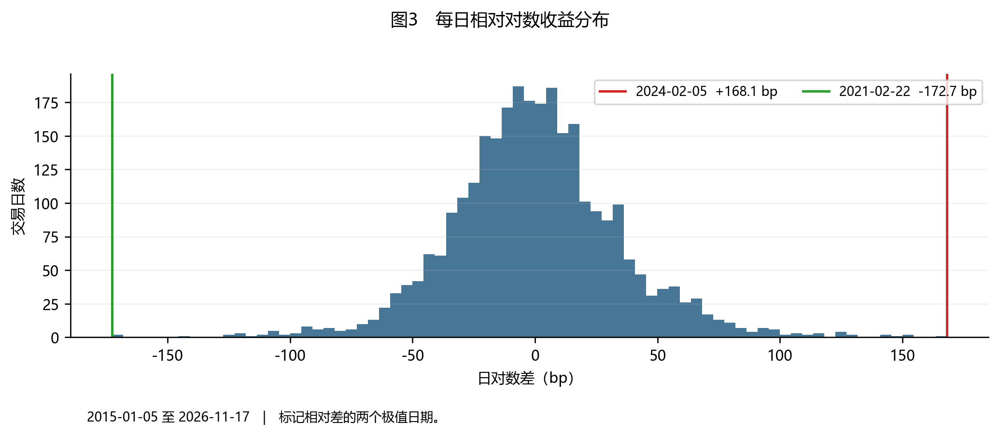

图 3　日相对收益分布及两个尾端日期

# 定向删帧：哪些日期能改变结论

按d从大到小删除，删1日尚余0.37%，删2日为-1.17%；因此最小翻转数k⁺=2。反过来，删去最差2日，领先扩大到5.62%。单侧删帧是事后极值构造，恰好给出固定k的可达下界和上界。即使极值超出10万次随机结果，也不能用它计算普通显著性p值。

表 1　翻转所需的最佳两日及相应的最差两日（两指数为原始简单收益）

| 类别 | 日期 | 上证 | 沪深300 | d（bp） |
| --- | --- | --- | --- | --- |
| 最佳 | 2024-02-05 | -1.02% | 0.65% | +168.11 |
| 最佳 | 2015-08-31 | -0.82% | 0.73% | +154.18 |
| 最差 | 2021-02-22 | -1.45% | -3.14% | -172.70 |
| 最差 | 2026-07-28 | -1.16% | -2.83% | -169.55 |

表 2　同删k日后的财富优势Q

| k | 删最佳 | 删最差 | 删最大绝对差 |
| --- | --- | --- | --- |
| 1 | 0.37% | 3.85% | 3.85% |
| 2 | -1.17% | 5.62% | 5.62% |
| 3 | -2.67% | 7.15% | 3.86% |
| 5 | -5.49% | 9.82% | 0.72% |
| 10 | -11.47% | 16.53% | -3.46% |
| 20 | -20.98% | 29.37% | -3.63% |
| 29 | -27.70% | 40.75% | -6.84% |
| 30 | -28.37% | 42.02% | -5.83% |
| 50 | -39.72% | 67.50% | -5.69% |
| 58 | -43.40% | 77.51% | -3.90% |
| 100 | -57.88% | 131.79% | -8.52% |
| 144 | -67.97% | 196.63% | -16.20% |
| 288 | -84.36% | 472.74% | -26.34% |
| 577 | -93.90% | 1339.96% | -17.45% |

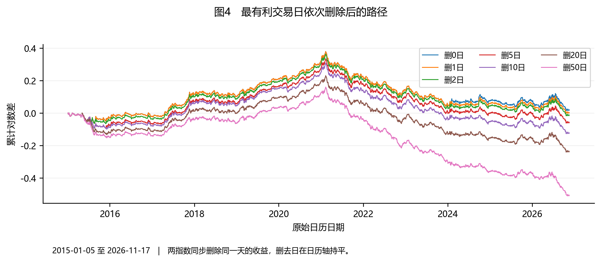

图 4　依次删除最佳相对收益日的合成路径

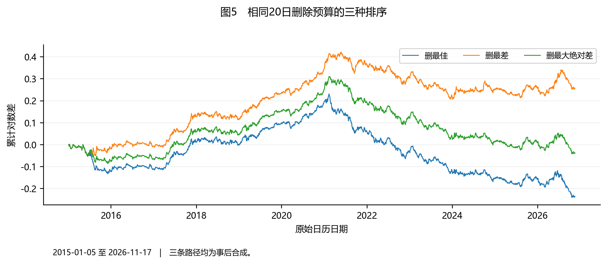

图 5　三种尾部排序的路径比较

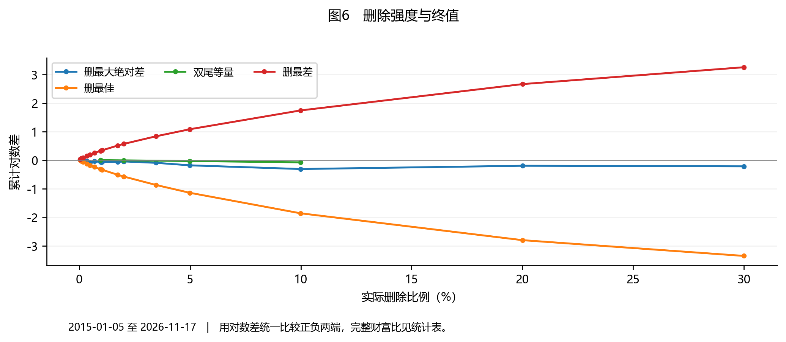

图 6　终点相对差随删除比例变化

# 随机删帧：历史优势能抵抗多大扰动

均匀无放回抽样使用Floyd算法，在候选位置已入选时改选此前不可达的当前末位置。每次重新从全体日期抽样，批次种子由主种子、机制、删除数和批次起点共同派生；各档日数按比例四舍五入。每次逐保留日重建双指数对数净值，计算终点、收益相关性及R²、均值、标准差、截距斜率、残差、累计偏离RMS与峰值等统计量。日收益回归包含截距，故R²等于相关系数平方。

表 3　均匀无放回，每档100,000次；财富比值的历史敏感性分布

| 约删比例 | 天数 | Q的5%分位 | 中位 | 95%分位 | Q>0频率 | 翻负频率 | 翻负频率95%区间 |
| --- | --- | --- | --- | --- | --- | --- | --- |
| 0.5% | 14 | -0.12% | 2.07% | 4.22% | 94.02% | 5.98% | 5.84%–6.13% |
| 1% | 29 | -1.03% | 2.07% | 5.19% | 86.45% | 13.55% | 13.34%–13.76% |
| 2% | 58 | -2.30% | 2.02% | 6.47% | 77.70% | 22.30% | 22.05%–22.56% |
| 5% | 144 | -4.62% | 1.96% | 8.98% | 68.46% | 31.54% | 31.25%–31.83% |
| 10% | 288 | -7.11% | 1.89% | 11.65% | 63.02% | 36.98% | 36.68%–37.28% |
| 20% | 577 | -10.06% | 1.66% | 14.88% | 58.80% | 41.20% | 40.90%–41.51% |
| 30% | 865 | -11.80% | 1.47% | 16.69% | 56.77% | 43.23% | 42.93%–43.54% |

表内的5%与95%分位描述不同删除集合导致的历史波动；末列Wilson区间只衡量有限模拟次数对共同抽样机制下频率估计的精度。两者都不表示未来市场收益的预测区间。删帧比例越大，随机扰动区间越宽；例如删除5%时，即使中位数仍为正，左尾已可出现明显落后。

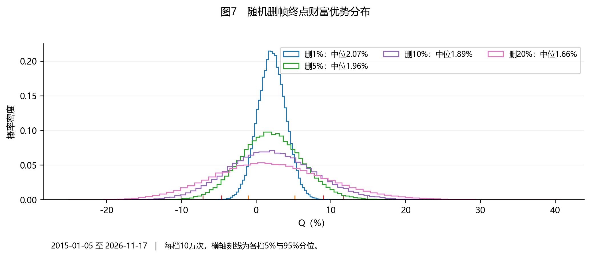

图 7　随机删帧后的终值分布

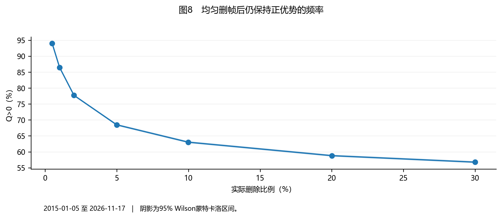

图 8　随机删帧下保持正优势的比例

# 分层、连续区块与同预算比较

年度和逐日历月份分层使用随机起点的累计配额取整，各层精确到其理论配额上下1日以内、各层之和严格为k，然后在每层内等概率抽取。连续删帧将长度固定的块压缩成一个位置，无放回选择不重叠块的位置，再展开；最后不足整块的余数随机分配给一个块。允许相邻块相接，无首尾环绕。该机制在区间边缘的单日入选概率可以不同于中段。另对k小于指定块长的情形删一个长度k的块。

表 4　同删288日的机制差异

| 机制 | 试验数 | Q的5%分位 | 中位 | 95%分位 | 翻负频率 | 蒙特卡洛标准误¹ |
| --- | --- | --- | --- | --- | --- | --- |
| uniform | 100000 | -7.11% | 1.89% | 11.65% | 36.98% | 0.15% |
| year | 3000 | -6.95% | 1.82% | 11.59% | 37.87% | 0.89% |
| month | 3000 | -7.17% | 1.87% | 11.36% | 37.50% | 0.88% |
| block5 | 3000 | -7.68% | 1.81% | 12.48% | 38.13% | 0.89% |
| block10 | 3000 | -7.49% | 1.92% | 12.06% | 37.07% | 0.88% |
| block20 | 3000 | -7.79% | 1.84% | 12.13% | 37.93% | 0.89% |
| block60 | 3000 | -8.30% | 1.57% | 12.40% | 40.20% | 0.90% |

¹ 频率的标准误。均匀、分层、区块回答不同的固定样本条件问题。比较机制差异时需结合各自的模拟误差；不能将本样本中较高的区块翻转频率解释成未来出现相同连续行情的概率。

表 5　定向删帧在同预算均匀随机分布中的位置（k=288）

| 定向规则 | 定向Q | 随机Q严格低于它的频率 | 同值频率 |
| --- | --- | --- | --- |
| 删最佳 | -84.36% | 0.00% | 0.00% |
| 删最差 | 472.74% | 100.00% | 0.00% |
| 删最大绝对差 | -26.34% | 0.00% | 0.00% |
| 双尾等量 | -6.90% | 5.40% | 0.00% |

完整 equal_budget_comparison.csv 包含每个定向预算与七种随机机制的经验位置。两端等量删帧要求偶数预算；各删0.5%、1%、2.5%、5%时按每端日数取整，所以有时总日数与直接对总比例取整相差一天。对照始终按实际k匹配。

# 路径接近、日收益拟合与稳健漂移

偏离指标为保留各日累计对数净值差的均方根及最大绝对值。另以同向日占比度量短周期方向一致性；终值Q单列，用于区分路径是否贴合、终点是否接近和日收益是否高度相关。日收益回归用B作因变量、A作自变量，残差标准差以n−2作分母。

表 6　删帧后的日收益拟合与累计路径距离

| 规则 | k | ρ | R² | Beta | 截距bp | 残差bp | RMS | 最大偏离 | Q |
| --- | --- | --- | --- | --- | --- | --- | --- | --- | --- |
| 原始 | 0 | 0.968 | 0.936 | 1.042 | 0.06 | 34.27 | 0.144 | 0.380 | 2.07% |
| 删最大绝对差 | 29 | 0.971 | 0.943 | 1.037 | -0.25 | 31.87 | 0.105 | 0.276 | -6.84% |
| 删最大绝对差 | 288 | 0.981 | 0.962 | 1.020 | -1.17 | 24.57 | 0.127 | 0.310 | -26.34% |
| 双尾等量 | 28 | 0.971 | 0.943 | 1.037 | 0.01 | 31.95 | 0.124 | 0.306 | 0.57% |
| 双尾等量 | 58 | 0.973 | 0.947 | 1.033 | -0.04 | 30.50 | 0.125 | 0.301 | -0.30% |
| 双尾等量 | 144 | 0.977 | 0.954 | 1.025 | -0.10 | 27.77 | 0.103 | 0.265 | -2.56% |
| 双尾等量 | 288 | 0.981 | 0.962 | 1.020 | -0.26 | 24.65 | 0.084 | 0.206 | -6.90% |

删去分化最大的29日，日收益R²从0.936升至0.943，RMS由0.144降至0.105，终值Q却由2.07%变为-6.84%。这三项给出的信息不同。均匀随机删除10%时R²中位数为0.936，没有相似幅度的提高。

表 7　相对日收益的稳健位置估计

| 估计量 | bp／日 |
| --- | --- |
| mean | +0.071 |
| median | -0.961 |
| trim5 | -0.276 |
| winsor5 | +0.031 |
| huber | -0.588 |

trim5删去两端各5%观测后求均值；winsor5将两端各5%拉回边界；Huber以中位数和固定MAD正态尺度起步，用1.345倍尺度对大偏差降权。中位数与Huber估计为负，普通均值略正，符号对尾部处理敏感。合成截尾曲线没有给投资者提供预知极端日的方法。

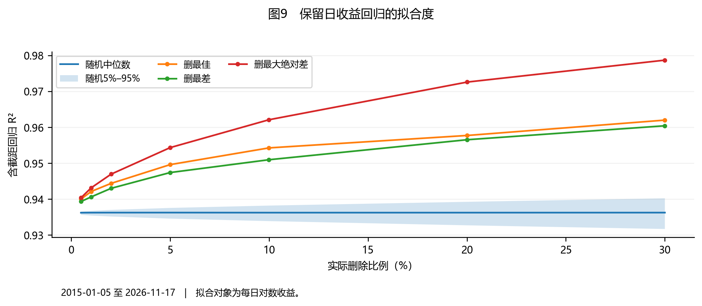

图 9　日收益R²与删帧比例

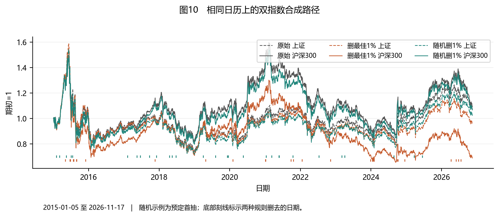

图 10　原始、正尾及预定首抽随机路径；被删日按日历标出

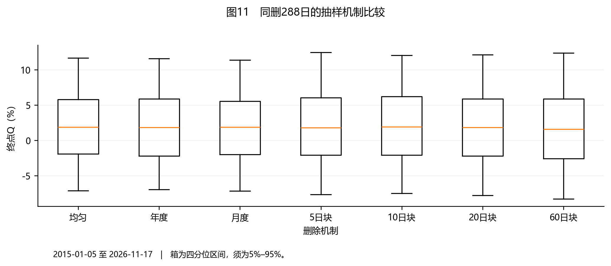

图 11　连续区块、分层和离散随机抽帧的同预算比较

# 年度贡献、市场状态与漂移检验

表 8　各年对长期相对收益的贡献（2026年截至11月17日）

| 年份 | 天数 | 正对数贡献 | 负对数贡献 | 年度Q | 最佳20日入选数 |
| --- | --- | --- | --- | --- | --- |
| 2015 | 243 | 0.3465 | -0.3770 | -3.00% | 7 |
| 2016 | 244 | 0.1969 | -0.1853 | 1.17% | 0 |
| 2017 | 244 | 0.3444 | -0.2109 | 14.28% | 1 |
| 2018 | 243 | 0.2880 | -0.2976 | -0.95% | 0 |
| 2019 | 244 | 0.3239 | -0.2172 | 11.26% | 1 |
| 2020 | 243 | 0.3216 | -0.2108 | 11.72% | 1 |
| 2021 | 243 | 0.4065 | -0.5068 | -9.54% | 3 |
| 2022 | 242 | 0.3293 | -0.4091 | -7.67% | 1 |
| 2023 | 242 | 0.2399 | -0.3229 | -7.97% | 0 |
| 2024 | 242 | 0.3465 | -0.3288 | 1.79% | 4 |
| 2025 | 243 | 0.2704 | -0.2768 | -0.63% | 0 |
| 2026 | 210 | 0.3276 | -0.3779 | -4.91% | 2 |

12个自然年（含末年部分区间）中，5年为正。最佳20日中2015年有7日、2024年有4日；但两个翻转关键日相隔多年。尾部贡献有所聚集，不能仅据两个日期给经济事件作因果归因。

表 9　以上证前120个交易日累计对数收益划分状态

| 状态 | 日数 | d均值bp | d标准差bp | 最佳20日数 |
| --- | --- | --- | --- | --- |
| warmup | 120 | -2.88 | 34.93 | 1 |
| up | 886 | 0.15 | 36.33 | 7 |
| range | 1105 | -0.28 | 33.87 | 7 |
| down | 772 | 0.93 | 33.80 | 5 |

以±0.05为趋势阈值，前120个收益日列为预热。状态仅用于分组，所有观测保留。

表 10　各长度完整滚动窗口的相对财富变化

| 交易日 | 窗口数 | 最小Q | 中位Q | 最大Q | 正窗口比例 |
| --- | --- | --- | --- | --- | --- |
| 20 | 2864 | -6.83% | 0.00% | 5.89% | 50.14% |
| 60 | 2824 | -9.70% | 0.14% | 8.44% | 52.69% |
| 120 | 2764 | -10.65% | 0.26% | 13.47% | 52.64% |
| 252 | 2632 | -17.30% | 0.89% | 17.31% | 55.70% |

滚动窗口存在重叠。这些占比为描述性统计，不将窗口当成独立样本计算显著性。

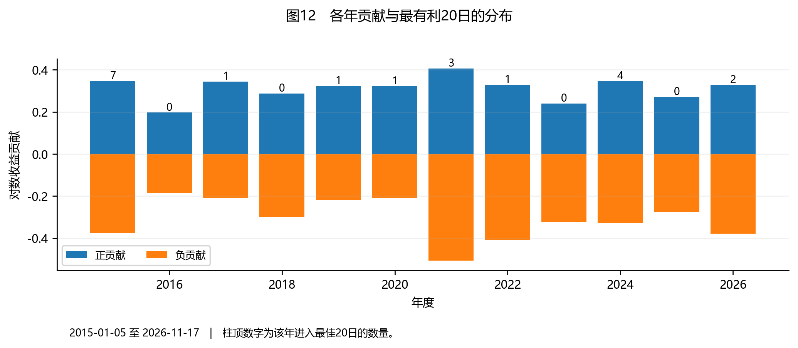

图 12　正负贡献的年度分布与关键日期集中度

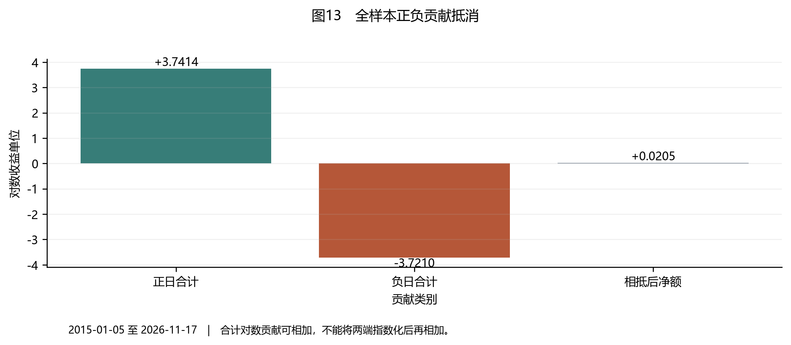

图 13　总正负贡献及相抵后的净额

表 11　原始日相对收益的双侧均值检验（bp／日）

| 估计 | 滞后／块长 | 均值 | 标准误 | 95%下界 | 95%上界 | p |
| --- | --- | --- | --- | --- | --- | --- |
| iid | 0 | 0.071 | 0.646 | -1.195 | 1.337 | 0.9125 |
| HAC | 5 | 0.071 | 0.677 | -1.256 | 1.398 | 0.9165 |
| HAC | 10 | 0.071 | 0.670 | -1.243 | 1.385 | 0.9157 |
| HAC | 20 | 0.071 | 0.678 | -1.257 | 1.399 | 0.9166 |
| circular_bootstrap | 5 | 0.071 | 0.676 | -1.261 | 1.396 | 0.9133 |
| circular_bootstrap | 20 | 0.071 | 0.679 | -1.257 | 1.395 | 0.9180 |
| circular_bootstrap | 60 | 0.071 | 0.714 | -1.356 | 1.447 | 0.9249 |

普通检验用截距模型与常规t区间；Newey–West使用Bartlett权重、有限样本修正及双侧正态近似。循环移动区块Bootstrap每次有放回抽取连续块，直到截足原长，三个块长各20,000次；区间取均值百分位，p值由以样本均值中心化的双侧重抽样分布估计。这里从时间序列推断均值，区别于固定历史删帧实验。

Ljung–Box检验在5、10、20阶的p值依次为0.035, 0.042, 0.066。按既有研究使用的2015–17、2018–20、2021–24、2025–26四段，带10阶HAC的联合等均值检验p=0.0062。这是对指定边界的阶段差异检验，不是对未知断点位置的估计。逐年均值检验在12年内以Holm方法校正，最小校正p为0.090。阶段均值有变化与全期均值显著为正是两个不同命题。

表 12　四个指定时期的日漂移

| 时期 | 均值bp | HAC 95%下界 | 95%上界 |
| --- | --- | --- | --- |
| 2015-2017 | +1.568 | -0.921 | 4.056 |
| 2018-2020 | +2.848 | 0.757 | 4.939 |
| 2021-2024 | -2.532 | -5.157 | 0.092 |
| 2025-2026 | -1.251 | -4.475 | 1.974 |

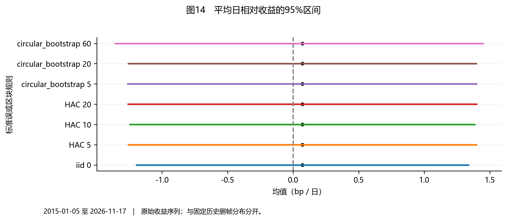

图 14　日均漂移的区间推断

# 解析结果与模拟核验

设 $I_t$ 为日t被删除的指示变量，$p=k/N$。固定k的无放回设计给出 $E[I_t]=p$，对不同日期有 $\mathrm{Cov}(I_i,I_j)=-p(1-p)/(N-1)$。将 $D^{(-S)}=D-\sum I_t d_t$ 展开，并以 $s_d^2=\sum(d_t-\bar{d})^2/(N-1)$ 表示有限总体方差，可得

$$E[D^{(-S)}]=(1-k/N)D,\qquad \mathrm{Var}(D^{(-S)})=k(1-k/N)s_d^2.$$

指数函数为凸函数，因此Q的条件期望须直接对每次exp(D)−1求平均；不能将D的解析期望简单指数化代替。

表 13　完全随机抽帧的有限总体解析核验（对数单位）

| k | 理论均值 | 模拟均值 | 理论SD | 模拟SD | 均值误差／MCSE |
| --- | --- | --- | --- | --- | --- |
| 14 | 0.02036 | 0.02033 | 0.01294 | 0.01294 | -0.74 |
| 29 | 0.02025 | 0.02040 | 0.01857 | 0.01857 | +2.47 |
| 58 | 0.02005 | 0.01990 | 0.02613 | 0.02617 | -1.78 |
| 144 | 0.01944 | 0.01937 | 0.04054 | 0.04051 | -0.50 |
| 288 | 0.01842 | 0.01846 | 0.05581 | 0.05581 | +0.24 |
| 577 | 0.01636 | 0.01653 | 0.07446 | 0.07452 | +0.68 |
| 865 | 0.01432 | 0.01455 | 0.08529 | 0.08520 | +0.86 |

独立种子对七档各再运行5,000次，与主种子的均值差最大为1.40个合并蒙特卡洛标准误。核验以原始价格比连乘重算56组定向／原始终值，另以独立实现逐项检查126组首抽的全部指标与日期掩码。每次模拟均断言删除计数等于k。

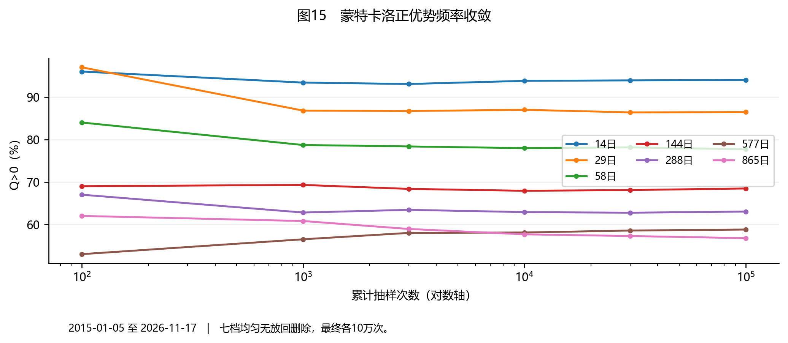

图 15　随模拟次数增加的条件频率

# 与多空对冲研究衔接

原始价格指数的买入持有财富比高出2.07%。沿用前报告的资本与成本口径，每日多0.5单位沪深300、空0.5单位上证综指，从空仓建立、逐日恢复目标权重并在样本末平仓，毛累计收益为2.45%，成本后为-10.20%。单边成交费5bp，年借券费2%、按实际自然日，现金收益为零。财富比、等额再平衡收益以及择时策略收益的计算对象各异。净财富差很小、关键日期可以改变符号、跨期均值变化均削弱固定方向长期盈利的实证依据。动态策略还须证明事前预测与成本后的滚动表现；本实验没有检验新的预测信号。

# 结论与研究限制

用净额和总额作分母，关键日的重要性看起来截然不同。最有利两日贡献之和为0.03223，相当于最终净对数优势的157.53%，但只占所有正日贡献的0.86%。即使取最有利20日，合计也仅占总正贡献的6.84%。因此，两天决定的是历史终点的正负号；全年市场中正向分化的规模远大于这两天。

就终值符号而言，两天足以抹去沪深300的领先；就全期收益形成而言，正负两端各累积了约3.7个对数单位，两个日期的重要性来自抵消后分母极小。它不能证明全部相对表现由两次孤立事件造成。删去最差两日反而把优势提高到5.62%，说明这种敏感性具有两面性。

在均匀删帧中，随机结果并不总是翻负，且翻负频率依赖删除强度和抽样机制。去掉绝对分化最大的日期常会改善日收益拟合，但保留路径仍可在多年内累积非零差异。均值区间包含零，不能由此证明真实期望严格为零，更不能推断未来不存在超额收益。历史事件解释、总收益指数、实际ETF可交易性与动态择时需要另行研究。

# 复现与交付

在仓库根目录运行 python experiments/relative_return_frame_deletion_v1/run.py。每批1,000次，主种子20261119，复核种子19470517。均匀七档共700,000次；补充预算、年度和月份分层及四种区块每个设定3,000次；复核种子35,000次。另有均值推断的60,000次有放回区块Bootstrap，不计入删帧试验数。每次迭代保存终点或汇总指标，不保存所有逐日模拟轨迹；批次缓存可断点续算，Git归档保存终值Q、抽样协议、首抽日期和完整分位统计。

结果目录内，daily_relative_returns.csv 含全部原始日数据、滚动优势、状态；top_positive_days.csv、top_negative_days.csv 按贡献排序；synthetic_paths.csv.gz 含定向删帧路径与逐日标志；年度贡献、相关回归、同预算经验位置及时间序列推断各有独立CSV。整合版PDF先完整保留既有多维对冲报告，再附本实验。
