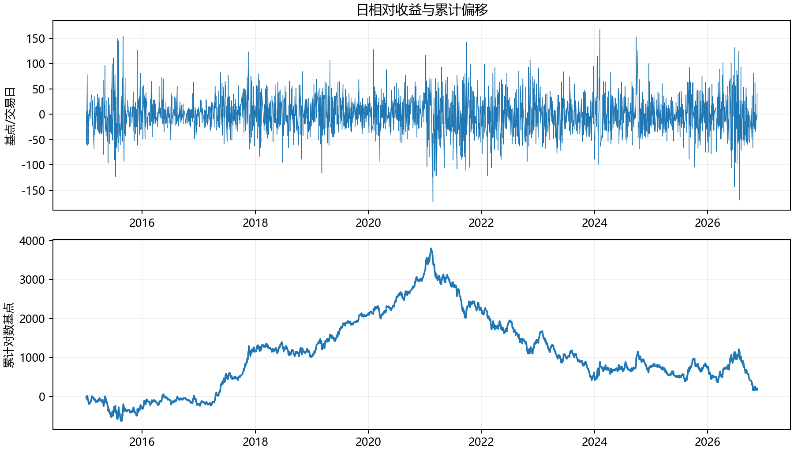
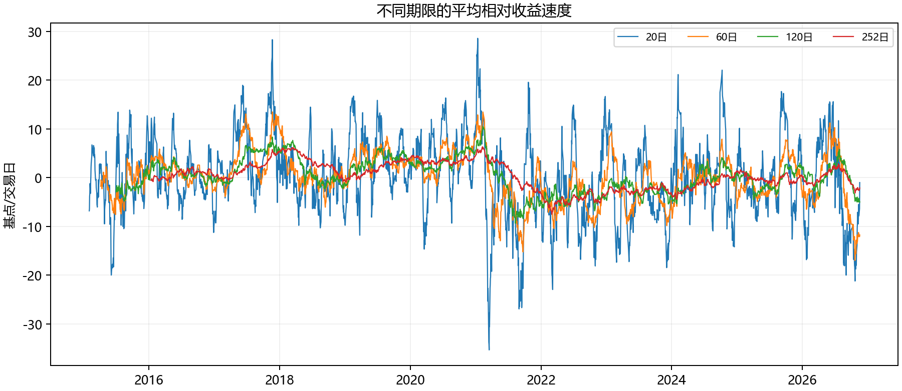
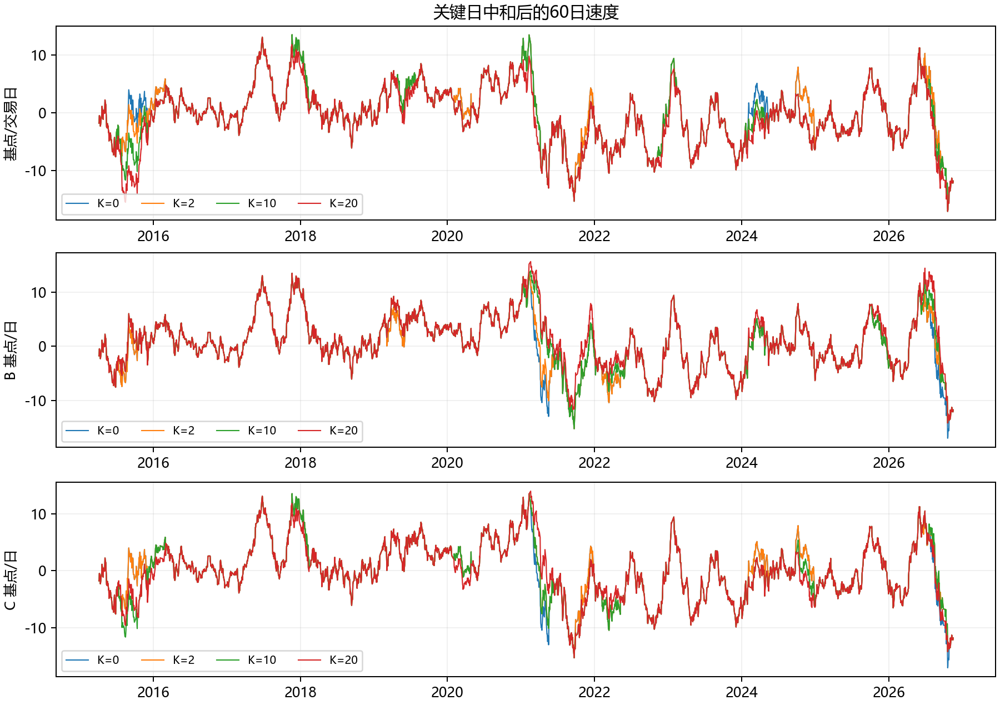
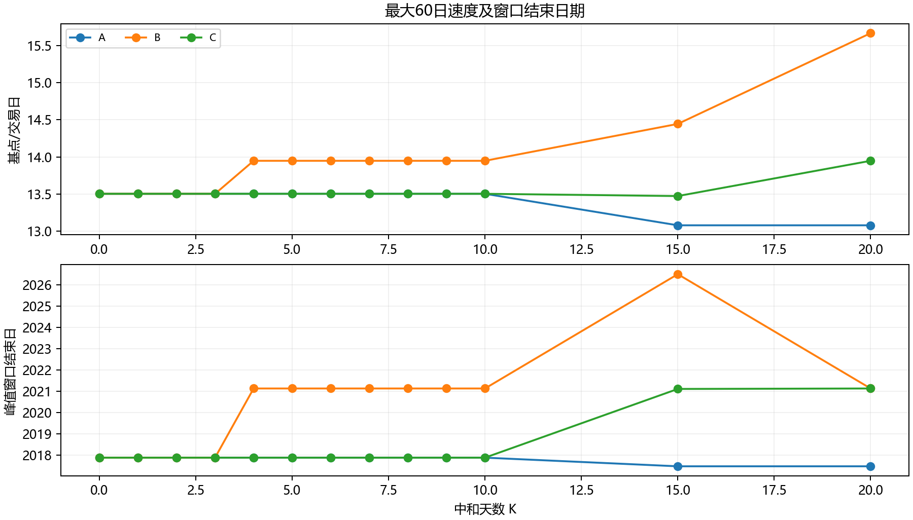
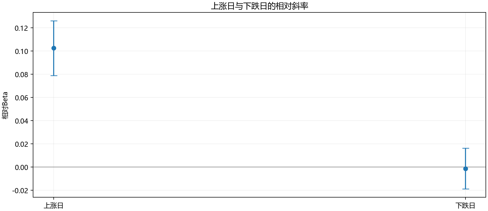
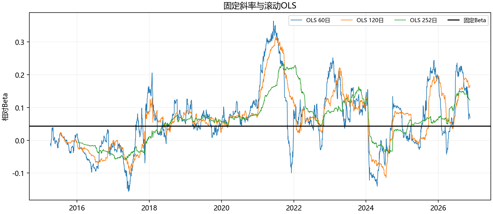
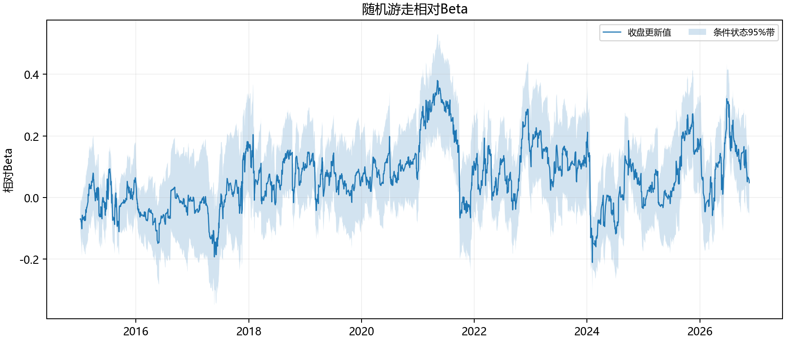
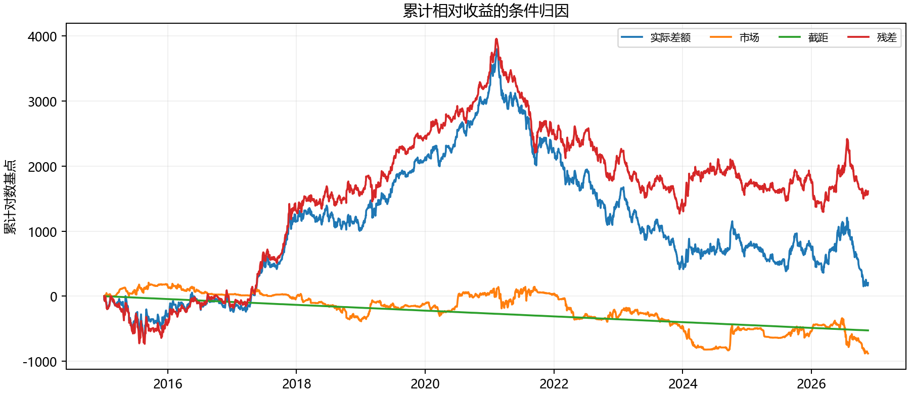
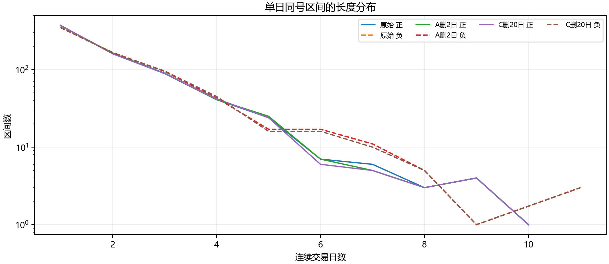
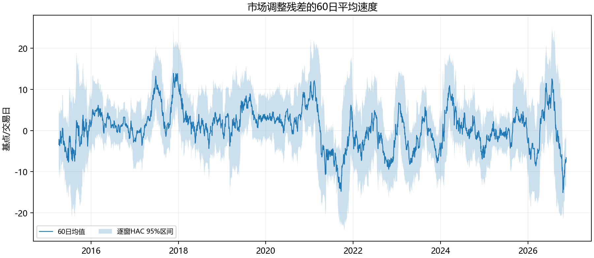

# 沪深300与上证综指的相对收益速度、共同市场暴露及连续偏移

## 摘要

以沪深300减上证综指定义日相对对数收益。两指数在2015-01-05至2026-11-17之间有2,884个共同收盘点。沪深300取得2.07%的期末相对价格财富优势。最有利两日中和后，终值符号翻转，但60日速度峰值依然出现在2017-11-21，达到13.50基点/日。中证全指的固定市场斜率差为0.0432，只解释3.28%的日差方差。动态暴露对顺序验证期的同期归因有所改善；固定暴露模型的残差也可形成多个正向区间。在允许区块依赖和极值搜索的比较中，未取得普通日存在独立持续溢价的证据。

## 一、数据、变量与反事实

以2015-01-05收盘归一，首个收益日为2015-01-06。数据库、归档收盘及旧实验日差逐日核对，主样本完整，收盘为正，日期无重复。中证全指只作市场代理。价格指数不计现金分红。数据检查、关键日清单复用和数学口径见[执行方案](README.md)及[分析输入](results/inputs.csv)。明汯因子文件使用日频小数，mktrf 为市场组合减无风险收益，rf_dly 为日无风险收益。将二者相加再取 log1p 得到市场代理，另按工作簿原超额简单收益比较。CH-3、CH-4的市场列相同，模型另含的规模、价值或换手因子未进入此次单因子回归。工作簿不能独立确认每只股票的分红修订史。[因子来源](https://www.mingshiim.com/database) · [因子构造论文](https://doi.org/10.1016/j.jfineco.2019.03.008)

每日速度 d 为两条指数日对数收益之差；累计偏移为 d 的前缀和，W日平均速度为窗口和除以W。下文1基点指0.0001对数收益。A按d降序、B按d升序、C按绝对值降序取前K日，K为0至10以及15、20。路径上将相应贡献置零，日历长度固定；估计模型时跳过这些收益观测，状态方差继续逐日传播。删除名单事后形成。

## 二、速度与关键日期

原始日速度最高168.11基点（2024-02-05），最低-172.70基点（2021-02-22）。累计偏移的最高点却在2021-02-10（3797.76基点）。表1的日期均为完整窗口结束日。局部峰谷根据平滑速度前后增量变号及中心二阶差分标注，只能在下一交易日确认。[全部局部转折、斜率与曲率](results/turns.csv.gz)

**表1　未经中和的窗口速度极值（基点/日）**

| window   | max_bp   | max_date   | min_bp   | min_date   |
|:---------|:---------|:-----------|:---------|:-----------|
| 20       | 28.6     | 2021-01-12 | -35.37   | 2021-03-17 |
| 60       | 13.5     | 2017-11-21 | -17.01   | 2026-10-21 |
| 120      | 10.53    | 2021-02-10 | -9.384   | 2021-08-11 |
| 252      | 6.334    | 2021-02-08 | -7.536   | 2022-03-02 |

**表2　关键日数与主窗口峰值**

| method   | K   | max_bp   | max_date   | min_bp   | min_date   |
|:---------|:----|:---------|:-----------|:---------|:-----------|
| A        | 2   | 13.5     | 2017-11-21 | -17.01   | 2026-10-21 |
| A        | 5   | 13.5     | 2017-11-21 | -17.01   | 2026-10-21 |
| A        | 10  | 13.5     | 2017-11-21 | -17.01   | 2026-10-21 |
| A        | 20  | 13.08    | 2017-06-26 | -17.01   | 2026-10-21 |
| B        | 2   | 13.5     | 2017-11-21 | -15.26   | 2021-09-22 |
| B        | 5   | 13.95    | 2021-02-18 | -15.26   | 2021-09-22 |
| B        | 10  | 13.95    | 2021-02-18 | -15.26   | 2021-09-22 |
| B        | 20  | 15.67    | 2021-02-18 | -14.18   | 2026-10-21 |
| C        | 2   | 13.5     | 2017-11-21 | -15.26   | 2021-09-22 |
| C        | 5   | 13.5     | 2017-11-21 | -15.26   | 2021-09-22 |
| C        | 10  | 13.5     | 2017-11-21 | -15.26   | 2021-09-22 |
| C        | 20  | 13.95    | 2021-02-18 | -15.26   | 2021-09-22 |

对A法，中和最有利的两日并未触及原60日最高速度；在已检验梯度中，首次迁移发生于K=15。删除某天只影响包含该日的窗口。原始终点对两天敏感与普通日期间仍能持续跑赢可以同时成立。[全部梯度及窗口累计收益](results/daily.csv.gz)

## 三、市场敏感度及涨跌非对称性

以 d 对常数项和同期中证全指日对数收益回归；两指数使用相同样本和解释变量，因此差额回归斜率严格等于两条单独回归斜率之差。非对称回归将市场收益正部和负部同时放入方程。表3列Newey–West十阶标准误及逐项95%区间；[全表](results/models.csv)保留5、10、20阶、调整R²、残差方差、均值和梯度校正。HAC在原日期间距上计算。

**表3　固定市场暴露与分段斜率（日对数小数）**

| term          | value     | se        | lo         | hi        | p         | adj_r2   |
|:--------------|:----------|:----------|:-----------|:----------|:----------|:---------|
| drift         | 7.097e-06 | 6.701e-05 | -0.0001242 | 0.0001384 | 0.9157    | 2.22e-16 |
| gamma         | 0.0432    | 0.008849  | 0.02586    | 0.06055   | 1.047e-06 | 0.03243  |
| up            | 0.1025    | 0.01207   | 0.07883    | 0.1262    | 2.088e-17 | 0.05643  |
| down          | -0.001248 | 0.008938  | -0.01877   | 0.01627   | 0.8889    | 0.05643  |
| up_minus_down | 0.1037    | 0.01318   | 0.0779     | 0.1296    | 3.546e-15 | 0.05643  |

上行斜率为0.1025，下行斜率接近零，二者之差的十阶HAC检验 p<0.0001。上涨日沪深300的胜率为55.39%，下跌日为41.02%。下跌日较常跑输与下跌幅度越大、相对损失就越大是不同命题。两组按当日市场收益符号划分。

| state   | n    | win    | raw_bp   | market_bp   | resid_bp   |
|:--------|:-----|:-------|:---------|:------------|:-----------|
| up      | 1513 | 0.5539 | 8545     | 7858        | 963.6      |
| down    | 1370 | 0.4102 | -8341    | -8740       | 648.9      |

共同日期为2816日，首末为2015-01-06至2026-08-31；收盘后无法获取的因子值不作前向填充。同样本更换代理后，固定斜率方向一致。

| proxy              | n    | value   | lo      | hi      | adj_r2   |
|:-------------------|:-----|:--------|:--------|:--------|:---------|
| market_matched     | 2816 | 0.0402  | 0.02305 | 0.05735 | 0.02855  |
| CH3_matched        | 2816 | 0.04163 | 0.0241  | 0.05916 | 0.02825  |
| CH4_matched        | 2816 | 0.04163 | 0.0241  | 0.05916 | 0.02825  |
| CH3_excess_matched | 2816 | 0.0425  | 0.02488 | 0.06011 | 0.02908  |
| CH4_excess_matched | 2816 | 0.0425  | 0.02488 | 0.06011 | 0.02908  |

在相同日期进一步分别估计两条指数的市场斜率，并以各市场代理重新训练动态模型。r2_300与r2_SSE是市场代理对**单条指数**的解释率，区别于表3对两条指数**差额**的解释率。两种口径的验证期仅含有匹配观测的日期，结果与全期验证分列。

| proxy   | n    | beta_300   | beta_SSE   | r2_300   | r2_SSE   | market_bp   | resid_mean_bp   | resid_p   | gain_vs_fixed   |
|:--------|:-----|:-----------|:-----------|:---------|:---------|:------------|:----------------|:----------|:----------------|
| market  | 2816 | 0.8775     | 0.8373     | 0.8783   | 0.9218   | -518.8      | 0.4793          | 0.476     | 0.07237         |
| CH3     | 2816 | 0.9349     | 0.8933     | 0.9201   | 0.9682   | -200.1      | 0.4092          | 0.5434    | 0.07004         |

## 四、暴露的时间变化与累计归因

随机游走斜率模型令状态创新和观测创新互不相关、截距固定。以高斯创新似然估计噪声方差，比较零状态方差的边界解。图7给出更新后的状态及给定全期超参数的条件区间，不含参数估计误差。归因则取吸收当日相对收益之前的斜率乘当日实际市场收益。估计的日状态方差为0.000249，条件斜率一日创新标准差为0.0158。为避免据曲线目测断点，另用相邻自然年截距和斜率交互检验年度暴露升降；2026年为不完整年度。表4列相邻年差幅最大的上升、下降，各区间从全部年度检验族校正。[全部年度检验](results/annual_changes.csv)

| first   | second   | change   | lo      | hi       | holm      |
|:--------|:---------|:---------|:--------|:---------|:----------|
| 2020    | 2021     | 0.1549   | 0.08667 | 0.223    | 9.384e-05 |
| 2021    | 2022     | -0.1479  | -0.2309 | -0.06484 | 0.004812  |

全期日差方差与终点归因使用不同分母。固定模型仅有约3.28%的方差解释率，其市场项累计57.98基点。动态模型中，实际差额204.60基点等于截距-526.50、市场项-881.48和一步创新1612.57之和。动态市场项为负，更高市场敏感度不足以解释期末略微领先。估计时点和模型设定均会影响这组分解。[逐K分解](results/decomposition.csv)

| method   | K   | fixed_beta   | state_variance   | total_bp   | intercept_bp   | market_bp   | residual_bp   |
|:---------|:----|:-------------|:-----------------|:-----------|:---------------|:------------|:--------------|
| A        | 2   | 0.04445      | 0.0002284        | -117.7     | -771.7         | -828.1      | 1482          |
| A        | 20  | 0.04272      | 0.0001709        | -2355      | -2637          | -846.8      | 1129          |
| B        | 2   | 0.04196      | 0.0002499        | 546.8      | -293.5         | -764.5      | 1605          |
| B        | 20  | 0.03886      | 0.000218         | 2575       | 1376           | -296.9      | 1496          |
| C        | 2   | 0.04196      | 0.0002499        | 546.8      | -293.5         | -764.5      | 1605          |
| C        | 20  | 0.03959      | 0.0001897        | -369.3     | -1042          | -681.6      | 1354          |

## 五、关键日之后的连续偏移与推断

区间定义为日差严格同号的最大连续交易日段；零或缺失中断。平滑速度同号区间另存，不能把一个滚动均值持续为正解读为每个交易日都跑赢。表5中count为段数、longest为天数，最后一列为各同号区间中与市场累计方向一致的比例。每段起止、贡献与同期市场差额见[完整区间](results/runs.csv.gz)。

| K   | sign   | count   | longest   | sum_bp     | fraction_market_same   |
|:----|:-------|:--------|:----------|:-----------|:-----------------------|
| 0   | -1     | 706     | 11        | -3.721e+04 | 0.585                  |
| 0   | 1      | 706     | 10        | 3.741e+04  | 0.6374                 |
| 2   | -1     | 706     | 11        | -3.721e+04 | 0.585                  |
| 2   | 1      | 707     | 10        | 3.709e+04  | 0.6379                 |
| 3   | -1     | 706     | 11        | -3.721e+04 | 0.585                  |
| 3   | 1      | 708     | 10        | 3.694e+04  | 0.6384                 |

A法删两日后，按累计正贡献取前三段，列示实际起止与市场方向。即使一段内沪深300每日都相对领先，中证全指本身仍可能下跌。

| start      | end        | days   | contribution_bp   | market_bp   |
|:-----------|:-----------|:-------|:------------------|:------------|
| 2024-09-24 | 2024-10-08 | 6      | 425.9             | 2986        |
| 2020-12-28 | 2021-01-07 | 8      | 378.9             | 591.1       |
| 2021-01-29 | 2021-02-10 | 9      | 351.5             | 437.5       |

下表比较中和后保留日的平均速度、残差速度（基点/日）、剩余前两正日占全部正贡献的比例，以及滤波斜率相对原始路径的最大绝对变化。与计算路径时使用的全日历分母不同，此处速度只除以保留日数。[全部梯度诊断](results/gradient_diagnostics.csv)

| method   | K   | mean_retained_bp   | residual_mean_bp   | top2_positive_fraction   | beta_max_delta   |
|:---------|:----|:-------------------|:-------------------|:-------------------------|:-----------------|
| A        | 2   | -0.04085           | 0.5145             | 0.008139                 | 0.08642          |
| A        | 20  | -0.8224            | 0.3943             | 0.005849                 | 0.1778           |
| B        | 2   | 0.1898             | 0.557              | 0.008614                 | 0.09291          |
| B        | 20  | 0.8994             | 0.5225             | 0.008614                 | 0.1325           |
| C        | 2   | 0.1898             | 0.557              | 0.008614                 | 0.09291          |
| C        | 20  | -0.129             | 0.473              | 0.006542                 | 0.1126           |

固定Beta残差带截距，样本内残差和机械归零。另用动态模型的一步创新检验平均及累计漂移；在全期拟合超参数条件下，HAC十阶均值检验 p=0.402，对累计量的标准误等于均值标准误乘有效天数。图10的区间只对单个窗口有效。正向区间存在，不足以说明漂移稳定或异常。

零平均差基准将联合日收益按同步循环区块抽样，对相对收益差移除全样本均值。每个长度5、20、60分别10,000次，每次重选赢家日、输家日和绝对差日，重新搜索各期限的最大及最小速度。模拟比较的是历史极值在稳定零漂移过程中的位置；不会为峰值日期本身提供置信区间。等量随机删除另在实际日历抽取10,000次。表6给20日区块下原始序列的双尾经验p值，以及按同类指标跨K、方向和窗口的Holm校正。原始60日峰谷均落在宽泛的模拟范围内。

| metric       | observed   | median    | p      | holm   |
|:-------------|:-----------|:----------|:-------|:-------|
| positive_run | 10         | 10        | 1      | 1      |
| negative_run | 11         | 11        | 1      | 1      |
| max_60       | 0.00135    | 0.001352  | 0.9915 | 1      |
| min_60       | -0.001701  | -0.001394 | 0.2762 | 1      |

A法中和2日与均匀中和2日的对照如下，速度与均值为日对数小数，游程为天数。定向删除有意挑出尾部，对终值有影响不等于对最长连续段也有影响。[全部模拟](results/simulations.csv)

| metric       | observed   | median   | p      | holm     |
|:-------------|:-----------|:---------|:-------|:---------|
| mean         | -4.082e-06 | 7.14e-06 | 0.0002 | 0.007399 |
| positive_run | 10         | 10       | 1      | 1        |
| max_60       | 0.00135    | 0.00135  | 1      | 1        |

另以固定市场斜率为基准，同步抽市场和残差区块，对每块残差随机换号，保留块内连续结构；每次重新排名、删日、拟合截距与斜率，检验市场调整残差的最长同号段与60日极值。为衡量是否全靠一两个区间，逐次排除最强的两个互不重叠60日窗口，再搜索第三段。表7为未删日的20日区块结果；下行极值以绝对幅度显示。第三段正向速度为12.80基点/日，因此正向积累可在多段观察到；多重校正后仍与固定暴露基准相容。这一检验依赖块残差符号对称假设。[逐梯度和区块结果](results/residual_null.csv)

| term             | observed   | lo        | hi       | p       | holm   |
|:-----------------|:-----------|:----------|:---------|:--------|:-------|
| positive_run     | 10         | 9         | 15       | 0.8645  | 1      |
| negative_run     | 11         | 9         | 15       | 0.6188  | 1      |
| max60            | 0.001329   | 0.001038  | 0.00191  | 0.5665  | 1      |
| negative_min60   | 0.001634   | 0.001036  | 0.001923 | 0.1392  | 1      |
| third_positive60 | 0.00128    | 0.0008582 | 0.001342 | 0.05809 | 1      |
| third_negative60 | 0.001265   | 0.0008642 | 0.001344 | 0.07599 | 1      |

## 六、扩展窗口验证与结论

首504日用于初始化，固定及非对称回归按日扩展；动态模型每63日仅用历史重新估计超参数，每天用上一日滤波状态归因。验证期2017-01-26至2026-11-17。表8的gain为相对于各对照的平方损失降幅，loss_bp2及其HAC区间为“对照损失减动态损失”，以平方基点计。

| comparator   | n    | gain    | loss_bp2   | lo    | hi    | p         |
|:-------------|:-----|:--------|:-----------|:------|:------|:----------|
| fixed_error  | 2379 | 0.0806  | 96.17      | 42.78 | 149.6 | 0.0004146 |
| asym_error   | 2379 | 0.05406 | 62.69      | 6.078 | 119.3 | 0.02997   |

相对固定线性规格，年度切片有10/10个取得正改善。动态模型虽降低整体条件归因误差，各时段的增量须结合年度差异理解。验证期动态误差合计-899.5基点，平均-0.378基点/日（十阶HAC区间[-1.845, 1.088]，p=0.613）。验证期均值及累计量均不足以识别可持续的独立收益。[逐年比较](results/validation.csv)

将原始样本三项暴露或漂移问题、两项创新均值及两个验证期损失比较合并为七项主检验（HAC十阶），Holm结果如下。相对固定Beta的改善通过校正，相对固定非对称模型的证据较弱。各设计另有逐梯度或峰值搜索校正，不把同一行情的多个口径计作独立验证。

| hypothesis                 | p         | holm      |
|:---------------------------|:----------|:----------|
| mean spread                | 0.9157    | 1         |
| fixed beta                 | 1.047e-06 | 6.284e-06 |
| up vs down                 | 3.546e-15 | 2.482e-14 |
| dynamic innovation mean    | 0.4023    | 1         |
| validation innovation mean | 0.6133    | 1         |
| gain vs fixed              | 0.0004146 | 0.002073  |
| gain vs asymmetric         | 0.02997   | 0.1199    |

共同市场暴露存在，但固定线性模型留下大部分日相对收益方差。上涨和下跌日的斜率明显不同。删去最有利的两三个交易日，正向区间和60日正峰仍存在；控制市场和区间搜索后，持续获利的解释缺乏支持。因子代理对固定斜率的符号影响较小，但价格指数无法检验分红后的财富分解。动态模型使用同期已实现的市场收益，其改善衡量条件归因能力。行业、估值、权重重叠和制度事件的作用仍无法由这两条指数的日收盘序列识别。
