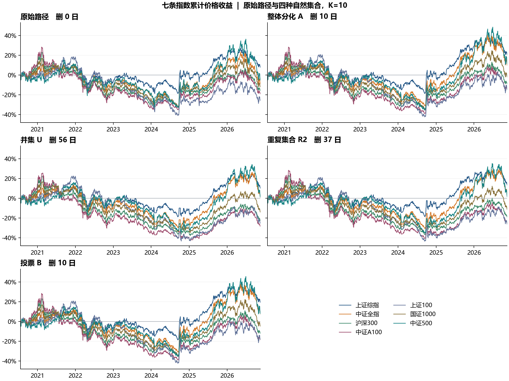
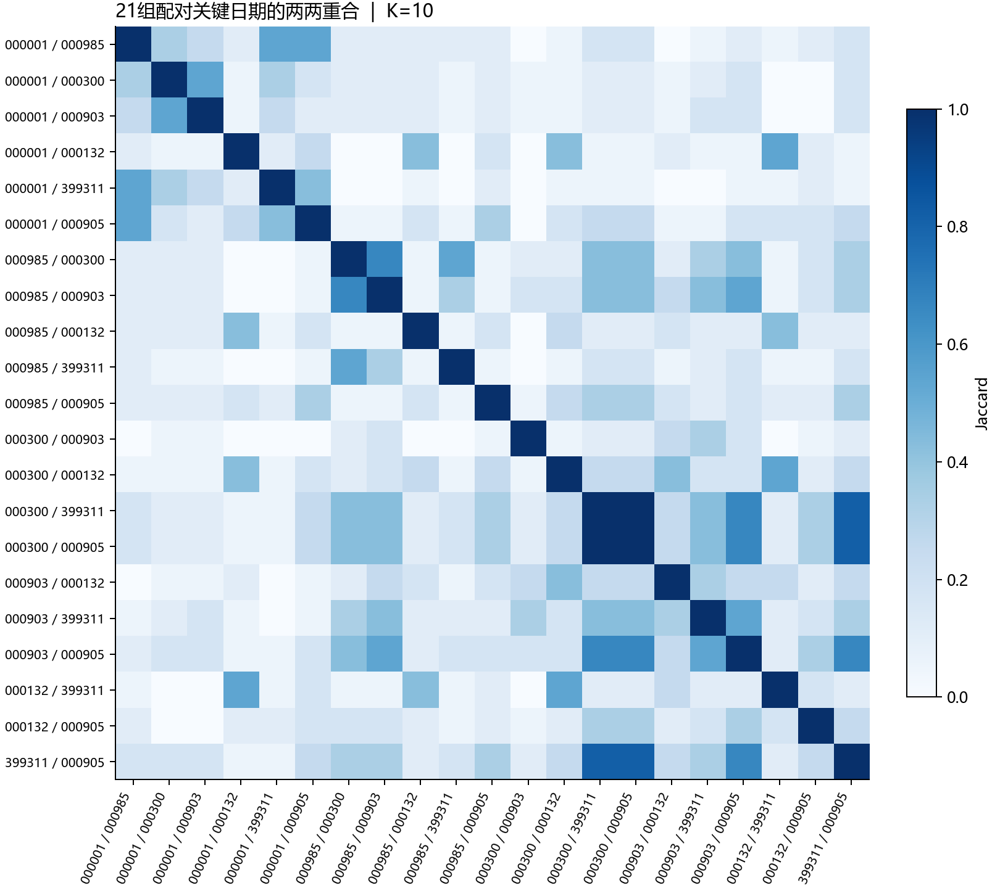
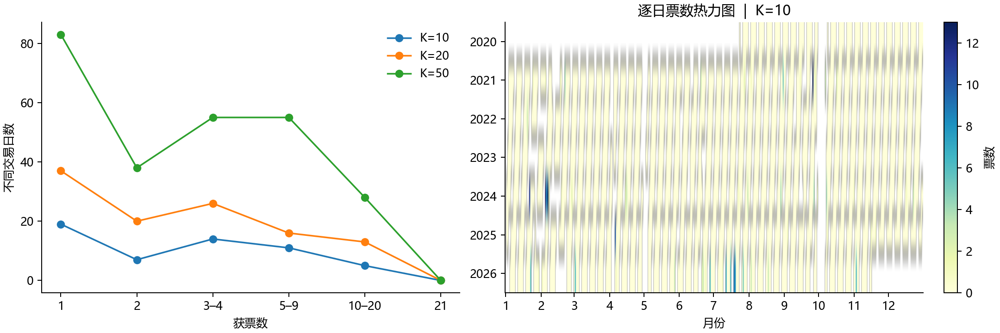
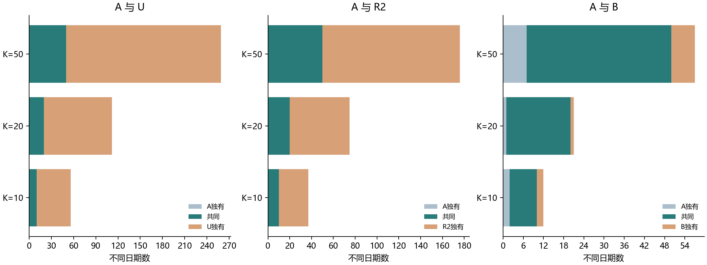
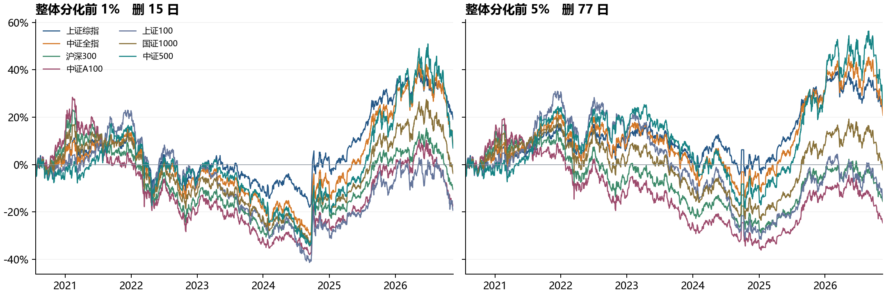
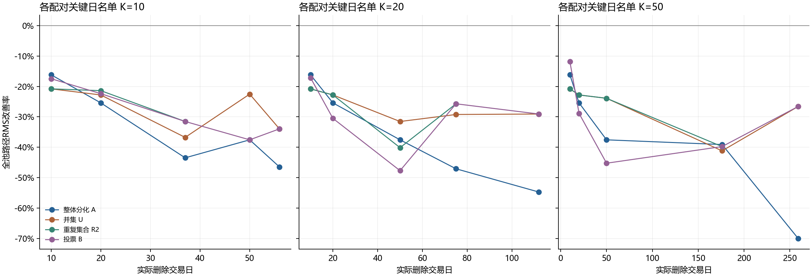
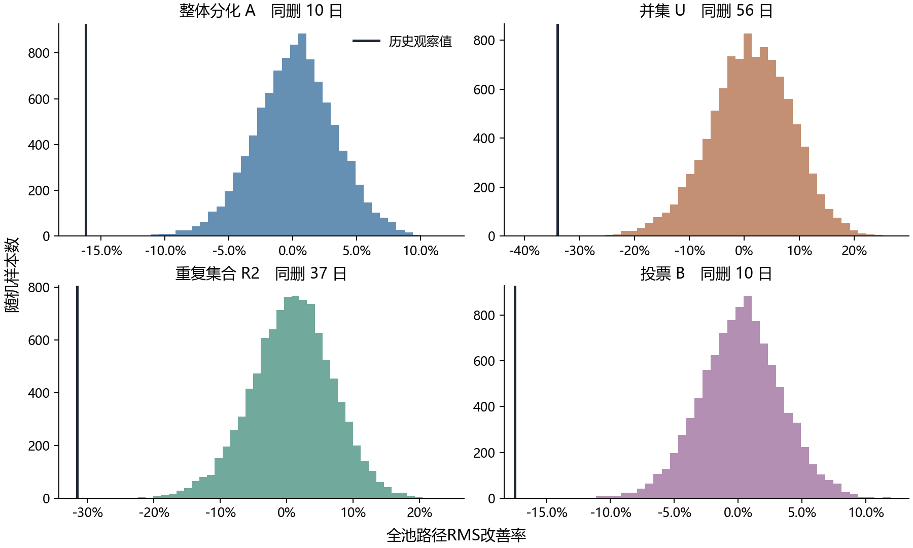
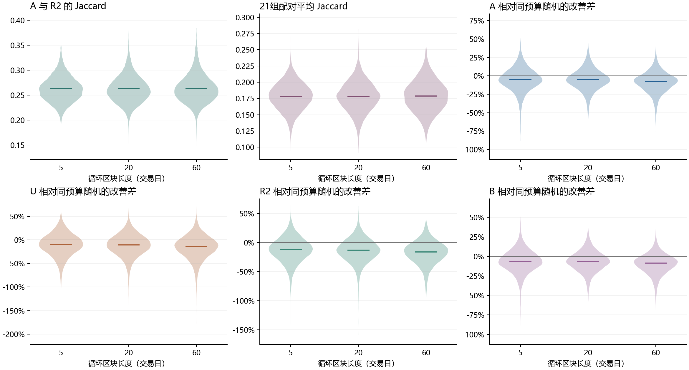

# 七大A股宽基指数关键日识别、集合重合与累计收益路径趋同实验（V2）

主样本为2020年7月23日收盘至2026年11月17日收盘。21组配对使用同一组1,531个日对数收益观测。

## 主要发现

每组取前10日时，210个名额来自56个不同日期，其中37日获至少两票，占不同日期的66.07%，覆盖了90.95%的名额。整体分化得分最高的10天全部进入重复集合，但21组严格交集为空。共享一条指数的配对，其关键日名单平均 Jaccard 为0.246，完全不共享指数时为0.124。

**高频共同关键日并没有带来累计路径趋同。** 主样本中，四种自然集合的路径距离全部扩大。同删10日时，整体分化法、投票法、并集截取、重复集合截取的路径RMS分别扩大16.18%、17.47%、20.80%和20.80%。整体分化法删除前1%和前5%时，路径RMS也分别扩大15.81%和55.76%。

季度内独立循环平移关键日名单后，所保留的日期重合明显少于历史观察。同步重抽七指数收益向量后，历史重合值落入各区块设定的中央95%区间。前者揭示了跨配对的同期对齐，后者表明这种对齐与指数之间保留的同期联动相容。主样本的49种非空删日掩码中，没有一个取得正的全池路径改善率，或在预设高尾检验中显著优于相同数量的随机删日。

**图1　原始路径与四种自然方案。** 各面板采用同一价格收益刻度与原日期轴。K=10指每组配对各取10日，并集和重复集合实际分别删除56和37日。[原始及图示方案的逐日累计收益](results/convergence_paths_main.csv) · [可编辑图](figures/01_common_paths.svg)

## 样本与识别口径

仅使用上证综指000001、中证全指000985、沪深300 000300、中证A100 000903、上证100 000132、国证1000 399311、中证500 000905。直接读取SQLite价格指数收盘点位，将每列与交易所日历、原始行情及 SHA-256 哈希核对。主样本各有1,532个收盘点和1,531个收益，首个收益日为2020-07-24。七指数长样本各有2,884个收盘点和2,883个收益，起始收盘日为2015-01-05。检查通过后才对相邻收盘价取对数差。两个样本均包含上证100于2024-09-30和中证500于2025-04-07两条绝对日对数收益超过10%的记录，均与归档快照一致，按原值保留。价格指数收益采用各供应商归档口径，现金分红未计入。[数据验收](results/data_audit.csv) · [异常筛查明细](results/flagged_returns.csv) · [主样本快照](results/input_closes_main.csv) · [长样本快照](results/input_closes_long.csv)

配对关键日按 $|r_{i,t}-r_{j,t}|$ 降序排序，整体分化分数 $S_t$ 是该日21组绝对收益差的均值。同分取较早日期。配对关键日名单取K=10、20、50，以10为正文主展示。按名单得票构造并集U、至少获2、3、5、10票的重复集合，以及21票的严格交集。固定K的投票法B依次按票数、$S_t$ 和日期排序，前两项取降序，日期取升序。所有删除都采用共同日期掩码，使当日七条收益同步归零，累计路径在该日保持前值。[整体分化日期全排序](results/overall_key_dates.csv) · [各配对前K日及绝对收益差](results/pairwise_key_dates.csv) · [逐日票数、名单与配对排名](results/date_frequency.csv)

## 日期共同性与名单统一性

| 每组前K | 总名额 | 并集U | 重复R2 | 重复日期占比 | 重复名额占比 | 严格交集 |
|---:|---:|---:|---:|---:|---:|---:|
| 10 | 210 | 56 | 37 | 66.07% | 90.95% | 0 |
| 20 | 420 | 112 | 75 | 66.96% | 91.19% | 0 |
| 50 | 1,050 | 259 | 176 | 67.95% | 92.10% | 0 |

K=10时，分别有19、7、14、11、5、0日获得1、2、3至4、5至9、10至20、21票。2024-02-07与2021-09-27各获13票，前者整体分化分数更高，在投票中排第一。两组配对间平均 Jaccard 为0.185，中位数0.111，标准差0.174，范围0至1，第5、25、75、95分位数分别为0、0.053、0.250、0.538。共享一条指数与完全不共享的比较各105组。两类均值差反映共同持有一条指数可能放大同步入选的机会，各组比较存在依赖。[集合汇总](results/set_summary.csv) · [频率与日历名单](results/frequency_distribution.csv) · [全部210组比较](results/pairwise_jaccard.csv) · [分组分位数](results/jaccard_summary.csv)

**图2　配对之间的关键日重合。** 对角线为自身比较，均值及分位数仅用非对角线的210组无序比较。[K=10矩阵](results/jaccard_main_K10.csv) · [K=20矩阵](results/jaccard_main_K20.csv) · [K=50矩阵](results/jaccard_main_K50.csv)

**图3　各票数区间的交易日数与逐日获票。** 热力图每格为一个日历日期，未交易日留空。

| K | A日期在U内 | U日期在A内 | J(A,U) | A日期在R2内 | R2日期在A内 | J(A,R2) | A与B共同日 | J(A,B) |
|---:|---:|---:|---:|---:|---:|---:|---:|---:|
| 10 | 100% | 17.86% | .179 | 100% | 27.03% | .270 | 8 | .667 |
| 20 | 100% | 17.86% | .179 | 100% | 26.67% | .267 | 19 | .905 |
| 50 | 100% | 19.31% | .193 | 100% | 28.41% | .284 | 43 | .754 |

整体法的名单短，始终被重复集合完全覆盖，反向覆盖约27%至28%。因此高覆盖与中等Jaccard同时出现。K=10时，A与B共享8天，双向覆盖率均为80%。A独有2026-01-23、2026-03-03，B独有2026-07-13、2026-07-21。整体分化和配对投票产生相近但有差异的固定名单，二者的重合度在K=20最高。[双向覆盖与全部交集](results/method_overlap.csv) · [A、U、R、B的共同与独有日期](results/method_overlap_dates.csv) · [并集](results/union_dates.csv) · [分门槛重复集合](results/repeated_dates.csv) · [投票名单](results/vote_dates.csv)

**图4　共同日期和各名单独有日期。** 严格交集在三个K均为空，原始路径保持不变。若A与空的重复集合比较，双向覆盖与Jaccard留空。

## 自然删日和等预算的路径比较

累计对数收益 $L_{i,t}$ 以共同起始收盘价为基期。全池RMS等于21组配对、全时间轴累计对数差的平方均值开根。路径改善率为 $1-D_{\text{after}}/D_{\text{before}}$，正值表示缩小。终点离散度分别用七条累计对数收益的总体标准差和累计简单收益最大值减最小值度量；日收益相关使用共同保留的交易日。

| 方案 | 实删 | 路径RMS（对数点） | RMS改善率 | 终点极差（百分点） | 平均日相关 | 趋同配对 |
|---|---:|---:|---:|---:|---:|---:|
| 原始 | 0 | 11.51 | — | 33.11 | .9164 | — |
| 整体分化A，前1% | 15 | 13.32 | −15.81% | 37.90 | .9176 | 3 |
| 整体分化A，前5% | 77 | 17.92 | −55.76% | 49.73 | .9187 | 4 |
| A，K=10 | 10 | 13.37 | −16.18% | 35.11 | .9171 | 3 |
| U，K=10 | 56 | 15.41 | −33.95% | 38.46 | .9145 | 3 |
| R2，K=10 | 37 | 15.13 | −31.52% | 39.02 | .9179 | 2 |
| B，K=10 | 10 | 13.52 | −17.47% | 37.83 | .9164 | 3 |

重复集合的自然效果与并集同样为扩大路径距离。门槛升至3、5、10票后，K=10分别减少至30、16、5个实际删除日，路径RMS分别扩大32.20%、23.45%、16.60%。部分方案提高了日相关，同时扩大累计路径距离与终点差距。绝对分化分数同时选取方向相反的收益差，移除高分日也可能移除原本抵消长期累计差距的收益。日相关只描述当期的共变，路径距离还取决于每次冲击的方向和出现时间。[全部方案及删日比例](results/convergence_results.csv) · [各方案实际删除日期与分数](results/deletion_dates.csv) · [各配对RMS和相关](results/pair_convergence.csv) · [各指数终点收益](results/index_endpoints.csv)

**图5　整体分化法的两个主要比例。** 每个比例乘以收益样本大小后四舍五入。前0.5%、2%、10%、20%的RMS也扩大，改善率分别为−16.44%、−42.32%、−30.92%、−67.72%。

| 配对名单K | 固定实际删日M | A改善率 | U改善率 | R2改善率 | B改善率 |
|---:|---:|---:|---:|---:|---:|
| 10 | 10 | −16.18% | −20.80% | −20.80% | −17.47% |
| 10 | 20 | −25.41% | −22.80% | −21.39% | −22.38% |
| 10 | 37 | −43.46% | −36.75% | −31.52% | −31.52% |
| 20 | 20 | −25.41% | −22.80% | −22.80% | −30.50% |
| 50 | 50 | −37.55% | −23.90% | −23.90% | −45.23% |

等预算时，A继续按整体分化分数取前M，B按投票次序延伸或截短至M。U与R2在自身候选日中按入选配对的最大绝对收益差排序，再按 $S_t$ 和日期打破并列。候选不足M时不补日期。四种方法的相对排名随预算变化，表中没有一种使全池路径改善。投票法在自然K=10时的删日效率也未超过整体分化法。[所有相同预算比较](results/deletion_budget_comparison.csv) · [候选不足的预算](results/unavailable_budgets.csv)

**图6　实际删除日数与全池RMS改善率。** 每个横坐标代表同一实际删除预算，线段连接已计算的预算点。

配对自身删日作为单独诊断，每一组仅对自己的两条收益同步应用自己的日期名单。K=10、20、50时中位改善率分别为−24.60%、−27.63%、−31.84%，21组中正改善的配对分别为2、3、4组。该诊断的各配对使用不同的时间掩码，结果只在配对内解释。[逐配对独立删除结果](results/independent_pair_deletion.csv)

K=10的21组曲线分三页展示。虚线为原始收益，实线为同步剔除本配对关键日后的收益，三页共用纵轴尺度。上证100与中证500的路径RMS缩小6.62%，上证综指与中证全指缩小1.36%。[第1至7组](figures/09_independent_pairs_1.png) · [第8至14组](figures/09_independent_pairs_2.png) · [第15至21组](figures/09_independent_pairs_3.png)

## 随机基准和时间依赖

### 同一历史路径上的等数量随机删除

对每个不同实际预算M无放回均匀抽取10,000组日期。每次使用同一掩码处理七列，记录全池和21组RMS改善率以及终点极差缩小量。高尾经验概率使用“达到或超过观察值的次数加一”除以10,001。全池检验对去重后的49个非空掩码做Holm校正，RMS与终点极差各为一个检验族；配对诊断在每个掩码内对21组作Holm校正。该比较固定了行情历史、选择指标与删日数量，给出删日效果相对均匀日期的经验位置。

| K=10自然方案 | 删日数 | 实际改善率 | 随机改善率97.5分位 | 高尾p值 | Holm校正 |
|---|---:|---:|---:|---:|---:|
| A | 10 | −16.18% | 6.54% | .9998 | 1.000 |
| U | 56 | −33.95% | 15.23% | .9999 | 1.000 |
| R2 | 37 | −31.52% | 12.43% | 1.0000 | 1.000 |
| B | 10 | −17.47% | 6.54% | 1.0000 | 1.000 |

**图7　同一删日数量下的随机改善率。** 竖线为观察结果。尾概率方向预设为改善更大，接近1说明真实规则几乎都落在随机改善率下方。各面板按对应实际预算重抽。[全池与终点基准](results/random_deletion_results.csv) · [逐配对统计](results/random_pair_results.csv) · [10,000次模拟档案](results/random_deletion_draws.npz)

### 日期重合的分层随机化

在每个年—季度内，以该季度实际交易日为环，各配对独立抽取一个均匀的平移量，将其全部入选日期在该季度内循环平移。每组的季度入选数量及季度内圆环间距完全保留，跨配对同日同步和跨季度边界的簇结构会被打散。原始整体A和得分 $S_t$ 固定，U、R2和B在每个随机副本上重建。对三个K、六个日期指标的18项高尾检验进行Holm校正。

K=10时，历史A与R2的Jaccard为0.270，分层随机化中央95%区间为0至0.103；配对间平均Jaccard为0.185，随机区间为0.0078至0.0150。18项检验的校正p值均约0.0018。该零假设对应给定季度结构下名单可独立平移，并破坏了组合共享指数带来的同期联动。它量化了日期对齐相对该条件基准的程度。[分层随机化分位数与尾概率](results/date_randomization_results.csv) · [抽样档案](results/date_randomization_draws.npz)

### 同步区块重抽

将相邻整段七指数收益向量一起抽出，区块首日均匀抽取，绕回样本起点，每条合成路径拼至1,531个收益日。区块长度为5、20、60，每个长度重抽10,000条。每次重算A、各配对名单、U、R2、B及重合度。相同来源日重复抽到时，按不同合成位置处理，分数并列采用合成轴上的先后顺序。各方法同时与该条路径上相同实际删除数量的随机删日作差，并额外将四个集合都截取到固定K进行比较。保留原经验联合收益分布作为抽样材料，结果用于检验描述性结论对历史顺序与局部依赖的敏感度。

| 区块长度 | K=10 A与R2的Jaccard中央95% | K=10配对平均Jaccard中央95% | A相对等量随机的中位改善差 | U | R2 | B |
|---:|---:|---:|---:|---:|---:|---:|
| 5 | [.217, .313] | [.135, .218] | −4.87 pp | −9.66 pp | −11.69 pp | −6.23 pp |
| 20 | [.214, .323] | [.132, .222] | −5.21 pp | −10.80 pp | −12.94 pp | −6.40 pp |
| 60 | [.217, .323] | [.132, .228] | −7.97 pp | −14.15 pp | −16.17 pp | −8.79 pp |

历史K=10的0.270和0.185落在三种同步区块的对应区间内。K=10、20、50的三个区块设定下，四种方法相对各自等量随机的改善差中位数都为负。K=10时，四种自然方案的改善差中央95%区间均跨零，表明模拟路径上的删日效果会改变符号。固定K的四种方法及所有有效次数均保存在统计表中。区块重抽区间描述经验联合过程下的统计波动，受总体历史分布和日期重复抽样影响。[同步区块统计表](results/bootstrap_results.csv) · [5日抽样](results/bootstrap_block_5.npz) · [20日抽样](results/bootstrap_block_20.npz) · [60日抽样](results/bootstrap_block_60.npz)

**图8　区块长度敏感性。** 前两幅为日期重合分布，后四幅以“针对性方案改善率减相同数量随机删日改善率”衡量净效果。图内短横线表示中位数。

## 2015年以来的长样本复核与结论

在七条共同覆盖的长样本上重新选日。K=10时，并集47日，重复集合29日，重复日期占61.70%，覆盖91.43%的名额，21组严格交集仍为空。K=20和50也没有严格共同日期。四种自然删日仍扩大路径，K=10时分别扩大103.37%、186.71%、150.91%和103.63%。删日数统一为10天时，A、B扩大约103%，两个截取集合扩大约73%。前1%和5%两个整体法的方向也相同。长样本结果属于对样本边界的描述性复核，正文的随机检验和重抽样区间均使用预设主样本。

本次结果回答了两个不同的问题。七条宽基有一批反复入选的高分化日，且共同性在不同K和长样本中持续可见。与此同时，删除这些高分化日后，净值路径整体更分散。日期共同性可以反映共享指数与共同市场冲击，净值路径由每日分化的方向、规模和时间累积决定。指数价格历史的共同性本身无法识别行业、调样或资金流等经济机制。

## 复现与文件

从仓库根目录运行。代码使用仓库行情库及原始快照，并依赖仓库 Python 环境和 exchange_calendars 4.13.2。测试读取重新生成的结果，并以独立计算核对投票、集合、掩码、K=0恒等性、Jaccard、区块排序和预算匹配。

~~~powershell
python experiments/seven_index_convergence_v2/run_all.py
python -m unittest discover -s experiments/seven_index_convergence_v2 -v
~~~

[配置](config.yaml) · [计算入口](run_all.py) · [随机种子、依赖版本和行情哈希](results/simulation_manifest.json) · [测试](test_research.py) · [图表目录](figures/) · [完整结果目录](results/)
