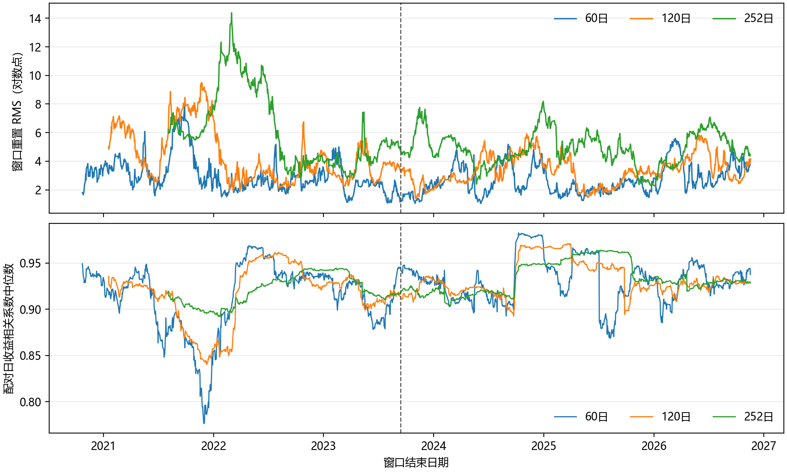
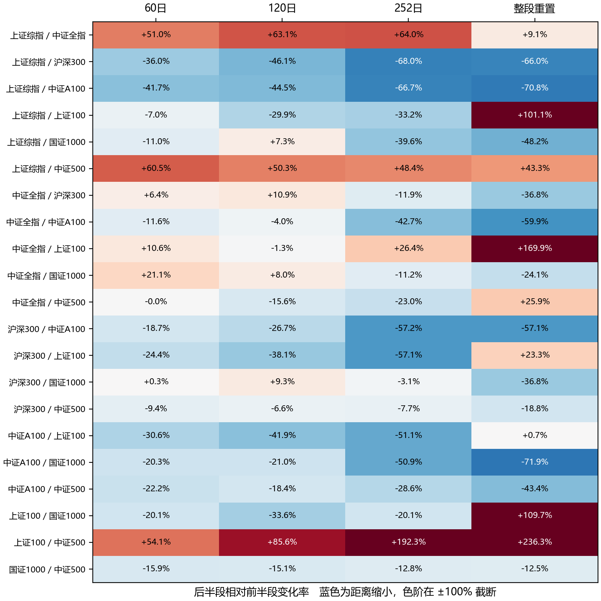

# 七指数局部收益趋同与早期偏移的复核（V3）

同一批七指数在后半段可以同时表现出更大的历史净值差距和更近的一年期走势。全池固定起点距离从7.12升至14.63个对数点；将每个252日窗口的起点重新对齐后，完全处于各自半段内的窗口距离中位数从5.45降至4.89个对数点。同步区块重抽显示，这个降幅在稳定联合收益过程的模拟中并不罕见。本章检验原始价格路径。第13章的关键日删除回答哪些日期影响长期财富差，第14章的段内中心化回答曲线在上下平移后有多接近。

## 数据与距离定义

输入为第13章归档的七指数共同收盘价。2020年7月23日至2026年11月17日共有1,532个收盘点和1,531个日对数收益。前段为2020年7月24日至2023年9月13日的765个收益日，后段从2023年9月14日起共766日。切点来自对历史图形的探索。各指数以相同的交易日计量。全章使用原始价格收益，无删日或交易策略。

**A　滚动重置路径距离。** 记第 $i$ 条指数的日对数收益为 $r_{i,t}$，$g_{ij,t}=r_{i,t}-r_{j,t}$。窗口起始日前一收盘时刻令每条曲线归零，计入首日收益。下式先在21组和窗口内各日上平均平方距离，再开平方。每半段的代表值取所有合格窗口的时间中位数。

$$
D_W(t)=\sqrt{\frac{1}{21W}\sum_{i<j}\sum_{s=t-W+1}^{t}\left(\sum_{u=t-W+1}^{s}g_{ij,u}\right)^2}.
$$

第14章的中心化距离允许两条曲线在窗口内上下平移，V3固定窗口起点，因此窗口内新形成并保留的领先也计入距离。单配对使用上式中的一组收益差。整段重置距离把整个半段视为一个窗口，只在半段起点归零一次。

**B　去趋势路径形状。** 对每组每半段的累计相对收益 $G_{ij,s}$ 分别估计带截距的线性趋势，时间 $s$ 为段内连续交易日序号。全池形状距离是所有配对与日期上残差的均方根。即使两指数存在稳定而明显的相对收益漂移，残差也可能很小。

$$
G_{ij,s}=\alpha_{ij}+\beta_{ij}s+e_{ij,s},\qquad
D_{\mathrm{shape}}=\sqrt{\frac{1}{21n}\sum_{i<j}\sum_{s=1}^{n}e_{ij,s}^{2}}.
$$

**C　漂移与共同运动。** 各配对年化绝对漂移为 $252|\bar g_{ij}|$，日收益相关系数使用同期Pearson相关系数。表58对这两项取21组中位数。另报告日相对收益的全池RMS，将每日21组收益差的平方一起平均后开方。距离乘100得到对数点，日收益差乘10,000得到基点。滚动相关系数也在窗口内按配对分别计算，见图58。

## 滚动窗口复现与边界敏感性

外部初算没有附原始代码。使用窗口中靠后的中央交易日确定归属，可将其三项前后读数及相对变化复现至所报精度。例如，252日窗口取第127日作为中央日。此规则将跨界的251个窗口也纳入比较，其中125个归前段，126个归后段。正式比较采用完整窗口分段，只有窗口起止均在同一段才计入。报告同时保留两种分法，使跨界影响可以量化。

表 57　同一重置路径公式在两种窗口归属规则下的结果

| 窗口 | 归属规则 | 前段窗口数 | 后段窗口数 | 前段中位数（对数点） | 后段中位数（对数点） | 相对变化 |
|---|---|---:|---:|---:|---:|---:|
| 60日 | 中央日 | 735 | 737 | 2.617 | 2.461 | −5.97% |
| 120日 | 中央日 | 705 | 707 | 3.538 | 3.364 | −4.93% |
| 252日 | 中央日 | 639 | 641 | 5.437 | 4.658 | −14.32% |
| 60日 | 完整窗口 | 706 | 707 | 2.652 | 2.487 | −6.23% |
| 120日 | 完整窗口 | 646 | 647 | 3.681 | 3.479 | −5.50% |
| 252日 | 完整窗口 | 514 | 515 | 5.446 | 4.892 | −10.17% |

三个期限的历史距离均下降。252日窗口的降幅受边界影响最大，相差4.15个百分点。每半段约有三个不重叠的一年窗口，逐日滚动所得的五百多个观察高度重叠。

图 58　七指数全池重置路径距离与滚动日收益相关性

横轴统一为窗口结束日，竖线为后段首日。曲线连续显示所有窗口，表57的完整窗口统计另行剔除跨界窗口。上图越低表示从该窗口起点累计的路径越接近，下图越高表示同期日收益同向变动越强。

## 路径形状与配对差异

表 58　前后半段的形状、漂移、相关性与整段重置距离

| 统计量 | 前段 | 后段 |
|---|---:|---:|
| 去趋势形状RMS（全池，对数点） | 4.157 | 3.298 |
| 年化绝对相对漂移（配对中位数） | 2.77% | 1.42% |
| 日收益相关系数（配对中位数） | 0.921 | 0.932 |
| 日收益差RMS（全池，基点） | 50.76 | 55.35 |
| 整段重置RMS（配对中位数，对数点） | 6.26 | 4.50 |
| 整段重置RMS（配对上四分位数，对数点） | 8.86 | 10.76 |
| 整段重置RMS（全池，对数点） | 7.12 | 7.53 |

去趋势后的形状距离下降20.65%。日收益相关性上升，日收益差的绝对规模仍可扩大，因为相关系数对各指数收益的波动幅度作了标准化。漂移的下降描述样本平均相对收益绝对值；它不能说明逐日差异或每组配对都变小。

整段起点重置后有12组缩小、9组扩大。配对距离的横截面中位数从6.2566降至4.5018点，按未舍入值计算下降28.05%。这个数字与**逐组变化率的中位数**（−18.75%）含义不同。全池平方平均会放大分化较大配对的影响，整段重置的全池距离因而上升5.69%。在60、120、252日的完整滚动窗口内，逐组窗口中位数下降的配对分别为14、14、17组。

图 59　21组在三种滚动期限及整段重置下的距离变化

每格为同一配对后段相对前段的变化率，蓝色表示缩小。前三列分别在每半段取该配对各完整窗口距离的中位数。最后一列反映整段从同一起点出发，直至段末保留的累积差异。中证全指与中证500在60日口径下的变化接近零，符号计数按未舍入值进行。

沪深300与中证A100的整段重置距离从2.77降至1.19个对数点，后段日收益相关系数为0.991，年化绝对漂移为0.053%。上证100与中证500则从4.35升至14.61个对数点，后段相关系数仍达0.953，年化绝对漂移达4.93%。这两组分别给出相关性高且累计路径接近、相关性高而累计路径继续拉开的实例。

## 早期差距是否集中于一次偏移

在每组前半段内，按其期末领先方向寻找贡献最大的单日和连续20日。以该区间有符号贡献除以前段期末相对收益，计算其贡献比例。比例超过100%表示其他日合计抵消了部分领先；当前段净差很小时，该比例会较大。这个计算描述最有利历史区间的集中度，也保留剔除该区间后的有符号期末差，供查核。

最大的一个交易日能解释至少一半前段净差的有3/21组，单日贡献比例的配对中位数为17.00%。把范围扩大至连续20个交易日，有17/21组至少达到一半，中位数为80.08%。以上证综指与沪深300为例，前段期末差为16.93个对数点；2021年2月22日贡献1.73点（10.20%），2021年2月18日至3月17日的20个交易日合计贡献7.07点（41.78%）。这支持部分偏移集中在一段时期，但单日解释多数前段净差只适用于少数组合。各组独立搜索，日期可能不同，未对峰值区间做事件因果检验。

## 同步区块Bootstrap检验

以完整历史的七维日收益向量作为联合抽样单位。在原假设下，两个半段来自同一稳定的联合收益过程。每次从全期均匀抽取区块起点，连续保留区块内全部指数收益，跨越原样本末端时绕回起点。拼接、截取至1,531日后按相同交易日序号切分，并在每条模拟序列上重算窗口与统计量。以20日为主要区块长度，同时使用5日和60日检查敏感性，每种长度模拟10,000次。这样保留了同日横截面相关和块内序列依赖，也避免将高度重叠的窗口当作独立样本。

检验量为后段统计量减前段统计量。双侧经验p值使用两侧中较小的含等号尾部计数，加一后除以10,001再乘二，上限取1。在每个区块长度内分别对三个完整窗口、三个中央日窗口及四项辅助指标实施Holm校正。表59的模拟区间是原假设下差值的中央95%范围，单位为对数点。

表 59　完整窗口的历史差值与稳定联合过程模拟对照

| 窗口 | 观察差值 | 20日区块的模拟区间 | 5日区块双侧p | 20日区块双侧p | 60日区块双侧p | 20日区块校正p |
|---|---:|---|---:|---:|---:|---:|
| 60日 | −0.165 | [−0.763, 0.740] | 0.618 | 0.653 | 0.655 | 1.000 |
| 120日 | −0.203 | [−1.477, 1.439] | 0.762 | 0.777 | 0.751 | 1.000 |
| 252日 | −0.554 | [−3.355, 3.322] | 0.716 | 0.733 | 0.695 | 1.000 |

20日区块下，去趋势形状、绝对漂移、相关系数与日差RMS的未校正双侧p值分别为0.437、0.577、0.506和0.259。三个区块长度中，所有主指标与辅助指标经各自检验族校正后均未达到5%显著性水平。原假设模拟打散超过区块长度的历史依赖，且没有模拟“先看图再择切点”的选择过程；所得概率只评价给定切点、给定统计量和该抽样模型。

## 结论与复现

外部初算的滚动读数、去趋势形状、漂移、相关性和两个配对案例均可在归档价格上复现。跨界窗口的归属影响降幅，汇总时是否对大幅分化配对加重权重也会改变方向。现有证据能描述后半段典型局部路径较近，尚不足以据此识别稳定结构变化，或预测其今后持续。原始固定起点距离继续回答长期财富位置问题。

在仓库根目录执行 `python experiments/seven_index_convergence_v3/run.py` 可重建数据表、图58及图59和30,000次模拟结果。执行 `python -m unittest discover -s experiments/seven_index_convergence_v3 -v` 可核验窗口边界、直接价格重置、同步抽样、校正和区间贡献。独立实验目录保存逐窗逐组距离与相关系数、前后段分布、区块模拟差值和输入文件哈希。[V3代码、统计表与可编辑图源](https://github.com/zhoushuming073-cell/A-Share-Broad-Market-Index-Research/tree/main/experiments/seven_index_convergence_v3)
