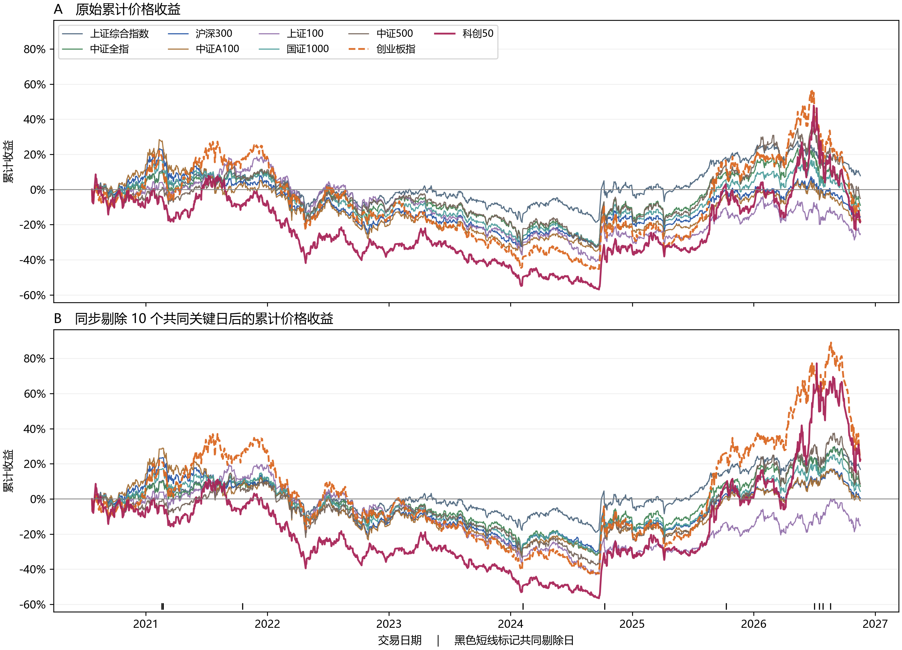
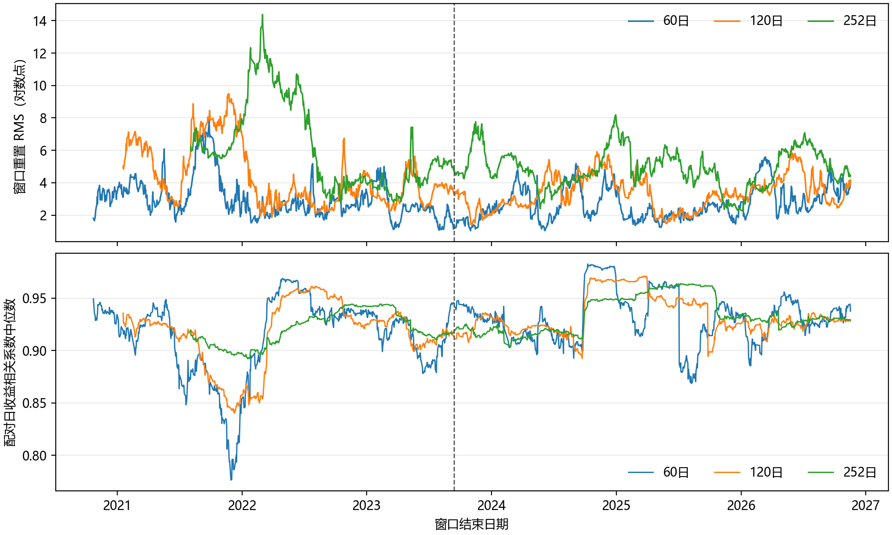
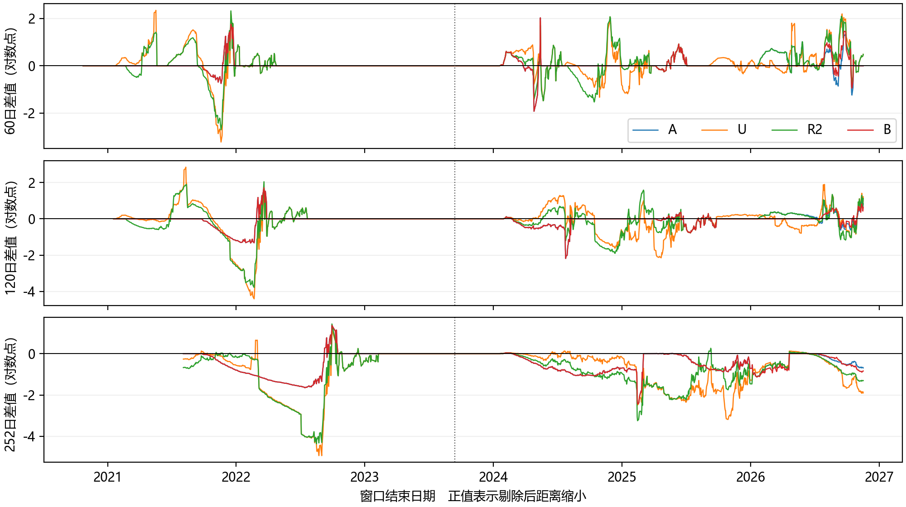

# A股宽基指数相对收益的净额脆弱性与多尺度路径差异

*Net-Return Fragility and Multiscale Path Divergence among Chinese Broad-Market Equity Indices*

## Abstract · 摘要

两条宽基指数十余年的收益排名可能因为两个交易日而翻转。这在多大程度上意味着少数日期主导了相对收益？本文用A股价格指数的日收盘数据，分别衡量历史领先的净额、关键日占全部正贡献的份额，以及重设起点后的累计路径距离。2015—2026年，沪深300相对上证综指的价格财富优势为2.07%；最有利的两日足以翻转符号，却仅占全部正贡献的0.86%。在2020—2026年的九指数36组配对中，31组在删除不超过1%的交易日后失去领先，只有2组同时满足预设的正贡献集中标准。对其中七指数使用四种共同删日规则，60日窗口的路径距离中位数均下降，252日窗口均上升。同步区块抽样未发现九指数贡献异常集中；七指数短窗的改善经等量随机删日和多重检验校正后也未达到5%显著性水平。结果表明，小净额使历史排名容易改变，同一批日期对累计路径的影响取决于评价期限。这些历史归因尚不足以识别价格形成机制或事前可预测的异常收益。

**关键词**　宽基指数；相对财富；关键交易日；路径距离；区块自助法

## 1. Introduction · 引言

设两条指数同时从一元起步。持有到期，第一条略微领先；若把两条指数在历史上最有利于第一条的两个交易日同时置平，第二条反而领先。从基准选择的角度，这意味着长期业绩排序对日期敏感。从收益归因的角度，还需知道这两天的贡献占了什么分母。相对于最后留下的一小笔净额，它可以超过百分之百；相对于领先日贡献的总和，它可能还不到百分之一。

本文研究一个问题：**历史净领先为何容易翻转，这种脆弱性在多大程度上也体现为整条相对收益路径对关键日期的依赖？** 终点仅保留所有日收益差的净和，路径则保留差异发生的顺序。若昨日的相对下跌恰好抵消了更早的领先，剔除昨日会使今天的累计差距扩大；若窗口从昨日之前不久才开始，删除同一天可能反而让两条路径更近。对基准使用者而言，期末排名、持有期内偏离和近期同步性分别涉及不同的评价决策。

研究以一组长期配对展示分母效应，再以九指数的全部无序配对判断其普遍程度，最后在七指数共同面板上固定删日名单、改变评价期限。实证贡献在于把三个可混淆的命题置于同一检验链条：小净额是否容易翻转，翻转是否伴随异常集中的同向贡献，共同关键日是否在多个期限上持续扩大指数间距离。数据支持第一个命题；后两个更强命题受到随机对照、共享指数和观察期限的约束。

## 2. Related Literature · 相关文献

Estrada（2008）通过排除市场表现最好或最差的交易日说明，长期投资终值对少数观察可能高度敏感。基准比较还多了一个分母选择。两条都经历大幅波动的指数可能积累十分接近的财富，足以翻转相对排名的日子只需抵消这笔小净差。Bessembinder（2018）研究的是美国股票之间长期财富创造的集中程度。本文考察同一配对跨日期的贡献，横截面财富集中和时间维度的净额脆弱性具有不同的观测单位。

Gatev、Goetzmann与Rouwenhorst（2006）使用历史标准化价格路径识别配对并检验后续相对价值交易。本文借用路径距离来度量基准偏离，归因日期使用完整历史。Gençay、Selçuk与Whitcher（2003）研究不同时间尺度上的系统性风险，说明估计尺度会改变金融风险的度量对象。本文通过重置每个窗口的财富起点隔离历史位置差异，既保留日度时间顺序，也使期限的金融含义直接对应持有长度。

Fei、Liu与Wen（2019）利用沪深300成分股的横截面分化度研究中国股票市场的波动预测。本文的预测对象是两条指数未来相对收益的波动，解释变量是单个配对在过去一年内的贡献集中度。同一研究中的预测失败应当对应到该目标和基准模型，不能推广为成分股分化普遍缺乏预测信息。

同一条指数会进入多个配对；研究者观察曲线后选择的切点还会影响推断。Lo与MacKinlay（1990）指出以样本自身特征构造检验所带来的数据窥探问题。本文分别采用保留同期收益向量的区块抽样和Holm（1979）的多重检验修正。平稳区块法依据Politis与Romano（1994），与固定长度区块作对照。这些方法处理特定的时间依赖和检验族，无法消除探索性研究设计带来的所有选择。对中国宽基关键日归因和多期限基准偏离的中文实证文献，现有综述仍不足以确认本研究的优先性。

## 3. Data and Methodology · 数据与方法

### 3.1 样本、数据和观察单位

表1列示三个分析层次。输入为仓库归档的东方财富和新浪价格指数日收盘点位，与交易日历和来源快照核对。七指数包含上证综指、中证全指、沪深300、中证A100（原中证100）、上证100、国证1000、中证500；九指数另含创业板指和科创50。以科创50发布实时行情后的共同收盘日作为九指数起点。上证综指按交易所综合指数口径纳入，指数名称中的市场范围不能视为七条序列历史成分资格完全相同。价格收益不含现金分红，“财富”均指归一化价格财富。每条指数在九指数池中参与8组配对，在七指数池中参与6组；两个主样本的七列与交易日期相同。配对数表征覆盖范围，推断须保留共同冲击。代码、样本异常记录与数据血缘见附录A、H。

**表1　配对范围、收盘样本与用途**

| 分析对象 | 首笔至末笔收盘 | 收盘点 / 日收益数 | 用途 |
|---|---|---:|---|
| 沪深300相对上证综指 | 2015-01-05 至 2026-11-17 | 2,884 / 2,883 | 固定方向的净额归因 |
| 九指数，36组 | 2020-07-23 至 2026-11-17 | 1,532 / 1,531 | 赢家翻转、贡献份额与预测 |
| 七指数，21组 | 2020-07-23 至 2026-11-17 | 1,532 / 1,531 | 共同关键日、固定起点和滚动距离 |
| 七指数长样本，21组 | 2015-01-05 至 2026-11-17 | 2,884 / 2,883 | 在更长历史中重新选日 |

### 3.2 终值、关键日与分母

记 $r_{i,t}=\log(P_{i,t}/P_{i,t-1})$，在给定方向上定义 $d_t=r_{i,t}-r_{j,t}$、$D=\sum_t d_t$，则期末相对财富为 $Q=\exp(D)-1$。相对财富的分母是另一条指数的期末财富。双指数案例固定沪深300在分子；九指数横截面比较把各组方向对准事后赢家，取 $z_t=\operatorname{sgn}(D)d_t$。以 $z_{(1)}\ge z_{(2)}\ge\cdots$ 表示排序，定义

$$
k^*=\min\{k:\textstyle\sum_{m=1}^{k} z_{(m)}\ge |D|\},\qquad
C_K=\frac{\sum_{m=1}^K z_{(m)}}{\sum_t \max(z_t,0)},\qquad
O=1-\frac{|D|}{\sum_t |d_t|}.
$$

$k^*$ 衡量使领先消失所需的最少天数，$C_K$ 衡量最有利的K日占全部同向贡献的份额，$O$ 衡量正负贡献相抵的程度。按原九指数协议，只有过半配对同时满足 $k^*/T\le1\%$ 和 $C_5\ge5\%$，才支持“普遍脆弱且集中”。这两个阈值是操作性约定。等量随机删日没有挑选历史赢家的极端贡献，第4节据此区分最坏边界与典型扰动。推导见附录B。

七指数考察双向分化，按每组 $|d_t|$ 选前K日，主设定 $K=10$。A取当日21组绝对差的平均数最高的K日；U取所有提名日的并集；R2取至少获两票的日期；B取票数最高的K日。全池共享同一批删日，在原交易日轴上将七列当日收益同步置零，其余逐日收益保留。U、R2的自然删日数可以超过K，故另比较统一删K日的名单。九指数的定向赢家名单和七指数的绝对差名单解决不同的归因问题，附录D给出票数和并列规则。

### 3.3 累计路径距离与检验设计

对有 $m$ 条指数的样本，令 $J=m(m-1)/2$，$g_{ij,s}=r_{i,s}-r_{j,s}$，$L_{ij,t}=\sum_{s=1}^{t}g_{ij,s}$。七指数的固定起点距离为 $[\sum_{i<j,t}L_{ij,t}^2/(JT)]^{1/2}$。对以 $t$ 结束的W日窗口，则在起始日前一交易日收盘把各指数同时归零：

$$
D_W(t)=\left\{\frac{1}{JW}\sum_{i<j}\sum_{s=t-W+1}^{t}
\left(\sum_{u=t-W+1}^{s}g_{ij,u}\right)^2\right\}^{1/2}.
$$

取 $W=60,120,252$，先在配对与窗口内日期上取均方根（RMS），再对合格窗口取时间中位数。距离乘100以对数点计。删日改善率 $I_W=1-\mathrm{median}(D_W^{(1)})/\mathrm{median}(D_W^{(0)})$，上标1和0分别为删后和原始行情，正值表示距离缩小。分段比较仅取完整位于段内的窗口；首个后段收益日为2023-09-14。该切分来自读图后的探索。逐日滚动使相邻窗口高度重叠，不能按窗口数作独立重复推断。

固定历史的随机删日，以同数量的均匀日期衡量针对性选择的额外效果。七指数的季度内独立循环移位检验名单的同期对齐；同步重抽完整的七维收益区块则保留配对之间的联动。九指数的零相对漂移基准先使各列均值相等，再同步抽取九维区块，每次重选赢家和日期。七指数的前后段距离检验从全期联合收益重抽，在稳定性原假设下重建两个半段，以双侧概率评估观察差值。各原假设、重复数、检验方向与校正族见附录E；它们不能相互替代。

## 4. Net-Return Fragility · 相对收益的净额脆弱性

### 4.1 两天能翻转什么

沪深300相对上证综指的正日对数差之和为3.74144，负日合计−3.72098，留下0.02046的净对数优势，对应2.07%的相对价格财富。2024年2月5日和2015年8月31日的差额分别为168.11和154.18个基点。同步删去最有利的一日，优势降为0.37%；删两日后变为−1.17%；若删去最不利的两日，则升至5.62%。最有利两日贡献为净优势的157.53%，同时只占全部正贡献的0.86%。这个案例给出了排名对分母的敏感度。[原始统计](../../experiments/relative_return_frame_deletion_v1/results/original_metrics.csv) · [定向删日结果](../../experiments/relative_return_frame_deletion_v1/results/deterministic_deletion.csv)

随机删日给出不同的量级。无放回均匀删去29日时，10万次抽样的相对财富中位数仍为2.07%，翻负频率13.55%；删去144日时，中位数为1.96%，翻负频率31.54%。日均相对收益为0.071个基点，10阶HAC的95%区间为[−1.243, 1.385]个基点，双侧 $p=0.9157$。指定四段的等均值检验 $p=0.0062$，而逐年检验的最小Holm校正值为0.090。阶段性差异和正的全期漂移需要不同证据。附录E、G列出全部抽样强度、区块长度与阶段划分。

### 4.2 九指数的横截面检验

在36组配对中，翻转所需天数为1至22日，中位数4日；31组在删去不超过1%交易日后失去历史领先。以总正贡献为分母，中位 $C_5$ 仅3.26%，前20日之和也只占10.21%。抵消率中位数为98.61%，同时满足两个预设门槛的仅2组。附录C逐组列示赢家、符号翻转和正贡献份额。

去除相对漂移后，历史中位 $C_5$ 在五种同步区块设定下的高尾 $p$ 值为0.679至0.750，前五日平均Jaccard重合度的高尾 $p$ 值为0.969至0.979。按配对对 $C_5$ 和 $k^*$ 分别作Holm校正，均未达到5%。进一步用过去252日的 $C_5$ 预测未来相对收益波动，在控制历史相对波动和平均绝对收益后，20日和60日的中位增量样本外 $R^2$ 分别为−12.87%和−4.44%。两个期限均无配对在校正后显著改善。历史排序易翻转的事实，没有转化为该设计下稳健的预测信息。[九指数联合检验](tables/nine_bootstrap_results.csv) · [逐对预测比较](tables/nine_prediction_results.csv)

## 5. Critical-Day Commonality and Path Effects · 共同关键日与路径

七指数每组按绝对分化提名10日，210个名额落在56个不同日期上，其中37日获至少两票，覆盖90.95%的名额；没有一天获全部21票。共享一条指数的配对之间平均Jaccard为0.246，不共享指数时为0.124。名单之间的机械联系会影响“异常重合”的判断。以季度为层，将每组名单独立循环平移，18项重合指标的高尾检验经Holm校正后均约0.0018；以5、20、60日区块同步重抽七条收益时，实际平均Jaccard（0.185）落在三种模拟的中央95%区间内。前者识别季度内的日历对齐，后者容许共享指数和同日冲击共同决定对齐程度。

表2沿用相同的七指数绝对差名单，让读者直接比较固定起点与窗口起点。固定起点下四种规则均使距离扩大。49份不同的非空共同删日名单都未取得正的全池改善，亦未在高尾检验中显著优于等数量随机删日。每组独立删10日时，21组中仅2组的固定起点距离缩小。同步区块重抽下，四种自然名单相对等量随机的中位改善差均为负，$K=10$ 的中央95%区间均跨零。遗漏一个曾经抵消前期差额的交易日，可以让其后许多日的累计差距同时增大。附录C至E给出逐配对例外、全部名单及模拟比较。

**表2　同一份关键日名单下，距离随持有期限变化的改善率（全样本，K=10）**

| 七指数规则 | 删日数 | 固定起点 | 滚动60日 | 滚动120日 | 滚动252日 |
|---|---:|---:|---:|---:|---:|
| 整体分化 A | 10 | −16.18% | +1.88% | +0.33% | −8.83% |
| 并集 U | 56 | −33.95% | +3.87% | +3.30% | −15.84% |
| 至少两票 R2 | 37 | −31.52% | +2.45% | +1.06% | −13.92% |
| 投票前列 B | 10 | −17.47% | +1.64% | −0.65% | −8.89% |

表注：各列相对于自身原始距离。固定起点统计量保留初始水平差的累积，后三列分别比较所有完整窗口的中位数。逐窗改善率的时间平均与此不同。[原始统计表](../../experiments/seven_index_convergence_v3/results/key_day_pool.csv)

图1展示另一种常见的反事实。在九指数中按历史赢家的正向贡献提名，以获票最多的10日同步置零，七条常规宽基内部21组的平均配对距离由10.45降至9.57个对数点，全部36组由14.24降至14.18。创业板指与这七条之间的平均距离却由14.03升至16.67。此处先逐对开平方再取平均；表2先合并平方差再开方，并以七指数双向绝对差选日。两项结果的方向不同，不能单独归因于加入了两条指数。

**图1　九指数共同关键日删除前后的累计价格收益。** 两面板使用同一日期和纵轴，短线标示被删除日期。来源为九指数实验的原始图，逐对口径见[路径距离表](../../experiments/nine_index_path_dependence_v1/results/path_distances.csv)。

## 6. Horizon Dependence · 期限依赖

### 6.1 继承的历史间距与新形成的偏离

上证综指相对沪深300在七指数主样本后半段平均领先19.62个对数点。两条路径原位置的距离为19.71点，但去掉这段平均间距后，差距围绕均值波动的幅度只有1.82点。七指数原始行情中，21组有15组的后段中心化距离低于前段。该指标允许整体平移。滚动重置则让窗口内新形成的领先保留下来，给出了从相同持有日起步的比较。附录F给出分解恒等式、线性净值尺度和去趋势结果。

**表3　七指数完整段内窗口的路径距离与稳定性检验**

| 窗口 | 前段中位数（对数点） | 后段中位数（对数点） | 相对变化 | 后段下降的配对 | 双侧p值 | Holm校正p值 |
|---|---:|---:|---:|---:|---:|---:|
| 60日 | 2.652 | 2.487 | −6.23% | 14/21 | 0.653 | 1.000 |
| 120日 | 3.681 | 3.479 | −5.50% | 14/21 | 0.777 | 1.000 |
| 252日 | 5.446 | 4.892 | −10.17% | 17/21 | 0.733 | 1.000 |

表注：前段765个收益日，后段766个。前三个数值列为全池统计，计数列比较每对指数各自的窗口中位数。检验量为后段减前段的距离，20日同步区块重抽10,000次，三个期限为同一检验族。5日及60日区块结论相同。[窗口明细](../../experiments/seven_index_convergence_v3/results/window_summary.csv) · [全部区块检验](tables/v3_bootstrap_tests.csv)

表3与图2显示，后半段三种期限的典型窗口均更接近。按中央日归属、允许窗口跨界时，252日降幅会变为14.32%。固定初始日起步的全池距离却由前段7.12增至后段14.63点。后段相关系数的配对中位数从0.921升至0.932，年化绝对相对漂移从2.77%降至1.42%，全池日收益差RMS从50.76升至55.35个基点。整段去线性趋势的形状距离下降20.65%；上述四项辅助指标在三个区块设定中，经各自检验族校正后均未达5%。历史间距、近期漂移和日差幅度可以同时给出不同方向的变化。

**图2　按窗口结束日排列的距离与相关性。** 上图为从窗口起点重新累计的全池距离，下图为窗内日收益相关系数的配对中位数。竖线为后半段起点。图中保留跨界窗口，表3的分段检验剔除了这些窗口。

### 6.2 对同一批关键日改变评价期限

回到表2。并集法删除相同的56日后，60日尺度有19/21组的距离缩小，252日尺度仅1/21组缩小。将四种方法统一为10个日期，A的60日改善最大（1.88%）；U与R2截取后使用完全相同的日期，改善率均为1.58%。按两个半段分别匹配删日数，针对每种配置随机删日10,000次。主设定在全期比较中最小单侧 $p$ 值来自A的60日结果（0.0164），在五份不同名单与三个期限的15项检验中校正后为0.246。各方法的短窗改善尚未表现出显著超过等量随机删除的能力。

图3按日期显示平均结果背后的方向变化。若持有期起点落在某个早期偏移之后，那个偏移不会进入该窗口的距离。在 $K=20,50$ 的敏感性比较中，四种原始名单仍均缩小60日距离并扩大252日距离。若比较**删日之后的后半段与前半段**，60和120日尺度的四种名单均显示后半段更近；252日尺度用A、B仍分别下降2.61%、2.43%，用U、R2则分别上升8.72%、1.98%。完整结果见附录G。归因所用的历史日期、观察期限和比较基准缺一不可。

**图3　四种关键日规则对逐窗距离的影响。** 正值表示关键日置零后距离缩小，单位为对数点。横轴为窗口结束日。窗口中不含名单日期时，窗口之前累积的删日效果在重置时消失。

## 7. Discussion and Limitations · 讨论与局限

从基准评价的角度，终点翻转适合揭示排名对样本的依赖，但其经济量级须由总正贡献和路径偏离共同约束。两个指数若长期相互赶超，许多交易日能够显著改变它们之间微小的净差。某一天既可令当期偏离加大，也可消化既有间距。上述解释由累加规则直接推出，行业配置、风格暴露、指数调整和资金流均可能改变日收益差的实际来源。本文没有用同期持仓或外生冲击区分这些机制。科技相关指数较远的路径同样容许多种解释。

样本来自单一市场的一段历史。九指数向七指数的收缩、跨配对共享指数和重叠窗口都限制有效独立信息；调整检验族只能处理明确列入的比较。V3的切点、平行形状和若干组别是在观察历史图形后提出，区块基准条件于给定切点，未模拟事后择点过程。原假设模拟保留的依赖取决于区块长度。不显著结果既可能反映效果有限，也可能反映较低检验功效。正文保留了九指数两个预设预测期的负结果，完整预测与检验族见附录C、E。价格指数不计分红，跨指数的现金分红差异足以影响小额排名；本文没有总收益口径或外部独立样本的验证。

## 8. Conclusion · 结论

A股宽基间长期领先容易翻转，首先因为用于决定输赢的是大量正负日差相抵后的净额。以全部正贡献衡量，样本中大多数配对未达到事先约定的集中门槛。关键日确有重合，但保留指数共同波动的模拟能够产生类似重合；剔除这些日期，对短窗和一年窗路径距离的历史影响甚至方向相反。因而，解读一份基准业绩排名至少须说明三个条件：用哪个分母衡量贡献、用什么信息选择日期、从哪个起点累计收益。现有证据支持这一历史评价方式，尚不足以证明持续漂移、结构性趋同或可预测的关键日溢价。

## References · 参考文献

Bessembinder, H. (2018). Do stocks outperform Treasury bills? *Journal of Financial Economics*, 129(3), 440–457. [DOI](https://doi.org/10.1016/j.jfineco.2018.06.004)

Estrada, J. (2008). Black swans and market timing: How not to generate alpha. *The Journal of Investing*, 17(3), 20–34. [作者存档的期刊原文](https://blog.iese.edu/jestrada/files/2012/06/BlackSwans.pdf)

Fei, T., Liu, X., & Wen, C. (2019). Cross-sectional return dispersion and volatility prediction. *Pacific-Basin Finance Journal*, 58, 101218. [DOI](https://doi.org/10.1016/j.pacfin.2019.101218)

Gatev, E., Goetzmann, W. N., & Rouwenhorst, K. G. (2006). Pairs trading: Performance of a relative-value arbitrage rule. *The Review of Financial Studies*, 19(3), 797–827. [DOI](https://doi.org/10.1093/rfs/hhj020)

Gençay, R., Selçuk, F., & Whitcher, B. (2003). Systematic risk and timescales. *Quantitative Finance*, 3(2), 108–116. [DOI](https://doi.org/10.1088/1469-7688/3/2/305)

Holm, S. (1979). A simple sequentially rejective multiple test procedure. *Scandinavian Journal of Statistics*, 6(2), 65–70. [期刊存档](https://www.jstor.org/stable/4615733)

Lo, A. W., & MacKinlay, A. C. (1990). Data-snooping biases in tests of financial asset pricing models. *The Review of Financial Studies*, 3(3), 431–467. [DOI](https://doi.org/10.1093/rfs/3.3.431)

Politis, D. N., & Romano, J. P. (1994). The stationary bootstrap. *Journal of the American Statistical Association*, 89(428), 1303–1313. [DOI](https://doi.org/10.1080/01621459.1994.10476870)

**研究资料与披露**　附录A至H提供来源、补充统计与复现入口。项目使用生成式AI辅助研究设计讨论、代码、分析和写作，本次整合沿用归档结果。辅助范围及仍需作者核实的事项见编辑审计。[在线附录](online_appendix.md) · [编辑审计](editorial_audit.md)
