# 摘要

宽基内部的股票可以在同一天大幅涨跌，两条高度相关的宽基也可以在多年后形成终值差异。投资者能否从这些差异获得可持续收益，取决于实际持仓、建仓日期、资金占用和成本。本文将成分股贡献、指数配置、配对账户与交易日贡献置于同一研究框架，并分别标明每个结论的样本范围。

在有完整权重和价格的2026年11月2日，中证A100的成分股正负贡献绝对值合计196.98个基点，净上涨66.93个基点。对四条宽基的长期回归显示，市场与风格暴露能够解释多数日收益波动。在多头配置实验中，滚动最小方差组合相对月度等权降低了样本外波动，夏普改善的区间包含零。

以2015年1月5日至2026年11月17日的2,884个共同收盘点回测，多上证综指、空沪深300并固定两腿数量，2,632个一年期窗口的平均扣费收益为−1.89%。在1,245个固定参数候选中，全历史冠军累计净收益为80.02%；按过去信息每半年重选收益规则，2018年起累计为−44.42%，同期开平仓的固定等额基准为−8.61%。冠军的共同市场方向贡献大于两指数的相对贡献。沪深300全期相对上证综指的价格财富优势为2.07%，删去事后最有利的两个交易日即转负。现有证据支持指数之间存在可观测的风险暴露差异，对事前持续获得正净收益的支持有限。

七指数V2实验中，21组配对各选10个关键日，去重后有56个日期，37日获至少两票，严格交集为空。四种共同删日方案均扩大全池累计路径距离。各配对独立删日时，21组中有2组缩小、19组扩大。七指数共同路径见图45，逐组结果见表52和图51至图53。进一步扣除各段平均差距后，原始行情有15组在后半段比前半段更平行，各自删10日后仍有12组。若在同一后半段比较删日前后，60日局部走势有19组更贴近，整个后半段有2组更贴近（表55至表56）。

**关键词**　A股宽基指数；成分股收益抵消；相对价值；动态对冲；事后选择偏差；关键交易日

**净值曲线阅读指引**　图14和图15比较基础配对策略的全历史与独立测试账户；图17和图18比较固定参数冠军与半年滚动选参；图42叠加全历史收益榜前三个不同参数的账户净值，表44列出复现其持仓所需的参数。逐日净值保存在研究目录的 `top_three_nav.csv`，列名为表44中的完整参数ID；`replay_top_three.py` 从归档榜单读取这些参数，重新核算净值并生成可编辑矢量图。

# 研究问题与证据口径

同一交易日内，持有多个行业可以分散个股风险。跨交易日观察，投资者还承担市场共同涨跌、资产相对强弱反转以及持仓成本。本研究依次考察三个可检验的判断：内部抵消是否足以解释指数表现；历史领先方向能否在冻结选择后继续获利；少数大幅分化的交易日能否改变长期领先者。第一个判断需要成分级历史权重，后两个可用成对指数日收益检验。

表 1　各项研究的计量对象与比较分母

| 观察层级 | 对象与分母 | 可回答的问题 |
|---|---|---|
| 指数内部 | 单日个股贡献之和，以绝对贡献总量为分母 | 一天内多少正负贡献相互抵消 |
| 长仓配置 | 市场及风格回归、按自有本金核算的长仓净值 | 加入更多宽基是否改善组合风险 |
| 配对账户 | 毛敞口、资金、费用与调仓明确的两腿账户 | 实际支付成本后，历史选向能否延续 |
| 规则搜索 | 全历史固定参数榜单及18个半年时序窗口 | 事后冠军与当时可执行的选择相差多少 |
| 交易日贡献 | 两个价格指数买入持有财富的比值减一 | 长期领先依赖哪些日期，优势有多稳健 |

以1表示初始财富。1个基点（bp）等于0.01个百分点。回撤在账户实验中按距高点的负收益表示，多维排名表则按损失幅度列正值。各章表内的“测试”均给出自己的起止日期；不同验证设计的累计收益须先对齐资金、时间和成本。

## 文献与研究假说

Gatev等[1]研究形成期配对与交易期价差规则，Do与Faff[2]考察简单配对策略的时期差异。Avellaneda与Lee[3]从残差构造统计套利信号，Zhang与Urquhart[4]研究内地与香港市场的配对。基础配对实验持续持有给定方向，没有设置价差偏离或回归的进出场阈值。这些研究提供形成期与评价期的设计依据，其收益率与本文的持续持仓账户采用不同的交易规则。Ederington[5]以方差降低评价对冲，为比较OLS与等名义策略提供理论参照。Lo与MacKinlay[6]、White[7]和Hansen[8]解释了反复检索历史规则后评价赢家的问题。本文采用时间切分及三项方向检验的多重校正，没有实施White或Hansen的策略族检验。

对冲比率的协方差估计对应固定多头单位下的最小残差方差。本文再按总名义敞口归一，长期样本外波动仍需用实际权重检验；对冲后表现良好也不构成价差均值回归的证据。

Liu、Stambaugh与Yuan[9]为中国股票构造规模和价值因子。本文采用相同日期比较市场模型与本地风格模型，以检验共同市场暴露以外的解释力。配对实验的零假设为冻结方向与反向的平均日净收益差等于零；交易日实验检验沪深300减上证综指的日相对对数收益均值等于零。两项检验的因变量、样本和费用处理各不相同。

# 宽基指数的市场暴露与内部抵消

## 研究问题与数据

研究对象是国证1000（399311）、中证A100（000903）、上证100（000132）和沪深300（000300），采用上证综指（000001）与中证全指（000985）双基准。我们分别检验指数的市场与风格暴露、指数当日内部发生的收益抵消，以及加入现有持仓时能否改善配置。指数编制规则、历史阶段和重叠持仓都可能影响比较。

六条价格指数共同覆盖2,884个收盘日，首日用作基期，共2,883条有效日收益。保留2015—2025年作为敏感性样本。个股归因使用2026-10-30官方权重文件自带的证券名单，搭配下一交易日不复权行情。个股快照和明汯因子归档于补充输入，数据库及原始文件以只读方式核验。上证综指近期成分名单文件有一项校验和差异，已复核日期、成分代码、名称和交易所与数据库一致。详见[数据盘点](../data_inventory.md)和[覆盖矩阵](../../outputs/tables/data_coverage.csv)。[明汯因子数据](https://www.mingshiim.com/database) · [Money Tree 行情接口](https://money-tree.eyunzhu.com/)

## 双基准市场模型

以收盘价简单收益估计 $r_i=\alpha+\beta r_m+\varepsilon$，全样本使用 Newey–West HAC，最大滞后5个交易日。主检验对8个截距和8个 Beta 等于1的检验分别作 Holm 校正。使用明汯日无风险利率再估计2,816日共同区间的超额收益模型，并与同区间的原始收益模型配对。两种基准均为价格指数。

表 2　两种市场基准下的回归结果

| 指数 | 对000001 Beta | 对000001 R² | 对000985 Beta | 对000985 R² |
|---|---:|---:|---:|---:|
| 国证1000 | 1.088 | 0.949 | 0.955 | 0.973 |
| 中证A100 | 1.004 | 0.858 | 0.816 | 0.755 |
| 上证100 | 1.125 | 0.793 | 1.041 | 0.905 |
| 沪深300 | 1.043 | 0.936 | 0.876 | 0.877 |

在5%水平，中证A100对000001的 Beta 无法与1区分，其余7项均显著不同。全样本截距校正后均未显著。国证1000对000001的分段 Beta 为1.049、1.125、1.172，分别对应2015—2019、2020—2022、2023年至期末。同期上涨和下跌日分开估计时，中证A100的 Beta 约为1.063和0.942。滚动和分段估计展示暴露变化，重叠持仓与共同因子均可产生较高相关性。

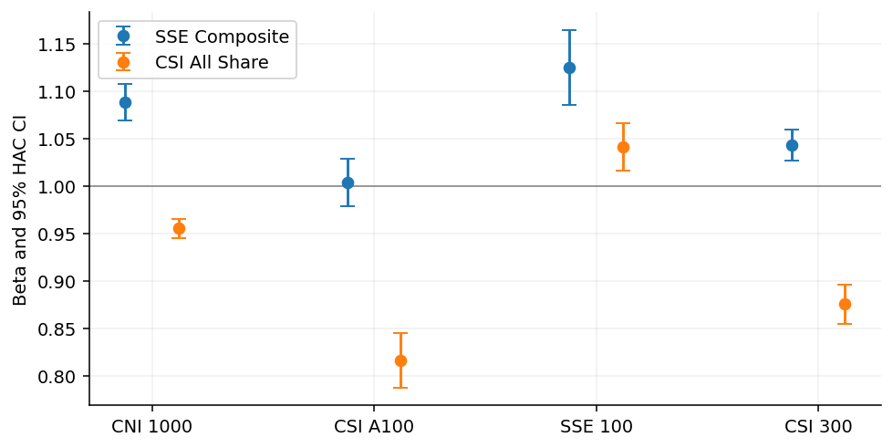

图 1　两个基准的Beta及HAC置信区间

[回归结果](../../outputs/tables/e1_regression.csv) · [60与252日滚动数据](../../outputs/tables/e1_rolling_beta.csv) · [000001滚动图](../../outputs/figures/e1_rolling_000001.png) · [000985滚动图](../../outputs/figures/e1_rolling_000985.png) · [收益散点图](../../outputs/figures/e1_scatter.png)

## 历史行情状态下的表现

用上证综指截至前一交易日的120日收益和均线位置标记状态。收益高于10%且在均线上方为主升，低于−10%且在均线下方为下跌，收益在 ±5% 内为震荡，其余为过渡。样本从完成预热后开始，2,763天中主升445天、震荡1,099天、下跌391天、过渡828天。

四条指数在历史下跌标签中的年化条件波动均最高，区间约24.73%—33.47%。在主规格中，四条指数的震荡组平均次日收益均为正，主升组均为负。这个排序是按历史状态观察下一日收益所得，四条指数各状态与过渡组的均值差在 Holm 校正后均未显著。条件累计收益和回撤把同一标签日按日期拼接，另有连续阶段结果。103段连续震荡的最长一段为100个交易日。

稳健性比较了60、252日窗口和两组更窄／更宽阈值，保留所有输出。Markov 三状态以每年开始前可得的最多756日估计，使用日度一步预测概率，产生2,152个样本外标签。按最高预测概率硬分类时，2,145日归入均值居中的状态，7日归入均值最高的状态，均值最低的状态没有被选中。这个规格的预测标签高度集中，无法为规则状态之间的比较提供有力的交叉验证。

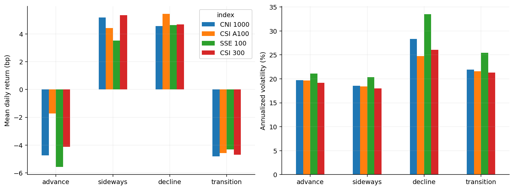

图 2　四条指数的条件收益与波动

[状态日历](../../outputs/tables/e2_states.csv) · [累计、Beta、捕获率与回撤](../../outputs/tables/e2_conditional.csv) · [阶段表](../../outputs/tables/e2_episodes.csv) · [均值差检验](../../outputs/tables/e2_mean_differences.csv) · [Markov拟合记录](../../outputs/tables/e2_markov_fit.csv)

## 风格暴露与截距

在同一2,816日比较明汯 CH 市场因子单因子、CH-3 和 CH-4。CH-3加入规模 SMB、价值 VMG。CH-4另含异常换手因子 PMO，并使用改造后的 SMB。PMO反映论文定义的异常换手特征。所有模型用相同日无风险利率和 HAC 推断，因变量是指数价格收益或两指数价格收益差。[Liu、Stambaugh与Yuan的模型原文](https://doi.org/10.1016/J.JFINECO.2019.03.008) · [CH-3和CH-4数据](https://www.mingshiim.com/database)

表 3　市场模型与风格模型的解释度及风格系数

| 指数 | 市场模型调整 R² | CH-3调整 R² | CH-4规模暴露 | CH-4价值暴露 |
|---|---:|---:|---:|---:|
| 国证1000 | 0.982 | 0.988 | −0.144 | −0.050 |
| 中证A100 | 0.808 | 0.933 | −0.468 | 0.169 |
| 上证100 | 0.879 | 0.900 | 0.202 | −0.132 |
| 沪深300 | 0.920 | 0.975 | −0.325 | 0.090 |

上述8项 CH-4 风格系数在按模型及因子校正后均显著。国证1000对 SMB 为负，负向幅度小于中证A100和沪深300。其相对表现能否归于规模溢价还需全收益和进一步归因。上证100呈正规模和负价值暴露，质量暴露尚未测量。中证A100减沪深300的调整 R² 从0.076升至 CH-3 的0.417，其 CH-4 价差截距不显著，行业归因有待补数。

15项截距校正后，沪深300 CH-4 的负截距达到5%水平，线性年化 −3.48%，调整后 p=0.021。指数价格收益漏计现金分红，而因子的资产收益口径可能不同。该结果有赖于模型及收益定义，无法用于判定全收益异常。

[模型对照](../../outputs/tables/e3_models.csv) · [全部因子系数](../../outputs/tables/e3_coefficients.csv) · [调整后R²图](../../outputs/figures/e3_factor_fit.png)

## 2026年11月2日收益抵消

按2026-10-30收盘权重乘以两日不复权收盘收益，贡献 $c_i=w_i r_i$。计算正贡献 $P$、负贡献绝对值 $L$、总活动 $G=P+L$、重建净收益 $\widehat R=P-L$ 与抵消 $TC=G-|\widehat R|=2\min(P,L)$。当 $G>0$ 时 $CO=TC/G$。保持权重原值，并用编制方两日官方点位计算复制误差。另用行情参考前收做敏感性计算，注明其可能包含除权调整。

表 4　成分股权重快照的贡献与抵消

| 指数 | 有效／文件只数 | 正贡献 bp | 负贡献绝对值 bp | 总活动 bp | 绝对抵消 bp | 抵消率 |
|---|---:|---:|---:|---:|---:|---:|
| 国证1000 | 996／998 | 185.42 | 56.91 | 242.33 | 113.82 | 46.97% |
| 中证A100 | 100／100 | 131.96 | 65.03 | 196.98 | 130.05 | 66.02% |
| 上证100 | 100／100 | 333.29 | 47.36 | 380.57 | 94.72 | 24.89% |
| 沪深300 | 300／300 | 147.09 | 68.24 | 215.33 | 136.49 | 63.39% |

中证A100、上证100与沪深300的绝对复制误差均小于0.01 bp。国证1000两只缺失个股合计原权重0.190个百分点，子样本复制误差为+0.209 bp。比较参考前收与前日实际收盘时，国证1000有两只出现价格基准变化，指数除数、调整股本和权重舍入的影响尚未逐事件识别。上证综指与中证全指也提供部分匹配的核验结果。

沪深300另外用历史观察名单和次日行情测量等权收益分化。23期合计6,783条可匹配收益，单期281至300只，个别缺失报价的原因需要单独核对。指标表同时列出横截面标准差、绝对偏差、相对指数的 CSSD／CSAD 及涨跌比例。

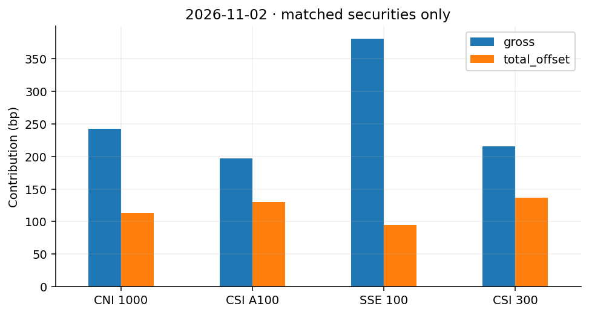

图 3　当日总贡献规模与绝对抵消

[抵消与复制核验](../../outputs/tables/e4_snapshot_metrics.csv) · [证券级贡献](../../outputs/tables/e4_snapshot_contributions.csv) · [沪深300辅助指标](../../outputs/tables/e4_hs300_stage_dispersion.csv)

## 行业间与行业内抵消

先在行业内加总 $C_j=\sum_{i\in j}c_i$。行业内抵消为 $G-\sum_j|C_j|$，行业间抵消为 $\sum_j|C_j|-|\widehat R|$。对权重表中拥有同一期行业分类的国证1000匹配子样本，行业内107.21 bp、行业间6.61 bp，恒等式误差为0。11个行业的权重 HHI 为0.140。该日行业内比例94.19%，参考前收规格约94.19%。当前仅有一个可分解横截面，行业数量和集中度控制需等到更多指数和日期可用。

[整体分解](../../outputs/tables/e5_decomposition.csv) · [行业净贡献](../../outputs/tables/e5_industry_contributions.csv) · [行业贡献图](../../outputs/figures/e5_industry.png)

## 连续震荡期的行业轮动

**待补数据。** 待检验假说是，连续震荡中可能同时存在当天的行业正负贡献抵消和多日行业方向往返。接口以连续至少5日的同标签为阶段，追踪日度行业贡献领先者更换率、行业收益排名的相邻日秩相关，以及阶段实现波动。以期初财富 $V_{t-1}$ 乘每日贡献链接为 $\sum_t V_{t-1}C_{j,t}$，行业链接贡献之和等于指数重建复合收益。日度横截面抵消与同一行业跨日绝对贡献的往返分别计量。

入口 [run_e6_rotation.py](../../scripts/run_e6_rotation.py) 接收指数代码、交易日期、行业、当日行业贡献、行业期初权重与行业内个股绝对贡献合计，要求覆盖连续交易日及完整行业集合。

## 抵消数据的增量预测

**待补数据。** 假说是 M2 可以降低未来风险的样本外预测误差。M0 接收截至当日的市场20日收益、指数20日波动、对数成交量。M1 增加 CSSD、CSAD。M2 再加入抵消率、贡献总规模和行业间抵消比重。目标为未来5日及20日实现波动和最大回撤，预测从日终 (t) 开始。至少504个已到期训练观测，扩展窗口每20个观测重新估计，训练标签的最后一天须不晚于预测时点。

入口 [run_e7_prediction.py](../../scripts/run_e7_prediction.py) 在相同样本检验 RMSE、MAE、相对历史均值的样本外 R²，以及 M2 相对 M0 和 M1 的损失改善。误差有重叠时按预测期限使用 HAC，p值按报告的检验族 Holm 校正。极端风险识别可在获得足够事件后扩展，本轮无可报告预测统计。

## 多宽基组合的增量价值

比较000001、四条单指数和000985，并模拟四宽基初始等权买入持有、每月恢复等权及事先设定权重下限10%、上限55%的滚动最小方差组合。动态组合用252日历史协方差，执行价格以信号生成后的下一收盘点位代理。成本情景为每单位实际买卖成交额0、5、10或20 bp，换手包含建仓、以交易后权重和漂移权重的绝对差合计度量。

表 5　长仓配置的共同样本外绩效

| 2016-02-01起共同样本外，2,620日 | 年化收益 | 年化波动 | 夏普（零利率口径） | 最大回撤 |
|---|---:|---:|---:|---:|
| 上证综指代理 | 2.63% | 16.51% | 0.240 | −30.77% |
| 沪深300代理 | 2.93% | 18.45% | 0.249 | −45.60% |
| 月度等权，10 bp | 2.26% | 18.68% | 0.213 | −44.72% |
| 动态最小方差，10 bp | 2.95% | 18.33% | 0.251 | −42.84% |

配对20日区块 Bootstrap 中，动态组合相对等权的年化波动差为−0.35个百分点，95%区间 [−0.51, −0.18] 个百分点，夏普差区间 [−0.041, 0.117] 覆盖0。动态组合相对上证综指的年化波动高1.83个百分点。动态组合的年化成交金额约为资产的105.9%，月度等权约23.6%。对应 CH-3 无风险利率共同区间的夏普和索提诺另列于表中。

全样本 HAC Wald 张成检验联合约束候选资产截距为0、基准系数和为1。加入四条目标指数时，单用000001、单用000985、同时用两条基准均拒绝张成，Holm 校正后 p 分别为 $2.32\times10^{-15}$、$3.32\times10^{-34}$、$3.21\times10^{-7}$。这是无约束的统计检验，含指数内部持股交叠和价格收益限制。它无法保证现实可买的长仓基金改善风险收益。

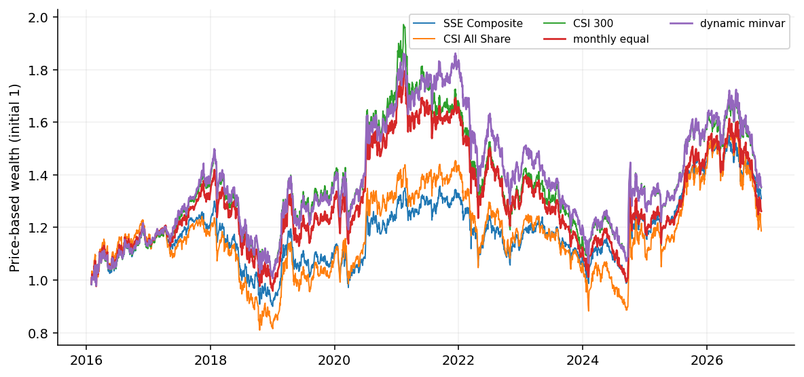

图 4　共同样本外的价格指数代理净值

[完整绩效](../../outputs/tables/e8_performance.csv) · [配对区间](../../outputs/tables/e8_bootstrap_differences.csv) · [张成检验](../../outputs/tables/e8_spanning.csv) · [日度权重及成本](../../outputs/tables/e8_daily_portfolios.csv)

# 从早期配对复现到资金口径统一

早期假设给每1元净资产配置1元上证多头和约0.820元沪深300空头。2021年1月4日至2026年11月17日，训练段毛收益20.34%，训练结束后的453个交易日毛收益5.56%，全期毛收益27.03%。将总名义敞口降至1倍，同段全期毛收益降至14.26%。等金额做多1元、做空1元的全期毛收益为31.00%，对应两倍总敞口。三项数字描述不同资金使用方式。后续四项基础实验以1倍总敞口起步，计入成交、借券与阶段开平仓费用。

早期六指数探索的1,560组配置使用另一套时间切分，测试从2024年7月2日开始。按验证期冻结的沪深300多头／上证100空头，采用60日波动率比，测试累计毛收益3.06%，成本情景收益0.49%。事后测试期毛收益第一名为多上证综指、空上证100，EWMA衰减系数0.94、每月更新，测试毛收益10.78%，成本后8.44%；训练期成本后为−14.52%，整段成本后仅0.03%。逐年重新选对后的累计毛收益为−1.94%。下图保留训练期，显示“测试冠军”在此前经历的亏损。

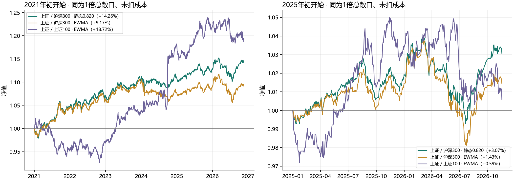

图 5　早期上证配对的相同日期与敞口对照

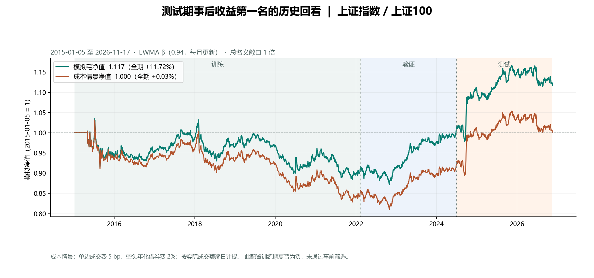

图 6　早期六指数搜索的测试冠军，包括训练期在内的完整路径

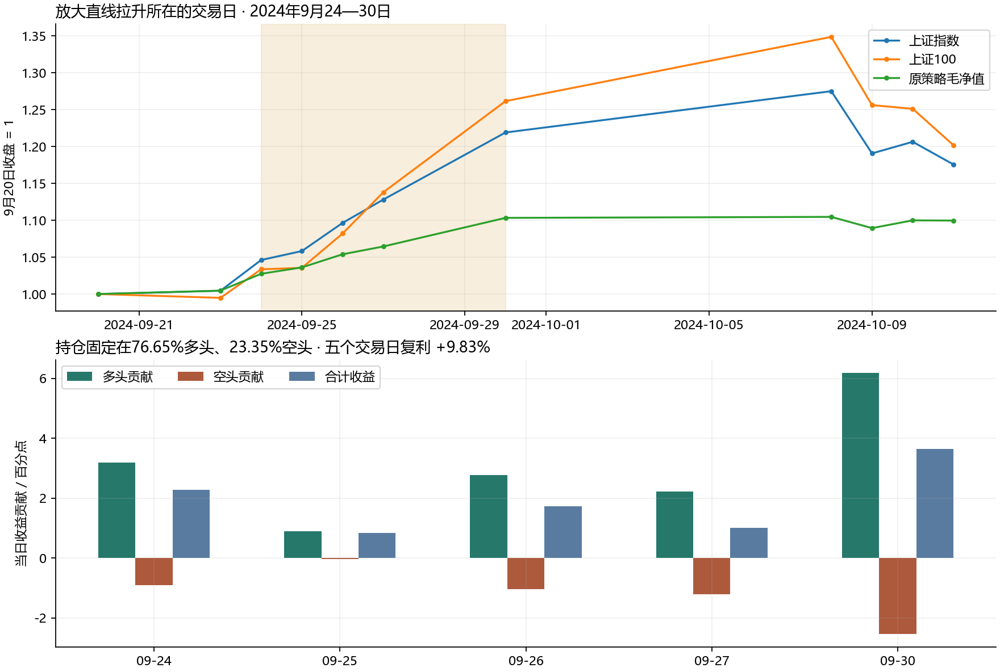

图 7　2024年9月五个交易日的净值跃升与持仓贡献

从2024年9月24日至30日的五个收益日，早期测试冠军累计毛收益9.825%。该月持仓约为76.645%多头与23.355%空头。即便空腿指数在这五天涨得更多，净多头仍可在市场普涨时获利。可交易性复核尚缺上证100空腿的历史券源和报价。[早期账户核算](../pair_experiment_explanation.md) · [逐日事件审计](../pair_jump_audit.md) · [工具与交易成本](../pair_trading_implementation.md)

# 四项配对实验与持仓方法

## 数据来源与样本说明

数据来自项目 SQLite 库 index_daily 表，提供方字段为 eastmoney，价格取 close。四条序列均与仓库留存的原始行情CSV逐日一致；日期与 exchange_calendars 4.13.2 的上海证券交易所交易日历在全区间完全相符。共同区间2015-01-05至2026-11-17，共2,884个收盘点、2,883个相邻收盘收益。没有重复日期、缺值或非正收盘价，每日重新计算的收益与库内 close_return 一致。原始文件与数据库为同一来源，本核验检验了数据处理链及交易日覆盖。

表 6　研究对象与用途

| 代码 | 指数 | 使用范围 |
| --- | --- | --- |
| 000001 | 上证综合指数 | 实验一至三 |
| 000300 | 沪深300 | 全部四项，另作Beta基准 |
| 000903 | 中证100（现称中证A100） | 实验二、三 |
| 000132 | 上证100 | 仅实验四的跨指数空头 |

训练期涵盖2015—2017年（731个收益日），验证期涵盖2018—2024年（1,699日），最终测试期为2025-01-02至2026-11-17（453日）。仅实验一遍历全部可行起点。实验二至四每个列报阶段均从净资产1、空仓开始，阶段末平仓。各期间的开平仓均在本阶段账户计费，初次成交为首个收益日之前一个交易日收盘。

## 数学模型与账户核算方法

设 $P_{i,t}$ 为价格指数收盘点位，$r_{i,t}=P_{i,t}/P_{i,t-1}-1$。以 $h_t$ 表示空方相对于多方的目标金额比，$w_t$、$v_t$ 是按一倍总名义敞口归一的带符号权重。对恢复目标仓位的策略，有

$$w_t=\frac{1}{1+h_t},\quad v_t=-\frac{h_t}{1+h_t},\quad g_t=w_t r_{L,t}+v_t r_{S,t}=\frac{r_{L,t}-h_t r_{S,t}}{1+h_t}.$$

设 $A_t,B_t$ 为成交后的带符号头寸，$Q_t$ 是调仓绝对成交额之和，末日还包括平仓成交额。$N^-_t$ 为结算后实际承担的空头名义金额，$\Delta d_t$ 为跨越的自然日数。每单位成交收5个基点，借券年率2%，现金收益率为零。日末净资产和阶段复利收益为

$$V_t=V_{t-1}+A_t r_{L,t}+B_t r_{S,t}-0.0005Q_t-0.02N^-_t\frac{\Delta d_t}{365},\qquad u_t=\frac{V_t}{V_{t-1}}-1.$$

$$R=\prod_t(1+u_t)-1,\quad R_{\mathrm{ann}}=(1+R)^{252/n}-1,\quad \sigma_{\mathrm{ann}}=\sqrt{252}\,s(u),\quad S=\sqrt{252}\,\bar{u}/s(u).$$

$$\mathrm{MDD}=\min_t\left(V_t/\max_{j\le t}V_j-1\right),\qquad \beta=\mathrm{Cov}(g,r_{300})/\mathrm{Var}(r_{300}).$$

年化收益、波动、Sharpe与最大回撤按成本后账户计算，峰值序列含期初1；收益恒为零的Sharpe未定义。Beta用毛收益度量指数敞口。累计换手为每日成交额除以当天期初净资产后的总和（双腿绝对额相加，包括进出），年化换手为日均值乘252。费用以每单位初始本金计。成交发生在前收盘、借券费覆盖该收盘至本收盘；台账按收益日记录整段现金流，首笔交易费并入首日，末日另计平仓费。

实验一首次严格按初始本金各建0.5元，交易费从现金扣除，因此成交后净资产为0.9995；对照账户从下一次调仓起按扣费后的可配置净资产恢复目标。实验二至四沿用原模型，全程按扣除当次交易费后的资本配置目标权重。交易量按市值漂移后的原仓位与新仓位之差计算。

## 实验一　建仓时点敏感性

在每个具有252个完整后续收益日的收盘日 $s$ 建仓。主账户持有 $0.5/P_{L,s}$ 单位多头和 $0.5/P_{S,s}$ 单位空头，数量保持至平仓。其未扣费累计收益可由两端价格独立计算：

$$R^{\mathrm{gross}}_{s,t}=\frac{1}{2}\left(P_{L,t}/P_{L,s}-P_{S,t}/P_{S,s}\right).$$

固定数量账户在两次成交之间仍按日盯市，空头计费基数随指数点位变化。对照账户逐日恢复目标权重，按实际调仓额付费。两者各有2,632个窗口，首个起点2015-01-05。

表 7　所有252日窗口的收益分布（每个建仓日等权）

| 规则／口径 | 均值 | 中位数 | 标准差 | 25%分位 | 75%分位 | 最小 | 最大 |
| --- | --- | --- | --- | --- | --- | --- | --- |
| 固定数量/毛 | −0.74% | −0.44% | 3.63% | −3.45% | 2.14% | −11.13% | 8.24% |
| 固定数量/净 | −1.89% | −1.56% | 3.70% | −4.66% | 0.99% | −12.49% | 7.24% |
| 每日恢复/毛 | −0.59% | −0.63% | 3.48% | −3.43% | 1.94% | −7.94% | 9.55% |
| 每日恢复/净 | −1.83% | −1.86% | 3.44% | −4.62% | 0.69% | −9.08% | 8.18% |

表 8　盈利概率的历史频数、持有期风险与成本

| 规则 | 毛收益>0 | 毛收益<0 | 净收益>0 | 净收益<0 | 路径波动¹ | 交易费² | 借券费² |
| --- | --- | --- | --- | --- | --- | --- | --- |
| 固定数量 | 44.30% | 55.70% | 32.29% | 67.71% | 2.82% | 0.10% | 1.05% |
| 每日恢复 | 42.29% | 57.71% | 29.75% | 70.25% | 2.63% | 0.21% | 1.03% |

¹ 各窗口日净收益的年化波动，再对建仓日取平均。上一表的标准差衡量各窗口终值的分散程度。² 平均累计费用，占该笔初始本金。

固定数量账户最差窗口为2020-02-03至2021-02-08（−12.49%），最佳为2021-02-10至2022-03-02（7.24%）。每日恢复权重提高了平均净收益，但盈利日期占比反而较低。这两个指标分别对损益幅度和正负号敏感。

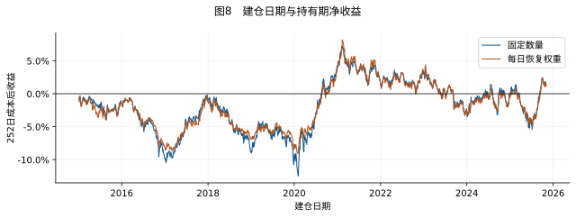

图 8　每个可行建仓日起持有252日的成本后收益

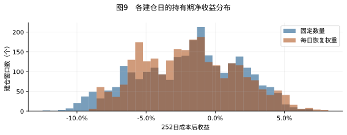

图 9　固定数量与每日恢复权重的持有期净收益分布

相邻起点共享251个收益日。为展示均值对样本路径的敏感性，沿建仓日序列按连续起点区块有放回抽样，区块越过样本尾部时循环到序列开头，两规则使用相同抽样索引，每次截取2,632个起点，重复5,000次，随机种子20261118。下表为百分位95%区间；区块长度改变后，固定数量规则的上界跨越零。有限历史中仅有少量长区块，均值应首先作描述性理解。

表 9　净收益均值的循环移动区块Bootstrap区间

| 规则 | 区块长度（起点数） | 95%下界 | 95%上界 |
| --- | --- | --- | --- |
| 固定数量 | 252 | −3.7649% | −0.0004% |
| 每日恢复 | 252 | −3.5565% | 0.0011% |
| 固定数量 | 504 | −4.0613% | 0.4629% |
| 每日恢复 | 504 | −3.8978% | 0.4733% |

## 实验二　多空方向选择偏差

每对指数双向模拟。为在2024-12-31收盘执行，先以验证期起点至2024-12-30收盘的可获行情比较两方向，从空仓开始并按该日假设退出计费。此后锁定方向。完整验证期表另计至12月31日。测试期六个账户在12月31日收盘从空仓独立建立，不继承任何持仓或费用；六条净值和全部检验均来自这六个账户。

表 10　六个方向各阶段独立账户的累计净收益

| 多头／空头 | 训练期 | 验证期 | 测试期 |
| --- | --- | --- | --- |
| 上证综指／沪深300 | −8.95% | −7.37% | 0.25% |
| 上证综指／中证100 | −10.62% | −4.62% | −0.54% |
| 沪深300／上证综指 | 2.29% | −8.18% | −4.58% |
| 沪深300／中证100 | −5.09% | −4.72% | −2.87% |
| 中证100／上证综指 | 3.70% | −11.24% | −3.95% |
| 中证100／沪深300 | −1.99% | −10.55% | −1.44% |

表 11　冻结方向与反向的比较（累计净收益）

| 所选多头／空头 | 选向期所选 | 选向期反向 | 测试所选 | 测试反向 | 差额¹ |
| --- | --- | --- | --- | --- | --- |
| 上证综指／沪深300 | −7.36% | −8.19% | 0.25% | −4.58% | 4.84 |
| 上证综指／中证100 | −4.53% | −11.33% | −0.54% | −3.95% | 3.40 |
| 沪深300／中证100 | −4.64% | −10.62% | −2.87% | −1.44% | −1.44 |

¹ 单位为百分点，按未取整数值计算。三个历史所选方向在选向期均为相对亏损较少的一方。进入测试期后，两组继续跑赢反向，仅上证综指多头／沪深300空头覆盖全部成本。

每日配对差为 $d_t=u_{\mathrm{selected},t}-u_{\mathrm{reverse},t}$。检验 $H_0:E(d_t)=0$。用Bartlett权重的Newey–West标准误及有限样本修正，以正态近似作双侧检验。下式中的 $\hat{\gamma}_k$ 为按样本量 $n$ 归一的样本自协方差：

$$\widehat{\mathrm{SE}}^2(\bar{d})=\frac{1}{n-1}\left(\hat{\gamma}_0+2\sum_{k=1}^K\left[1-\frac{k}{K+1}\right]\hat{\gamma}_k\right),\quad z=\bar{d}/\widehat{\mathrm{SE}}(\bar{d}).$$

表 12　测试期配对检验（453个交易日，均值及区间单位为基点／日）

| 历史所选多头／空头 | 滞后 | 日均差 | 95%下界 | 95%上界 | 原始p | Holm p |
| --- | --- | --- | --- | --- | --- | --- |
| 上证综指／沪深300 | 5 | 1.092 | −2.137 | 4.321 | 0.5075 | 1.0000 |
| 上证综指／沪深300 | 10 | 1.092 | −2.200 | 4.384 | 0.5157 | 1.0000 |
| 上证综指／沪深300 | 20 | 1.092 | −2.319 | 4.503 | 0.5303 | 1.0000 |
| 上证综指／中证100 | 5 | 0.768 | −3.385 | 4.921 | 0.7170 | 1.0000 |
| 上证综指／中证100 | 10 | 0.768 | −3.401 | 4.938 | 0.7180 | 1.0000 |
| 上证综指／中证100 | 20 | 0.768 | −3.540 | 5.076 | 0.7267 | 1.0000 |
| 沪深300／中证100 | 5 | −0.324 | −1.861 | 1.212 | 0.6793 | 1.0000 |
| 沪深300／中证100 | 10 | −0.324 | −1.907 | 1.259 | 0.6882 | 1.0000 |
| 沪深300／中证100 | 20 | −0.324 | −1.976 | 1.328 | 0.7005 | 1.0000 |

每个滞后阶数内分别校正三对检验。主规格为5日，10日及20日下结论相同。若允许看完测试期再选方向，三对的平均累计净收益为−0.58%，依历史选向则为−1.05%，事后多出0.48个百分点。差额完全来自沪深300与中证100。三对共同使用相同市场和日期，这一差额不能外推到整个历史策略搜索空间。

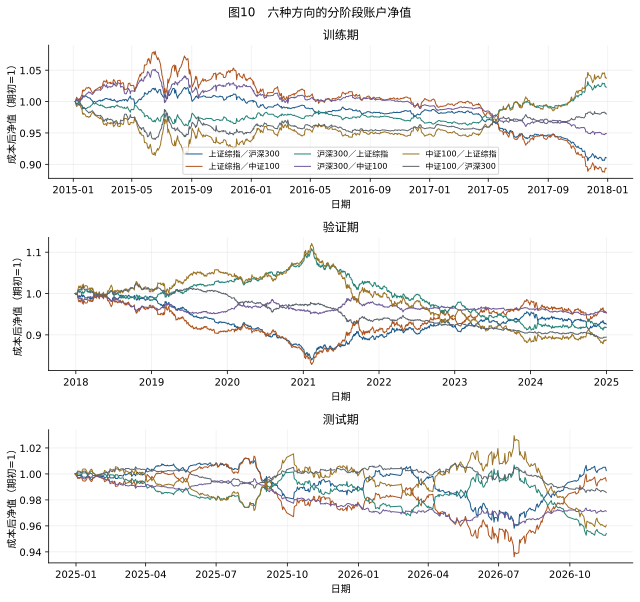

图 10　六方向累计净值，逐阶段从空仓及净资产1开始

## 实验三　对冲比例敏感性

静态与滚动OLS均为带截距的日收益回归，指数加权法采用递推的中心协方差。令 $s_L,s_S$ 为估计期标准差，$\rho$ 为同期相关系数，$C_\lambda$ 为指数加权中心协方差，三种估计为

$$h_{\mathrm{OLS}}=\rho\,s_L/s_S,\qquad h_{\mathrm{EWMA}}=C_\lambda(L,S)/C_\lambda(S,S),\qquad h_{\mathrm{vol}}=s_L/s_S.$$

滚动OLS及波动率比使用120个收益日。EWMA使用衰减0.97、最少60个收益、递推均值（adjust=False）。静态OLS在验证和测试阶段均冻结于2017-12-28收盘的训练估计，留出12月29日用于执行。训练期自身使用最初120个训练收益估计一次并冻结至期末。为让五种方法训练期可比，统一在前121个收益日持有现金（120个观测及1个执行滞后），从2015-07-06开始获得持仓收益；现金日计入训练期长度。这样可以既报告训练期账户，又避免将2017年底才知道的斜率用于2015年交易。

动态比率按日、周、月、季更新。以首个适用收益日为 t，仅使用截至 t−2 交易日收盘的数据，在 t−1 收盘执行。低频规则在相应自然周期的第一个收益日启用新比率，其余日仍逐日恢复目标权重。无效、缺失或非正的新估计沿用上一个有效值；若此前没有有效值用1。测试、验证及训练启用后的回退次数均为零。训练期每条路径121/731日按共同规则空仓（16.55%），验证、测试期为0%。完整日表保留执行日期、估计截止日期、目标比率和回退标记。

表 13　最终测试期五种方法的六方向等权统计均值

| 方法 | 毛收益 | 净收益 | 净年化 | 净波动 | 净Sharpe | 净回撤 | 绝对Beta |
| --- | --- | --- | --- | --- | --- | --- | --- |
| 等额 | −0.06% | −2.19% | −1.23% | 2.77% | −0.51 | −5.25% | 0.085 |
| 静态OLS | 0.05% | −2.04% | −1.14% | 2.83% | −0.46 | −5.34% | 0.090 |
| 滚动OLS | −0.17% | −2.25% | −1.26% | 2.53% | −0.57 | −4.58% | 0.024 |
| EWMA | −0.12% | −2.22% | −1.24% | 2.48% | −0.57 | −4.68% | 0.024 |
| 波动率比 | −0.06% | −2.19% | −1.22% | 2.49% | −0.57 | −4.49% | 0.020 |

表 14　最终测试期的平均头寸与成本（六方向，每日更新）

| 方法 | 平均h | 累计换手¹ | 交易费 | 借券费 |
| --- | --- | --- | --- | --- |
| 等额 | 1.000 | 5.42 | 0.27% | 1.86% |
| 静态OLS | 0.963 | 5.36 | 0.27% | 1.83% |
| 滚动OLS | 0.968 | 5.46 | 0.27% | 1.82% |
| EWMA | 0.967 | 5.83 | 0.29% | 1.82% |
| 波动率比 | 1.015 | 5.53 | 0.27% | 1.86% |

¹ 单位为倍，按各策略已实现日换手累计后取平均。各列为独立策略指标的算术均值。附录逐方向列示每个阶段的净收益；phase_statistics.csv 对每个方向、阶段及频率逐列保存所有指标。

表 15　比率更新频率与平均年化净波动（测试期）

| 更新频率 | 滚动OLS | EWMA | 波动率比 |
| --- | --- | --- | --- |
| 每日 | 2.53% | 2.48% | 2.49% |
| 每周 | 2.53% | 2.48% | 2.49% |
| 每月 | 2.55% | 2.52% | 2.52% |
| 每季 | 2.56% | 2.61% | 2.53% |

对验证期选中的沪深300多头／中证100空头，改用每日EWMA后，测试期波动由1.46%降至1.33%，净收益由−2.87%降至−3.59%，Beta由−0.028变为0.011。另一方向沪深300多头／上证综指空头的亏损则由−4.58%收窄至−3.53%。调仓有时减轻、有时扩大亏损。静态OLS的六方向平均绝对Beta高于等额法，也说明估计空头比率可能增加实现市场暴露。

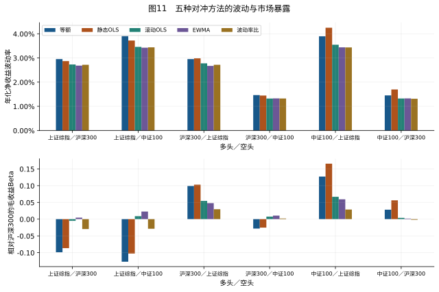

图 11　五种方法在各方向的年化净波动与实现毛收益Beta

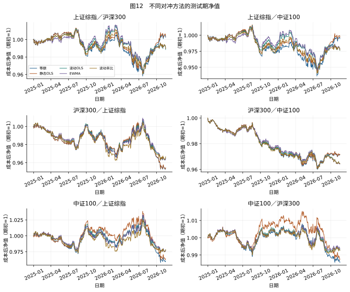

图 12　六方向、五种方法的独立测试账户净值

## 实验四　同指数与跨指数比较

当两腿均为沪深300，设名义多头为 $L$、空头为 $S$，执行前合并为同一标的的净头寸。每单位名义总额对应的毛收益为

$$g_t=\frac{L-S}{L+S}r_{300,t}=\frac{1-h_t}{1+h_t}r_{300,t}.$$

h=1时零持仓，成交与借券均为零。h=0.5时持有三分之一净多头，h=2时持有三分之一净空头。沪深300与上证100是不同标的，对两腿各自市值变动和成交额计费。两种账户的名义输入均按本金一倍配置，净额结算后的实际持仓随净敞口缩减。

定义 $r_{M,t}=(r_{L,t}+r_{S,t})/2$，$r_{R,t}=(r_{L,t}-r_{S,t})/2$。恒等式给出对称的共同方向与相对贡献：

$$g_t=\frac{1-h_t}{1+h_t}r_{M,t}+r_{R,t}.$$

对实际带符号头寸 $A_t,B_t$，共同损益金额为 $(A_t+B_t)r_{M,t}$，相对损益金额为 $(A_t-B_t)r_{R,t}$。逐日累加两个金额，扣除实际交易费、借券费，恰等于期末净资产减1。若归因对象是无费用毛净值，改用前一日毛净值乘当日两项收益后求和。两种累计基数分别保存在统计表中。此分解中的共同项是两指数收益均值；相对项可以与市场相关，均不承担资产定价因子识别功能。

表 16　测试期净账户损益桥（每1元初始资金的百分点）

| 空头 | 方法 | 共同损益 | 相对损益 | 交易费 | 借券费 | 净收益¹ |
| --- | --- | --- | --- | --- | --- | --- |
| 沪深300 | 等额 | 0.000 | 0.000 | 0.000 | 0.000 | 0.000 |
| 沪深300 | 固定0.5 | 0.926 | 0.000 | 0.074 | 0.000 | 0.852 |
| 沪深300 | 固定2 | −1.505 | 0.000 | 0.106 | 1.198 | −2.810 |
| 上证100 | 等额 | 0.000 | −2.511 | 0.326 | 1.830 | −4.667 |
| 上证100 | 静态OLS | 1.082 | −2.478 | 0.292 | 1.537 | −3.224 |
| 上证100 | 滚动OLS | −0.040 | −2.461 | 0.303 | 1.536 | −4.341 |
| 上证100 | EWMA | −0.500 | −2.458 | 0.349 | 1.520 | −4.827 |
| 上证100 | 波动率比 | −0.155 | −2.480 | 0.311 | 1.657 | −4.603 |
| 上证100 | 固定0.5 | 1.840 | −2.446 | 0.261 | 1.277 | −2.144 |
| 上证100 | 固定2 | −2.500 | −2.561 | 0.383 | 2.326 | −7.770 |

¹ 共同损益＋相对损益−交易费−借券费。各项独立取整。同指数的四种估计法均得h=1，与等额行完全重合。最终测试期跨指数的七种设定均净亏损。

跨指数等额账户的共同贡献为零，全部毛收益−2.53%来自相对变化，成本后净收益−4.67%，实现Beta为−0.059。跨指数静态OLS在毛账户中得到共同贡献1.06、相对贡献−2.50个百分点，合成毛收益−1.43%。正的共同方向敞口抵消了部分相对亏损。

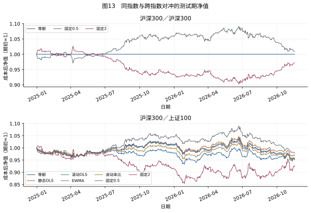

图 13　沪深300多头分别对冲同一标的和上证100的测试期净值

## 代表策略的净值曲线与建仓方法

在实验三的84个跨指数设定中，按测试期累计净收益从高到低排列，只有2个设定盈利。下表列出测试期前两名，并加入按训练期累计净收益排第一的策略。每行的入选时期都已标明。测试期排名是看完期末净值后的历史描述；训练期第一名随后两个阶段的表现则可以检验其优势是否延续。三组均为价格指数模拟账户。

表 17　三条入选曲线的阶段收益与回撤（阶段收益均为扣费后累计值）

| 多头／空头及方法 | 入选依据 | 训练期 | 验证期 | 测试期 | 测试期最大回撤 |
| --- | --- | --- | --- | --- | --- |
| 上证综指／沪深300 · 静态OLS | 测试期第1名 | −9.77% | −7.12% | 0.37% | −5.18% |
| 上证综指／沪深300 · 等额 | 测试期第2名 | −9.80% | −7.37% | 0.25% | −5.35% |
| 中证100／上证综指 · 月度EWMA | 训练期第1名 | 12.69% | −9.43% | −1.98% | −5.72% |

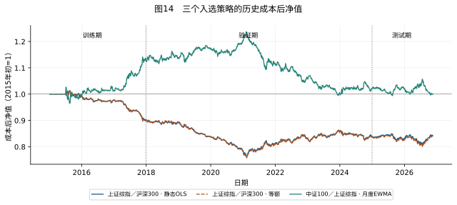

图 14　三条策略的完整历史成本后净值，竖线划分训练、验证与测试期

图14从2015-01-05的1元本金开始，将三个阶段已经扣费的日收益依日期复利连接。阶段末按原账本平仓，下一阶段从空仓按同一规则重建，边界保留两次实际交易费用。图15单独展示2024-12-31收盘重新建仓至2026-11-17的测试账户，三幅图采用相同纵轴。

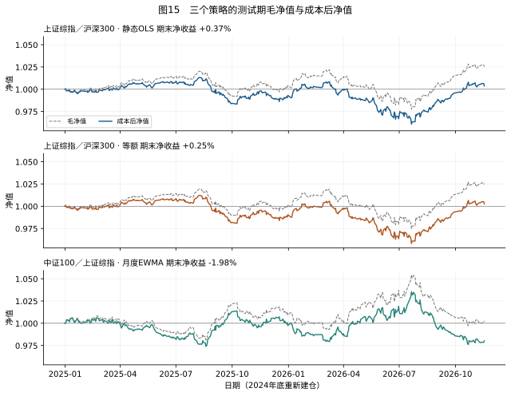

图 15　逐策略对照测试期毛净值与成本后净值（每个账户重新从1元开始）

**多上证综指（000001）、空沪深300（000300）｜静态OLS。** 用多头日收益对空头日收益做带截距回归。训练期展示段用最初120个收益日拟合；验证期和测试期使用截至2017-12-28的训练样本固定斜率。每做多1元配空0.9731元。按一倍总敞口折算，测试期初多头50.68%、空头49.32%。以后每日恢复这两个目标权重，直至期末平仓。

**多上证综指（000001）、空沪深300（000300）｜等额。** 空头和多头的目标名义金额始终相等，h=1；每天收盘按扣除当次交易费后的可配置净资产各配50%。两腿相同，便于与静态OLS逐日对照。测试期两者净收益仅差0.12个百分点，图14中的两条曲线也多次重叠。

**多中证100（000903）、空上证综指（000001）｜月度EWMA。** 空头比率取两腿日收益的指数加权中心协方差除以空头日收益的加权方差。衰减系数0.97，至少60个历史收益，递推均值。每月首个收益日启用新比率，以前两交易日收盘前已观察到的数据估计，在前一交易日收盘执行；月内固定比率，每日恢复对应权重。测试首笔按截至2024-12-30的数据估得h=1.0677，初始多头48.36%、空头51.64%。测试期平均h为1.1305。

三条策略均按实际成交金额收取单边5个基点，按每日真实空头名义金额收取年率2%的借券费，按实际自然日数除以365，现金利率为零。训练期前121个收益日共同持有现金，首笔实际成交在2015-07-03收盘。测试期包括初始建仓和期末清仓。

表 18　测试期成本、风险与收益（费用占期初本金）

| 方法 | 毛收益 | 交易费 | 借券费 | 净收益 | 净年化 | 净波动 | 毛Beta |
| --- | --- | --- | --- | --- | --- | --- | --- |
| 静态OLS | 2.53% | 0.27% | 1.84% | 0.37% | 0.21% | 2.87% | −0.087 |
| 等额 | 2.44% | 0.27% | 1.87% | 0.25% | 0.14% | 2.95% | −0.099 |
| EWMA | 0.28% | 0.29% | 1.98% | −1.98% | −1.10% | 3.52% | 0.066 |

静态OLS和等额法的测试期毛收益分别为2.53%和2.44%；两者借券费用均明显高于交易费用。月度EWMA在训练期取得12.69%净收益，验证期和测试期均亏损。逐日净值、比率和权重可在 results/selected_strategy_curves.csv 回查，逐策略逐阶段的参数和统计见 results/selected_strategy_details.csv。

## 综合讨论

实验一表明，选择起点与是否允许权重漂移会同时改变尾部亏损、交易量和盈利频数。实验二控制交易规则后，历史所选方向可以继续少亏，但盈利仍取决于相对变化能否覆盖两腿成本。实验三对协方差的响应有助于控制部分波动；交易方向错误时，提高风险估计频率并不能稳定修复净收益。实验四进一步说明，账面上的两条名义腿是否形成真实的两个头寸，直接决定投资者实际承担的费用。

# 多维搜索与冠军策略的收益来源

前三条代表曲线检验固定多空方向。进一步允许动量、反转、空仓和杠杆随规则变化后，本章分别计算同一参数的完整历史净值与每半年重新选择参数的账户净值。前者衡量历史上有哪些规则表现突出，后者衡量当时能否把它选出来。

## 数据、时序与账户

上证综指000001为A、沪深300指数000300为B。使用仓库v2价格快照并核对上海交易日历，2015-01-05收盘至2026-11-17收盘，2,883个日收益。所有统计采用252个交易日年化，现金及Sharpe的无风险利率为零。价格指数不含分红；不能按指数点位实际成交，尚未纳入ETF跟踪、期指基差、保证金制度、滑点及实际可借规模。

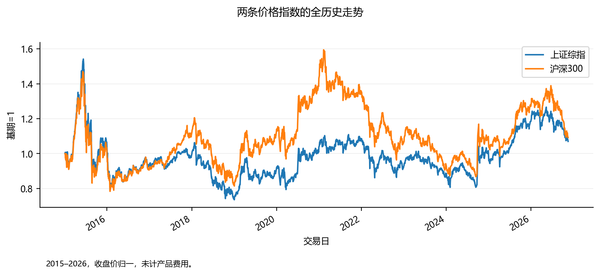

图 16　两条价格指数的全历史走势。2015–2026，收盘价归一，未计产品费用。

收益日t的特征仅使用截至t−2收盘的收益，t−1收盘执行。信号确认后仅在设定频率的交易日调整，期间持仓随市价漂移。名义总敞口最高为自有权益的2.5倍，对应40%总名义保证金；漂移超限于下一次收盘决策强制恢复目标。成交按费后权益迭代确定，末日清仓。空头卖出款全额受限，自有权益可用于多头，超额多头借款年率3%，空头借券2%，单边成交费5bp，按相邻收盘自然日/365计息。权益耗尽触发破产异常，本轮没有破产路径。

## 决策函数与参数空间

组合按目标总敞口G、空多比h及方向s配置，A权重=sG/(1+h)，B权重=−sGh/(1+h)。固定家族始终多A空B。允许反向的扩展家族在负信号下交换符号。静态总敞口0.5–2.5，h取0.35–2.2；频率为每1、5或20个交易日。方向确认1或3日，寿命5、20或60日，到期退出。动量、趋势的标准化强度为窗口平均日收益乘根号窗口长度再除以窗口标准差。所有窗口属于10、20、40、60、120日。

表 19　八类规则及条件变量

| 家族 | 方向、对冲或持仓规则 |
| --- | --- |
| 固定 | 固定h与G；另保留G=h=1的日调仓对照 |
| 相对动量 | A−B日收益强度越过0.2–1.8阈值；确认、平仓或反向 |
| 相对反转 | 对平稳性要求更弱的收益差采用反向强度信号；不假设价格协整 |
| 共同趋势 | 用(A+B)/2收益强度控制是否交易与方向 |
| 波动预算 | 按过去(A−B)/2波动率将总仓缩放至上限；目标2%–10%，为代理风险预算 |
| 动态对冲 | 等额、首120日静态OLS、滚动OLS、EWMA、波动比、共同基准Beta匹配、总敞口最小方差 |
| 状态切换 | 共同趋势强度绝对值超1时追随相对动量，否则反转；波动冲击比率过滤 |
| 信号融合 | 0.65相对动量+0.35共同趋势；波动上限、目标风险及4%–15%回撤后10日冷却 |

以 A 为多头、B 为空头，传统 OLS 取 $h=\mathrm{Cov}(r_A,r_B)/\mathrm{Var}(r_B)$，使固定多头金额下的剩余方差最小。若约束一倍总敞口，带符号权重满足 $w_A-w_B=1$，则 $h=(\mathrm{Var}(r_A)+\mathrm{Cov}(r_A,r_B))/(\mathrm{Var}(r_B)+\mathrm{Cov}(r_A,r_B))$。相对等权市场的Beta匹配在本模型与该式等价。动态比率裁剪至0.15–5，缺失退回1；未形成有效方向信号时空仓。策略库未把所有可想象的连续交易阈值或机器学习规则纳入搜索。

## 分层搜索与评分协议

首个外层窗之前：2015–16用于训练，2017为内层验证，截止至2017-12-28。固定随机种子7319、9319；每个种子随机128、打乱Sobol 256、分组多变量TPE 128、NSGA-II 128次。随机与Sobol在八族内均匀分层，类别离散映射，连续值保留四位小数。TPE代理为0.35训练Sharpe+0.65验证Sharpe+2验证CAGR−验证回撤（Sharpe截至±4）。NSGA-II种群32，以验证CAGR、负回撤、Sharpe最大化，继承上阶段8个代理高分起点。种子对比是顺序热启动试验，非独立重复。初次Sobol加随机共768次；TPE采用有限预算，把更多计算用于逐窗重新选择。

之后每半年取最近约三年为内层，最后一年为验证，两年为训练；将外层首笔执行收盘留出，搜索截止到再前一交易日。每窗重评冻结库并追加24次TPE、64次NSGA-II。验证Pareto集中仅考虑活跃率至少15%的候选，邻域总敞口与阈值或配比同时±10%扰动。A按CAGR、B按理想评分、C按综合评分冻结。若当窗没有合格B，以分数最高者作为近似策略，明示不合格。外层平仓后下一窗重新开仓，按窗末本金顺序复利。信号没有重叠的未来标签；时间分隔用于保障收盘执行顺序。

全历史榜单专评首窗冻结的参数库，按完整历史事后排序。A与C要求15%活跃率；B另要求年化≥1.5%、Sharpe≥0.65、回撤≤12%、活跃≥30%、盈利年度比例≥60%且对数净值斜率为正。B的增长、回撤及持续时间、Sharpe/Sortino、盈利月份及Ulcer、盈利年度、成本换手权重为20/25/20/15/15/5。C对增长、风险、Sharpe组合、邻域、后续窗口表现、成本、绝对Beta与参数数目分别加权25/15/12/15/12/8/8/5。内层用已知训练表现代替后续表现。固定尺度截至[0,1]，CAGR以12%、回撤25%、持续500日、年化波动20%、Sharpe 2、Sortino 3、Ulcer 10%、年化成本4%、年化换手80倍为尺度。具体映射见scoring.py。全部阈值先于最终排名设定。

## 全历史榜单与日度净值

表 20　代表策略的固定参数及全历史表现

| 榜单 | 参数ID | 家族 | 累计 | CAGR | 回撤 | Sharpe |
| --- | --- | --- | --- | --- | --- | --- |
| 收益 | 3dea574fab809815 | 相对动量 | 80.02% | 5.27% | 16.42% | 0.67 |
| 理想近似 | 3dea574fab809815 | 相对动量 | 80.02% | 5.27% | 16.42% | 0.67 |
| 综合 | 3dea574fab809815 | 相对动量 | 80.02% | 5.27% | 16.42% | 0.67 |

收益冠军比较过去40个交易日的相对动量，阈值为0.6432，信号须连续确认3日。每20个交易日按规则调整，连续持仓满60个交易日后退出。目标总名义敞口为净资产的1.4318倍，基准配比为2.1958，允许两腿交换方向。三个榜首对应同一参数ID，图中只需一条曲线。附录图42另列收益榜前三个不同配置，逐项规则见表44。

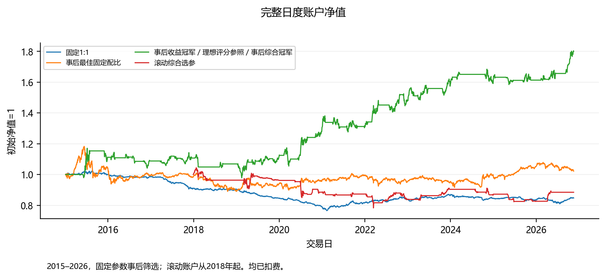

图 17　完整日度账户净值。2015–2026，固定参数事后筛选；滚动账户从2018年起。均已扣费。

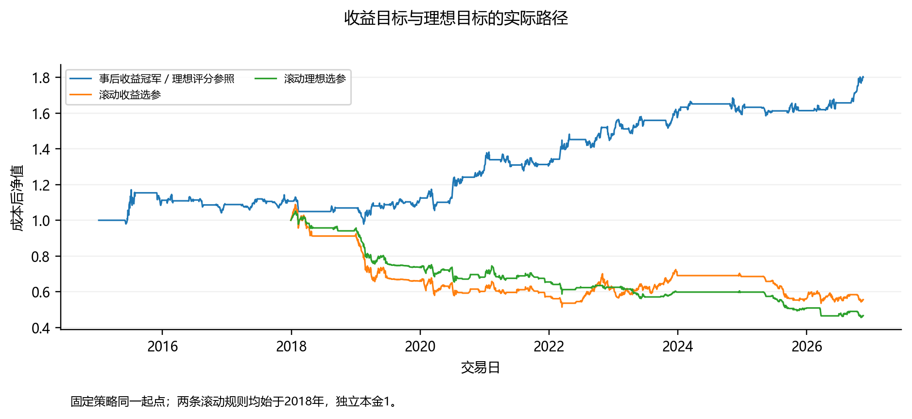

图 18　收益目标与理想目标的实际路径。固定策略同一起点；两条滚动规则均始于2018年，独立本金1。

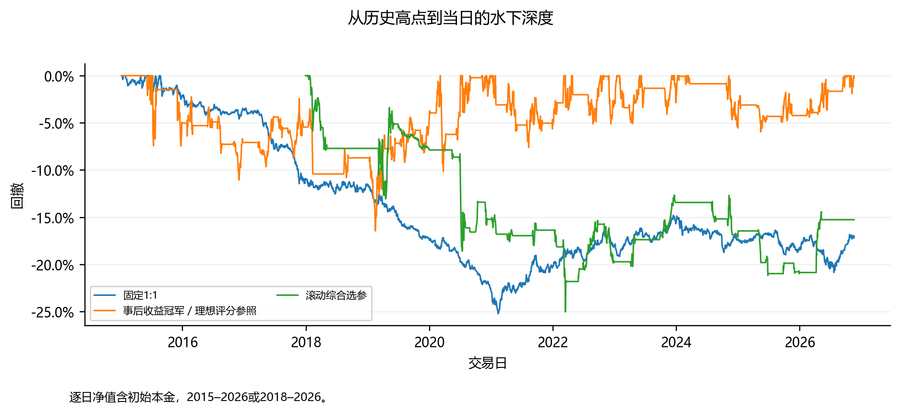

图 19　从历史高点到当日的水下深度。逐日净值含初始本金，2015–2026或2018–2026。

冠军最长水下期1133个交易日，水下日占比93.69%，盈利月占比39.16%。理想榜为空，近似者虽获高分仍超过回撤上限。收益榜与综合榜选出同一参数组合。这些曲线的事后识别不构成盈利预测。

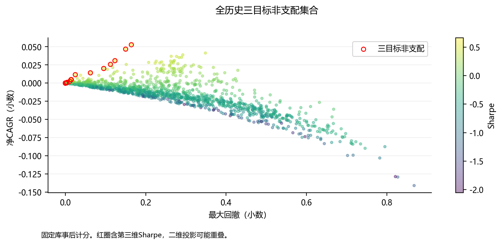

图 20　全历史三目标非支配集合。固定库事后计分。红圈含第三维Sharpe，二维投影可能重叠。

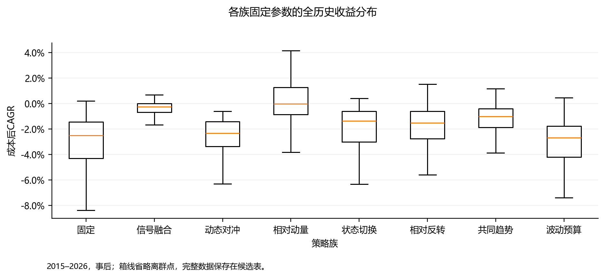

图 21　各族固定参数的全历史收益分布。2015–2026，事后；箱线省略离群点，完整数据保存在候选表。

表 21　各族样本分布（非等概率投资组合）

| 家族 | 候选数 | CAGR中位 | CAGR最高 | 回撤中位 |
| --- | --- | --- | --- | --- |
| 固定 | 146 | -2.51% | 0.19% | 41.80% |
| 信号融合 | 136 | -0.24% | 0.67% | 6.45% |
| 动态对冲 | 135 | -2.34% | -0.60% | 35.29% |
| 相对动量 | 275 | -0.02% | 5.27% | 24.02% |
| 状态切换 | 138 | -1.36% | 0.41% | 19.94% |
| 相对反转 | 144 | -1.52% | 1.52% | 20.62% |
| 共同趋势 | 127 | -1.02% | 2.15% | 16.67% |
| 波动预算 | 144 | -2.67% | 0.44% | 40.68% |

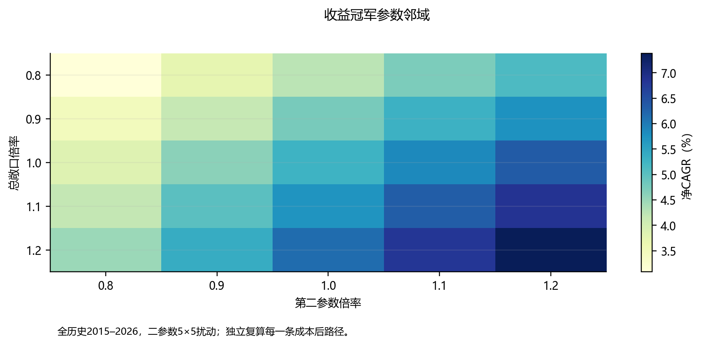

图 22　收益冠军参数邻域。全历史2015–2026，二参数5×5扰动；独立复算每一条成本后路径。

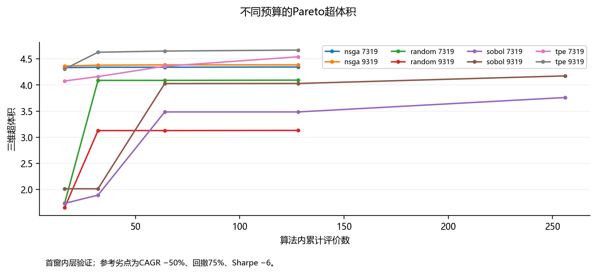

图 23　不同预算的Pareto超体积。首窗内层验证；参考劣点为CAGR −50%、回撤75%、Sharpe −6。

表 22　初始探索各算法成本与末次诊断

| 算法 | 种子 | 次数 | 最优验证CAGR | HV | 搜索耗时秒¹ |
| --- | --- | --- | --- | --- | --- |
| nsga | 7319 | 128 | 18.42% | 4.35 | 0.18 |
| nsga | 9319 | 128 | 19.35% | 4.39 | 0.15 |
| random | 7319 | 128 | 14.68% | 4.09 | 0.69 |
| random | 9319 | 128 | 6.04% | 3.13 | 0.11 |
| sobol | 7319 | 256 | 10.60% | 3.76 | 0.34 |
| sobol | 9319 | 256 | 19.02% | 4.17 | 0.28 |
| tpe | 7319 | 128 | 21.58% | 4.54 | 1.87 |
| tpe | 9319 | 128 | 23.64% | 4.67 | 1.46 |

¹ 从各组首次评价结束至最后一次评价结束，包括Optuna候选生成；最优值及超体积轨迹见 convergence.csv。初始种群继承既有高分点，算法间的差异同时包含热启动与搜索预算影响。

## 严格时序选择及后续历史

采用与18个外窗完全相同的开仓日、清仓日及调仓日历，冻结参数的等额基准累计-8.61%，事后收益冠军累计52.33%。这一对照将切窗引起的再平衡及双边交易费也对齐。后一个参数的冠军身份使用了后续历史，仍属事后分析；逐窗事前选参的结果单独列示。

表 23　阶段累计净收益（空白表示尚未启动）

| 账户 | 2015–17 | 2018–24 | 2025–26 | 全段累计 | 全段回撤 |
| --- | --- | --- | --- | --- | --- |
| 固定1:1 | -8.91% | -7.28% | 0.30% | -15.29% | 25.20% |
| 事后最佳固定配比 | -1.40% | 0.69% | 2.92% | 2.18% | 24.73% |
| 事后收益冠军 | 10.69% | 45.01% | 12.15% | 80.02% | 16.42% |
| 理想评分参照 | 10.69% | 45.01% | 12.15% | 80.02% | 16.42% |
| 事后综合冠军 | 10.69% | 45.01% | 12.15% | 80.02% | 16.42% |
| 滚动收益选参 | — | -31.47% | -18.89% | -44.42% | 52.76% |
| 滚动理想选参 | — | -40.20% | -21.98% | -53.35% | 56.63% |
| 滚动综合选参 | — | -12.79% | 1.43% | -11.54% | 25.00% |

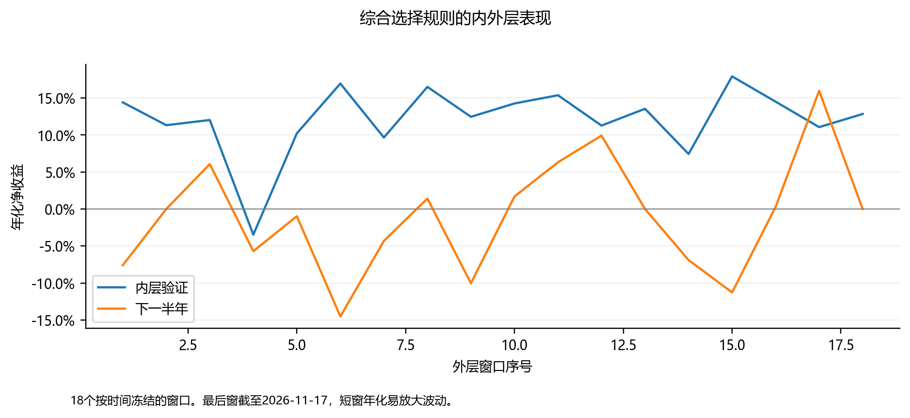

图 24　综合选择规则的内外层表现。18个按时间冻结的窗口。最后窗截至2026-11-17，短窗年化易放大波动。

以相同TPE代理在各窗前16次与全部预算中选择，再以外层真实账本拼接，两者累计分别为-14.55%和-15.27%。更多尝试能提高库内最优值，不保证下一窗改善。2025–2026的原始历史在先前研究中已被查看，本实验不能把它当成全新盲测。

## 头寸、资金成本与风险归因

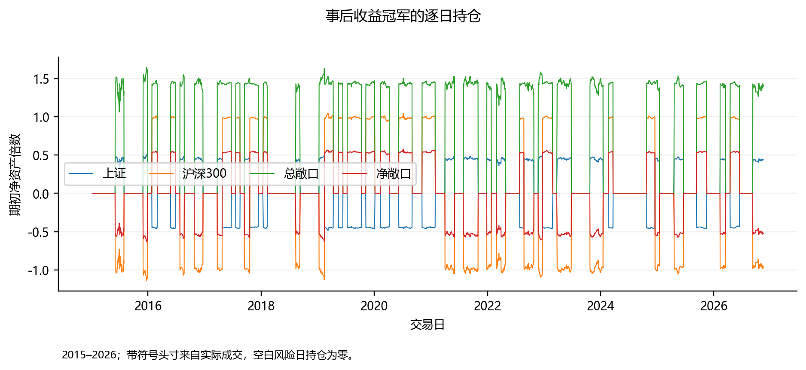

图 25　事后收益冠军的逐日持仓。2015–2026；带符号头寸来自实际成交，空白风险日持仓为零。

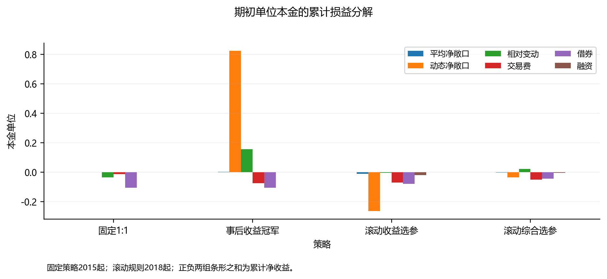

图 26　期初单位本金的累计损益分解。固定策略2015起；滚动规则2018起；正负两组条形之和为累计净收益。

将(A+B)/2作为共同收益，(A−B)/2作为相对收益，分别乘以当日实际头寸之和与之差。共同项再分解成全段平均净权重与偏离平均的部分，仅为描述性恒等式。收益冠军共同损益+0.824元，其中动态净敞口+0.822元；相对损益+0.156元，交易费0.074、借券0.106、融资0.0001元。标签为动态方向主导，绝对Beta较低仍可有大的条件方向暴露。120日实现Beta在daily_positions.csv。

## 稳健性、经济解释与结论

表 24　冠军的单独成本冲击

| 费率／借券／融资情景 | 净CAGR |
| --- | --- |
| fee=0,borrow=0,finance=0 | 6.53% |
| fee=0.001,borrow=0.04,finance=0.06 | 4.03% |
| fee=0.0005,borrow=0.02,finance=0.06 | 5.27% |

表 25　冠军一次仅改一个变量的最大绝对变化

| 参数 | CAGR变化 | 回撤变化 |
| --- | --- | --- |
| window | 5.58% | 10.08% |
| hold | 4.71% | 3.66% |
| frequency | 2.83% | 6.36% |
| reverse | 2.80% | 3.43% |
| confirm | 2.24% | 11.76% |
| threshold | 1.51% | 11.61% |
| ratio | 1.44% | 2.73% |
| gross | 1.02% | 3.38% |

对该冠军，在所试邻域内，对收益最敏感的是window，对回撤最敏感的是confirm。二维邻域收益范围3.09%至7.38%。±10%邻域稳定度0.882（1为最稳）；早期、主段、追加段分别重开账户后的CAGR为3.56%、3.42%、0.96%。局部稳定性无法抵消重复筛选产生的乐观偏差。

三目标全历史前沿有26个参数。不同风险容忍度对应不同可选点。提高风险与邻域权重后，综合第一名为3dea574fab809815（原为3dea574fab809815）。内外层年化差与参数数目的Spearman相关为-0.18，重复窗口和相同赢家使其只能作描述性诊断。多信号融合族中位CAGR为-0.24%；这些观察没有隔离交互项的因果效果。

含择时而始终只允许多上证、空沪深300的候选共774个，最高CAGR为2.15%，中位-1.59%；允许反向的471个候选分别为5.27%、-0.53%。这两个候选集合的参数分布不同，不能将收益差直接归于方向反转本身。

相较固定等额，全部候选中有673/1245个在完整历史上获得更高CAGR。但固定族不得反向，最高值为0.19%；历史收益最高的结构属相对动量。绝对收益、低回撤和持续性需同时评价，最高历史收益不等于最稳的未来策略。本次没有合格理想策略，滚动收益、理想、综合规则的真实时序表现见表。即便事后固定赢家在部分后续年份盈利，也没有证据证明滚动选择能反复识别它。

本次是有成本、有限结构和有限预算的经验边界。相互依赖的候选、共享市场路径、研究者已知历史及短而不独立的半年窗限制统计推断。没有把搜索次数等同于独立试验次数，也未对参数挑选的收益进行显著性宣称。

# 关键交易日与相对收益的稳定性

本章把方向统一改为沪深300相对上证综指。同步删除两个指数在同一批日期的已实现收益，观察买入持有财富比值的变化。该操作使用历史实现值，承担敏感性检验的角色。最后再将财富比值与实际扣费的多空账户对照。

## 数据、时间坐标与财富口径

使用仓库 four_pair_tests_v2/data/input_closes.csv 的上证综指000001（A）和沪深300 000300（B），与只读SQLite库及上海交易日日历复核。2,884个正收盘价配对形成2,883组日收益。价格指数未含现金分红。先逐日从相邻真实收盘价计算两条对数收益，再使用同一日期掩码过滤。没有跨越已删除日期重新计算任何收益。

令 $d_t=\log(B_t/B_{t-1})-\log(A_t/A_{t-1})$。对删除集合 $S$，保留日的累计对数差 $D^{(-S)}=\sum_{t\notin S}d_t=D-\sum_{t\in S}d_t$，相对财富优势 $Q^{(-S)}=\exp(D^{(-S)})-1$。图中用原日历轴呈现，删除日维持前值；均值、相关性、回归与路径偏离统计只计保留日。所有终值均为累计值。由于删帧不改变原日历跨度，本文不把保留日压缩为新的实际投资年数。

原始买入持有累计价格收益为上证综指6.99%、沪深300 9.20%。两者相差2.21个百分点，财富比值减一则为2.07%。相对日标准差34.66bp。B领先的交易日1400个（48.56%），落后1483个（51.44%）。正日对数差合计3.74144、负日-3.72098、合计0.02046。抵消率定义为1−|净和|/绝对贡献之和。

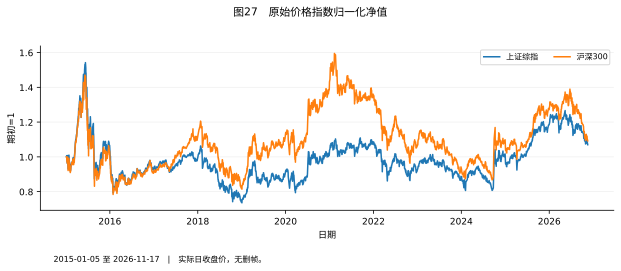

图 27　两指数全时期买入持有价格净值

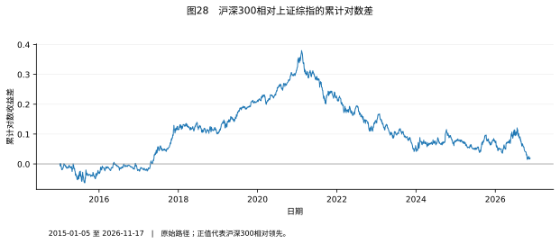

图 28　沪深300相对上证综指的累计对数收益轨迹

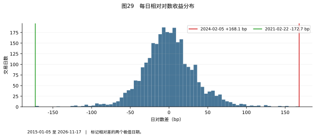

图 29　日相对收益分布及两个尾端日期

## 定向删帧：哪些日期能改变结论

按d从大到小删除，删1日尚余0.37%，删2日为-1.17%；因此最小翻转数k⁺=2。反过来，删去最差2日，领先扩大到5.62%。单侧删帧是事后极值构造，恰好给出固定k的可达下界和上界。即使极值超出10万次随机结果，也不能用它计算普通显著性p值。

表 26　翻转所需的最佳两日及相应的最差两日（两指数为原始简单收益）

| 类别 | 日期 | 上证 | 沪深300 | d（bp） |
| --- | --- | --- | --- | --- |
| 最佳 | 2024-02-05 | -1.02% | 0.65% | +168.11 |
| 最佳 | 2015-08-31 | -0.82% | 0.73% | +154.18 |
| 最差 | 2021-02-22 | -1.45% | -3.14% | -172.70 |
| 最差 | 2026-07-28 | -1.16% | -2.83% | -169.55 |

表 27　同删k日后的财富优势Q

| k | 删最佳 | 删最差 | 删最大绝对差 |
| --- | --- | --- | --- |
| 1 | 0.37% | 3.85% | 3.85% |
| 2 | -1.17% | 5.62% | 5.62% |
| 3 | -2.67% | 7.15% | 3.86% |
| 5 | -5.49% | 9.82% | 0.72% |
| 10 | -11.47% | 16.53% | -3.46% |
| 20 | -20.98% | 29.37% | -3.63% |
| 29 | -27.70% | 40.75% | -6.84% |
| 30 | -28.37% | 42.02% | -5.83% |
| 50 | -39.72% | 67.50% | -5.69% |
| 58 | -43.40% | 77.51% | -3.90% |
| 100 | -57.88% | 131.79% | -8.52% |
| 144 | -67.97% | 196.63% | -16.20% |
| 288 | -84.36% | 472.74% | -26.34% |
| 577 | -93.90% | 1339.96% | -17.45% |

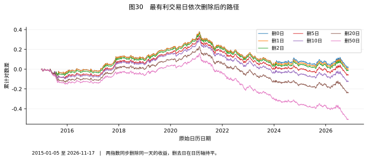

图 30　依次删除最佳相对收益日的合成路径

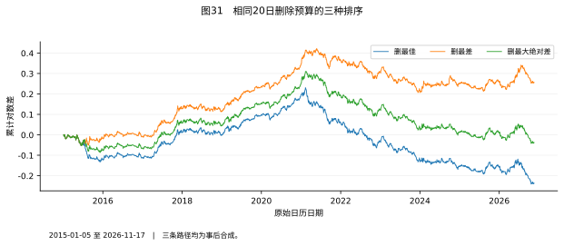

图 31　三种尾部排序的路径比较

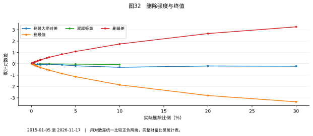

图 32　终点相对差随删除比例变化

## 随机删帧：历史优势能抵抗多大扰动

均匀无放回抽样使用Floyd算法，在候选位置已入选时改选此前不可达的当前末位置。每次重新从全体日期抽样，批次种子由主种子、机制、删除数和批次起点共同派生；各档日数按比例四舍五入。每次逐保留日重建双指数对数净值，计算终点、收益相关性及R²、均值、标准差、截距斜率、残差、累计偏离RMS与峰值等统计量。日收益回归包含截距，故R²等于相关系数平方。

表 28　均匀无放回，每档100,000次；财富比值的历史敏感性分布

| 约删比例 | 天数 | Q的5%分位 | 中位 | 95%分位 | Q>0频率 | 翻负频率 | 翻负频率95%区间 |
| --- | --- | --- | --- | --- | --- | --- | --- |
| 0.5% | 14 | -0.12% | 2.07% | 4.22% | 94.02% | 5.98% | 5.84%–6.13% |
| 1% | 29 | -1.03% | 2.07% | 5.19% | 86.45% | 13.55% | 13.34%–13.76% |
| 2% | 58 | -2.30% | 2.02% | 6.47% | 77.70% | 22.30% | 22.05%–22.56% |
| 5% | 144 | -4.62% | 1.96% | 8.98% | 68.46% | 31.54% | 31.25%–31.83% |
| 10% | 288 | -7.11% | 1.89% | 11.65% | 63.02% | 36.98% | 36.68%–37.28% |
| 20% | 577 | -10.06% | 1.66% | 14.88% | 58.80% | 41.20% | 40.90%–41.51% |
| 30% | 865 | -11.80% | 1.47% | 16.69% | 56.77% | 43.23% | 42.93%–43.54% |

表内的5%与95%分位描述不同删除集合导致的历史波动；末列Wilson区间只衡量有限模拟次数对共同抽样机制下频率估计的精度。两者都不表示未来市场收益的预测区间。删帧比例越大，随机扰动区间越宽；例如删除5%时，即使中位数仍为正，左尾已可出现明显落后。

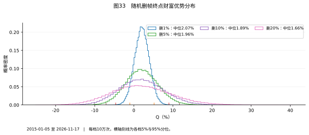

图 33　随机删帧后的终值分布

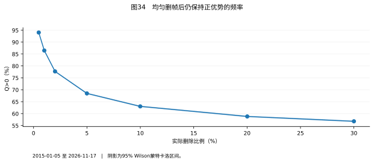

图 34　随机删帧下保持正优势的比例

## 分层、连续区块与同预算比较

年度和逐日历月份分层使用随机起点的累计配额取整，各层精确到其理论配额上下1日以内、各层之和严格为k，然后在每层内等概率抽取。连续删帧将长度固定的块压缩成一个位置，无放回选择不重叠块的位置，再展开；最后不足整块的余数随机分配给一个块。允许相邻块相接，无首尾环绕。该机制在区间边缘的单日入选概率可以不同于中段。另对k小于指定块长的情形删一个长度k的块。

表 29　同删288日的机制差异

| 机制 | 试验数 | Q的5%分位 | 中位 | 95%分位 | 翻负频率 | 蒙特卡洛标准误¹ |
| --- | --- | --- | --- | --- | --- | --- |
| uniform | 100000 | -7.11% | 1.89% | 11.65% | 36.98% | 0.15% |
| year | 3000 | -6.95% | 1.82% | 11.59% | 37.87% | 0.89% |
| month | 3000 | -7.17% | 1.87% | 11.36% | 37.50% | 0.88% |
| block5 | 3000 | -7.68% | 1.81% | 12.48% | 38.13% | 0.89% |
| block10 | 3000 | -7.49% | 1.92% | 12.06% | 37.07% | 0.88% |
| block20 | 3000 | -7.79% | 1.84% | 12.13% | 37.93% | 0.89% |
| block60 | 3000 | -8.30% | 1.57% | 12.40% | 40.20% | 0.90% |

¹ 频率的标准误。均匀、分层、区块回答不同的固定样本条件问题。比较机制差异时需结合各自的模拟误差；不能将本样本中较高的区块翻转频率解释成未来出现相同连续行情的概率。

表 30　定向删帧在同预算均匀随机分布中的位置（k=288）

| 定向规则 | 定向Q | 随机Q严格低于它的频率 | 同值频率 |
| --- | --- | --- | --- |
| 删最佳 | -84.36% | 0.00% | 0.00% |
| 删最差 | 472.74% | 100.00% | 0.00% |
| 删最大绝对差 | -26.34% | 0.00% | 0.00% |
| 双尾等量 | -6.90% | 5.40% | 0.00% |

完整 equal_budget_comparison.csv 包含每个定向预算与七种随机机制的经验位置。两端等量删帧要求偶数预算；各删0.5%、1%、2.5%、5%时按每端日数取整，所以有时总日数与直接对总比例取整相差一天。对照始终按实际k匹配。

## 路径接近、日收益拟合与稳健漂移

偏离指标为保留各日累计对数净值差的均方根及最大绝对值。另以同向日占比度量短周期方向一致性；终值Q单列，用于区分路径是否贴合、终点是否接近和日收益是否高度相关。日收益回归用B作因变量、A作自变量，残差标准差以n−2作分母。

表 31　删帧后的日收益拟合与累计路径距离

| 规则 | k | ρ | R² | Beta | 截距bp | 残差bp | RMS | 最大偏离 | Q |
| --- | --- | --- | --- | --- | --- | --- | --- | --- | --- |
| 原始 | 0 | 0.968 | 0.936 | 1.042 | 0.06 | 34.27 | 0.144 | 0.380 | 2.07% |
| 删最大绝对差 | 29 | 0.971 | 0.943 | 1.037 | -0.25 | 31.87 | 0.105 | 0.276 | -6.84% |
| 删最大绝对差 | 288 | 0.981 | 0.962 | 1.020 | -1.17 | 24.57 | 0.127 | 0.310 | -26.34% |
| 双尾等量 | 28 | 0.971 | 0.943 | 1.037 | 0.01 | 31.95 | 0.124 | 0.306 | 0.57% |
| 双尾等量 | 58 | 0.973 | 0.947 | 1.033 | -0.04 | 30.50 | 0.125 | 0.301 | -0.30% |
| 双尾等量 | 144 | 0.977 | 0.954 | 1.025 | -0.10 | 27.77 | 0.103 | 0.265 | -2.56% |
| 双尾等量 | 288 | 0.981 | 0.962 | 1.020 | -0.26 | 24.65 | 0.084 | 0.206 | -6.90% |

删去分化最大的29日，日收益R²从0.936升至0.943，RMS由0.144降至0.105，终值Q却由2.07%变为-6.84%。这三项给出的信息不同。均匀随机删除10%时R²中位数为0.936，没有相似幅度的提高。

表 32　相对日收益的稳健位置估计

| 估计量 | bp／日 |
| --- | --- |
| mean | +0.071 |
| median | -0.961 |
| trim5 | -0.276 |
| winsor5 | +0.031 |
| huber | -0.588 |

trim5删去两端各5%观测后求均值；winsor5将两端各5%拉回边界；Huber以中位数和固定MAD正态尺度起步，用1.345倍尺度对大偏差降权。中位数与Huber估计为负，普通均值略正，符号对尾部处理敏感。合成截尾曲线没有给投资者提供预知极端日的方法。

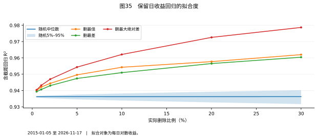

图 35　日收益R²与删帧比例

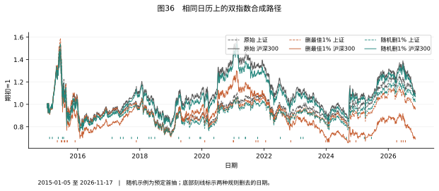

图 36　原始、正尾及预定首抽随机路径；被删日按日历标出

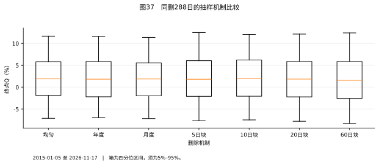

图 37　连续区块、分层和离散随机抽帧的同预算比较

## 年度贡献、市场状态与漂移检验

表 33　各年对长期相对收益的贡献（2026年截至11月17日）

| 年份 | 天数 | 正对数贡献 | 负对数贡献 | 年度Q | 最佳20日入选数 |
| --- | --- | --- | --- | --- | --- |
| 2015 | 243 | 0.3465 | -0.3770 | -3.00% | 7 |
| 2016 | 244 | 0.1969 | -0.1853 | 1.17% | 0 |
| 2017 | 244 | 0.3444 | -0.2109 | 14.28% | 1 |
| 2018 | 243 | 0.2880 | -0.2976 | -0.95% | 0 |
| 2019 | 244 | 0.3239 | -0.2172 | 11.26% | 1 |
| 2020 | 243 | 0.3216 | -0.2108 | 11.72% | 1 |
| 2021 | 243 | 0.4065 | -0.5068 | -9.54% | 3 |
| 2022 | 242 | 0.3293 | -0.4091 | -7.67% | 1 |
| 2023 | 242 | 0.2399 | -0.3229 | -7.97% | 0 |
| 2024 | 242 | 0.3465 | -0.3288 | 1.79% | 4 |
| 2025 | 243 | 0.2704 | -0.2768 | -0.63% | 0 |
| 2026 | 210 | 0.3276 | -0.3779 | -4.91% | 2 |

12个自然年（含末年部分区间）中，5年为正。最佳20日中2015年有7日、2024年有4日；但两个翻转关键日相隔多年。尾部贡献有所聚集，不能仅据两个日期给经济事件作因果归因。

表 34　以上证前120个交易日累计对数收益划分状态

| 状态 | 日数 | d均值bp | d标准差bp | 最佳20日数 |
| --- | --- | --- | --- | --- |
| warmup | 120 | -2.88 | 34.93 | 1 |
| up | 886 | 0.15 | 36.33 | 7 |
| range | 1105 | -0.28 | 33.87 | 7 |
| down | 772 | 0.93 | 33.80 | 5 |

以±0.05为趋势阈值，前120个收益日列为预热。状态仅用于分组，所有观测保留。

表 35　各长度完整滚动窗口的相对财富变化

| 交易日 | 窗口数 | 最小Q | 中位Q | 最大Q | 正窗口比例 |
| --- | --- | --- | --- | --- | --- |
| 20 | 2864 | -6.83% | 0.00% | 5.89% | 50.14% |
| 60 | 2824 | -9.70% | 0.14% | 8.44% | 52.69% |
| 120 | 2764 | -10.65% | 0.26% | 13.47% | 52.64% |
| 252 | 2632 | -17.30% | 0.89% | 17.31% | 55.70% |

滚动窗口存在重叠。这些占比为描述性统计，不将窗口当成独立样本计算显著性。

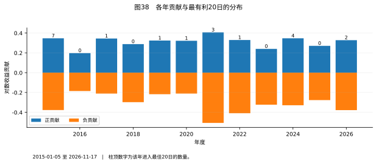

图 38　正负贡献的年度分布与关键日期集中度

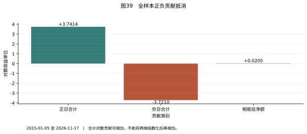

图 39　总正负贡献及相抵后的净额

表 36　原始日相对收益的双侧均值检验（bp／日）

| 估计 | 滞后／块长 | 均值 | 标准误 | 95%下界 | 95%上界 | p |
| --- | --- | --- | --- | --- | --- | --- |
| iid | 0 | 0.071 | 0.646 | -1.195 | 1.337 | 0.9125 |
| HAC | 5 | 0.071 | 0.677 | -1.256 | 1.398 | 0.9165 |
| HAC | 10 | 0.071 | 0.670 | -1.243 | 1.385 | 0.9157 |
| HAC | 20 | 0.071 | 0.678 | -1.257 | 1.399 | 0.9166 |
| circular_bootstrap | 5 | 0.071 | 0.676 | -1.261 | 1.396 | 0.9133 |
| circular_bootstrap | 20 | 0.071 | 0.679 | -1.257 | 1.395 | 0.9180 |
| circular_bootstrap | 60 | 0.071 | 0.714 | -1.356 | 1.447 | 0.9249 |

普通检验用截距模型与常规t区间；Newey–West使用Bartlett权重、有限样本修正及双侧正态近似。循环移动区块Bootstrap每次有放回抽取连续块，直到截足原长，三个块长各20,000次；区间取均值百分位，p值由以样本均值中心化的双侧重抽样分布估计。这里从时间序列推断均值，区别于固定历史删帧实验。

Ljung–Box检验在5、10、20阶的p值依次为0.035, 0.042, 0.066。按既有研究使用的2015–17、2018–20、2021–24、2025–26四段，带10阶HAC的联合等均值检验p=0.0062。这是对指定边界的阶段差异检验，不是对未知断点位置的估计。逐年均值检验在12年内以Holm方法校正，最小校正p为0.090。阶段均值有变化与全期均值显著为正是两个不同命题。

表 37　四个指定时期的日漂移

| 时期 | 均值bp | HAC 95%下界 | 95%上界 |
| --- | --- | --- | --- |
| 2015-2017 | +1.568 | -0.921 | 4.056 |
| 2018-2020 | +2.848 | 0.757 | 4.939 |
| 2021-2024 | -2.532 | -5.157 | 0.092 |
| 2025-2026 | -1.251 | -4.475 | 1.974 |

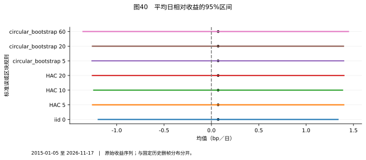

图 40　日均漂移的区间推断

## 解析结果与模拟核验

设 $I_t$ 为日t被删除的指示变量，$p=k/N$。固定k的无放回设计给出 $E[I_t]=p$，对不同日期有 $\mathrm{Cov}(I_i,I_j)=-p(1-p)/(N-1)$。将 $D^{(-S)}=D-\sum I_t d_t$ 展开，并以 $s_d^2=\sum(d_t-\bar{d})^2/(N-1)$ 表示有限总体方差，可得

$$E[D^{(-S)}]=(1-k/N)D,\qquad \mathrm{Var}(D^{(-S)})=k(1-k/N)s_d^2.$$

指数函数为凸函数，因此Q的条件期望须直接对每次exp(D)−1求平均；不能将D的解析期望简单指数化代替。

表 38　完全随机抽帧的有限总体解析核验（对数单位）

| k | 理论均值 | 模拟均值 | 理论SD | 模拟SD | 均值误差／MCSE |
| --- | --- | --- | --- | --- | --- |
| 14 | 0.02036 | 0.02033 | 0.01294 | 0.01294 | -0.74 |
| 29 | 0.02025 | 0.02040 | 0.01857 | 0.01857 | +2.47 |
| 58 | 0.02005 | 0.01990 | 0.02613 | 0.02617 | -1.78 |
| 144 | 0.01944 | 0.01937 | 0.04054 | 0.04051 | -0.50 |
| 288 | 0.01842 | 0.01846 | 0.05581 | 0.05581 | +0.24 |
| 577 | 0.01636 | 0.01653 | 0.07446 | 0.07452 | +0.68 |
| 865 | 0.01432 | 0.01455 | 0.08529 | 0.08520 | +0.86 |

独立种子对七档各再运行5,000次，与主种子的均值差最大为1.40个合并蒙特卡洛标准误。核验以原始价格比连乘重算56组定向／原始终值，另以独立实现逐项检查126组首抽的全部指标与日期掩码。每次模拟均断言删除计数等于k。

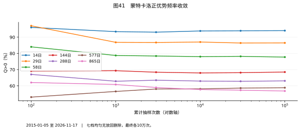

图 41　随模拟次数增加的条件频率

## 与多空对冲研究衔接

原始价格指数的买入持有财富比高出2.07%。沿用前报告的资本与成本口径，每日多0.5单位沪深300、空0.5单位上证综指，从空仓建立、逐日恢复目标权重并在样本末平仓，毛累计收益为2.45%，成本后为-10.20%。单边成交费5bp，年借券费2%、按实际自然日，现金收益为零。财富比、等额再平衡收益以及择时策略收益的计算对象各异。净财富差很小、关键日期可以改变符号、跨期均值变化均削弱固定方向长期盈利的实证依据。动态策略还须证明事前预测与成本后的滚动表现；本实验没有检验新的预测信号。

## 结论与研究限制

用净额和总额作分母，关键日的重要性看起来截然不同。最有利两日贡献之和为0.03223，相当于最终净对数优势的157.53%，但只占所有正日贡献的0.86%。即使取最有利20日，合计也仅占总正贡献的6.84%。因此，两天决定的是历史终点的正负号；全年市场中正向分化的规模远大于这两天。

就终值符号而言，两天足以抹去沪深300的领先；就全期收益形成而言，正负两端各累积了约3.7个对数单位，两个日期的重要性来自抵消后分母极小。它不能证明全部相对表现由两次孤立事件造成。删去最差两日反而把优势提高到5.62%，说明这种敏感性具有两面性。

在均匀删帧中，随机结果并不总是翻负，且翻负频率依赖删除强度和抽样机制。去掉绝对分化最大的日期常会改善日收益拟合，但保留路径仍可在多年内累积非零差异。均值区间包含零，不能由此证明真实期望严格为零，更不能推断未来不存在超额收益。历史事件解释、总收益指数、实际ETF可交易性与动态择时需要另行研究。

# 讨论与结论

**宽基分散了什么风险？** 单日抵消率能说明持仓内部的收益分化。中证A100当日有约三分之二的绝对贡献被抵消，同时指数仍然上涨。双基准回归显示宽基保留了相当大的市场敞口；加入本地规模和价值因子后，部分指数的解释度进一步提高。仅凭这一天的行业分解，尚无法判断分散持仓在不同市场状态下如何改变长期回报。

**历史赢家怎样赚钱？** 在四项实验的84个对冲设定中，最终测试期仅两个取得正净收益，且都属于多上证综指、空沪深300。扩展规则后，事后冠军每1元初始资金的共同方向损益约为+0.824元，相对损益约为+0.156元；计入交易、借券和融资后净赚约0.800元。全期平均Beta可以接近零，而不同时段变化的方向敞口仍可贡献大量收益。这个会计分解说明资金在哪类行情中获利，无法单独证明择时技巧。

**事前能否选中？** 用同样18个外层窗口比较，回看选定冠军的净收益为+52.33%，事前逐窗按收益选参为−44.42%，按综合评分选参为−11.54%，同期开平仓的固定等额为−8.61%。时间切分限制了程序可以使用的信息，但研究者已经观察过部分后段历史。现有数据支持对事前选参的谨慎评价。

**两个关键日意味着什么？** 最有利两日占全期正贡献的0.86%，却相当于最终净对数优势的157.53%。差别来自长时期正负贡献几乎相互抵消。删去关键日能改变最终排名，日均漂移的HAC区间也包含零。两项证据都限制了从历史排名外推持续超额收益的能力。

## 研究局限与后续检验

价格指数省略现金分红，真实ETF与期指还涉及跟踪差、基差、展期、保证金和券源。固定费率只对应给定情景。长仓组合、早期配对和多维搜索各有资金规则，跨章比较须使用共同时间与敞口。重叠建仓窗口共享大量收益日；百万次抽样增加了对一段固定历史的模拟精度，可用于检验独立市场时期的样本数并未增加。

优先补齐历史生效的成分权重、行业和公司行为，检验逐日指数复制误差，再测行业轮动及抵消对风险预测的增量。要评价可交易性，还需在全收益指数、带券源或期货报价的实际工具，以及研究者未观察过的后续期间，按预先固定的规则验证。

# 参考文献

[1] Gatev E, Goetzmann W N, Rouwenhorst K G. Pairs Trading: Performance of a Relative-Value Arbitrage Rule. *Review of Financial Studies*, 2006, 19(3), 797–827. [DOI](https://doi.org/10.1093/rfs/hhj020)

[2] Do B, Faff R. Does Simple Pairs Trading Still Work? *Financial Analysts Journal*, 2010, 66(4), 83–95. [DOI](https://doi.org/10.2469/faj.v66.n4.1)

[3] Avellaneda M, Lee J H. Statistical Arbitrage in the US Equities Market. *Quantitative Finance*, 2010, 10(7), 761–782. [DOI](https://doi.org/10.1080/14697680903124632)

[4] Zhang H, Urquhart A. Pairs Trading Across Mainland China and Hong Kong Stock Markets. *International Journal of Finance & Economics*, 2019, 24(2), 698–726. [DOI](https://doi.org/10.1002/ijfe.1687)

[5] Ederington L H. The Hedging Performance of the New Futures Markets. *Journal of Finance*, 1979, 34(1), 157–170. [DOI](https://doi.org/10.1111/j.1540-6261.1979.tb02077.x)

[6] Lo A W, MacKinlay A C. Data-Snooping Biases in Tests of Financial Asset Pricing Models. *Review of Financial Studies*, 1990, 3(3), 431–467. [DOI](https://doi.org/10.1093/rfs/3.3.431)

[7] White H. A Reality Check for Data Snooping. *Econometrica*, 2000, 68(5), 1097–1126. [DOI](https://doi.org/10.1111/1468-0262.00152)

[8] Hansen P R. A Test for Superior Predictive Ability. *Journal of Business & Economic Statistics*, 2005, 23(4), 365–380. [DOI](https://doi.org/10.1198/073500105000000063)

[9] Liu J, Stambaugh R F, Yuan Y. Size and Value in China. *Journal of Financial Economics*, 2019, 134(1), 48–69. [DOI](https://doi.org/10.1016/j.jfineco.2019.03.008)

# 附录　阶段明细与复现索引

## 四项配对实验的分阶段结果与修订记录

表 39　训练期六方向累计净收益（动态法每日更新）

| 多头／空头 | 等额 | 静态OLS | 滚动OLS | EWMA | 波动率比 |
| --- | --- | --- | --- | --- | --- |
| 上证综指／沪深300 | −9.80% | −9.77% | −9.52% | −9.65% | −9.97% |
| 上证综指／中证100 | −14.06% | −13.80% | −12.45% | −12.16% | −14.17% |
| 沪深300／上证综指 | 4.53% | 4.57% | 5.24% | 5.50% | 4.72% |
| 沪深300／中证100 | −7.34% | −6.99% | −6.69% | −6.46% | −7.28% |
| 中证100／上证综指 | 9.29% | 9.39% | 11.66% | 12.50% | 9.43% |
| 中证100／沪深300 | 1.68% | 1.70% | 2.26% | 2.50% | 1.61% |

表 40　验证期六方向累计净收益（动态法每日更新）

| 多头／空头 | 等额 | 静态OLS | 滚动OLS | EWMA | 波动率比 |
| --- | --- | --- | --- | --- | --- |
| 上证综指／沪深300 | −7.37% | −7.12% | −7.86% | −7.89% | −7.15% |
| 上证综指／中证100 | −4.62% | −4.19% | −7.78% | −7.27% | −6.08% |
| 沪深300／上证综指 | −8.18% | −8.11% | −9.05% | −8.85% | −8.34% |
| 沪深300／中证100 | −4.72% | −4.68% | −6.63% | −6.60% | −6.32% |
| 中证100／上证综指 | −11.24% | −10.73% | −11.50% | −10.64% | −9.80% |
| 中证100／沪深300 | −10.55% | −10.19% | −9.34% | −8.99% | −9.03% |

表 41　测试期六方向累计净收益（动态法每日更新）

| 多头／空头 | 等额 | 静态OLS | 滚动OLS | EWMA | 波动率比 |
| --- | --- | --- | --- | --- | --- |
| 上证综指／沪深300 | 0.25% | 0.37% | −1.15% | −1.02% | −1.03% |
| 上证综指／中证100 | −0.54% | −0.30% | −2.38% | −2.25% | −2.32% |
| 沪深300／上证综指 | −4.58% | −4.55% | −3.45% | −3.53% | −3.33% |
| 沪深300／中证100 | −2.87% | −2.85% | −3.56% | −3.59% | −3.56% |
| 中证100／上证综指 | −3.95% | −3.62% | −2.23% | −2.29% | −2.15% |
| 中证100／沪深300 | −1.44% | −1.27% | −0.73% | −0.64% | −0.73% |

表 42　与原报告的口径对照

| 统计量 | 原版 | 修订版 | 变动来源 |
| --- | --- | --- | --- |
| 实验一主规格均值 | −1.83% | −1.89% | 每日恢复改为固定数量 |
| 实验一每日对照均值 | −1.83% | −1.83% | 首次各按初始本金50%成交 |
| 实验四同指数等额净收益 | −2.08% | 0.00% | 同标的净额计费 |
| 实验四跨指数等额净收益 | −4.62% | −4.67% | 测试期重新开户 |
| 实验四跨指数静态共同贡献¹ | 0.61% | 1.06% | 对称收益分解 |

¹ 毛账户按初始本金归一。原版等额同指数测试期的−2.08%来自连续持有、两腿分账计费；修订后整个路径零成交。实验二已公布的空仓测试净值可以重现；发生变化的是统计检验所用账户。完整逐项差额见 results/version_comparison.csv。

复算顺序为 run.py、verify.py、figures.py、build_manuscript.py、build_word.py --word-fields（均在该实验目录）。分析依赖沿用仓库 requirements.txt，日历另用 exchange_calendars==4.13.2；Word生成用原版的 pypandoc_binary、python-docx 与 Windows Word。核验覆盖两套建仓规则的逐日净值、298个阶段账户、289,598条账户记录、62,642种去重后的动态及静态估计输入组合，以及全部9项HAC结果。

data/input_closes.csv 保存共同价格；results/e1_windows.csv 与 e1_paths.npz 保存逐窗口明细及毛净路径；e2_paired_daily.csv、e2_hac.csv 和 e2_selection.csv 对应配对差、显著性与历史锁定记录；e2_daily.csv.gz、e3_daily.csv.gz、e4_daily.csv.gz 保存逐日账本；phase_statistics.csv 提供每种设置的各阶段毛净收益、净年化、波动、Sharpe、回撤、毛Beta、平均比率、换手、费用和金额归因。figures 目录含PNG与可编辑SVG。可直接编辑本报告的Word或Markdown；手工编辑Markdown后只需重新运行Word排版脚本。

## 多维搜索的试验记录

逐笔试验见 all_trials.csv，内层与事后前沿分别见 inner_fronts.csv、pareto_front.csv；候选完整参数、风险成本、三段统计与相对基准差见 candidate_metrics.csv。榜单与最近似候选独立存档。walk_forward.csv 提供每次冻结的ID、执行日、信息截止和参数。daily_nav.csv 与 daily_positions.csv 保存日度净值及会计桥。verification.json 记录账户及排名核验。

## 抽帧模拟与随机种子

在仓库根目录运行 python experiments/relative_return_frame_deletion_v1/run.py。每批1,000次，主种子20261119，复核种子19470517。均匀七档共700,000次；补充预算、年度和月份分层及四种区块每个设定3,000次；复核种子35,000次。另有均值推断的60,000次有放回区块Bootstrap，不计入删帧试验数。每次迭代保存终点或汇总指标，不保存所有逐日模拟轨迹；批次缓存可断点续算，Git归档保存终值Q、抽样协议、首抽日期和完整分位统计。

结果目录内，daily_relative_returns.csv 含全部原始日数据、滚动优势、状态；top_positive_days.csv、top_negative_days.csv 按贡献排序；synthetic_paths.csv.gz 含定向删帧路径与逐日标志；年度贡献、相关回归、同预算经验位置及时间序列推断各有独立CSV。

## 数据、核验与图表源

各实验的原始价格、逐日账本、统计表与画图程序保存在同一仓库。下列链接指向相应的实验目录或表格；全历史搜索结果可用参数ID对应到日度路径。Word中的公式与表格可直接编辑。编辑本报告的 Markdown 源稿后，可在仓库根目录运行 `python reports/integrated/build_word.py` 更新 Word。

表 43　研究数据与核验文件索引

| 模块 | 输入或结果 | 复现与图表 |
|---|---|---|
| 宽基结构与配置 | [数据盘点](../data_inventory.md)、[数据缺口](../data_gaps.md) | [主研究复现说明](../reproduction.md) |
| 早期配对复现 | [原始提案的复算表](../../outputs/tables/sse_csi300_replication_performance.csv)、[冠军逐日净值](../../outputs/tables/pair_champion_full_history.csv) | [早期搜索报告](../pair_trading_full_research.md) |
| 四项配对实验 | [四指数收盘价](../../experiments/four_pair_tests_v2/data/input_closes.csv)、[各账户阶段统计](../../experiments/four_pair_tests_v2/results/phase_statistics.csv) | [核验记录](../../experiments/four_pair_tests_v2/results/verification.json)、[作图代码](../../experiments/four_pair_tests_v2/figures.py) |
| 多维策略搜索 | [候选参数](../../experiments/multidimensional_longshort_search_v1/results/candidate_metrics.csv)、[逐日净值](../../experiments/multidimensional_longshort_search_v1/results/daily_nav.csv) | [逐窗选择](../../experiments/multidimensional_longshort_search_v1/results/walk_forward.csv)、[核验记录](../../experiments/multidimensional_longshort_search_v1/results/verification.json) |
| 交易日敏感性 | [日相对收益](../../experiments/relative_return_frame_deletion_v1/results/daily_relative_returns.csv)、[随机删帧结果](../../experiments/relative_return_frame_deletion_v1/results/random_deletion_summary.csv) | [核验记录](../../experiments/relative_return_frame_deletion_v1/results/verification.json)、[指数与账户对照](../../experiments/relative_return_frame_deletion_v1/results/hedge_bridge.csv) |

# 附录　全历史收益前三名的建仓规则与净值

以已归档的全历史收益榜锁定前三个不同参数，使用原账户引擎从2015年1月5日的1元本金回放到2026年11月17日，包括早期训练历史、无信号的空仓日和最后平仓。三条曲线各自覆盖2,883个收益日。逐日核对榜首净值，三组终值和最大回撤均可复现至所列精度。三组均属允许反向的相对动量策略，排名使用了整段历史。

表 44　全历史收益榜前三个不同配置的决策参数及风险

| 排名与参数ID | 回看／调仓间隔（日） | 信号阈值 | 总敞口（倍） | B与A名义金额比 | 累计净收益 | 最大回撤幅度 |
|---|---:|---:|---:|---:|---:|---:|
| 1 · 3dea574fab809815 | 40／20 | 0.6432 | 1.4318 | 2.1958 | +80.02% | 16.42% |
| 2 · 0379e26f831870d1 | 40／5 | 0.7226 | 1.7516 | 1.8047 | +68.64% | 14.99% |
| 3 · b8a33db2a3b77aac | 120／5 | 0.6972 | 2.2039 | 2.0556 | +58.94% | 34.84% |

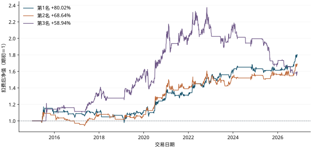

图 42　全历史收益榜前三个不同参数的扣费后净值，按同一初始资金和日历回放

A代表上证综指，B代表沪深300。设窗口长度为 $k$，$x_t=r_{A,t}-r_{B,t}$。策略以 $z=\sqrt{k}\,\bar{x}/s(x)$ 衡量窗口内的相对动量。连续3个信号日的 $z$ 均高于阈值时，方向为多A空B；均低于负阈值时，方向为多B空A。其余情况在计划调仓日将目标设为零。给定表中总敞口 $G$ 与配比 $h$，正向目标权重为 $G/(1+h)$ 及 $-Gh/(1+h)$，反向将两个符号同时翻转。信号截至收益日前两个交易日收盘，执行于前一收盘。计划调仓之间头寸随市值漂移，连续持仓满60个交易日退出；总名义规模漂移超2.5倍时按规则调整。费用包括单边成交5 bp、年借券2%和超额多头融资3%。

在这段历史内，第二名的回撤小于第一名，第三名的回撤超过前两名的两倍。三条曲线使用同一对指数和同一类信号，不能据此把三个排名当成盈利能力的三份独立证据。按当时可得信息重选参数的结果见正文图24。

# 九大A股宽基指数相对收益的路径依赖与关键日集中性研究

*Path Dependence and Critical-Day Concentration in Relative Returns Across Nine Chinese Broad-Market Indices*

2026年11月22日　｜　历史样本截止2026年11月17日

## 九指数扩展检验的主要发现

九条价格指数形成36组无序配对。其中31组只要删去不超过1%交易日便会失去历史领先，翻转所需日数的中位数为4天。但最有利的5天只占全部正向对数贡献的3.26%（配对中位数），正负贡献抵消率中位数达98.61%。小额净优势容易翻转，可以与相对收益分散在数百个交易日同时成立。五种同步区块零漂移模拟均未检出全池前五日贡献占比或关键日期重合异常偏高。过去一年的集中度也未改善多数配对的样本外风险预测。

**关键词**　宽基指数，相对财富，路径依赖，收益集中度，同步区块抽样，样本外预测

## 九条曲线的直接比较

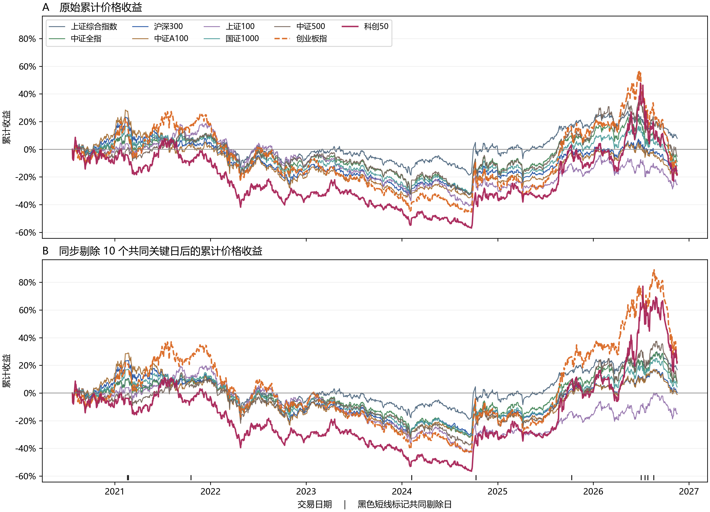

图 43　原始路径与同步剔除共同关键日后的路径

 初始收盘日为2020-07-23，累计收益从0开始。先对每组配对取历史赢家贡献最大的10日，再按每个日期入选的配对数降序排列，同票取较早日期。第二幅图将入选最多的十个日期上九条指数的日对数收益同时置零，其余日收益按原顺序复合。黑色短线标记被剔除日。纵轴与日期范围相同，每条曲线保留其自然波动幅度。该图使用全样本事后归因。[可编辑矢量图](https://github.com/zhoushuming073-cell/A-Share-Broad-Market-Index-Research/blob/886ff02/experiments/nine_index_path_dependence_v1/figures/nine_paths.svg) · [逐日净值，初始值为1](https://github.com/zhoushuming073-cell/A-Share-Broad-Market-Index-Research/blob/886ff02/experiments/nine_index_path_dependence_v1/results/nine_paths.csv) · [共同日期及得票](https://github.com/zhoushuming073-cell/A-Share-Broad-Market-Index-Research/blob/886ff02/experiments/nine_index_path_dependence_v1/results/common_key_dates.csv)

为检验科创50、创业板指可能偏离其余七条的观察，先对每组配对计算全路径的距离。令 $W_{i,t}$ 为从同一初值累计的财富，以 $\sqrt{\operatorname{mean}_t[(\log W_{i,t}-\log W_{j,t})^2]}$ 度量两条曲线在整个样本期的分离程度，再对指定组内的配对等权平均。表45的距离乘100，以对数点计。日收益相关性只使用保留日。

表 45　全路径距离与日收益相关性

| 比较组 | 配对数 | 原始路径距离 | 同删10日后 | 原始日收益相关 | 同删后日收益相关 |
|---|---:|---:|---:|---:|---:|
| 其余七条之间 | 21 | 10.45 | 9.57 | 0.916 | 0.917 |
| 科创50与其余七条 | 7 | 25.07 | 24.39 | 0.754 | 0.750 |
| 创业板指与其余七条 | 7 | 14.03 | 16.67 | 0.857 | 0.857 |
| 科创50与创业板指 | 1 | 19.40 | 22.20 | 0.834 | 0.827 |
| 全部配对 | 36 | 14.24 | 14.18 | — | — |

 其余七条之间的平均距离下降约8.5%，全部36组的平均距离仅下降约0.4%。科创50与七条的距离仍是七条内部距离的2.55倍，创业板指为1.74倍。数据支持这两条指数相对更分散的判断；同步删除后，创业板指反而离七条更远。删除5日或20日时，三个组的距离排序相同，但全池平均距离分别为14.05、15.35对数点。因而不能从删日操作推出九条曲线会普遍收敛。“科技行业集中造成分离”是待检验的机制，需要同期行业权重及收益归因。该分组是在配对主实验运行期间、绘制此图前提出的描述性分析。[逐对距离与相关](https://github.com/zhoushuming073-cell/A-Share-Broad-Market-Index-Research/blob/886ff02/experiments/nine_index_path_dependence_v1/results/path_distances.csv)

## 样本与判据

从 SQLite 行情库读取九条价格指数，以交易所代码标识。2015年开始的历史行情用于早期研究，本次统一使用科创50正式发布实时行情后的1,532个共同收盘点，得到2020-07-24至2026-11-17的1,531个日对数收益。九列均与上海交易日历逐日匹配，逐列重核来源、点位、发布日期和原始快照哈希。以绝对日对数收益超过10%作异常筛查，九列合计10个观测，保留经源文件核对的记录。价格收益未含现金分红，指数仍可能发生编制规则调整。[逐指数验收与编制方资料](https://github.com/zhoushuming073-cell/A-Share-Broad-Market-Index-Research/blob/886ff02/experiments/nine_index_path_dependence_v1/results/data_audit.csv) · [共同价格快照](https://github.com/zhoushuming073-cell/A-Share-Broad-Market-Index-Research/blob/886ff02/experiments/nine_index_path_dependence_v1/results/input_closes.csv) · [科创50发布公告](https://www.sse.com.cn/market/sseindex/diclosure/c/c_20200619_5130634.shtml)

主分析开始前固定以下操作性判据。超过半数配对同时满足翻转占比不超过1%、前五日占正贡献至少5%，才称“普遍且集中”。异常集中与异常重合的主统计量分别为36组的中位 $C_5$ 和630个集合比较的平均前五日 Jaccard，两者分别要求自己的单侧 p 值在五种设定下均不超过0.05。预测要求在20日和60日两个期限上均有正的中位增量样本外 $R^2$，且各有至少一组通过校正的正向DM检验。这些阈值为研究约定，原始连续统计量也全部保留。[预设协议版本](https://github.com/zhoushuming073-cell/A-Share-Broad-Market-Index-Research/blob/78357b0/experiments/nine_index_path_dependence_v1/config.yaml)

## A　终值有多容易翻转

令 $d_t=r_{j,t}-r_{i,t}$，$D=\sum d_t$，$z_t=\operatorname{sgn}(D)d_t$。原始赢家相对输家的财富优势为 $\exp(|D|)-1$。按 $z_t$ 降序移除前K日后的财富优势为 $\exp(|D|-\sum_{m=1}^K z_{(m)})-1$。转向后用 $|D|$ 判定首次失去领先，保证两种代码排序给出相同翻转日数。取 $C_K=\sum_{m=1}^K z_{(m)}/\sum z_t^+$，$HHI=\sum(z_t^+/\sum z_t^+)^2$，有效贡献日数为其倒数，抵消率为 $1-|D|/\sum|z_t|$。

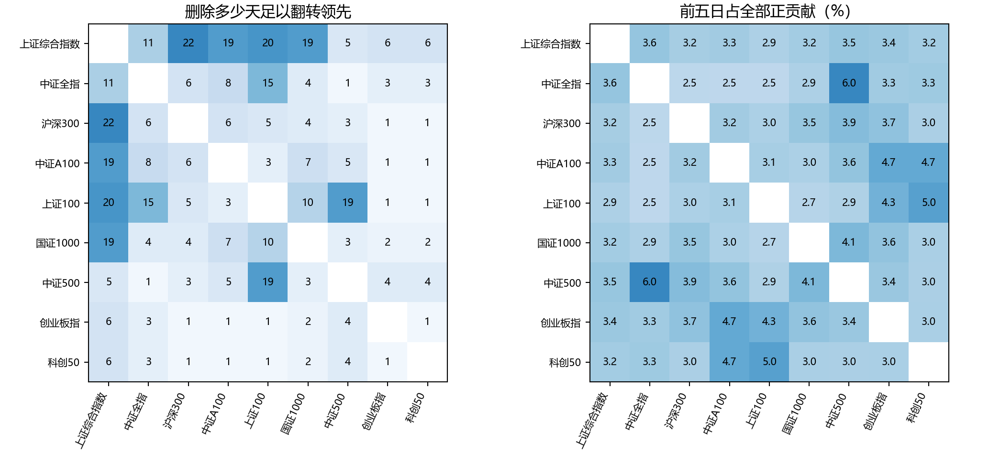

图 44　全体配对的历史归因

 翻转所需交易日从1至22日，中位值4日，占样本0.26%。31组达到低翻转门槛，只有2组同时达到5%的集中度门槛，低于预设多数标准。正向有效贡献日数的中位数为461日，最有利20日的贡献占比中位数为10.21%。历史终值的符号敏感性强于日贡献本身的集中程度。[36组的赢家、全部指标及删1、2、5、10、20日后的财富优势](https://github.com/zhoushuming073-cell/A-Share-Broad-Market-Index-Research/blob/886ff02/experiments/nine_index_path_dependence_v1/results/pairwise_summary.csv) · [逐对关键日及原始贡献](https://github.com/zhoushuming073-cell/A-Share-Broad-Market-Index-Research/blob/886ff02/experiments/nine_index_path_dependence_v1/results/key_days.csv)

## B　哪些日期反复出现

前五日名单的180个名额分布于60个交易日，前十日名单的360个名额分布于110个交易日。2021-02-22进入14组配对的前十，2026-07-28进入12组，2026-07-17进入11组。得票最多的十个日期合计占96个前十名额，为26.7%。每两组日期集合按交集除以并集计算重合度，630组比较的平均值在前五日为0.0754，前十日为0.0853。每个指数参与8组配对，36组共用同一段市场历史，对集中出现的日期需按联合样本推断。[逐日频数](https://github.com/zhoushuming073-cell/A-Share-Broad-Market-Index-Research/blob/886ff02/experiments/nine_index_path_dependence_v1/results/key_date_overlap.csv) · [逐月频数](https://github.com/zhoushuming073-cell/A-Share-Broad-Market-Index-Research/blob/886ff02/experiments/nine_index_path_dependence_v1/results/monthly_overlap.csv) · [全部两两重合度](https://github.com/zhoushuming073-cell/A-Share-Broad-Market-Index-Research/blob/886ff02/experiments/nine_index_path_dependence_v1/results/pair_jaccard.csv)

## C　零相对漂移下的联合检验

逐列从日收益扣除自身样本均值，再加回九列均值的平均值，得到共同市场平均漂移相同的九维向量。循环移动区块按均匀随机起点抽取，越过样本末端时绕回。平稳区块每天以1/20概率重新抽取起点。每次均同步抽取九维向量，累计至1,531日。每条模拟路径重新选择36组赢家，并重新计算关键日、正向贡献、有效日数及重合程度。重复抽到的来源日期在合成时间轴上是不同的收益日，同一次抽到的九个收益始终共用时间位置。按来源日期和同日抽取顺序打破并列。

每列20,000条路径。$k^*$ 取低尾，其余三行取高尾。概率用“尾部次数加一”除以20,001。对个别配对，在每个指标及区块设定内另行对36项检验作Holm校正。表中池级统计量直接从同步抽样的联合分布计算。

表 46　主统计量及辅助统计量的经验单侧p值

| 统计量 | 历史值 | 循环5日 | 循环10日 | 循环20日 | 循环60日 | 平稳20日 |
|---|---:|---:|---:|---:|---:|---:|
| 中位翻转日数 | 4 | .158 | .161 | .151 | .168 | .159 |
| 中位前五日贡献占比 | 3.26% | .750 | .727 | .712 | .679 | .701 |
| 平均前五日 Jaccard | .0754 | .969 | .973 | .973 | .979 | .977 |
| 平均前十日 Jaccard | .0853 | .971 | .969 | .967 | .970 | .970 |

以循环20日为例，模拟中位 $C_5$ 的中央95%区间为2.92%至4.57%，历史值处于区间内。五种设定对“异常偏高”的判断一致。配对级 $C_5$ 与低翻转日数检验经 Holm 校正均未达到5%。重合度的高尾 p 值接近1，表示模拟中出现更大重合度相当常见；本研究预设的是高尾检验。该基准以真实历史厚尾和共同冲击为抽样材料，只检验等平均漂移及既定局部时间依赖下的相对异常程度。[全部指标、经验区间、蒙特卡洛标准误与校正结果](https://github.com/zhoushuming073-cell/A-Share-Broad-Market-Index-Research/blob/886ff02/experiments/nine_index_path_dependence_v1/results/bootstrap_results.csv)

## 稳健性与样本切分

将1,531个收益日按时间分为前765日、后766日，在各半样本重新确定赢家与关键日。中位 $C_5$ 分别为4.64%和7.81%，中位翻转日占比分别为0.98%和0.33%，同时满足两个描述性门槛的配对比例分别为22.2%和88.9%。两段处于不同市场时期，且半样本的正贡献分母较小，故不把水平差异直接归于市场结构改变。全样本逐一排除某条指数、保留28组配对，中位 $C_5$ 在3.18%至3.31%之间。上述分段与排除比较是描述性敏感性检验，联合模拟推断对应预设全样本。[完整稳健性结果](https://github.com/zhoushuming073-cell/A-Share-Broad-Market-Index-Research/blob/886ff02/experiments/nine_index_path_dependence_v1/results/robustness_results.csv)

## D　过去的集中度能否预测下一阶段的风险

每个预测日收盘，用过去252日的赢家方向和正向贡献计算 $C_5$。目标为随后 $h$ 日相对对数收益平方和的平方根。三个模型依次使用过去252日的相对收益标准差及平均绝对收益，再加入 $C_5$，再加入有符号日均相对收益及绝对收益超过窗口标准差两倍的频率。逐日滚动OLS仅取最近252个已完全到期的标签，预测值以零为下限。相对历史均值预测和相对基准回归分别计算样本外 $R^2$。DM比较基准与扩展模型的平方损失，采用Bartlett权重、滞后 $h-1$ 的HAC标准误及双侧渐近检验，各预测期限和模型比较内对36组作Holm校正。目标重叠和嵌套模型限制检验功效。

表 47　历史集中度对未来相对波动的预测

| 期限 | 每组预测次数 | 扩展模型优于基准 | 中位增量样本外R² | 校正后显著改善 |
|---|---:|---:|---:|---:|
| 20日 | 989 | 4／36 | −12.87% | 0／36 |
| 60日 | 909 | 6／36 | −4.44% | 0／36 |

加入趋势与极端频率后，相对基准的中位增量 $R^2$ 分别为−22.92%和−15.83%。在这套滚动设计中，集中度没有达到预设预测标准。[各配对的MAE、RMSE、两种样本外R²与DM检验](https://github.com/zhoushuming073-cell/A-Share-Broad-Market-Index-Research/blob/886ff02/experiments/nine_index_path_dependence_v1/results/prediction_results.csv) · [逐日预测及实际值](https://github.com/zhoushuming073-cell/A-Share-Broad-Market-Index-Research/blob/886ff02/experiments/nine_index_path_dependence_v1/results/predictions.csv.gz)

## 学术判断

历史领先对少量交易日敏感，是本样本最一致的发现。结合贡献分母后，证据指向大量正负相对收益抵消形成小净差。异常集中、异常日期重合与样本外增量预测三个更强命题均未达到预先约定的标准。九条指数的持仓存在交叠，价格收益遗漏现金分红，仅观察到一段市场历史。指数曲线与行业权重间的因果关系仍待持仓数据检验。

# 七大A股宽基指数关键日识别与累计收益路径趋同实验（V2）

每组取前10日时，210个名额来自56个不同日期，其中37日获至少两票，占不同日期的66.07%，覆盖了90.95%的名额。整体分化得分最高的10天全部进入重复集合，但21组严格交集为空。共享一条指数的配对，其关键日名单平均 Jaccard 为0.246，完全不共享指数时为0.124。

**高频共同关键日并没有带来累计路径趋同。** 主样本中，四种自然集合的路径距离全部扩大。同删10日时，整体分化法、投票法、并集截取、重复集合截取的路径RMS分别扩大16.18%、17.47%、20.80%和20.80%。整体分化法删除前1%和前5%时，路径RMS也分别扩大15.81%和55.76%。

季度内独立循环平移关键日名单后，所保留的日期重合明显少于历史观察。同步重抽七指数收益向量后，历史重合值落入各区块设定的中央95%区间。前者揭示了跨配对的同期对齐，后者表明这种对齐与指数之间保留的同期联动相容。主样本的49种非空删日掩码中，没有一个取得正的全池路径改善率，或在预设高尾检验中显著优于相同数量的随机删日。

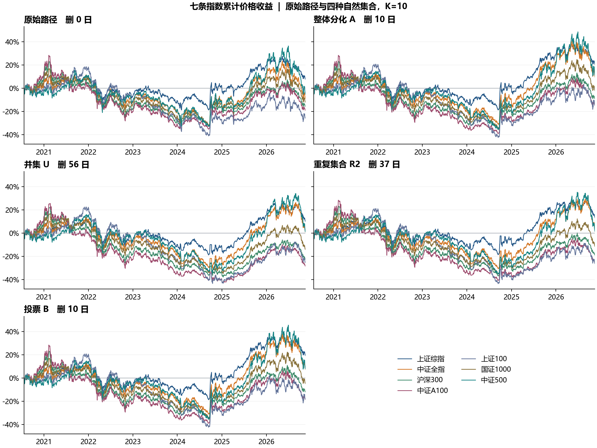

图 45　原始路径与四种自然方案

各面板采用同一价格收益刻度与原日期轴。K=10指每组配对各取10日，并集和重复集合实际分别删除56和37日。[原始及图示方案的逐日累计收益](https://github.com/zhoushuming073-cell/A-Share-Broad-Market-Index-Research/blob/92d0f2e38be570fc9f8b10df3b9c345336acf985/experiments/seven_index_convergence_v2/results/convergence_paths_main.csv) · [可编辑图](https://github.com/zhoushuming073-cell/A-Share-Broad-Market-Index-Research/blob/92d0f2e38be570fc9f8b10df3b9c345336acf985/experiments/seven_index_convergence_v2/figures/01_common_paths.svg)

## 样本与识别口径

仅使用上证综指000001、中证全指000985、沪深300 000300、中证A100 000903、上证100 000132、国证1000 399311、中证500 000905。直接读取SQLite价格指数收盘点位，将每列与交易所日历、原始行情及 SHA-256 哈希核对。主样本各有1,532个收盘点和1,531个收益，首个收益日为2020-07-24。七指数长样本各有2,884个收盘点和2,883个收益，起始收盘日为2015-01-05。检查通过后才对相邻收盘价取对数差。两个样本均包含上证100于2024-09-30和中证500于2025-04-07两条绝对日对数收益超过10%的记录，均与归档快照一致，按原值保留。价格指数收益采用各供应商归档口径，现金分红未计入。[数据验收](https://github.com/zhoushuming073-cell/A-Share-Broad-Market-Index-Research/blob/92d0f2e38be570fc9f8b10df3b9c345336acf985/experiments/seven_index_convergence_v2/results/data_audit.csv) · [异常筛查明细](https://github.com/zhoushuming073-cell/A-Share-Broad-Market-Index-Research/blob/92d0f2e38be570fc9f8b10df3b9c345336acf985/experiments/seven_index_convergence_v2/results/flagged_returns.csv) · [主样本快照](https://github.com/zhoushuming073-cell/A-Share-Broad-Market-Index-Research/blob/92d0f2e38be570fc9f8b10df3b9c345336acf985/experiments/seven_index_convergence_v2/results/input_closes_main.csv) · [长样本快照](https://github.com/zhoushuming073-cell/A-Share-Broad-Market-Index-Research/blob/92d0f2e38be570fc9f8b10df3b9c345336acf985/experiments/seven_index_convergence_v2/results/input_closes_long.csv)

配对关键日按 $|r_{i,t}-r_{j,t}|$ 降序排序，整体分化分数 $S_t$ 是该日21组绝对收益差的均值。同分取较早日期。配对关键日名单取K=10、20、50，以10为正文主展示。按名单得票构造并集U、至少获2、3、5、10票的重复集合，以及21票的严格交集。固定K的投票法B依次按票数、$S_t$ 和日期排序，前两项取降序，日期取升序。所有删除都采用共同日期掩码，使当日七条收益同步归零，累计路径在该日保持前值。[整体分化日期全排序](https://github.com/zhoushuming073-cell/A-Share-Broad-Market-Index-Research/blob/92d0f2e38be570fc9f8b10df3b9c345336acf985/experiments/seven_index_convergence_v2/results/overall_key_dates.csv) · [各配对前K日及绝对收益差](https://github.com/zhoushuming073-cell/A-Share-Broad-Market-Index-Research/blob/92d0f2e38be570fc9f8b10df3b9c345336acf985/experiments/seven_index_convergence_v2/results/pairwise_key_dates.csv) · [逐日票数、名单与配对排名](https://github.com/zhoushuming073-cell/A-Share-Broad-Market-Index-Research/blob/92d0f2e38be570fc9f8b10df3b9c345336acf985/experiments/seven_index_convergence_v2/results/date_frequency.csv)

## 日期共同性与名单统一性

表 48　各删日规模下的关键日期并集与重复率

| 每组前K | 总名额 | 并集U | 重复R2 | 重复日期占比 | 重复名额占比 | 严格交集 |
|---:|---:|---:|---:|---:|---:|---:|
| 10 | 210 | 56 | 37 | 66.07% | 90.95% | 0 |
| 20 | 420 | 112 | 75 | 66.96% | 91.19% | 0 |
| 50 | 1,050 | 259 | 176 | 67.95% | 92.10% | 0 |

K=10时，分别有19、7、14、11、5、0日获得1、2、3至4、5至9、10至20、21票。2024-02-07与2021-09-27各获13票，前者整体分化分数更高，在投票中排第一。两组配对间平均 Jaccard 为0.185，中位数0.111，标准差0.174，范围0至1，第5、25、75、95分位数分别为0、0.053、0.250、0.538。共享一条指数与完全不共享的比较各105组。两类均值差反映共同持有一条指数可能放大同步入选的机会，各组比较存在依赖。[集合汇总](https://github.com/zhoushuming073-cell/A-Share-Broad-Market-Index-Research/blob/92d0f2e38be570fc9f8b10df3b9c345336acf985/experiments/seven_index_convergence_v2/results/set_summary.csv) · [频率与日历名单](https://github.com/zhoushuming073-cell/A-Share-Broad-Market-Index-Research/blob/92d0f2e38be570fc9f8b10df3b9c345336acf985/experiments/seven_index_convergence_v2/results/frequency_distribution.csv) · [全部210组比较](https://github.com/zhoushuming073-cell/A-Share-Broad-Market-Index-Research/blob/92d0f2e38be570fc9f8b10df3b9c345336acf985/experiments/seven_index_convergence_v2/results/pairwise_jaccard.csv) · [分组分位数](https://github.com/zhoushuming073-cell/A-Share-Broad-Market-Index-Research/blob/92d0f2e38be570fc9f8b10df3b9c345336acf985/experiments/seven_index_convergence_v2/results/jaccard_summary.csv)

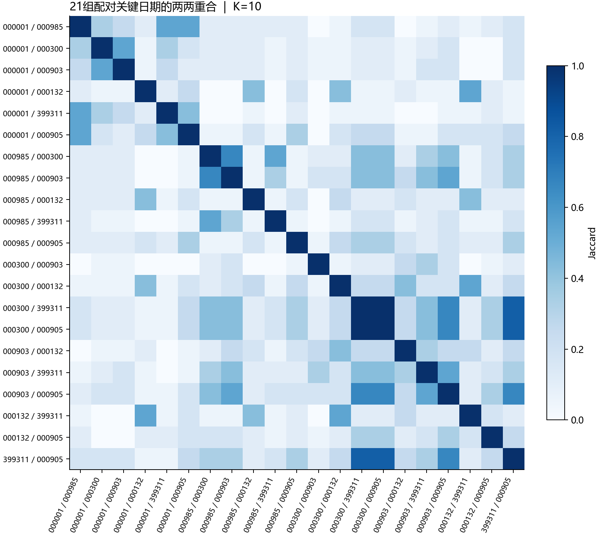

图 46　配对之间的关键日重合

对角线为自身比较，均值及分位数仅用非对角线的210组无序比较。[K=10矩阵](https://github.com/zhoushuming073-cell/A-Share-Broad-Market-Index-Research/blob/92d0f2e38be570fc9f8b10df3b9c345336acf985/experiments/seven_index_convergence_v2/results/jaccard_main_K10.csv) · [K=20矩阵](https://github.com/zhoushuming073-cell/A-Share-Broad-Market-Index-Research/blob/92d0f2e38be570fc9f8b10df3b9c345336acf985/experiments/seven_index_convergence_v2/results/jaccard_main_K20.csv) · [K=50矩阵](https://github.com/zhoushuming073-cell/A-Share-Broad-Market-Index-Research/blob/92d0f2e38be570fc9f8b10df3b9c345336acf985/experiments/seven_index_convergence_v2/results/jaccard_main_K50.csv)

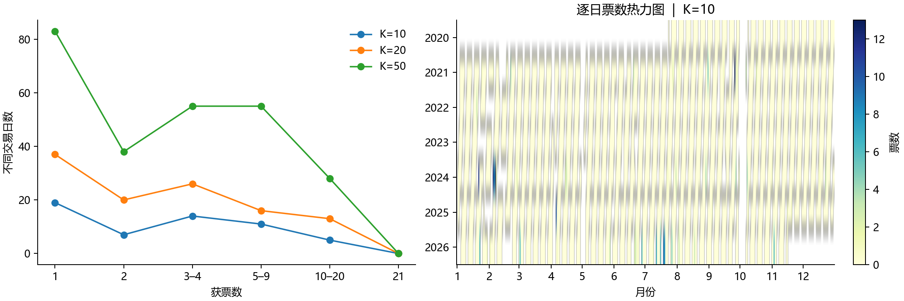

图 47　各票数区间的交易日数与逐日获票

热力图每格为一个日历日期，未交易日留空。

表 49　整体分化法与并集、重复集合和投票集合的重合度

| K | A日期在U内 | U日期在A内 | J(A,U) | A日期在R2内 | R2日期在A内 | J(A,R2) | A与B共同日 | J(A,B) |
|---:|---:|---:|---:|---:|---:|---:|---:|---:|
| 10 | 100% | 17.86% | .179 | 100% | 27.03% | .270 | 8 | .667 |
| 20 | 100% | 17.86% | .179 | 100% | 26.67% | .267 | 19 | .905 |
| 50 | 100% | 19.31% | .193 | 100% | 28.41% | .284 | 43 | .754 |

整体法的名单短，始终被重复集合完全覆盖，反向覆盖约27%至28%。因此高覆盖与中等Jaccard同时出现。K=10时，A与B共享8天，双向覆盖率均为80%。A独有2026-01-23、2026-03-03，B独有2026-07-13、2026-07-21。整体分化和配对投票产生相近但有差异的固定名单，二者的重合度在K=20最高。[双向覆盖与全部交集](https://github.com/zhoushuming073-cell/A-Share-Broad-Market-Index-Research/blob/92d0f2e38be570fc9f8b10df3b9c345336acf985/experiments/seven_index_convergence_v2/results/method_overlap.csv) · [A、U、R、B的共同与独有日期](https://github.com/zhoushuming073-cell/A-Share-Broad-Market-Index-Research/blob/92d0f2e38be570fc9f8b10df3b9c345336acf985/experiments/seven_index_convergence_v2/results/method_overlap_dates.csv) · [并集](https://github.com/zhoushuming073-cell/A-Share-Broad-Market-Index-Research/blob/92d0f2e38be570fc9f8b10df3b9c345336acf985/experiments/seven_index_convergence_v2/results/union_dates.csv) · [分门槛重复集合](https://github.com/zhoushuming073-cell/A-Share-Broad-Market-Index-Research/blob/92d0f2e38be570fc9f8b10df3b9c345336acf985/experiments/seven_index_convergence_v2/results/repeated_dates.csv) · [投票名单](https://github.com/zhoushuming073-cell/A-Share-Broad-Market-Index-Research/blob/92d0f2e38be570fc9f8b10df3b9c345336acf985/experiments/seven_index_convergence_v2/results/vote_dates.csv)

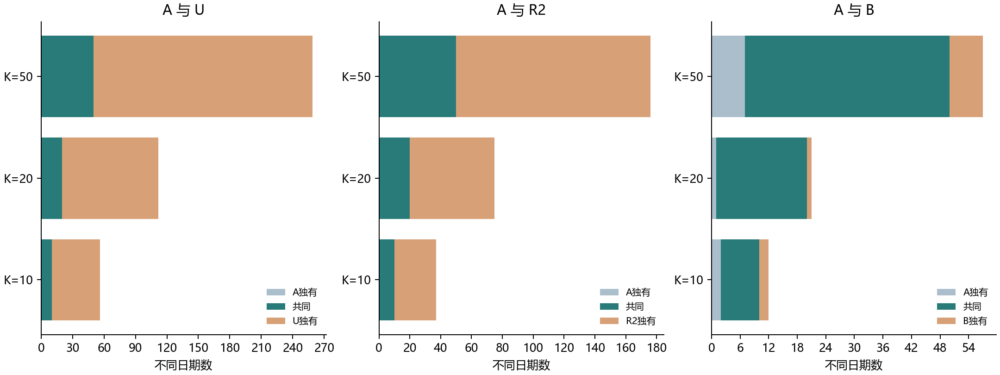

图 48　共同日期和各名单独有日期

严格交集在三个K均为空，原始路径保持不变。若A与空的重复集合比较，双向覆盖与Jaccard留空。

## 自然删日和等预算的路径比较

累计对数收益 $L_{i,t}$ 以共同起始收盘价为基期。全池RMS等于21组配对、全时间轴累计对数差的平方均值开根。路径改善率为 $1-D_{\text{after}}/D_{\text{before}}$，正值表示缩小。终点离散度分别用七条累计对数收益的总体标准差和累计简单收益最大值减最小值度量；日收益相关使用共同保留的交易日。

表 50　自然集合下的路径距离、终点差距和日收益相关性

| 方案 | 实删 | 路径RMS（对数点） | RMS改善率 | 终点极差（百分点） | 平均日相关 | 趋同配对 |
|---|---:|---:|---:|---:|---:|---:|
| 原始 | 0 | 11.51 | — | 33.11 | .9164 | — |
| 整体分化A，前1% | 15 | 13.32 | −15.81% | 37.90 | .9176 | 3 |
| 整体分化A，前5% | 77 | 17.92 | −55.76% | 49.73 | .9187 | 4 |
| A，K=10 | 10 | 13.37 | −16.18% | 35.11 | .9171 | 3 |
| U，K=10 | 56 | 15.41 | −33.95% | 38.46 | .9145 | 3 |
| R2，K=10 | 37 | 15.13 | −31.52% | 39.02 | .9179 | 2 |
| B，K=10 | 10 | 13.52 | −17.47% | 37.83 | .9164 | 3 |

重复集合的自然效果与并集同样为扩大路径距离。门槛升至3、5、10票后，K=10分别减少至30、16、5个实际删除日，路径RMS分别扩大32.20%、23.45%、16.60%。部分方案提高了日相关，同时扩大累计路径距离与终点差距。绝对分化分数同时选取方向相反的收益差，移除高分日也可能移除原本抵消长期累计差距的收益。日相关只描述当期的共变，路径距离还取决于每次冲击的方向和出现时间。[全部方案及删日比例](https://github.com/zhoushuming073-cell/A-Share-Broad-Market-Index-Research/blob/92d0f2e38be570fc9f8b10df3b9c345336acf985/experiments/seven_index_convergence_v2/results/convergence_results.csv) · [各方案实际删除日期与分数](https://github.com/zhoushuming073-cell/A-Share-Broad-Market-Index-Research/blob/92d0f2e38be570fc9f8b10df3b9c345336acf985/experiments/seven_index_convergence_v2/results/deletion_dates.csv) · [各配对RMS和相关](https://github.com/zhoushuming073-cell/A-Share-Broad-Market-Index-Research/blob/92d0f2e38be570fc9f8b10df3b9c345336acf985/experiments/seven_index_convergence_v2/results/pair_convergence.csv) · [各指数终点收益](https://github.com/zhoushuming073-cell/A-Share-Broad-Market-Index-Research/blob/92d0f2e38be570fc9f8b10df3b9c345336acf985/experiments/seven_index_convergence_v2/results/index_endpoints.csv)

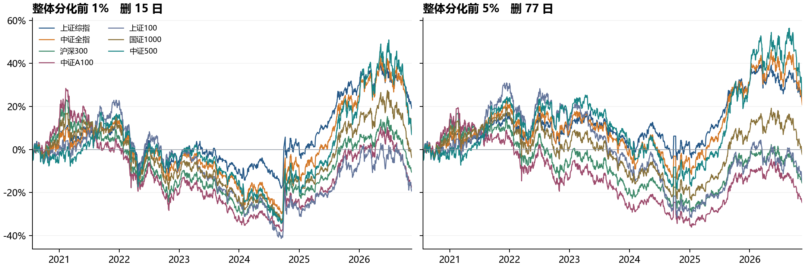

图 49　整体分化法的两个主要比例

每个比例乘以收益样本大小后四舍五入。前0.5%、2%、10%、20%的RMS也扩大，改善率分别为−16.44%、−42.32%、−30.92%、−67.72%。

表 51　等量去除日期时的四种方法比较

| 配对名单K | 固定实际删日M | A改善率 | U改善率 | R2改善率 | B改善率 |
|---:|---:|---:|---:|---:|---:|
| 10 | 10 | −16.18% | −20.80% | −20.80% | −17.47% |
| 10 | 20 | −25.41% | −22.80% | −21.39% | −22.38% |
| 10 | 37 | −43.46% | −36.75% | −31.52% | −31.52% |
| 20 | 20 | −25.41% | −22.80% | −22.80% | −30.50% |
| 50 | 50 | −37.55% | −23.90% | −23.90% | −45.23% |

等预算时，A继续按整体分化分数取前M，B按投票次序延伸或截短至M。U与R2在自身候选日中按入选配对的最大绝对收益差排序，再按 $S_t$ 和日期打破并列。候选不足M时不补日期。四种方法的相对排名随预算变化，表中没有一种使全池路径改善。投票法在自然K=10时的删日效率也未超过整体分化法。[所有相同预算比较](https://github.com/zhoushuming073-cell/A-Share-Broad-Market-Index-Research/blob/92d0f2e38be570fc9f8b10df3b9c345336acf985/experiments/seven_index_convergence_v2/results/deletion_budget_comparison.csv) · [候选不足的预算](https://github.com/zhoushuming073-cell/A-Share-Broad-Market-Index-Research/blob/92d0f2e38be570fc9f8b10df3b9c345336acf985/experiments/seven_index_convergence_v2/results/unavailable_budgets.csv)

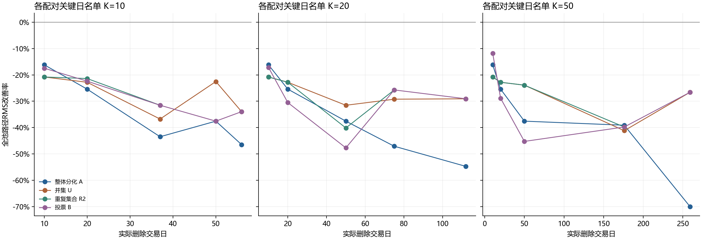

图 50　实际删除日数与全池RMS改善率

每个横坐标代表同一实际删除预算，线段连接已计算的预算点。

配对自身删日作为单独诊断，每一组仅对自己的两条收益同步应用自己的日期名单。K=10、20、50时中位改善率分别为−24.60%、−27.63%、−31.84%，21组中正改善的配对分别为2、3、4组。该诊断的各配对使用不同的时间掩码，结果只在配对内解释。[逐配对独立删除结果](https://github.com/zhoushuming073-cell/A-Share-Broad-Market-Index-Research/blob/92d0f2e38be570fc9f8b10df3b9c345336acf985/experiments/seven_index_convergence_v2/results/independent_pair_deletion.csv)

## 21组独立删日的逐组曲线与结果

每个面板以虚线表示原始累计价格收益，以同色实线表示该组同步剔除自身前10个关键日后的累计价格收益。所有面板共用同一个起始收盘日、日期轴和纵轴尺度。表中RMS乘100，以对数点表示。正的改善率对应距离缩小。

表 52　21组独立删日的原始与调整后路径距离

| 组 | 指数配对 | 原始 RMS | 删10日 RMS | 删10日改善率 | 删20日改善率 | 删50日改善率 |
|---:|---|---:|---:|---:|---:|---:|
| 1 | 上证综指／中证全指 | 8.90 | 8.77 | +1.36% | +5.80% | +5.46% |
| 2 | 上证综指／沪深300 | 15.49 | 16.41 | −5.98% | +14.29% | +22.80% |
| 3 | 上证综指／中证A100 | 18.67 | 18.77 | −0.54% | −10.38% | −10.69% |
| 4 | 上证综指／上证100 | 21.53 | 27.89 | −29.55% | −33.89% | −53.23% |
| 5 | 上证综指／国证1000 | 11.71 | 14.22 | −21.41% | −6.45% | −1.20% |
| 6 | 上证综指／中证500 | 8.84 | 13.64 | −54.18% | −51.95% | −31.84% |
| 7 | 中证全指／沪深300 | 7.91 | 17.23 | −117.75% | −166.06% | −229.28% |
| 8 | 中证全指／中证A100 | 10.94 | 23.23 | −112.35% | −144.75% | −211.55% |
| 9 | 中证全指／上证100 | 14.03 | 18.60 | −32.57% | −14.81% | −45.33% |
| 10 | 中证全指／国证1000 | 3.69 | 9.07 | −145.48% | −248.72% | −285.33% |
| 11 | 中证全指／中证500 | 3.82 | 3.92 | −2.61% | −2.50% | −1.71% |
| 12 | 沪深300／中证A100 | 3.41 | 6.78 | −98.67% | −28.87% | +13.31% |
| 13 | 沪深300／上证100 | 10.02 | 10.85 | −8.28% | −27.63% | −14.75% |
| 14 | 沪深300／国证1000 | 4.36 | 5.41 | −24.05% | −51.94% | −109.75% |
| 15 | 沪深300／中证500 | 10.87 | 13.54 | −24.60% | −25.00% | −112.43% |
| 16 | 中证A100／上证100 | 9.93 | 14.45 | −45.57% | −23.42% | −11.53% |
| 17 | 中证A100／国证1000 | 7.44 | 10.63 | −42.86% | −62.84% | −79.53% |
| 18 | 中证A100／中证500 | 13.63 | 18.03 | −32.27% | −54.72% | −138.08% |
| 19 | 上证100／国证1000 | 11.66 | 14.50 | −24.37% | −13.50% | −16.41% |
| 20 | 上证100／中证500 | 15.99 | 14.93 | +6.62% | +19.47% | +13.64% |
| 21 | 国证1000／中证500 | 6.73 | 7.09 | −5.39% | −40.50% | −84.02% |

K=10时，上证100与中证500的路径距离从15.99降至14.93对数点，改善6.62%。上证综指与中证全指缩小1.36%，其余19组均扩大。中证全指与国证1000的距离增幅最大，为145.48%。改用K=20和50后，改善的配对分别有3组和4组。

图 51　21组逐组曲线，第1至7组

图 52　21组逐组曲线，第8至14组

图 53　21组逐组曲线，第15至21组

## 随机基准和时间依赖

### 同一历史路径上的等数量随机删除

对每个不同实际预算M无放回均匀抽取10,000组日期。每次使用同一掩码处理七列，记录全池和21组RMS改善率以及终点极差缩小量。高尾经验概率使用“达到或超过观察值的次数加一”除以10,001。全池检验对去重后的49个非空掩码做Holm校正，RMS与终点极差各为一个检验族；配对诊断在每个掩码内对21组作Holm校正。该比较固定了行情历史、选择指标与删日数量，给出删日效果相对均匀日期的经验位置。

表 53　自然集合相对于等数量随机删日的比较

| K=10自然方案 | 删日数 | 实际改善率 | 随机改善率97.5分位 | 高尾p值 | Holm校正 |
|---|---:|---:|---:|---:|---:|
| A | 10 | −16.18% | 6.54% | .9998 | 1.000 |
| U | 56 | −33.95% | 15.23% | .9999 | 1.000 |
| R2 | 37 | −31.52% | 12.43% | 1.0000 | 1.000 |
| B | 10 | −17.47% | 6.54% | 1.0000 | 1.000 |

图 54　同一删日数量下的随机改善率

竖线为观察结果。尾概率方向预设为改善更大，接近1说明真实规则几乎都落在随机改善率下方。各面板按对应实际预算重抽。[全池与终点基准](https://github.com/zhoushuming073-cell/A-Share-Broad-Market-Index-Research/blob/92d0f2e38be570fc9f8b10df3b9c345336acf985/experiments/seven_index_convergence_v2/results/random_deletion_results.csv) · [逐配对统计](https://github.com/zhoushuming073-cell/A-Share-Broad-Market-Index-Research/blob/92d0f2e38be570fc9f8b10df3b9c345336acf985/experiments/seven_index_convergence_v2/results/random_pair_results.csv) · [10,000次模拟档案](https://github.com/zhoushuming073-cell/A-Share-Broad-Market-Index-Research/blob/92d0f2e38be570fc9f8b10df3b9c345336acf985/experiments/seven_index_convergence_v2/results/random_deletion_draws.npz)

### 日期重合的分层随机化

在每个年—季度内，以该季度实际交易日为环，各配对独立抽取一个均匀的平移量，将其全部入选日期在该季度内循环平移。每组的季度入选数量及季度内圆环间距完全保留，跨配对同日同步和跨季度边界的簇结构会被打散。原始整体A和得分 $S_t$ 固定，U、R2和B在每个随机副本上重建。对三个K、六个日期指标的18项高尾检验进行Holm校正。

K=10时，历史A与R2的Jaccard为0.270，分层随机化中央95%区间为0至0.103；配对间平均Jaccard为0.185，随机区间为0.0078至0.0150。18项检验的校正p值均约0.0018。该零假设对应给定季度结构下名单可独立平移，并破坏了组合共享指数带来的同期联动。它量化了日期对齐相对该条件基准的程度。[分层随机化分位数与尾概率](https://github.com/zhoushuming073-cell/A-Share-Broad-Market-Index-Research/blob/92d0f2e38be570fc9f8b10df3b9c345336acf985/experiments/seven_index_convergence_v2/results/date_randomization_results.csv) · [抽样档案](https://github.com/zhoushuming073-cell/A-Share-Broad-Market-Index-Research/blob/92d0f2e38be570fc9f8b10df3b9c345336acf985/experiments/seven_index_convergence_v2/results/date_randomization_draws.npz)

### 同步区块重抽

将相邻整段七指数收益向量一起抽出，区块首日均匀抽取，绕回样本起点，每条合成路径拼至1,531个收益日。区块长度为5、20、60，每个长度重抽10,000条。每次重算A、各配对名单、U、R2、B及重合度。相同来源日重复抽到时，按不同合成位置处理，分数并列采用合成轴上的先后顺序。各方法同时与该条路径上相同实际删除数量的随机删日作差，并额外将四个集合都截取到固定K进行比较。保留原经验联合收益分布作为抽样材料，结果用于检验描述性结论对历史顺序与局部依赖的敏感度。

表 54　同步区块重抽下的日期重合度与路径改善差

| 区块长度 | K=10 A与R2的Jaccard中央95% | K=10配对平均Jaccard中央95% | A相对等量随机的中位改善差 | U | R2 | B |
|---:|---:|---:|---:|---:|---:|---:|
| 5 | [.217, .313] | [.135, .218] | −4.87 pp | −9.66 pp | −11.69 pp | −6.23 pp |
| 20 | [.214, .323] | [.132, .222] | −5.21 pp | −10.80 pp | −12.94 pp | −6.40 pp |
| 60 | [.217, .323] | [.132, .228] | −7.97 pp | −14.15 pp | −16.17 pp | −8.79 pp |

历史K=10的0.270和0.185落在三种同步区块的对应区间内。K=10、20、50的三个区块设定下，四种方法相对各自等量随机的改善差中位数都为负。K=10时，四种自然方案的改善差中央95%区间均跨零，表明模拟路径上的删日效果会改变符号。固定K的四种方法及所有有效次数均保存在统计表中。区块重抽区间描述经验联合过程下的统计波动，受总体历史分布和日期重复抽样影响。[同步区块统计表](https://github.com/zhoushuming073-cell/A-Share-Broad-Market-Index-Research/blob/92d0f2e38be570fc9f8b10df3b9c345336acf985/experiments/seven_index_convergence_v2/results/bootstrap_results.csv) · [5日抽样](https://github.com/zhoushuming073-cell/A-Share-Broad-Market-Index-Research/blob/92d0f2e38be570fc9f8b10df3b9c345336acf985/experiments/seven_index_convergence_v2/results/bootstrap_block_5.npz) · [20日抽样](https://github.com/zhoushuming073-cell/A-Share-Broad-Market-Index-Research/blob/92d0f2e38be570fc9f8b10df3b9c345336acf985/experiments/seven_index_convergence_v2/results/bootstrap_block_20.npz) · [60日抽样](https://github.com/zhoushuming073-cell/A-Share-Broad-Market-Index-Research/blob/92d0f2e38be570fc9f8b10df3b9c345336acf985/experiments/seven_index_convergence_v2/results/bootstrap_block_60.npz)

图 55　区块长度敏感性

前两幅为日期重合分布，后四幅以“针对性方案改善率减相同数量随机删日改善率”衡量净效果。图内短横线表示中位数。

## 2015年以来的长样本复核与结论

在七条共同覆盖的长样本上重新选日。K=10时，并集47日，重复集合29日，重复日期占61.70%，覆盖91.43%的名额，21组严格交集仍为空。K=20和50也没有严格共同日期。四种自然删日仍扩大路径，K=10时分别扩大103.37%、186.71%、150.91%和103.63%。删日数统一为10天时，A、B扩大约103%，两个截取集合扩大约73%。前1%和5%两个整体法的方向也相同。长样本结果属于对样本边界的描述性复核，正文的随机检验和重抽样区间均使用预设主样本。

本次结果回答了两个不同的问题。七条宽基有一批反复入选的高分化日，且共同性在不同K和长样本中持续可见。与此同时，删除这些高分化日后，净值路径整体更分散。日期共同性可以反映共享指数与共同市场冲击，净值路径由每日分化的方向、规模和时间累积决定。指数价格历史的共同性本身无法识别行业、调样或资金流等经济机制。

## 复现与文件

从仓库根目录运行。代码使用仓库行情库及原始快照，并依赖仓库 Python 环境和 exchange_calendars 4.13.2。测试读取重新生成的结果，并以独立计算核对投票、集合、掩码、K=0恒等性、Jaccard、区块排序和预算匹配。

~~~powershell
python experiments/seven_index_convergence_v2/run_all.py
python -m unittest discover -s experiments/seven_index_convergence_v2 -v
~~~

[配置](https://github.com/zhoushuming073-cell/A-Share-Broad-Market-Index-Research/blob/92d0f2e38be570fc9f8b10df3b9c345336acf985/experiments/seven_index_convergence_v2/config.yaml) · [计算入口](https://github.com/zhoushuming073-cell/A-Share-Broad-Market-Index-Research/blob/92d0f2e38be570fc9f8b10df3b9c345336acf985/experiments/seven_index_convergence_v2/run_all.py) · [随机种子、依赖版本和行情哈希](https://github.com/zhoushuming073-cell/A-Share-Broad-Market-Index-Research/blob/92d0f2e38be570fc9f8b10df3b9c345336acf985/experiments/seven_index_convergence_v2/results/simulation_manifest.json) · [测试](https://github.com/zhoushuming073-cell/A-Share-Broad-Market-Index-Research/blob/92d0f2e38be570fc9f8b10df3b9c345336acf985/experiments/seven_index_convergence_v2/test_research.py) · [图表目录](https://github.com/zhoushuming073-cell/A-Share-Broad-Market-Index-Research/tree/92d0f2e38be570fc9f8b10df3b9c345336acf985/experiments/seven_index_convergence_v2/figures) · [完整结果目录](https://github.com/zhoushuming073-cell/A-Share-Broad-Market-Index-Research/tree/92d0f2e38be570fc9f8b10df3b9c345336acf985/experiments/seven_index_convergence_v2/results)

# 七指数收益曲线在后半段是否平行

原始行情中，21组配对有15组的后半段走势比前半段更平行。各配对独立删去10个关键日后，仍有12组表现出这一特征。若把删日前后的同一后半段直接比较，只有2组在整个后半段更平行。这三组计数采用同一批价格和同一距离定义，区别在于比较对象。图56以上证综指和沪深300说明这种区别。

## 衡量已经形成的差距与段内走势

保持上一章的七条价格指数、21组配对、1,531个日对数收益和全部历史关键日名单。将交易日按时间顺序等分，前765个收益日从2020年7月24日至2023年9月13日，后766个从2023年9月14日至2026年11月17日。共同基日收盘为2020年7月23日。分段边界由交易日数量确定。删日当天两腿收益同时置零，交易日仍占一个位置。每组独立删日时，同一指数可能在不同配对中被删去不同日期。

记 $g_t$ 为指数 $i$ 和 $j$ 从全样本共同起点累计的对数收益之差。对任一含 $n$ 个收盘观察的区间 $W$，令 $\bar g_W$ 为区间平均差。旧距离 $L_W$ 衡量两条曲线在原始位置上相隔多远，新距离 $D_W$ 衡量差距围绕平均值波动多少。两者可以在同一组日期上精确分解。

$$
L_W^2=\frac{1}{n}\sum_{t\in W}g_t^2=\bar g_W^2+D_W^2,\qquad
D_W=\sqrt{\frac{1}{n}\sum_{t\in W}(g_t-\bar g_W)^2}.
$$

例如，两条累计对数收益曲线始终相隔20个对数点，则旧距离是20，新距离为零。若间距从10点逐渐扩大到30点，新距离就会大于零。计算只允许整体上下平移，保留趋势、波动幅度和交易日期。均值偏移占比 $\bar g_W^2/L_W^2$ 衡量该段平均间距在平方距离中的份额。仅凭这个份额无法确定差距具体在哪一天形成。

对每个完整的60、120或252个观察日窗口重复计算 $D_W$，再在所在半段取等权平均。每个窗口独立估计平均差，且完全位于该半段内。为对应原图的线性纵轴，另计算从共同基日以1起步的两条净值之差在段内的总体标准差。该指标捕捉固定的净值点差，对数指标捕捉固定的财富比例。日跟踪误差按两腿日对数收益差的样本标准差乘以 $\sqrt{252}$ 计算，包含已置零的日子。

## 后半段走势与前期累积差距

原始行情中，21组中心化距离的中位数从前半段5.45降至后半段3.93个对数点。逐组比较，15组缩小，6组扩大。独立删10日后，前后半段的横截面中位数为6.06和6.26点，逐组仍有12组缩小。两项统计的差别来自各组的起始距离与变化幅度，表55给出逐行对照。

图 56　上证综指与沪深300在共同起点和后半段起点下的走势

上排保留2020年起的累计路径，竖线标出后半段首日。下排在2023年9月13日收盘将两腿同时归零，用同一纵轴比较删日前后。原始行情下，后半段上证综指平均领先19.62个对数点，旧距离为19.71点，中心化距离为1.82点。平均间距解释平方距离的99.15%。删去该配对的10个关键日后，其中7日在后半段，中心化距离升至2.43点，仍明显小于删日后前半段的7.59点。重新对齐有助于读图，中心化度量则避免单个起始日决定整段距离。

表 55　各配对前后半段的中心化距离（对数点）

| 配对 | 原始前半 | 原始后半 | 各删10日前半 | 各删10日后半 |
|---|---:|---:|---:|---:|
| 上证综指 / 中证全指 | 2.83 | 3.91 | 2.83 | 4.03 |
| 上证综指 / 沪深300 | 7.59 | 1.82 | 7.59 | 2.43 |
| 上证综指 / 中证A100 | 9.75 | 2.37 | 9.64 | 3.04 |
| 上证综指 / 上证100 | 6.06 | 5.79 | 6.06 | 9.91 |
| 上证综指 / 国证1000 | 4.96 | 2.67 | 4.96 | 2.66 |
| 上证综指 / 中证500 | 3.17 | 6.98 | 3.17 | 8.93 |
| 中证全指 / 沪深300 | 5.60 | 3.93 | 6.30 | 7.17 |
| 中证全指 / 中证A100 | 7.92 | 3.54 | 10.79 | 6.26 |
| 中证全指 / 上证100 | 4.39 | 7.21 | 4.15 | 8.77 |
| 中证全指 / 国证1000 | 2.68 | 2.10 | 2.68 | 4.63 |
| 中证全指 / 中证500 | 3.16 | 3.79 | 3.83 | 4.00 |
| 沪深300 / 中证A100 | 2.50 | 1.18 | 3.80 | 1.15 |
| 沪深300 / 上证100 | 8.05 | 5.78 | 9.68 | 7.11 |
| 沪深300 / 国证1000 | 3.03 | 2.12 | 3.42 | 2.62 |
| 沪深300 / 中证500 | 8.61 | 6.92 | 10.02 | 8.44 |
| 中证A100 / 上证100 | 10.12 | 6.36 | 14.68 | 7.37 |
| 中证A100 / 国证1000 | 5.42 | 1.61 | 6.45 | 2.01 |
| 中证A100 / 中证500 | 10.95 | 6.19 | 13.48 | 8.05 |
| 上证100 / 国证1000 | 5.45 | 6.45 | 4.91 | 7.71 |
| 上证100 / 中证500 | 4.14 | 9.56 | 4.14 | 10.15 |
| 国证1000 / 中证500 | 5.66 | 4.82 | 6.31 | 5.59 |

## 删除关键日的效果随观察期限变化

以下固定比较同一后半段内删日前后的差异。改善率为 $1-M_{1}/M_{0}$，其中 $M_0$ 和 $M_1$ 分别为同一配对、同一区间按相同口径计算的删前与删后距离。表56先逐组计算改善率，再取21组中位数。起点固定距离与各项对数中心化距离均以对数点表示，线性净值距离为每100单位初始资金对应的净值点，年化跟踪误差为百分数。

表 56　后半段各配对独立删10日前后的比较

| 观察口径 | 删前中位数 | 删后中位数 | 逐组改善率中位数 | 距离缩小组数 |
|---|---:|---:|---:|---:|
| 起点固定距离 | 11.88 | 18.65 | -27.18% | 4/21 |
| 整段中心化距离 | 3.93 | 6.26 | -23.06% | 2/21 |
| 60日中心化距离 | 1.52 | 1.41 | +5.07% | 19/21 |
| 120日中心化距离 | 2.04 | 2.00 | +1.71% | 11/21 |
| 252日中心化距离 | 2.68 | 2.92 | -7.29% | 3/21 |
| 线性净值中心化距离 | 4.36 | 6.82 | -19.62% | 2/21 |
| 年化日跟踪误差 | 8.22 | 7.33 | +9.65% | 21/21 |

60日窗口中有19组局部距离缩小，120日窗口中有11组，252日窗口中有3组。覆盖整个后半段时，有2组中心化距离缩小，分别为上证综指与国证1000、沪深300与中证A100。按线性净值点差复核，同样有2组缩小。按绝对日收益差选日会直接影响日跟踪误差，因此该项下降对长期路径的解释力有限。逐日差异的方向可以持续累积，也可以随后反转，两种情形均可能伴随较小的短窗距离。

图 57　21组在后半段独立删10日后的距离改善率

图中逐格对照四种度量。蓝色表示距离缩小。以沪深300与上证综指为例，删日使后半段120日局部距离缩小4.97%，同时使整个后半段的中心化距离扩大33.67%。逐窗扣除平均差后，较慢积累的相对走势对局部统计量的影响随窗口缩短而减弱。

沿用V2其他日期名单，逐组独立删20日和50日后，整个后半段中心化距离分别有2组和1组缩小。改为七指数共用同一份名单，K=10时整体分化法A、并集U、重复集合R2和投票B分别有4、1、1、4组缩小，对应实际删日数为10、56、37、10。表56中的独立删日结果对应每组自己的10个日期。

本节是在阅读全期路径后提出的描述性复核。中点和窗口以统一交易日数确定，关键日沿用全历史识别结果，未做样本外预测。不同窗口彼此重叠，21组也共享指数。文中的计数和中位数描述这段历史，未对新增指标进行独立样本显著性检验，也未设定普适的“高度重合”阈值。原报告的固定起点距离继续用于衡量实际累计财富差异，本节的中心化距离用于衡量同段走势的平行程度。

全部区间与配对明细保存在 `experiments/seven_index_convergence_v2/results/local_shape_pairs.csv`，分组汇总见同目录的 `local_shape_summary.csv`。从仓库根目录运行 `python experiments/seven_index_convergence_v2/local_shape.py` 可重新计算并生成图56和图57的PNG及SVG文件。
