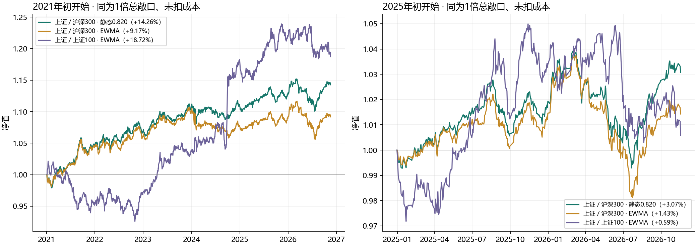

# 两次配对实验的比较口径

原实验是2021年开始的上证指数/沪深300，静态比例约0.820，每1元净资产做多1元、做空0.820元，总敞口1.820倍。全期累计27.03%。改成1倍总敞口后，累计14.26%。图中的新实验是2015年开始的上证指数/上证100，EWMA每月更新，另画了扣成本曲线。

上图静态比例用2021—2024年估计，左图含估计期，右图在估计期之后。两个EWMA曲线用过去可得收益更新比例。配对与参数已经被历史研究查看过，这张图用于解释口径差异。

上证/上证100的图中配置在2015—2022年训练段亏损8.64%、夏普−0.218，未通过训练夏普大于零的筛选条件。它是测试期回看收益最高的配置。真正经过验证选出的配置是沪深300/上证100的60日波动率比。

训练段用于静态Beta估计、动态规则历史回放与盈利门槛筛选。验证段在通过门槛的配置中按夏普选择配对、方向、方法和参数。测试段固定这些选择，动态比例继续按既定算法更新。现有规则没有预测未来相对收益，也没有在预期不利时平仓或切换多空方向。

OLS和EWMA以历史协方差/方差估计对冲比率，目标是减少共同波动。即使估计完全正确，扣除市场部分后的平均收益仍然可能小于零。三段切分检查这类收益能否延续，切分本身不产生收益。

当前搜索只覆盖六条指数和既定规则。结果支持该搜索尚未找到可靠的事前选择方法。对于所有宽基相对价值策略是否可行，现有实验不能给出普遍结论。
