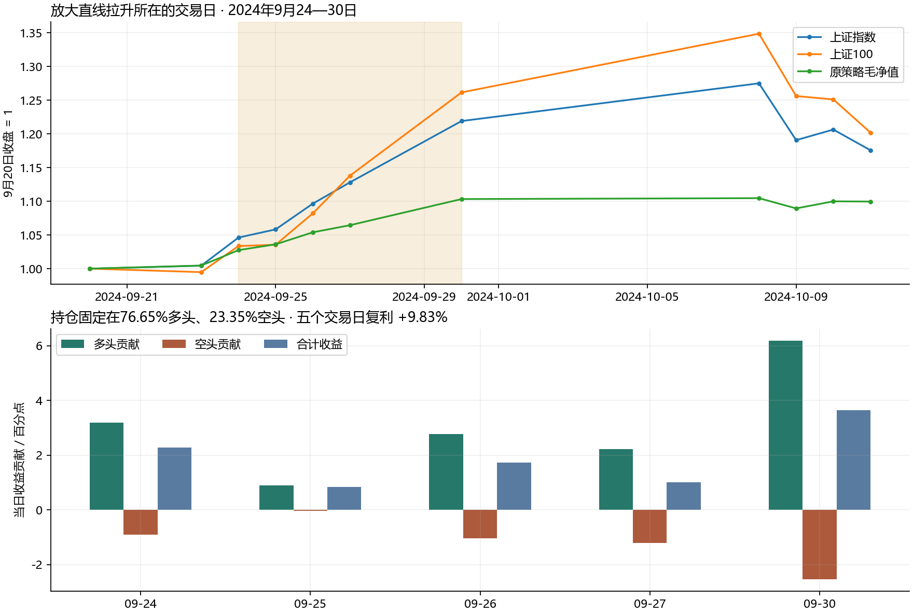

# 上证指数／上证100在2024年9月的净值跃升审计

原曲线的直线拉升对应2024-09-24至2024-09-30五个收益日，累计模拟毛收益9.8250%。原始点位、收益计算、资金复利和冻结持仓可重建，未发现这段由日期错位、净值重置或拼接产生的异常。行情已经指数公司及两家独立供应商核对。该盈利高度依赖当时的净多头方向暴露。

## 逐日验算

|日期|上证收盘|上证100收盘|上证涨跌|上证100涨跌|多头贡献|空头贡献|组合涨跌|
|---|---:|---:|---:|---:|---:|---:|---:|
|2024-09-24|2863.13|4347.83|4.1547%|3.8940%|3.1844%|-0.9095%|2.2749%|
|2024-09-25|2896.31|4356.16|1.1589%|0.1916%|0.8882%|-0.0447%|0.8435%|
|2024-09-26|3000.95|4552.12|3.6129%|4.4985%|2.7691%|-1.0506%|1.7185%|
|2024-09-27|3087.53|4787.48|2.8851%|5.1703%|2.2113%|-1.2075%|1.0037%|
|2024-09-30|3336.50|5307.28|8.0637%|10.8575%|6.1804%|-2.5358%|3.6447%|

事件前收盘到末日，上证涨21.37%，上证100涨26.82%。9月30日组合收益为 0.766450 × 8.0637% − 0.233550 × 10.8575% = 3.6447%。

## 持仓为何偏多

9月2日为9月首个收益日，当月参数只使用截至2024-08-29的日收益，计划在8月30日收盘执行。用全历史有限指数权重手工重建，h=0.304716831，与保存头寸一致。9月全月冻结比例，净多头53.2900%。8月28日估计h约0.437，8月29日上证跌0.50%、上证100涨2.05%，短期协方差估计降至0.305；8月30日当日收益不参与9月的冻结估计。

10月首个收益日是10月8日，代码在9月30日收盘换至新比例，信息截止9月27日。重新定权只改变头寸，净值不因定权跳变。每日按净值恢复既定权重仍会产生交易。

## 方向暴露与配对差额

使用恒等式 r_p = (w_A + w_B) × r_A + (−w_B) × (r_A − r_B)，将第一项解释为净多头按上证收益获得的贡献，第二项为等金额配对部分。按事件期初资本1元，逐日按此前净值加权，得出完全相加的盈亏。
净多头部分贡献10.9977%，相对收益部分贡献-1.1727%，合计9.8250%。这是一种会计分解，基准取上证指数；净名义敞口不等同于市场Beta。该窗口的行情变化令历史估计的对冲比例未能消除市场方向。

## 频率与极端事件依赖

|保持其他规则的对照|五日毛收益|全测试期毛收益|剔除五日后毛收益|
|---|---:|---:|---:|
|ewma_0.94_D|3.44%|4.40%|0.93%|
|ewma_0.94_W|5.69%|6.89%|1.14%|
|ewma_0.94_M|9.83%|10.78%|0.87%|
|ewma_0.94_Q|5.09%|6.35%|1.20%|
|one|-2.36%|3.05%|5.54%|

剔除日仅用于收益集中度诊断，各日比例采用原路径，假设当日收益归零，不代表提前规避或重新优化。所有频率参数来自原始已搜索网格。

## 独立来源与复算

|来源|指数|核对日期数|最大点位差|
|---|---|---:|---:|
|CSI|000001|82|0.0000|
|CSI|000132|82|0.0000|
|Sina|000001|82|0.0050|
|Sina|000132|82|0.0050|
|Tencent|000001|82|0.0000|
|Tencent|000132|82|0.0000|

逐日比较范围2024-07-01至2024-10-31，包含参数估计末端和拉升窗口。CSI官方和腾讯与库内点位一致，新浪高精度点位最大相差0.005点。新浪与腾讯是独立供应商，其底层指数仍来自相同官方发布体系。

原始响应的标准化快照和SHA-256见 outputs/inputs/pair_jump_audit 与 [来源核对表](../outputs/tables/pair_jump_source_checks.csv)。[逐日贡献](../outputs/tables/pair_jump_daily_audit.csv) · [频率对照](../outputs/tables/pair_jump_counterfactuals.csv)。

在项目根目录运行 python scripts/audit_pair_jump.py，使用已获取的独立来源快照。重建了全2883个收益日的毛净值，并与原图保存的成本净值核对。

本次审计支持这段模拟收益可由已核对的历史行情与既定规则产生。该收益的实盘可实现性仍依赖上证100空头工具、成交价格与借券条件。
