# A股宽基指数两两配对交易研究

**2024-07-02 至 2026-11-17 的留出测试中，验证期锁定的沪深300 / 上证100累计毛收益 3.06%，计入单边5bp及年化2%借券假设后为 0.49%。** 测试期回看可找到累计赚 10.78% 的上证指数 / 上证100。独立按年重复选对后，累计毛收益为 -1.94%。结合成本、统计证据与空头工具缺口，暂不支持进入以收益为考核目标的模拟基金阶段。

## 冠军配对的完整历史曲线

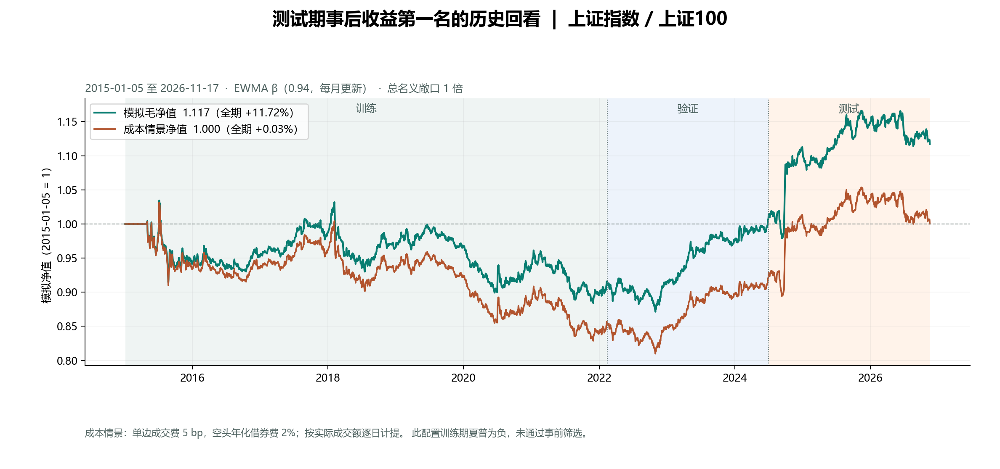

曲线从2015-01-05的1元起始，覆盖训练、验证和测试三个阶段。同一组EWMA 0.94、每月更新的参数贯穿全段。该组合是看过测试期收益后选出的冠军，训练期与验证期曲线用于展示历史表现。逐日净值见[完整历史数据](../outputs/tables/pair_champion_full_history.csv)。

| 阶段 | 收益日 | 毛收益 | 成本情景收益 | 毛收益年化 | 毛收益最大回撤 |
|---|---:|---:|---:|---:|---:|
| 训练 | 1,729 | -8.64% | -14.52% | -1.31% | -14.53% |
| 验证 | 577 | +10.39% | +7.92% | +4.41% | -5.30% |
| 测试 | 577 | +10.78% | +8.44% | +4.57% | -4.47% |
| 全期 | 2,883 | +11.72% | +0.03% | +0.97% | -15.75% |

阶段收益分别从阶段首日净值重新计量。

## 测试期收益冠军的模拟净值

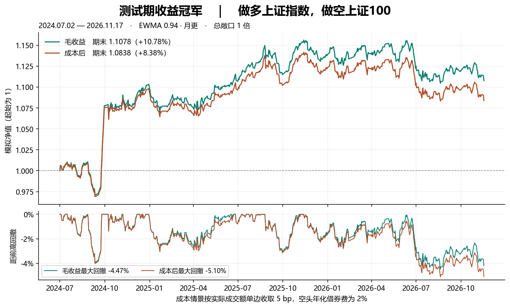

## 冻结选择与历史冠军

| 角色 | 多头 / 空头 | 方法 | 平均 h | 累计 | 年化 | 波动 | 夏普 | 最大回撤 | 成本后累计¹ |
|---|---|---|---|---|---|---|---|---|---|
| 验证锁定 | 沪深300 / 上证100 | 波动率比 60 · 日更 | 0.786 | 3.06% | 1.33% | 5.21% | 0.28 | -6.55% | 0.49% |
| 测试事后冠军 | 上证指数 / 上证100 | EWMA 0.94 · 月更 | 0.597 | 10.78% | 4.57% | 5.61% | 0.83 | -4.47% | 8.38% |
| 原配对等敞口基准 | 上证指数 / 沪深300 | 训练期静态OLS | 0.920 | 2.55% | 1.11% | 2.69% | 0.42 | -4.37% | -0.09% |

¹ 两腿实际买卖金额分别收费，计入进入与退出；空头按期初市值和实际日历天数/365计息。各表除注明外均为价格指数毛收益，现金利息和无风险率设为零。h 为每1元多头对应的空头金额。动态方法的平均 h 仅用于描述，不能作为每日固定值。

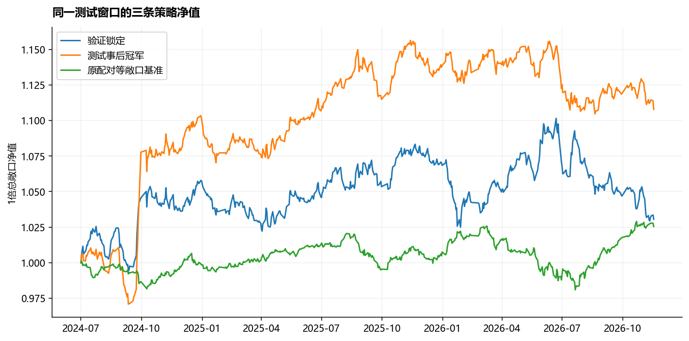

## 候选池与研究设计

项目库有6条具有日线的指数，均属于本任务指定的宽基。覆盖 2015-01-05 至 2026-11-17，每条 2,884 个共同收盘点、2,883 个收益日，缺失率均为零。本次搜索边界是已入库的宽基。无已入库行业或主题指数。逐指数起止、类别、纳入状态见[候选池](../outputs/tables/index_universe.csv)。

| 阶段 | 首个收益日 | 末个收益日 | 天数 |
|---|---|---|---|
| 训练 | 2015-01-06 | 2022-02-14 | 1729 |
| 验证 | 2022-02-15 | 2024-07-01 | 577 |
| 测试 | 2024-07-02 | 2026-11-17 | 577 |

先计算15个无序配对、30个方向的基础指标，再在每个方向测试52个配置。固定方向有1,380种、双向均值回归180种，合计1,560。训练夏普必须为正、验证期持仓日占比至少50%，按验证夏普选一组，保留最后一个验证收盘作为建仓时间。测试期的冠军、前三张榜单与全期冠军仅作回顾。该项目此前已使用过部分测试年份，时间切分可以约束本程序的信息流，不能恢复研究者从未看过的历史。

固定方向的对冲网格包括等金额、训练期含截距的固定OLS、60/120/252/504日滚动OLS、衰减系数0.94/0.97/0.99的EWMA、四个同窗口的波动率比。后三种方法均按日/周/月/季更新 h，EWMA至少60日预热。全日线在同一日历上评价，预热或无效比例时持现；训练期包含冷启动及静态OLS样本内拟合。动态策略持有 t−1 至 t 的头寸使用截至 t−2 收盘的信息，静态OLS保留最后一个训练交易日作为执行缓冲。

主实验每天将总名义归一为1倍净资产，多头权重1/(1+h)，空头权重−h/(1+h)。周/月/季指 h 的更新频率；下文另测期间完全不交易、允许权重漂移。相同的毛敞口不保证对市场 Beta 中性。逐日实际金额按初始资本1元记录，乘以初始资金即可换算；净敞口为两腿带符号权重之和。现金多头全额占用为多头权重，另以空头名义100%作为抵押压力示例，两者之和为名义占用，实际保证金依工具另核。原始口径 rA−h×rB 保存在逐日档及全结果表，活跃时原始总敞口1+h。

## 收益由什么决定

**配对选择。** 固定1∶1后，30个方向的测试年化介于 -2.40% 和 2.27%。下图每个方向取该方向事后年化最高的配置，因此包含方向内选优。两条指数原始曲线从测试建仓收盘归一为1。

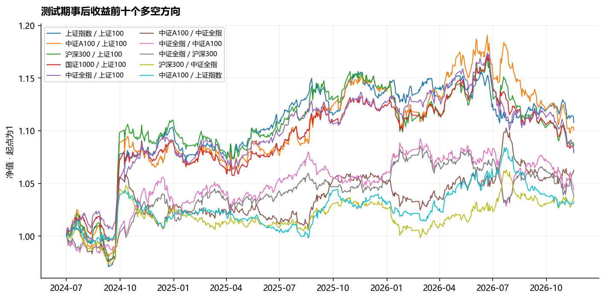

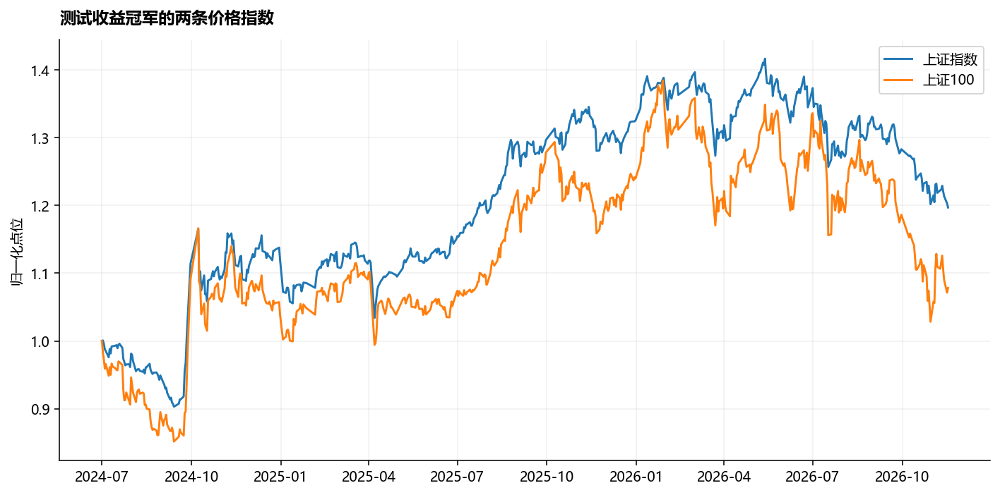

**对冲比例。** 锁定策略的60日波动率比在测试期介于 0.521 和 1.003，合计平均多头权重56.20%、空头权重-43.80%、净敞口12.40%。下面固定这一配对，每个方法用验证夏普最高的规格进行描述性对照。

| 方法 | 验证夏普 | 测试累计 | 测试波动 | 测试回撤 |
|---|---|---|---|---|
| 波动率比 60 · 日更 | 0.68 | 3.06% | 5.21% | -6.55% |
| EWMA 0.94 · 日更 | 0.57 | -0.04% | 5.38% | -7.87% |
| 等金额 | 0.48 | 1.27% | 5.83% | -6.42% |
| 滚动OLS 60 · 日更 | 0.37 | 5.37% | 5.50% | -7.59% |
| 训练期静态OLS | 0.13 | 3.77% | 5.21% | -6.93% |

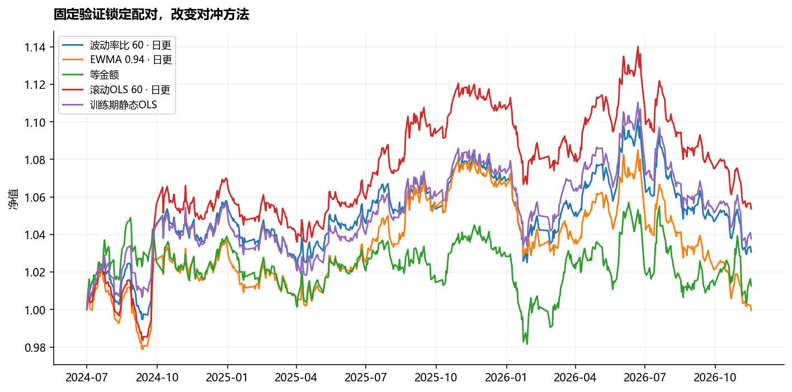

**估计窗口。** 固定配对、每日更新滚动OLS，各窗口的测试表现如下。

| 窗口 | 平均 h | 累计收益 | 年化波动 |
|---|---|---|---|
| 60 | 0.674 | 5.37% | 5.50% |
| 120 | 0.687 | 4.40% | 5.52% |
| 252 | 0.694 | 4.18% | 5.49% |
| 504 | 0.712 | 4.69% | 5.29% |

**实际调仓。** 固定同一配对和120日滚动OLS，均按5bp与2%借券假设计费。持股数模式只在规定频率交易，期间总敞口随价格漂移。成交额为每1元初始资产在全测试期的双边累计成交金额。

| 频率 | 净值每日重置年化 | 仅调仓日交易年化 | 仅调仓日成交额 |
|---|---|---|---|
| 日 | 0.88% | 0.88% | 7.86 |
| 周 | 0.78% | 0.77% | 4.72 |
| 月 | 1.23% | 1.35% | 3.51 |
| 季 | 1.00% | 1.62% | 2.87 |

## 市场状态、历史反转与风险暴露

沿用既有上证指数状态规则，仅用前一日可见的120日累计收益和均线。趋势超过±10%且位于相应均线一侧分别划为主升/下跌，累计收益在±5%为震荡，其余为过渡。下表按状态内的收益日复利年化；短状态年化可能很大，不能视为可连续持有一整年的收益。

| 测试状态 | 日数 | 验证锁定 | 测试事后冠军 | 原配对等敞口基准 |
|---|---|---|---|---|
| 主升 | 202 | -4.47% | -3.04% | 0.55% |
| 震荡 | 204 | 8.36% | 13.71% | 1.52% |
| 下跌 | 22 | -19.86% | -20.11% | -5.10% |
| 过渡 | 149 | 3.64% | 7.48% | 2.24% |

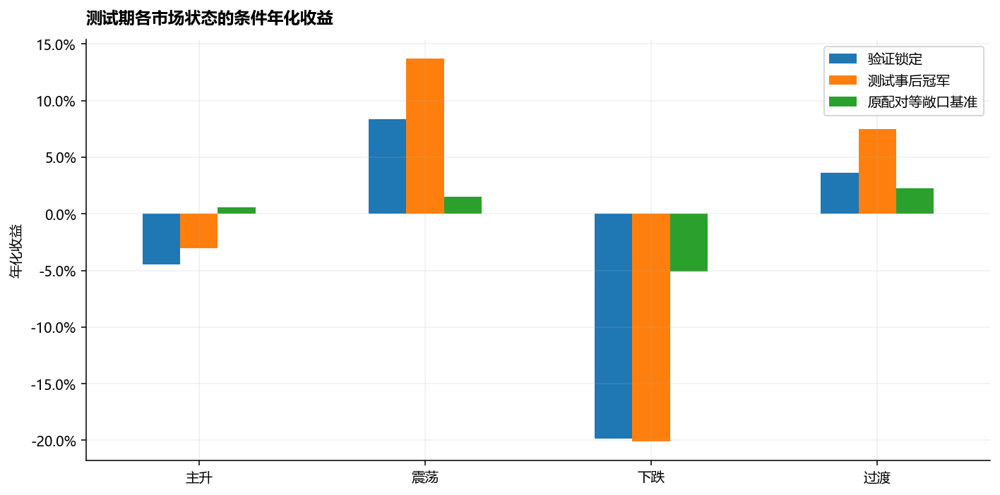

| 既定方向历史切片 | 2018—2020 | 2021—2024 | 2025—2026-11-17 |
|---|---|---|---|
| 验证锁定 | 4.78% | 5.10% | -2.55% |
| 测试事后冠军 | -4.59% | 18.11% | 0.59% |
| 原配对等敞口基准 | -9.62% | 11.47% | 2.71% |

切片间重叠于主实验的训练、验证或测试段，仅作归因，其中静态基准回看训练前段使用了训练内估计。按原实验独立复算，2021—2024年 h=0.819943，2025年以来原始累计+5.56%、1倍总敞口+3.07%；2015—2017年估计 h=0.973105，用于2018—2020年同方向分别为−19.18%及−10.17%。

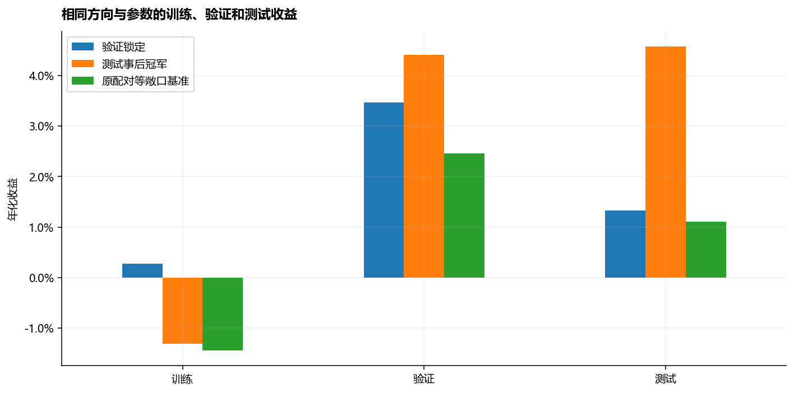

| 组合 | 上证 Beta | 中证全指 Beta | 沪深300 Beta | CH4规模暴露 |
|---|---|---|---|---|
| 验证锁定 | 0.056 | 0.015 | 0.075 | -0.156 |
| 测试事后冠军 | 0.190 | 0.099 | 0.143 | -0.024 |
| 原配对等敞口基准 | -0.005 | -0.016 | -0.045 | 0.140 |

三条市场基准分别回归，CH4联合回归包含市场、规模、价值及PMO，因子覆盖至2026-08-31。系数、HAC标准误、置信区间及样本日数见[风险暴露](../outputs/tables/pair_factor_exposures.csv)。

## 检验强度与赢家偏差

| 对象 | 算术年化均值 | HAC年化标准误 | 双侧 p | 20日区块95%区间 | 去掉最好5日累计 |
|---|---|---|---|---|---|
| 测试事后冠军 | 4.63% | 4.67% | 0.322 | [-3.75%, 14.76%] | 0.75% |
| 原配对等敞口基准 | 1.14% | 1.75% | 0.515 | [-2.58%, 4.78%] | -0.19% |
| 验证锁定 | 1.45% | 4.02% | 0.718 | [-5.56%, 8.74%] | -2.23% |

日度Newey–West取5阶。对全部1,560个均值检验进行Holm与BH校正，5%水平分别通过0和0个。保留策略间同期相关性的共同日期循环区块Bootstrap，20日为块、固定种子、2,000次。去均值后比较全网格最大单侧HAC t统计量，非恒定序列1410条，调整后 p=0.506。该检验直接处理搜索最高收益的机会，不假设1,560条策略彼此独立。

| 配对减去同期原基准 | 年化平均差 | HAC p | 配对Bootstrap 95%区间 |
|---|---|---|---|
| 测试事后冠军 | 3.49% | 0.489 | [-5.22%, 14.54%] |
| 验证锁定 | 0.32% | 0.950 | [-8.88%, 10.18%] |

## 均值回归独立实验

每季使用此前504日对数点位，分别检查两腿水平ADF p>0.05、一阶差分ADF p<0.05、带常数Engle–Granger、残差ADF和AR(1)半衰期。季度内对30个方向EG检验作BH校正，要求 q<0.05、残差ADF p<0.05、正价格斜率且半衰期1—126日。1170个配对季度中通过22个。上季模型在新季度重置，以最近可用收盘计算Z，±1.5/2/2.5入场，回归0或同侧0.5出场，同时按4倍标准差止损、最长60日。价差过高做空第一腿、过低做多，反向时抵押与借券跟随实际空头。

验证期全部180个阈值配置的持仓率最大为0.0%，无法据此选择阈值，冻结的均值回归决策是持现，测试收益为0。事后网格中有30个配置在测试期交易，最高测试年化2.00%，不作为已选策略。见[滚动检验明细](../outputs/tables/pair_rolling_cointegration.csv)。

## 成本与杠杆

以下为锁定策略累计净收益，列为空头年化借券率，行为单边成交费。全部1,560种策略的25种组合均已运行。

| 单边费 | 0% | 1% | 2% | 3% | 5% |
|---|---|---|---|---|---|
| 0 bp | 3.06% | 1.99% | 0.93% | -0.11% | -2.18% |
| 2 bp | 2.88% | 1.81% | 0.76% | -0.29% | -2.35% |
| 5 bp | 2.61% | 1.54% | 0.49% | -0.55% | -2.60% |
| 10 bp | 2.16% | 1.10% | 0.05% | -0.99% | -3.03% |
| 20 bp | 1.26% | 0.21% | -0.83% | -1.86% | -3.88% |

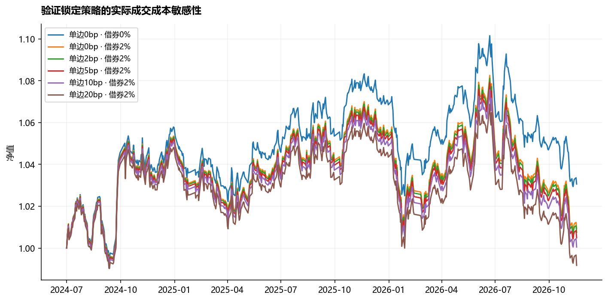

| 锁定策略总敞口 | 测试累计毛收益 | 波动 | 最大回撤 |
|---|---|---|---|
| 0.5倍 | 1.60% | 2.61% | -3.31% |
| 1倍 | 3.06% | 5.21% | -6.55% |
| 2倍 | 5.56% | 10.42% | -12.79% |

## 逐年向前检验

每轮前三个日历年训练、下一年验证、再下一年交易。静态Beta逐轮重估，动态估计只读当时可得历史；最后一个验证交易日留作成交。按与主实验相同的训练盈利门槛和验证夏普规则选固定方向配置，不用当年收益修改选择。年度间按净值连续复利，表列毛收益。

| 交易年 | 多头 / 空头 | 冻结规格 | 验证夏普 | 当年毛收益 | 成本后收益¹ | 当年毛回撤 |
|---|---|---|---|---|---|---|
| 2019 | 中证A100 / 沪深300 | vol_252_M | 1.51 | -0.40% | -1.55% | -2.08% |
| 2020 | 国证1000 / 上证指数 | rolling_504_Q | 2.70 | 4.90% | 3.58% | -1.34% |
| 2021 | 沪深300 / 上证指数 | one | 2.66 | -4.61% | -5.69% | -8.35% |
| 2022 | 上证100 / 中证全指 | rolling_252_Q | 1.54 | -3.34% | -4.52% | -3.82% |
| 2023 | 上证指数 / 中证A100 | vol_504_Q | 0.65 | 4.07% | 2.96% | -1.77% |
| 2024 | 上证指数 / 国证1000 | vol_60_M | 1.87 | 0.43% | -0.66% | -2.09% |
| 2025 | 上证指数 / 上证100 | rolling_120_D | 2.07 | 2.30% | 1.33% | -2.86% |
| 2026 | 中证A100 / 上证100 | rolling_60_D | 1.13 | -4.80% | -5.70% | -7.79% |

年度切换在同一账户内按六条指数实际持仓净额交易。按单边5bp、年化2%借券，连续持有的净值由1降至0.8975，累计成本后收益-10.25%。

8段中4段盈利，累计-1.94%、年化-0.26%、夏普-0.05、最大回撤-11.34%。若事后在各年度均跟踪同一个规格，跨年度累计最高的是上证指数 / 上证100（trade_date
2024-07-01    4864.57
2024-07-02    4785.10
2024-07-03    4732.37
2024-07-04    4665.02
2024-07-05    4697.96
               ...
2026-11-11    5477.19
2026-11-12    5377.45
2026-11-13    5300.97
2026-11-16    5211.70
2026-11-17    5244.59
Name: 000132, Length: 578, dtype: float64，15.68%）；年度交易策略没有事先锁定这一规格。

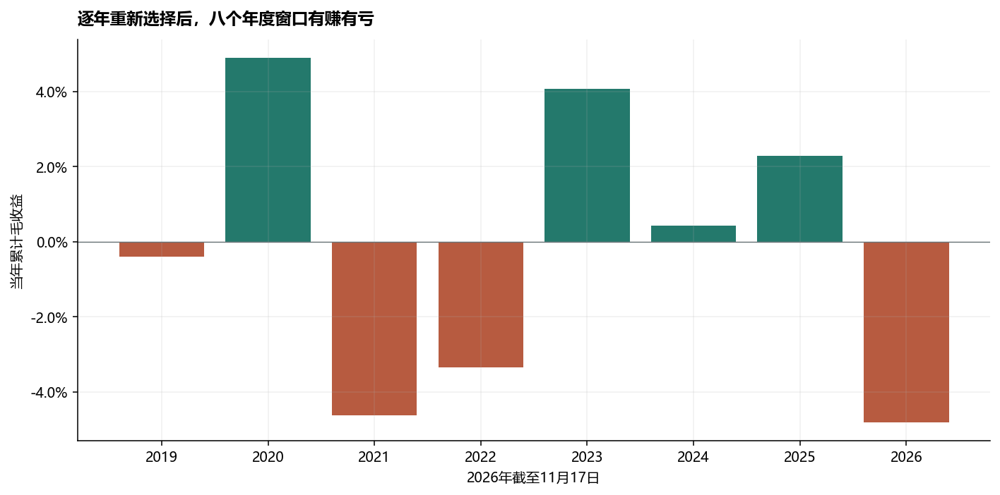

## 榜单与可复算材料

各阶段冠军以下按年化收益排列，验证锁定另按预设风险调整规则。三张前20名榜以多空方向为单位，同方向仅保留该榜指标最佳的规格。综合榜取测试年化、回撤、夏普、测试覆盖日历年盈利比例、最差状态年化、训练测试年化差绝对值的反向排名，六项百分位等权。首尾非完整年度按实际覆盖计算。

| 阶段（回顾） | 多头 / 空头 | 规格 | 该阶段年化 |
|---|---|---|---|
| 训练 | 中证A100 / 上证指数 | rolling_120_M | 2.87% |
| 验证 | 上证指数 / 上证100 | one | 5.49% |
| 最终测试 | 上证指数 / 上证100 | ewma_0.94_M | 4.57% |
| 全样本事后 | 中证A100 / 上证100 | ewma_0.94_Q | 2.27% |

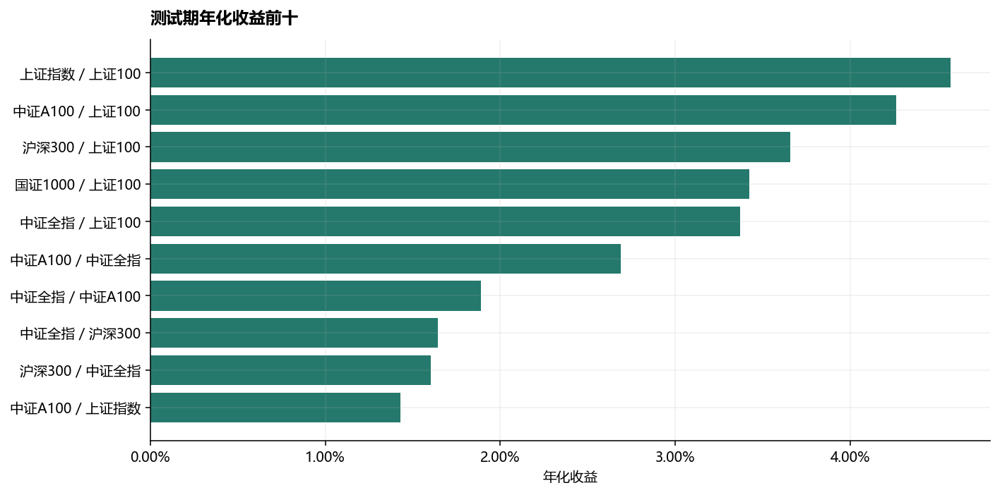

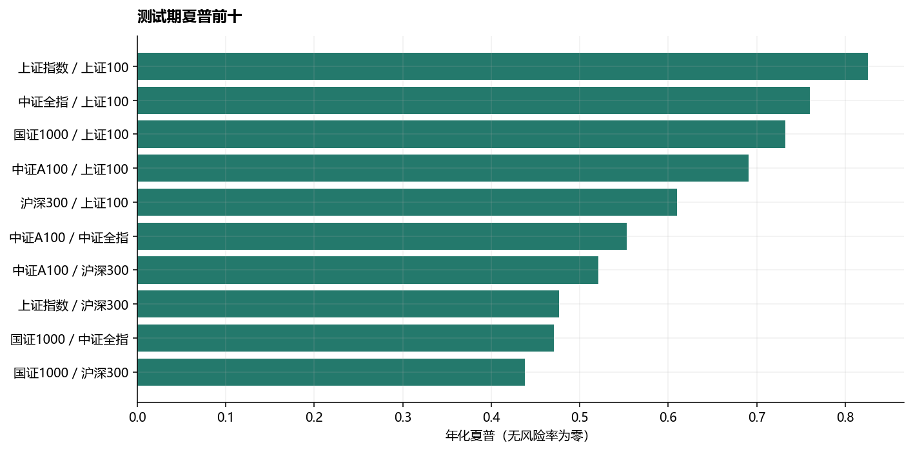

### 绝对收益前20个方向

| 名次 | 多头 / 空头 | 规格 | 测试年化 | 夏普 | 回撤 | 综合分 |
|---|---|---|---|---|---|---|
| 1 | 上证指数 / 上证100 | ewma_0.94_M | 4.57% | 0.83 | -4.47% | 0.559 |
| 2 | 中证A100 / 上证100 | ewma_0.94_Q | 4.26% | 0.69 | -7.78% | 0.565 |
| 3 | 沪深300 / 上证100 | ewma_0.94_M | 3.66% | 0.61 | -7.34% | 0.515 |
| 4 | 国证1000 / 上证100 | rolling_60_M | 3.42% | 0.73 | -7.89% | 0.490 |
| 5 | 中证全指 / 上证100 | rolling_60_D | 3.37% | 0.76 | -8.10% | 0.471 |
| 6 | 中证A100 / 中证全指 | ewma_0.94_Q | 2.69% | 0.55 | -4.86% | 0.770 |
| 7 | 中证全指 / 中证A100 | static | 1.89% | 0.41 | -5.87% | 0.577 |
| 8 | 中证全指 / 沪深300 | static | 1.64% | 0.43 | -5.03% | 0.632 |
| 9 | 沪深300 / 中证全指 | ewma_0.94_Q | 1.60% | 0.40 | -4.74% | 0.713 |
| 10 | 中证A100 / 上证指数 | ewma_0.94_Q | 1.43% | 0.39 | -5.20% | 0.698 |
| 11 | 上证指数 / 中证A100 | rolling_504_Q | 1.28% | 0.38 | -5.94% | 0.563 |
| 12 | 上证指数 / 沪深300 | rolling_504_Q | 1.24% | 0.48 | -4.44% | 0.657 |
| 13 | 国证1000 / 中证全指 | ewma_0.94_Q | 1.13% | 0.47 | -2.88% | 0.818 |
| 14 | 中证A100 / 国证1000 | ewma_0.94_Q | 1.13% | 0.44 | -2.59% | 0.818 |
| 15 | 上证指数 / 中证全指 | ewma_0.94_M | 1.01% | 0.34 | -3.10% | 0.793 |
| 16 | 中证全指 / 上证指数 | ewma_0.94_D | 0.97% | 0.34 | -3.75% | 0.805 |
| 17 | 中证全指 / 国证1000 | one | 0.91% | 0.43 | -2.87% | 0.769 |
| 18 | 国证1000 / 沪深300 | ewma_0.94_D | 0.78% | 0.44 | -2.45% | 0.847 |
| 19 | 国证1000 / 中证A100 | static | 0.77% | 0.30 | -3.24% | 0.715 |
| 20 | 中证A100 / 沪深300 | ewma_0.94_Q | 0.70% | 0.52 | -1.50% | 0.875 |

### 夏普前20个方向

| 名次 | 多头 / 空头 | 规格 | 测试年化 | 夏普 | 回撤 | 综合分 |
|---|---|---|---|---|---|---|
| 1 | 上证指数 / 上证100 | ewma_0.94_M | 4.57% | 0.83 | -4.47% | 0.559 |
| 2 | 中证全指 / 上证100 | rolling_60_D | 3.37% | 0.76 | -8.10% | 0.471 |
| 3 | 国证1000 / 上证100 | rolling_60_M | 3.42% | 0.73 | -7.89% | 0.490 |
| 4 | 中证A100 / 上证100 | ewma_0.94_Q | 4.26% | 0.69 | -7.78% | 0.565 |
| 5 | 沪深300 / 上证100 | rolling_60_M | 3.53% | 0.61 | -7.32% | 0.510 |
| 6 | 中证A100 / 中证全指 | ewma_0.94_Q | 2.69% | 0.55 | -4.86% | 0.770 |
| 7 | 中证A100 / 沪深300 | ewma_0.94_Q | 0.70% | 0.52 | -1.50% | 0.875 |
| 8 | 上证指数 / 沪深300 | rolling_504_Q | 1.24% | 0.48 | -4.44% | 0.657 |
| 9 | 国证1000 / 中证全指 | ewma_0.94_Q | 1.13% | 0.47 | -2.88% | 0.818 |
| 10 | 国证1000 / 沪深300 | ewma_0.94_D | 0.78% | 0.44 | -2.45% | 0.847 |
| 11 | 中证A100 / 国证1000 | ewma_0.94_Q | 1.13% | 0.44 | -2.59% | 0.818 |
| 12 | 中证全指 / 沪深300 | static | 1.64% | 0.43 | -5.03% | 0.632 |
| 13 | 中证全指 / 国证1000 | one | 0.91% | 0.43 | -2.87% | 0.769 |
| 14 | 中证全指 / 中证A100 | static | 1.89% | 0.41 | -5.87% | 0.577 |
| 15 | 沪深300 / 中证全指 | ewma_0.94_Q | 1.60% | 0.40 | -4.74% | 0.713 |
| 16 | 中证A100 / 上证指数 | ewma_0.94_Q | 1.43% | 0.39 | -5.20% | 0.698 |
| 17 | 上证指数 / 中证A100 | rolling_504_Q | 1.28% | 0.38 | -5.94% | 0.563 |
| 18 | 中证全指 / 上证指数 | ewma_0.94_D | 0.97% | 0.34 | -3.75% | 0.805 |
| 19 | 上证指数 / 中证全指 | ewma_0.94_M | 1.01% | 0.34 | -3.10% | 0.793 |
| 20 | 国证1000 / 中证A100 | static | 0.77% | 0.30 | -3.24% | 0.715 |

### 综合稳定性前20个方向

| 名次 | 多头 / 空头 | 规格 | 测试年化 | 夏普 | 回撤 | 综合分 |
|---|---|---|---|---|---|---|
| 1 | 中证A100 / 沪深300 | ewma_0.94_Q | 0.70% | 0.52 | -1.50% | 0.875 |
| 2 | 国证1000 / 沪深300 | vol_504_Q | 0.58% | 0.33 | -2.21% | 0.847 |
| 3 | 国证1000 / 中证全指 | rolling_120_Q | 0.48% | 0.22 | -2.86% | 0.831 |
| 4 | 中证A100 / 国证1000 | ewma_0.94_Q | 1.13% | 0.44 | -2.59% | 0.818 |
| 5 | 国证1000 / 上证指数 | ewma_0.94_Q | 0.47% | 0.19 | -3.97% | 0.806 |
| 6 | 中证全指 / 上证指数 | ewma_0.94_D | 0.97% | 0.34 | -3.75% | 0.805 |
| 7 | 上证指数 / 中证全指 | ewma_0.94_M | 1.01% | 0.34 | -3.10% | 0.793 |
| 8 | 中证A100 / 中证全指 | ewma_0.94_Q | 2.69% | 0.55 | -4.86% | 0.770 |
| 9 | 中证全指 / 国证1000 | one | 0.91% | 0.43 | -2.87% | 0.769 |
| 10 | 沪深300 / 国证1000 | ewma_0.94_Q | 0.28% | 0.15 | -3.35% | 0.729 |
| 11 | 国证1000 / 中证A100 | rolling_504_M | 0.60% | 0.25 | -3.00% | 0.716 |
| 12 | 沪深300 / 中证全指 | ewma_0.94_Q | 1.60% | 0.40 | -4.74% | 0.713 |
| 13 | 上证指数 / 国证1000 | rolling_504_M | 0.59% | 0.24 | -4.64% | 0.698 |
| 14 | 中证A100 / 上证指数 | ewma_0.94_Q | 1.43% | 0.39 | -5.20% | 0.698 |
| 15 | 沪深300 / 中证A100 | rolling_504_Q | -0.06% | -0.04 | -2.50% | 0.683 |
| 16 | 沪深300 / 上证指数 | ewma_0.94_Q | 0.55% | 0.20 | -4.23% | 0.682 |
| 17 | 上证指数 / 沪深300 | rolling_504_Q | 1.24% | 0.48 | -4.44% | 0.657 |
| 18 | 中证全指 / 沪深300 | vol_60_D | 1.03% | 0.31 | -5.18% | 0.652 |
| 19 | 中证A100 / 上证100 | vol_252_Q | 1.57% | 0.31 | -6.68% | 0.620 |
| 20 | 沪深300 / 上证100 | vol_504_Q | 1.04% | 0.22 | -6.27% | 0.595 |

## 结论与实际工具

在这六条宽基中，收益冠军的多数收益集中在测试前段，2025年以来累计只有0.59%。验证锁定策略在同一段为-2.55%。两者均未显示显著优于等敞口原基准。年度重复选择与成本压力进一步削弱了将其作为模拟基金收益策略的依据。

两组共同的上证100空头尚缺已核实的直接工具和逐日券源。另行检验了三只场内ETF与IF单月合约，原配对可观察到工具收益、流动性及换月基差。[实际可交易性与工具收益报告](pair_trading_implementation.md)

**复算入口**　在项目根目录运行 `python scripts/run_pair_search.py`。工具报告可单独运行 `python scripts/pair_instruments.py`，优先读取已缓存的ETF与期货快照。SQLite全程以只读方式打开。指数收盘取AKShare/东方财富项目归档，无全收益、分红与成分股复权重建。

**主要数据**　[全参数结果](../outputs/tables/all_pair_results.csv) · [基础配对统计](../outputs/tables/pair_basic_statistics.csv) · [固定配对方法对照](../outputs/tables/hedge_method_comparison.csv) · [成本压力测试](../outputs/tables/cost_sensitivity.csv) · [年度逐候选记录](../outputs/tables/walk_forward_trials.csv) · [持仓与成交明细](../outputs/tables/pair_selected_ledger.csv)。

每个有向配对的完整逐日档位于 outputs/pair_paths/A_B.npz。date 为收益日期，ids 为行顺序；w、v 为两腿签名权重，ret 为1倍毛收益，raw_ret 为原始敞口毛收益，traded 为每1元初始资本实际买卖额（首笔开仓、末日含平仓）。逐日净值为 (1+ret) 累乘。all_pair_results 的 turnover 是沿完整路径的日均成交额/期初净资产，单独成本情景则在测试起点从空仓开始。
