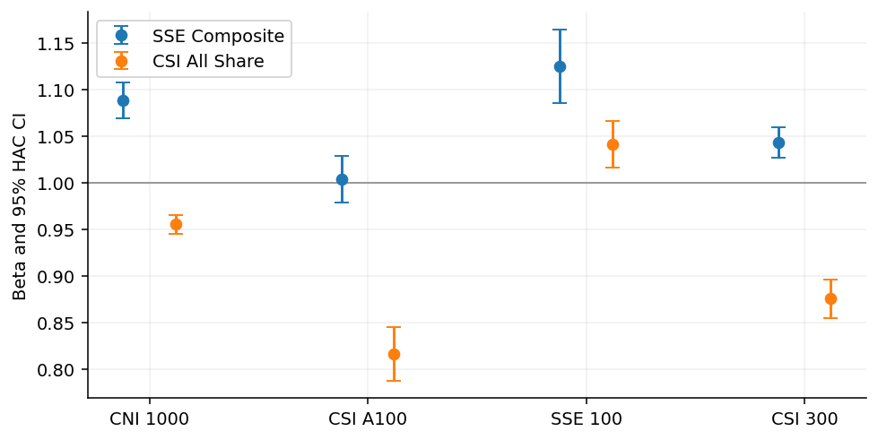
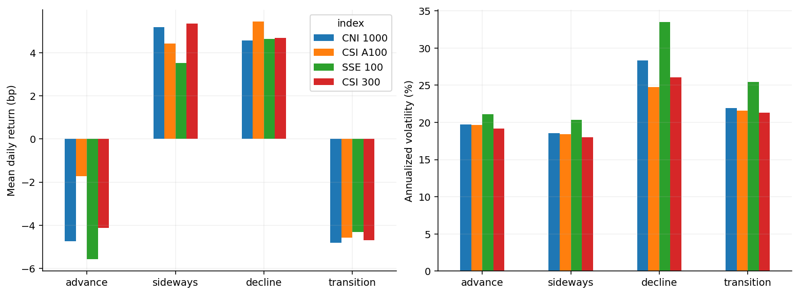
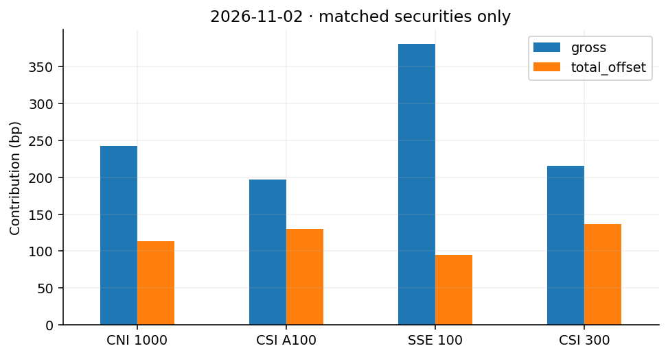
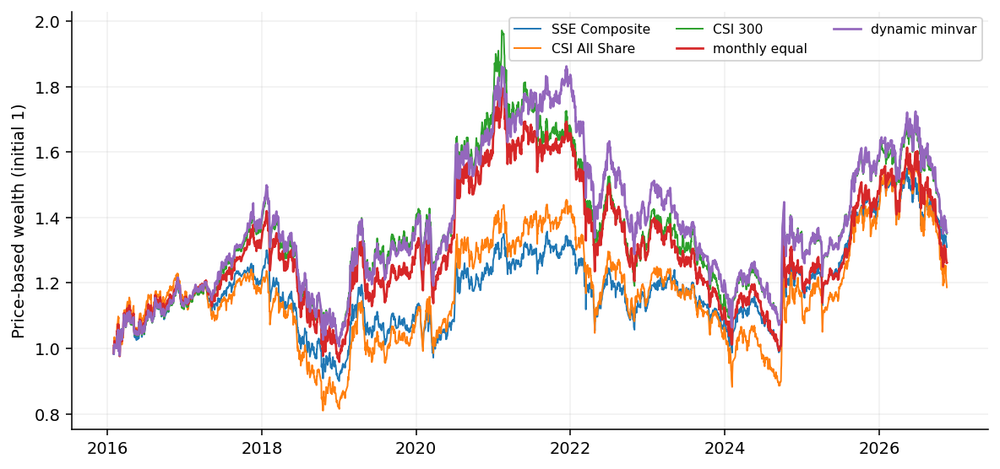

# A股宽基指数内部收益抵消与投资价值研究初稿

2026年11月18日 · 实证观察期 2015-01-06 至 2026-11-17

## 摘要

四条宽基共享较强的市场暴露，风险差异取决于所用基准。国证1000相对上证综指的 Beta 为 **1.088**，换成中证全指后为 **0.955**。上证100相对上证综指的残差年化波动为 **11.42%**，明显高于国证1000的 **5.02%**。全样本普通市场模型未检出显著正截距。规模与价值暴露解释了部分差异，中证A100的调整后 R² 从 **0.808** 升至 **0.933**。

2026年11月2日的权重快照试算表明，指数净涨幅相近时，内部正负贡献可以大得多。中证A100净涨约 **66.93 bp**，正负贡献绝对值合计 **196.98 bp**，抵消率为 **66.02%**。国证1000匹配子样本当日约 **94.19%** 的抵消发生在行业内部。历史数据目前只支持单日归因，无法判断这一构成是否稳定、随行情变化，或具有预测价值。

指数代理组合中，按月约束最小方差相对按月等权降低了样本外波动，计入每单位成交 10 bp 成本后的夏普差异仍有较大不确定性。相对上证综指或中证全指的无约束张成检验拒绝联合原假设，其约束和投资假设与组合模拟不同。结果属于价格指数口径，产品配置价值仍需全收益与 ETF 核验。

## 研究问题与数据

研究对象是国证1000（399311）、中证A100（000903）、上证100（000132）和沪深300（000300），采用上证综指（000001）与中证全指（000985）双基准。我们分别检验指数的市场与风格暴露、指数当日内部发生的收益抵消，以及加入现有持仓时能否改善配置。指数编制规则、历史阶段和重叠持仓都可能影响比较。

六条价格指数共同覆盖2,884个收盘日，首日用作基期，共2,883条有效日收益。保留2015—2025年作为敏感性样本。个股归因使用2026-10-30官方权重文件自带的证券名单，搭配下一交易日不复权行情。个股快照和明汯因子归档于补充输入，数据库及原始文件以只读方式核验。上证综指近期成分名单文件有一项校验和差异，已复核日期、成分代码、名称和交易所与数据库一致。详见[数据盘点](data_inventory.md)和[覆盖矩阵](../outputs/tables/data_coverage.csv)。[明汯因子数据](https://www.mingshiim.com/database) · [Money Tree 行情接口](https://money-tree.eyunzhu.com/)

## E1 双基准市场模型

以收盘价简单收益估计 $r_i=\alpha+\beta r_m+\varepsilon$，全样本使用 Newey–West HAC，最大滞后5个交易日。主检验对8个截距和8个 Beta 等于1的检验分别作 Holm 校正。使用明汯日无风险利率再估计2,816日共同区间的超额收益模型，并与同区间的原始收益模型配对。两种基准均为价格指数。

| 指数 | 对000001 Beta | 对000001 R² | 对000985 Beta | 对000985 R² |
|---|---:|---:|---:|---:|
| 国证1000 | 1.088 | 0.949 | 0.955 | 0.973 |
| 中证A100 | 1.004 | 0.858 | 0.816 | 0.755 |
| 上证100 | 1.125 | 0.793 | 1.041 | 0.905 |
| 沪深300 | 1.043 | 0.936 | 0.876 | 0.877 |

在5%水平，中证A100对000001的 Beta 无法与1区分，其余7项均显著不同。全样本截距校正后均未显著。国证1000对000001的分段 Beta 为1.049、1.125、1.172，分别对应2015—2019、2020—2022、2023年至期末。同期上涨和下跌日分开估计时，中证A100的 Beta 约为1.063和0.942。滚动和分段估计展示暴露变化，重叠持仓与共同因子均可产生较高相关性。

[回归结果](../outputs/tables/e1_regression.csv) · [60与252日滚动数据](../outputs/tables/e1_rolling_beta.csv) · [000001滚动图](../outputs/figures/e1_rolling_000001.png) · [000985滚动图](../outputs/figures/e1_rolling_000985.png) · [收益散点图](../outputs/figures/e1_scatter.png)

## E2 历史行情状态下的表现

用上证综指截至前一交易日的120日收益和均线位置标记状态。收益高于10%且在均线上方为主升，低于−10%且在均线下方为下跌，收益在 ±5% 内为震荡，其余为过渡。样本从完成预热后开始，2,763天中主升445天、震荡1,099天、下跌391天、过渡828天。

四条指数在历史下跌标签中的年化条件波动均最高，区间约24.73%—33.47%。在主规格中，四条指数的震荡组平均次日收益均为正，主升组均为负。这个排序是按历史状态观察下一日收益所得，四条指数各状态与过渡组的均值差在 Holm 校正后均未显著。条件累计收益和回撤把同一标签日按日期拼接，另有连续阶段结果。103段连续震荡的最长一段为100个交易日。

稳健性比较了60、252日窗口和两组更窄／更宽阈值，保留所有输出。Markov 三状态以每年开始前可得的最多756日估计，使用日度一步预测概率，产生2,152个样本外标签。按最高预测概率硬分类时，2,145日归入均值居中的状态，7日归入均值最高的状态，均值最低的状态没有被选中。这个规格的预测标签高度集中，无法为规则状态之间的比较提供有力的交叉验证。

[状态日历](../outputs/tables/e2_states.csv) · [累计、Beta、捕获率与回撤](../outputs/tables/e2_conditional.csv) · [阶段表](../outputs/tables/e2_episodes.csv) · [均值差检验](../outputs/tables/e2_mean_differences.csv) · [Markov拟合记录](../outputs/tables/e2_markov_fit.csv)

## E3 风格暴露与截距

在同一2,816日比较明汯 CH 市场因子单因子、CH-3 和 CH-4。CH-3加入规模 SMB、价值 VMG。CH-4另含异常换手因子 PMO，并使用改造后的 SMB。PMO反映论文定义的异常换手特征。所有模型用相同日无风险利率和 HAC 推断，因变量是指数价格收益或两指数价格收益差。[Liu、Stambaugh与Yuan的模型原文](https://doi.org/10.1016/J.JFINECO.2019.03.008) · [CH-3和CH-4数据](https://www.mingshiim.com/database)

| 指数 | 市场模型调整 R² | CH-3调整 R² | CH-4规模暴露 | CH-4价值暴露 |
|---|---:|---:|---:|---:|
| 国证1000 | 0.982 | 0.988 | −0.144 | −0.050 |
| 中证A100 | 0.808 | 0.933 | −0.468 | 0.169 |
| 上证100 | 0.879 | 0.900 | 0.202 | −0.132 |
| 沪深300 | 0.920 | 0.975 | −0.325 | 0.090 |

上述8项 CH-4 风格系数在按模型及因子校正后均显著。国证1000对 SMB 为负，负向幅度小于中证A100和沪深300。其相对表现能否归于规模溢价还需全收益和进一步归因。上证100呈正规模和负价值暴露，质量暴露尚未测量。中证A100减沪深300的调整 R² 从0.076升至 CH-3 的0.417，其 CH-4 价差截距不显著，行业归因有待补数。

15项截距校正后，沪深300 CH-4 的负截距达到5%水平，线性年化 −3.48%，调整后 p=0.021。指数价格收益漏计现金分红，而因子的资产收益口径可能不同。该结果有赖于模型及收益定义，无法用于判定全收益异常。

[模型对照](../outputs/tables/e3_models.csv) · [全部因子系数](../outputs/tables/e3_coefficients.csv) · [调整后R²图](../outputs/figures/e3_factor_fit.png)

## E4 2026年11月2日收益抵消

按2026-10-30收盘权重乘以两日不复权收盘收益，贡献 $c_i=w_i r_i$。计算正贡献 $P$、负贡献绝对值 $L$、总活动 $G=P+L$、重建净收益 $\widehat R=P-L$ 与抵消 $TC=G-|\widehat R|=2\min(P,L)$。当 $G>0$ 时 $CO=TC/G$。保持权重原值，并用编制方两日官方点位计算复制误差。另用行情参考前收做敏感性计算，注明其可能包含除权调整。

| 指数 | 有效／文件只数 | 正贡献 bp | 负贡献绝对值 bp | 总活动 bp | 绝对抵消 bp | 抵消率 |
|---|---:|---:|---:|---:|---:|---:|
| 国证1000 | 996／998 | 185.42 | 56.91 | 242.33 | 113.82 | 46.97% |
| 中证A100 | 100／100 | 131.96 | 65.03 | 196.98 | 130.05 | 66.02% |
| 上证100 | 100／100 | 333.29 | 47.36 | 380.57 | 94.72 | 24.89% |
| 沪深300 | 300／300 | 147.09 | 68.24 | 215.33 | 136.49 | 63.39% |

中证A100、上证100与沪深300的绝对复制误差均小于0.01 bp。国证1000两只缺失个股合计原权重0.190个百分点，子样本复制误差为+0.209 bp。比较参考前收与前日实际收盘时，国证1000有两只出现价格基准变化，指数除数、调整股本和权重舍入的影响尚未逐事件识别。上证综指与中证全指也提供部分匹配的核验结果。

沪深300另外用历史观察名单和次日行情测量等权收益分化。23期合计6,783条可匹配收益，单期281至300只，个别缺失报价的原因需要单独核对。指标表同时列出横截面标准差、绝对偏差、相对指数的 CSSD／CSAD 及涨跌比例。

[抵消与复制核验](../outputs/tables/e4_snapshot_metrics.csv) · [证券级贡献](../outputs/tables/e4_snapshot_contributions.csv) · [沪深300辅助指标](../outputs/tables/e4_hs300_stage_dispersion.csv)

## E5 行业间与行业内抵消

先在行业内加总 $C_j=\sum_{i\in j}c_i$。行业内抵消为 $G-\sum_j|C_j|$，行业间抵消为 $\sum_j|C_j|-|\widehat R|$。对权重表中拥有同一期行业分类的国证1000匹配子样本，行业内107.21 bp、行业间6.61 bp，恒等式误差为0。11个行业的权重 HHI 为0.140。该日行业内比例94.19%，参考前收规格约94.19%。当前仅有一个可分解横截面，行业数量和集中度控制需等到更多指数和日期可用。

[整体分解](../outputs/tables/e5_decomposition.csv) · [行业净贡献](../outputs/tables/e5_industry_contributions.csv) · [行业贡献图](../outputs/figures/e5_industry.png)

## E6 连续震荡期的行业轮动

**BLOCKED。** 待检验假说是，连续震荡中可能同时存在当天的行业正负贡献抵消和多日行业方向往返。接口以连续至少5日的同标签为阶段，追踪日度行业贡献领先者更换率、行业收益排名的相邻日秩相关，以及阶段实现波动。以期初财富 $V_{t-1}$ 乘每日贡献链接为 $\sum_t V_{t-1}C_{j,t}$，行业链接贡献之和等于指数重建复合收益。日度横截面抵消与同一行业跨日绝对贡献的往返分别计量。

入口 [run_e6_rotation.py](../scripts/run_e6_rotation.py) 接收指数代码、交易日期、行业、当日行业贡献、行业期初权重与行业内个股绝对贡献合计，要求覆盖连续交易日及完整行业集合。

## E7 抵消数据的增量预测

**BLOCKED。** 假说是 M2 可以降低未来风险的样本外预测误差。M0 接收截至当日的市场20日收益、指数20日波动、对数成交量。M1 增加 CSSD、CSAD。M2 再加入抵消率、贡献总规模和行业间抵消比重。目标为未来5日及20日实现波动和最大回撤，预测从日终 (t) 开始。至少504个已到期训练观测，扩展窗口每20个观测重新估计，训练标签的最后一天须不晚于预测时点。

入口 [run_e7_prediction.py](../scripts/run_e7_prediction.py) 在相同样本检验 RMSE、MAE、相对历史均值的样本外 R²，以及 M2 相对 M0 和 M1 的损失改善。误差有重叠时按预测期限使用 HAC，p值按报告的检验族 Holm 校正。极端风险识别可在获得足够事件后扩展，本轮无可报告预测统计。

## E8 多宽基组合的增量价值

比较000001、四条单指数和000985，并模拟四宽基初始等权买入持有、每月恢复等权及事先设定权重下限10%、上限55%的滚动最小方差组合。动态组合用252日历史协方差，执行价格以信号生成后的下一收盘点位代理。成本情景为每单位实际买卖成交额0、5、10或20 bp，换手包含建仓、以交易后权重和漂移权重的绝对差合计度量。

| 2016-02-01起共同样本外，2,620日 | 年化收益 | 年化波动 | 夏普（零利率口径） | 最大回撤 |
|---|---:|---:|---:|---:|
| 上证综指代理 | 2.63% | 16.51% | 0.240 | −30.77% |
| 沪深300代理 | 2.93% | 18.45% | 0.249 | −45.60% |
| 月度等权，10 bp | 2.26% | 18.68% | 0.213 | −44.72% |
| 动态最小方差，10 bp | 2.95% | 18.33% | 0.251 | −42.84% |

配对20日区块 Bootstrap 中，动态组合相对等权的年化波动差为−0.35个百分点，95%区间 [−0.51, −0.18] 个百分点，夏普差区间 [−0.041, 0.117] 覆盖0。动态组合相对上证综指的年化波动高1.83个百分点。动态组合的年化成交金额约为资产的105.9%，月度等权约23.6%。对应 CH-3 无风险利率共同区间的夏普和索提诺另列于表中。

全样本 HAC Wald 张成检验联合约束候选资产截距为0、基准系数和为1。加入四条目标指数时，单用000001、单用000985、同时用两条基准均拒绝张成，Holm 校正后 p 分别为 $2.32\times10^{-15}$、$3.32\times10^{-34}$、$3.21\times10^{-7}$。这是无约束的统计检验，含指数内部持股交叠和价格收益限制。它无法保证现实可买的长仓基金改善风险收益。

[完整绩效](../outputs/tables/e8_performance.csv) · [配对区间](../outputs/tables/e8_bootstrap_differences.csv) · [张成检验](../outputs/tables/e8_spanning.csv) · [日度权重及成本](../outputs/tables/e8_daily_portfolios.csv)

## 局限与后续研究

现有结果支持宽基存在不同的市场和风格暴露。单日试算也显示内部大额正负贡献可同时出现，在国证1000这一天主要发生于行业内部。数据仍不足以区分历史抵消是否主要来自行业轮动、是否能预测未来风险，或是否能改善可交易基金组合。因子 Alpha、指数规则变更及持仓重叠均需在更一致的全收益数据上复核。

优先补采四条目标指数逐日生效成分与权重、覆盖退市和公司行为的历史个股收益与行业，以及全收益指数和对应ETF。取得连续样本后先用真实调样日和公司行为日验证复制误差，再扩展抵消和预测实验。字段和来源见[数据缺口](data_gaps.md)，运行方法见[复现说明](reproduction.md)，逐项样本与状态见[实验状态](experiment_status.md)。
